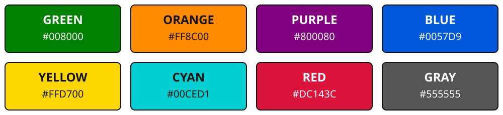

# Diagram အရောင် ၈ မျိုးနှင့် Network Label သတ်မှတ်ချက်

`rom_photos` ထဲက diagram အားလုံးမှာ အောက်ပါ **solid color ၈ မျိုး** ကို တစ်သမတ်တည်း သုံးပါတယ်။ အရောင်ဖျော့တူတူများအစား hue ကွဲသော green၊ orange၊ purple၊ blue၊ yellow၊ cyan၊ red၊ gray ကို ရွေးထားပါတယ်။

| အသုံးပြုပုံ | အရောင် | နမူနာ | Fill | Text |
|---|---|---|---|---|
| Policy Network / Actor; Online / Current Q Network | **Green / အစိမ်း** |  | `#008000` | `#FFFFFF` |
| Value Network / Critic / Baseline; Dueling value head | **Orange / လိမ္မော်** |  | `#FF8C00` | `#111111` |
| Frozen Target Network | **Purple / ခရမ်း** |  | `#800080` | `#FFFFFF` |
| State / environment / data / shared backbone | **Blue / အပြာ** |  | `#0057D9` | `#FFFFFF` |
| Batch / sampling / advantage | **Yellow / အဝါ** |  | `#FFD700` | `#111111` |
| Preprocessing / PER / action selection / synchronization | **Cyan / စိမ်းပြာ** |  | `#00CED1` | `#111111` |
| Loss / gradient / optimizer | **Red / အနီ** |  | `#DC143C` | `#FFFFFF` |
| Outputs / probabilities / returns / target values / aggregation | **Gray / မီးခိုး** |  | `#555555` | `#FFFFFF` |

အလင်းရောင်အတွက် text ကို အဖြူ / အမည်း ခွဲထားပြီး node ဘောင်ကို `#111111` သုံးပါတယ်။ Arrow က blue `#0057D9`၊ group နောက်ခံက transparent ဖြစ်ပါတယ်။ အဖြူ/အမည်းကို စာသားနှင့် canvas အတွက်သာ သုံးပြီး block role အရောင်အသစ် မဟုတ်ပါဘူး။

## Network အမျိုးအစားကို Block ထဲမှာ ဖတ်နိုင်ရမည်

| Network role | Block label ဥပမာ | အရောင် |
|---|---|---|
| Policy / actor | `Policy Network (Actor Head)` | Green |
| Value / critic / baseline | `Value Network (Critic Head)`၊ `Value Network (FCV Baseline)` | Orange |
| Online / current Q | `Online Network (Main Q)`၊ `Online Network (Dueling Q)` | Green |
| Frozen target Q | `Target Network (Q)`၊ `Target Network (Dueling Q)` | Purple |
| Shared actor-critic / local copy | `Actor-Critic Network: Policy Network + Value Network` | Blue; သီးခြား heads မှာ green / orange |
| Dueling streams | `Value Head inside Q Network`၊ `Advantage Head inside Q Network` | Orange / yellow |

Shared actor-critic မှာ actor/value heads က backbone တစ်ခုကို မျှဝေနိုင်ပါတယ်။ `Policy Network + Value Network` လို့ ရေးထားခြင်းက **model object နှစ်ခု သီးခြားရှိရမည်** လို့ မဆိုလိုပါဘူး။ Dueling ရဲ့ value/advantage heads က Q Network ထဲက အစိတ်အပိုင်းများဖြစ်ပြီး policy network သီးခြား မဟုတ်ပါဘူး။

Neuron များကို စုပြထားတဲ့ diagram မှာ `Policy Network` နဲ့ `Policy Network Output Head` ဆိုတဲ့ enclosing ခေါင်းစဉ်များဖြင့် အမျိုးအစား ဖော်ပြပါတယ်။ Neuron တစ်ခုစီကို network တစ်ခုစီလို့ မယူပါနှင့်။

## အရောင်ကို သီးသန့်အသုံးပြုပုံ

- **Green / orange / purple** ကို သက်ဆိုင်ရာ network၊ trainable layer / head နဲ့ network participant များအတွက်သာ သုံးပါ။ Policy နဲ့ online Q က algorithm အလိုက် role ကွာတာဖြစ်လို့ green ကို မျှဝေပြီး label ဖြင့်ခွဲပါတယ်။
- Network က ထုတ်သော Q/V prediction၊ probability၊ return၊ target value နဲ့ aggregation သည် **gray** ဖြစ်ပါတယ်။ Target value ရှိခြင်းက Target Network ရှိခြင်းနဲ့ မတူပါဘူး။
- Data collection / environment = **blue**၊ batch / advantage = **yellow**၊ action selection / PER / preprocessing / synchronization = **cyan**၊ loss / optimizer = **red** ဖြစ်ပါတယ်။
- Network ကို update လုပ်သော operation block ဟာ network object မဟုတ်လို့ **red** ဆက်သုံးပါတယ်။ Network label ပါရုံနဲ့ green / orange / purple မပြောင်းပါနှင့်။
- Paper lineage / algorithm comparison အုပ်စုများမှာလည်း network အရောင် ၃ ရောင်ကို မသုံးပါနှင့်။

## Markdown နှင့် SVG

Markdown မှာ SVG ပုံကို တိုက်ရိုက်ပြထားပြီး `Mermaid source (ပြင်ဆင်ရန်)` အောက်မှာ source ကို သိမ်းထားပါတယ်။ Source label / color ပြင်ရင် သက်ဆိုင်ရာ `diagrams/*.svg` ကိုပါ ပြန်ထုတ်ရပါတယ်။ အရောင်နှင့် network label သတ်မှတ်ချက်ရဲ့ စံဖိုင်က ဒီဖိုင်ဖြစ်ပါတယ်။
