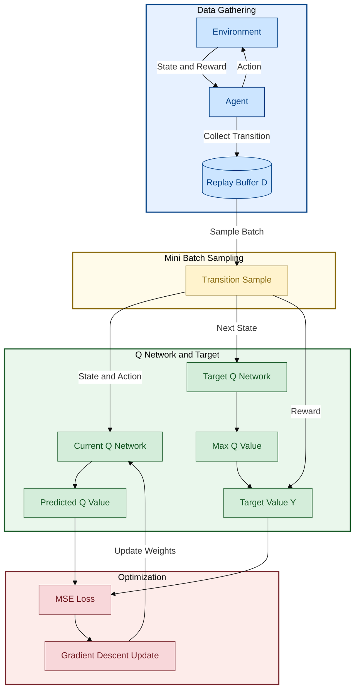
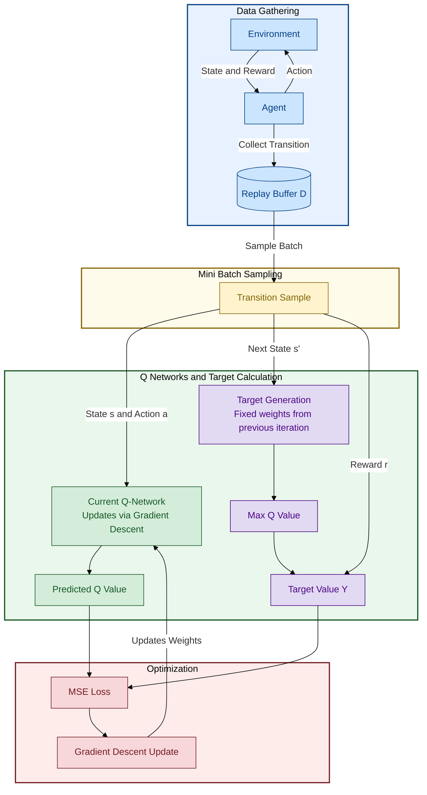
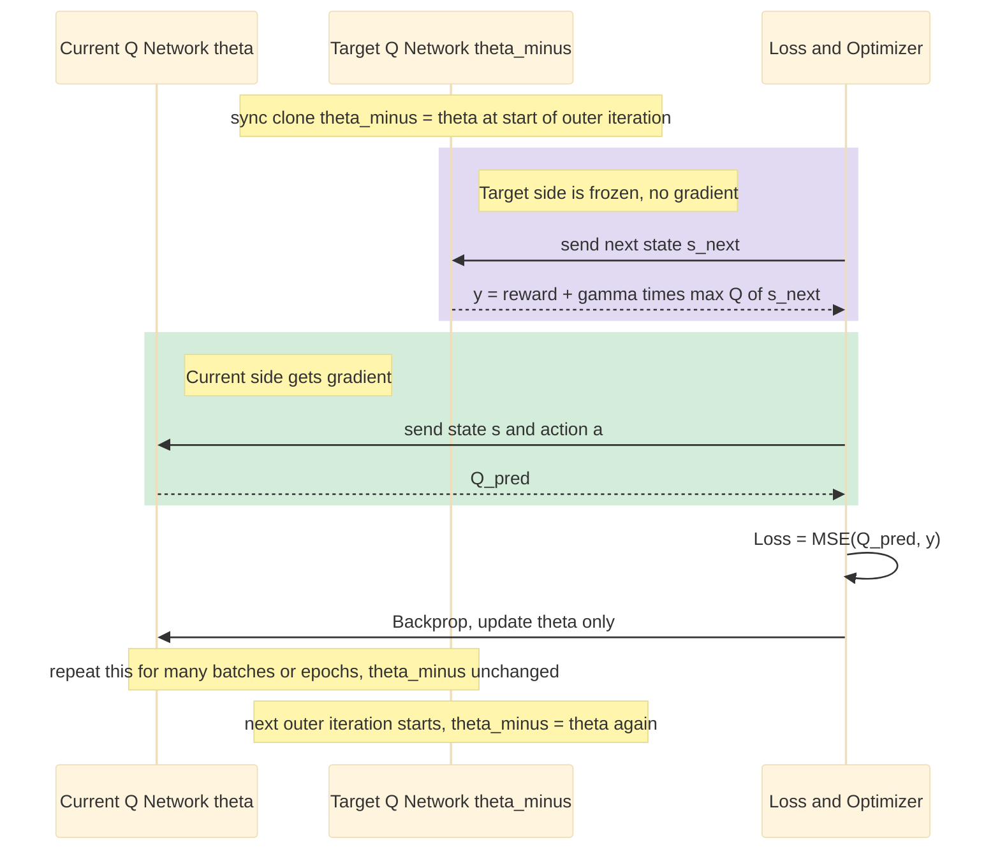

# NFQ (Neural Fitted Q-Iteration) Original Paper Diagrams

NFQ algorithm ရဲ့ data flow ကို diagram ၂ ခုနဲ့ ဖော်ပြထားပါတယ်။ ပထမတစ်ခုက overview (basic) version ဖြစ်ပြီး ဒုတိယတစ်ခုက Q-Network နဲ့ Target Network ကို ပိုမိုရှင်းလင်းစွာ ခွဲခြားပြထားတဲ့ detailed version ဖြစ်ပါတယ်။

## Diagram 1 — Basic Overview

## Diagram 2 — Detailed Version (Current Q-Network vs. Target Generation)

### Diagram 1 vs Diagram 2 ခြားနားချက်

- Diagram 1 က `MLP` / `Target_Net` ဆိုပြီး node name အတိုချုပ်ပဲ သုံးထားပြီး၊ Diagram 2 ကတော့ `Current Q-Network` (gradient descent နဲ့ update လုပ်တဲ့ network) နဲ့ `Target Generation` (ယခင် iteration ရဲ့ fixed weights သုံးတဲ့ network) ဆိုပြီး ရှင်းလင်းစွာ label တပ်ထားပါတယ်။
- Color coding အားလုံးမှာ **Data Gathering** = ပြာ၊ **Sampling** = အဝါ၊ **Current/Q Network** = အစိမ်း၊ **Target Network** (Diagram 2) = ခရမ်းရောင်၊ **Optimization** = အနီ ဖြစ်ပါတယ်။

## Q&A — Current Q-Network vs Target Q-Network

### မေး ၁။ Network နှစ်ခုလား? တစ်ခုထဲလား?

**Architecture (layer structure) အရ တစ်မျိုးတည်းပဲ ဖြစ်ပေမယ့်, memory ထဲမှာ weight set ၂ ခု သီးခြားစီ ရှိနေရပါတယ်။**

- **Current Q-Network** (weight θ) — gradient descent နဲ့ step တိုင်း update ဖြစ်နေတဲ့ "active" network။
- **Target Q-Network** (weight θ⁻) — Current Network ရဲ့ **weight snapshot (copy) တစ်ခု** ဖြစ်ပြီး၊ target value y တွက်ဖို့အတွက်ပဲ သုံးတာ၊ ဒီ weight တွေကို frozen ထားလို့ gradient မစီးဘူး။

ဒီတော့ "network ၂ ခု" လို့ ပြောလို့ရပေမယ့်, ၎င်းတို့ဟာ **architecture တူတဲ့ clone copy ၂ ခု** ဖြစ်ပါတယ် — model class သီးခြား ၂ မျိုး မဟုတ်ပါဘူး။ (NFQ original paper, Riedmiller 2005 မှာတော့ "outer loop" တစ်ခုချင်းစီအတွက် ယခင် iteration ရဲ့ Q-network ကို frozen snapshot အဖြစ် သုံးပြီး, ထို snapshot ပေါ်မှာ target တွေတွက်ကာ network အသစ်ကို (Rprop နဲ့ batch training) fit လုပ်တဲ့ idea အတူတူပါပဲ — "target network" ဆိုတဲ့ အသုံးအနှုန်းကို နောက်ပိုင်း DQN (Mnih et al., 2015) က ပိုရှင်းအောင် သီးခြား object နှစ်ခုခွဲပြထားတာပါ။)

### မေး ၂။ Target ကို weight freeze လုပ်ပြီး, loop တစ်ခါပြီးမှ current အသစ်ယူကာ loss တွက်တာလား?

**မှန်ပါတယ်, စဉ်းစားပုံအတိအကျ ဖြစ်ပါတယ်။** အဆင့်ဆင့် ဖြစ်စဉ်:

- **Target (θ⁻)** ကို ရေတိုမှာ **freeze** ထားပြီး gradient descent **မတွက်ဘူး** — y တွက်ဖို့ forward pass အတွက်ပဲ သုံးတယ် (PyTorch မှာဆိုရင် `.detach()` / `torch.no_grad()` သုံးတာနဲ့ အတူတူ)။
- **Current (θ)** ကိုပဲ gradient descent နဲ့ update လုပ်တယ် — θ⁻ ကို ထိမထားဘူး။
- Loss = (Q(s,a;θ) − y)² ကို θ အတွက်ပဲ backprop လုပ်တယ်။
- ဒီ cycle ကို (NFQ မှာဆို whole pattern set ကို Rprop နဲ့ epoch အများကြီး fit ဖြစ်အောင်, DQN မှာဆို steps အများကြီး) ထပ်ခါထပ်ခါ လုပ်ပြီးမှ — **outer loop/iteration တစ်ခါ ပြီးမှ** θ⁻ ကို θ ရဲ့ value အသစ်နဲ့ **sync/clone** ပြန်လုပ်တယ်။ ဒီနောက်မှ target value တွေ ပြန်တွက်ပြီး iteration အသစ် စလုပ်တာပါ။
- ဒီ "target ကို ခဏ freeze ထားတာ" ကပဲ training ကို stable ဖြစ်စေတဲ့ core idea ဖြစ်ပါတယ် — target ကိုလည်း current အတူတူ step တိုင်း update ရင် "moving target" ပြဿနာ ဖြစ်ပြီး loss ဟာ oscillate/diverge လွယ်သွားမှာပါ။

### မေး ၃။ Network output က ဘာကို ထုတ်ပေးတာလဲ — evaluate လုပ်တာလား, action ရွေးချယ်တာလား?

**Network output ဟာ "evaluation" (value estimate) ပဲ ဖြစ်ပါတယ် — action ကို တိုက်ရိုက် ရွေးချယ်ပေးတာ မဟုတ်ပါဘူး။**

- **Input:** state `s` (NFQ original architecture မှာ state+action `(s,a)` ကို input အတူတကွ ထည့်ပြီး scalar Q value ထုတ်တယ်; DQN-style architecture မှာတော့ state `s` ချည်းပဲ input ပေးပြီး, possible action တစ်ခုစီအတွက် Q value array တစ်ခုလုံးကို တစ်ပြိုင်နက် output ထုတ်ပေးတယ်)။
- **Output:** `Q(s,a)` — "ဒီ state `s` မှာ action `a` ကို ယူပြီး အဲဒီနောက်မှာ (optimal/greedy ဆက်လုပ်မယ်ဆိုရင်) ဘယ်လောက် expected discounted return ရနိုင်မလဲ" ဆိုတဲ့ **value evaluation** ပါ။ ဒါကြောင့် network ကိုယ်တိုင်က "ဘယ် action လုပ်မယ်" ဆိုတာ ဒီဇိုင်းအနေနဲ့ ထုတ်ပေးတာ မဟုတ်ဘဲ, action တစ်ခုချင်းစီရဲ့ "ကောင်းမှု" ကိုပဲ အကဲဖြတ်ပေးတာပါ။
- **Action ရွေးချယ်ခြင်း** ကတော့ ဒီ Q-value evaluation ပေါ်မှာ **နောက်ထပ်တစ်ဆင့်** ထပ်လုပ်တာပါ:
  - Exploitation အချိန်မှာ — `argmax_a Q(s,a)` (Q value အများဆုံး action ကို ယူတယ်)
  - Training/exploration အချိန်မှာ — **ε-greedy** (ε probability နဲ့ random action, (1-ε) နဲ့ argmax action) စတဲ့ policy rule တစ်ခုခုနဲ့ ဆုံးဖြတ်တယ်။
- အတိုချုပ်ပြောရရင်: **Q-network = "critic/evaluator"**, action selection rule (argmax / ε-greedy) = **"policy"** ။ NFQ/DQN မျိုးဟာ value-based method ဖြစ်လို့ policy ကို သီးခြား network နဲ့ မသင်ဘူး — value function ပေါ်မှာ derive ထားတဲ့ implicit policy ကိုပဲ သုံးတာပါ (ဒါကြောင့် actor-critic/policy-gradient method တွေနဲ့ ကွာခြားတာ ဖြစ်ပါတယ်)။
