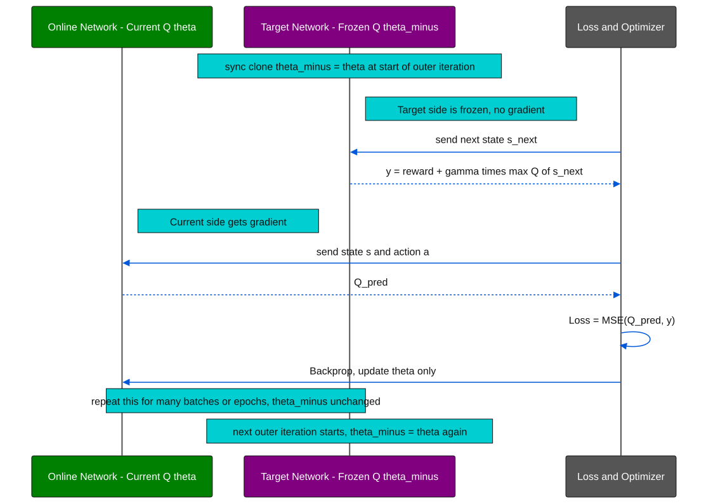

# NFQ (Neural Fitted Q-Iteration) Original Paper Diagrams

NFQ algorithm ရဲ့ data flow ကို diagram ၂ ခုနဲ့ ဖော်ပြထားပါတယ်။ ပထမတစ်ခုက overview (basic) version ဖြစ်ပြီး ဒုတိယတစ်ခုက Q-Network နဲ့ Target Network ကို ပိုမိုရှင်းလင်းစွာ ခွဲခြားပြထားတဲ့ detailed version ဖြစ်ပါတယ်။

### အရောင်အသုံးပြုပုံ (Color Rule)

[အရောင် ၈ မျိုးနှင့် network label သတ်မှတ်ချက် — 00_1_color_define.md](./00_1_color_define.md)

| အသုံးပြုပုံ | အရောင် | နမူနာ | Fill | Text |
|---|---|---|---|---|
| Policy Network / Actor; Online / Current Q Network | **Green / အစိမ်း** |  | `#008000` | `#FFFFFF` |
| Value Network / Critic / Baseline; Dueling value head | **Orange / လိမ္မော်** |  | `#FF8C00` | `#111111` |
| Frozen Target Network | **Purple / ခရမ်း** |  | `#800080` | `#FFFFFF` |
| State / environment / data / shared backbone | **Blue / အပြာ** |  | `#0057D9` | `#FFFFFF` |
| Batch / sampling / advantage | **Yellow / အဝါ** |  | `#FFD700` | `#111111` |
| Preprocessing / PER / action selection / synchronization | **Cyan / စိမ်းပြာ** |  | `#00CED1` | `#111111` |
| Loss / gradient / optimizer | **Red / အနီ** |  | `#DC143C` | `#FFFFFF` |
| Outputs / probabilities / returns / target values / aggregation | **Gray / မီးခိုး** |  | `#555555` | `#FFFFFF` |

**Green / orange / purple ကို network၊ trainable layer / head တွေအတွက်သာ သီးသန့်သုံးပါတယ်။** Network block ထဲမှာ `Policy Network`၊ `Value Network`၊ `Online Network` သို့မဟုတ် `Target Network` ဆိုပြီး အမျိုးအစားပါပါတယ်။ Neuron များကို စုပြထားသောပုံမှာ အမျိုးအစားကို enclosing network / layer ခေါင်းစဉ်မှာ ရေးထားပါတယ်။

Shared actor-critic block မှာ **Policy Network + Value Network** နှစ်ခုလုံးကို ဖော်ပြပြီး shared backbone / copy ကို blue သုံးထားပါတယ်။ Shared heads ဖြစ်ရင် သီးခြား model နှစ်ခုရှိတယ်လို့ မဆိုလိုပါဘူး။ Dueling ရဲ့ value / advantage heads က Q Network ထဲက အစိတ်အပိုင်းများဖြစ်ပြီး သီးခြား policy network မဟုတ်ပါဘူး။

**Target value / return = gray၊ Target Network = purple** ဖြစ်ပါတယ်။ Network outputs၊ action sampling၊ loss နဲ့ paper-lineage block များကို network အရောင် ၃ ရောင်နဲ့ မပြပါဘူး။ Group နောက်ခံကို transparent ထားပြီး arrow ကို blue သုံးထားပါတယ်။

## Diagram 1 — Basic Overview



<details>
<summary>Mermaid source (ပြင်ဆင်ရန်)</summary>

```text
%%{init: {"theme": "base", "themeVariables": {"primaryColor": "#555555", "primaryTextColor": "#FFFFFF", "primaryBorderColor": "#111111", "secondaryColor": "#555555", "tertiaryColor": "#FFFFFF", "lineColor": "#0057D9", "clusterBkg": "#FFFFFF", "clusterBorder": "#555555", "edgeLabelBackground": "#FFFFFF", "textColor": "#111111"}, "htmlLabels": false, "flowchart": {"htmlLabels": false}, "themeCSS": ".edgeLabel text, .edgeLabel tspan { fill: #111111 !important; } .edgeLabel { color: #111111 !important; } .cluster-label text, .cluster-label tspan { fill: #111111 !important; }"}}%%
graph TD
    subgraph Phase1 [Data Gathering]
        Env[Environment] -->|State and Reward| Agent[Agent]
        Agent -->|Action| Env
        Agent -->|Collect Transition| Buffer[(Replay Buffer D)]
    end

    subgraph Phase2 [Mini Batch Sampling]
        Buffer -->|Sample Batch| Batch[Transition Sample]
    end

    subgraph Phase3 [Q Network and Target]
        Batch -->|State and Action| MLP["Online Network (Current Q)<br/>Trainable weights theta"]
        MLP --> Q_pred[Predicted Q Value]

        Batch -->|Next State| Target_Net["Target Network (Q)<br/>Frozen previous-iteration weights"]
        Target_Net --> Max_Q[Max Q Value]
        Batch -->|Reward| Target_Y[Target Value Y]
        Max_Q --> Target_Y
    end

    subgraph Phase4 [Optimization]
        Q_pred --> Loss[MSE Loss]
        Target_Y --> Loss
        Loss --> Opt[Gradient Descent Update]
        Opt -->|Update Weights| MLP
    end
    classDef data fill:#0057D9,stroke:#111111,stroke-width:2px,color:#FFFFFF;
    classDef batch fill:#FFD700,stroke:#111111,stroke-width:2px,color:#111111;
    classDef train fill:#DC143C,stroke:#111111,stroke-width:2px,color:#FFFFFF;
    classDef result fill:#555555,stroke:#111111,stroke-width:2px,color:#FFFFFF;
    classDef onlineNetwork fill:#008000,stroke:#111111,stroke-width:2px,color:#FFFFFF;
    classDef targetNetwork fill:#800080,stroke:#111111,stroke-width:2px,color:#FFFFFF;

    class Env,Agent,Buffer data;
    class Batch batch;
    class Loss,Opt train;
    class Q_pred,Max_Q,Target_Y result;
    class MLP onlineNetwork;
    class Target_Net targetNetwork;
    style Phase1 fill:none,stroke:#555555,stroke-width:2px,color:#111111;
    style Phase2 fill:none,stroke:#555555,stroke-width:2px,color:#111111;
    style Phase3 fill:none,stroke:#555555,stroke-width:2px,color:#111111;
    style Phase4 fill:none,stroke:#555555,stroke-width:2px,color:#111111;
```

</details>

## Diagram 2 — Detailed Version (Current Q-Network vs. Target Generation)



<details>
<summary>Mermaid source (ပြင်ဆင်ရန်)</summary>

```text
%%{init: {"theme": "base", "themeVariables": {"primaryColor": "#555555", "primaryTextColor": "#FFFFFF", "primaryBorderColor": "#111111", "secondaryColor": "#555555", "tertiaryColor": "#FFFFFF", "lineColor": "#0057D9", "clusterBkg": "#FFFFFF", "clusterBorder": "#555555", "edgeLabelBackground": "#FFFFFF", "textColor": "#111111"}, "htmlLabels": false, "flowchart": {"htmlLabels": false}, "themeCSS": ".edgeLabel text, .edgeLabel tspan { fill: #111111 !important; } .edgeLabel { color: #111111 !important; } .cluster-label text, .cluster-label tspan { fill: #111111 !important; }"}}%%
graph TD
    subgraph Phase1 [Data Gathering]
        Env2[Environment] -->|State and Reward| Agent2[Agent]
        Agent2 -->|Action| Env2
        Agent2 -->|Collect Transition| Buffer2[(Replay Buffer D)]
    end

    subgraph Phase2 [Mini Batch Sampling]
        Buffer2 -->|Sample Batch| Batch2[Transition Sample]
    end

    subgraph Phase3 [Q Networks and Target Calculation]
        Batch2 -->|State s and Action a| Q_Current["Online Network (Current Q)<br/>Updates via gradient descent"]
        Q_Current --> Q_pred2[Predicted Q Value]

        Batch2 -->|Next State s'| Q_Target["Target Network (Q)<br/>Fixed weights from previous iteration"]
        Q_Target --> Max_Q2[Max Q Value]
        Batch2 -->|Reward r| Target_Y2[Target Value Y]
        Max_Q2 --> Target_Y2
    end

    subgraph Phase4 [Optimization]
        Q_pred2 --> Loss2[MSE Loss]
        Target_Y2 --> Loss2
        Loss2 --> Opt2[Gradient Descent Update]
        Opt2 -->|Updates Weights| Q_Current
    end
    classDef data fill:#0057D9,stroke:#111111,stroke-width:2px,color:#FFFFFF;
    classDef batch fill:#FFD700,stroke:#111111,stroke-width:2px,color:#111111;
    classDef train fill:#DC143C,stroke:#111111,stroke-width:2px,color:#FFFFFF;
    classDef result fill:#555555,stroke:#111111,stroke-width:2px,color:#FFFFFF;
    classDef onlineNetwork fill:#008000,stroke:#111111,stroke-width:2px,color:#FFFFFF;
    classDef targetNetwork fill:#800080,stroke:#111111,stroke-width:2px,color:#FFFFFF;

    class Env2,Agent2,Buffer2 data;
    class Batch2 batch;
    class Loss2,Opt2 train;
    class Q_pred2,Max_Q2,Target_Y2 result;
    class Q_Current onlineNetwork;
    class Q_Target targetNetwork;
    style Phase1 fill:none,stroke:#555555,stroke-width:2px,color:#111111;
    style Phase2 fill:none,stroke:#555555,stroke-width:2px,color:#111111;
    style Phase3 fill:none,stroke:#555555,stroke-width:2px,color:#111111;
    style Phase4 fill:none,stroke:#555555,stroke-width:2px,color:#111111;
```

</details>

### Diagram 1 vs Diagram 2 ခြားနားချက်

- Diagram 1 က `MLP` / `Target_Net` ဆိုပြီး node name အတိုချုပ်ပဲ သုံးထားပြီး၊ Diagram 2 ကတော့ `Current Q-Network` (gradient descent နဲ့ update လုပ်တဲ့ network) နဲ့ `Target Generation` (ယခင် iteration ရဲ့ fixed weights သုံးတဲ့ network) ဆိုပြီး ရှင်းလင်းစွာ label တပ်ထားပါတယ်။
- အရောင်အသုံးပြုပုံကို အပေါ်က **Color Rule** table အတိုင်း ဖတ်ပါ။ Network အရောင် ၃ ရောင်ကို အခြား block များမှာ မသုံးထားပါဘူး။

## Q&A — Current Q-Network vs Target Q-Network

### မေး ၁။ Network နှစ်ခုလား? တစ်ခုထဲလား?

**Architecture (layer structure) အရ တစ်မျိုးတည်းပဲ ဖြစ်ပေမယ့်, memory ထဲမှာ weight set ၂ ခု သီးခြားစီ ရှိနေရပါတယ်။**

- **Current Q-Network** (weight θ) — gradient descent နဲ့ step တိုင်း update ဖြစ်နေတဲ့ "active" network။
- **Target Q-Network** (weight θ⁻) — Current Network ရဲ့ **weight snapshot (copy) တစ်ခု** ဖြစ်ပြီး၊ target value y တွက်ဖို့အတွက်ပဲ သုံးတာ၊ ဒီ weight တွေကို frozen ထားလို့ gradient မစီးဘူး။

ဒီတော့ "network ၂ ခု" လို့ ပြောလို့ရပေမယ့်, ၎င်းတို့ဟာ **architecture တူတဲ့ clone copy ၂ ခု** ဖြစ်ပါတယ် — model class သီးခြား ၂ မျိုး မဟုတ်ပါဘူး။ (NFQ original paper, Riedmiller 2005 မှာတော့ "outer loop" တစ်ခုချင်းစီအတွက် ယခင် iteration ရဲ့ Q-network ကို frozen snapshot အဖြစ် သုံးပြီး, ထို snapshot ပေါ်မှာ target တွေတွက်ကာ network အသစ်ကို (Rprop နဲ့ batch training) fit လုပ်တဲ့ idea အတူတူပါပဲ — "target network" ဆိုတဲ့ အသုံးအနှုန်းကို နောက်ပိုင်း DQN (Mnih et al., 2015) က ပိုရှင်းအောင် သီးခြား object နှစ်ခုခွဲပြထားတာပါ။)

### မေး ၂။ Target ကို weight freeze လုပ်ပြီး, loop တစ်ခါပြီးမှ current အသစ်ယူကာ loss တွက်တာလား?

**မှန်ပါတယ်, စဉ်းစားပုံအတိအကျ ဖြစ်ပါတယ်။** အဆင့်ဆင့် ဖြစ်စဉ်:



<details>
<summary>Mermaid source (ပြင်ဆင်ရန်)</summary>

```text
%%{init: {"theme": "base", "themeVariables": {"lineColor": "#0057D9", "signalColor": "#0057D9", "signalTextColor": "#111111", "actorLineColor": "#555555", "loopLineColor": "#555555", "actorBkg": "#555555", "actorBorder": "#111111", "actorTextColor": "#FFFFFF", "noteBkgColor": "#00CED1", "noteBorderColor": "#111111", "noteTextColor": "#111111", "labelBoxBkgColor": "#FFD700", "labelBoxBorderColor": "#111111", "labelTextColor": "#111111", "loopTextColor": "#111111"}, "themeCSS": "rect.actor[name=\"Cur\"] { fill: #008000 !important; stroke: #111111 !important; } rect.actor[name=\"Cur\"] + text { fill: #FFFFFF !important; } rect.actor[name=\"Tgt\"] { fill: #800080 !important; stroke: #111111 !important; } rect.actor[name=\"Tgt\"] + text { fill: #FFFFFF !important; } "}}%%
sequenceDiagram
    participant Cur as Online Network - Current Q theta
    participant Tgt as Target Network - Frozen Q theta_minus
    participant L as Loss and Optimizer

    Note over Tgt: sync clone theta_minus = theta at start of outer iteration
    rect rgba(255, 255, 255, 0)
    Note right of Tgt: Target side is frozen, no gradient
    L->>Tgt: send next state s_next
    Tgt-->>L: y = reward + gamma times max Q of s_next
    end
    rect rgba(255, 255, 255, 0)
    Note right of Cur: Current side gets gradient
    L->>Cur: send state s and action a
    Cur-->>L: Q_pred
    end
    L->>L: Loss = MSE(Q_pred, y)
    L->>Cur: Backprop, update theta only
    Note over Cur,Tgt: repeat this for many batches or epochs, theta_minus unchanged
    Note over Tgt: next outer iteration starts, theta_minus = theta again
```

</details>

- **Target (θ⁻)** ကို ရေတိုမှာ **freeze** ထားပြီး gradient descent **မတွက်ဘူး** — y တွက်ဖို့ forward pass အတွက်ပဲ သုံးတယ် (PyTorch မှာဆိုရင် `.detach()` / `torch.no_grad()` သုံးတာနဲ့ အတူတူ)။
- **Current (θ)** ကိုပဲ gradient descent နဲ့ update လုပ်တယ် — θ⁻ ကို ထိမထားဘူး။
- Loss = (Q(s,a;θ) − y)² ကို θ အတွက်ပဲ backprop လုပ်တယ်။
- ဒီ cycle ကို (NFQ မှာဆို whole pattern set ကို Rprop နဲ့ epoch အများကြီး fit ဖြစ်အောင်, DQN မှာဆို steps အများကြီး) ထပ်ခါထပ်ခါ လုပ်ပြီးမှ — **outer loop/iteration တစ်ခါ ပြီးမှ** θ⁻ ကို θ ရဲ့ value အသစ်နဲ့ **sync/clone** ပြန်လုပ်တယ်။ ဒီနောက်မှ target value တွေ ပြန်တွက်ပြီး iteration အသစ် စလုပ်တာပါ။
- ဒီ "target ကို ခဏ freeze ထားတာ" ကပဲ training ကို stable ဖြစ်စေတဲ့ core idea ဖြစ်ပါတယ် — target ကိုလည်း current အတူတူ step တိုင်း update ရင် "moving target" ပြဿနာ ဖြစ်ပြီး loss ဟာ oscillate/diverge လွယ်သွားမှာပါ။

### မေး ၃။ Network output က ဘာကို ထုတ်ပေးတာလဲ — evaluate လုပ်တာလား, action ရွေးချယ်တာလား?

**Network output ဟာ "evaluation" (value estimate) ပဲ ဖြစ်ပါတယ် — action ကို တိုက်ရိုက် ရွေးချယ်ပေးတာ မဟုတ်ပါဘူး။**

- **Input:** state `s` (NFQ original architecture မှာ state+action `(s,a)` ကို input အတူတကွ ထည့်ပြီး scalar Q value ထုတ်တယ်; DQN-style architecture မှာတော့ state `s` ချည်းပဲ input ပေးပြီး, possible action တစ်ခုစီအတွက် Q value array တစ်ခုလုံးကို တစ်ပြိုင်နက် output ထုတ်ပေးတယ်)။
- **Output:** `Q(s,a)` — "ဒီ state `s` မှာ action `a` ကို ယူပြီး အဲဒီနောက်မှာ (optimal/greedy ဆက်လုပ်မယ်ဆိုရင်) ဘယ်လောက် expected discounted return ရနိုင်မလဲ" ဆိုတဲ့ **value evaluation** ပါ။ ဒါကြောင့် network ကိုယ်တိုင်က "ဘယ် action လုပ်မယ်" ဆိုတာ ဒီဇိုင်းအနေနဲ့ ထုတ်ပေးတာ မဟုတ်ဘဲ, action တစ်ခုချင်းစီရဲ့ "ကောင်းမှု" ကိုပဲ အကဲဖြတ်ပေးတာပါ။
- **Action ရွေးချယ်ခြင်း** ကတော့ ဒီ Q-value evaluation ပေါ်မှာ **နောက်ထပ်တစ်ဆင့်** ထပ်လုပ်တာပါ:
  - Exploitation အချိန်မှာ — `argmax_a Q(s,a)` (Q value အများဆုံး action ကို ယူတယ်)
  - Training/exploration အချိန်မှာ — **ε-greedy** (ε probability နဲ့ random action, (1-ε) နဲ့ argmax action) စတဲ့ policy rule တစ်ခုခုနဲ့ ဆုံးဖြတ်တယ်။
- အတိုချုပ်ပြောရရင်: **Q-network = "critic/evaluator"**, action selection rule (argmax / ε-greedy) = **"policy"** ။ NFQ/DQN မျိုးဟာ value-based method ဖြစ်လို့ policy ကို သီးခြား network နဲ့ မသင်ဘူး — value function ပေါ်မှာ derive ထားတဲ့ implicit policy ကိုပဲ သုံးတာပါ (ဒါကြောင့် actor-critic/policy-gradient method တွေနဲ့ ကွာခြားတာ ဖြစ်ပါတယ်)။
