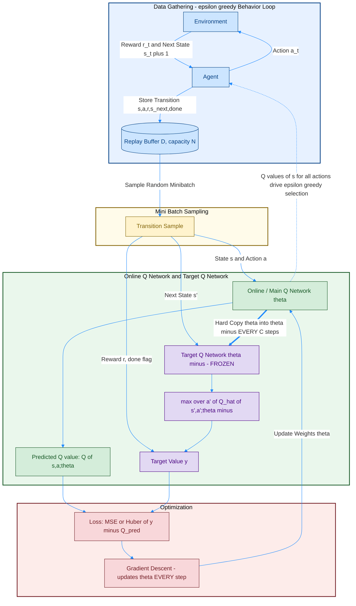
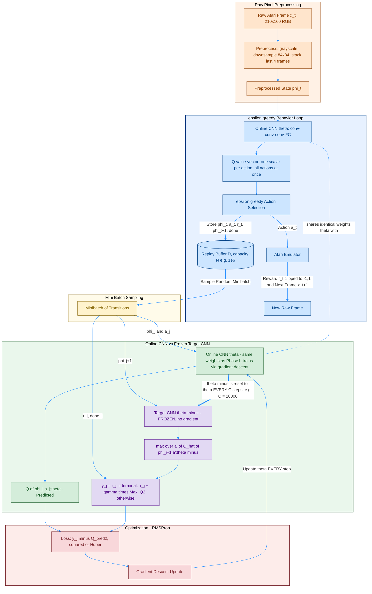
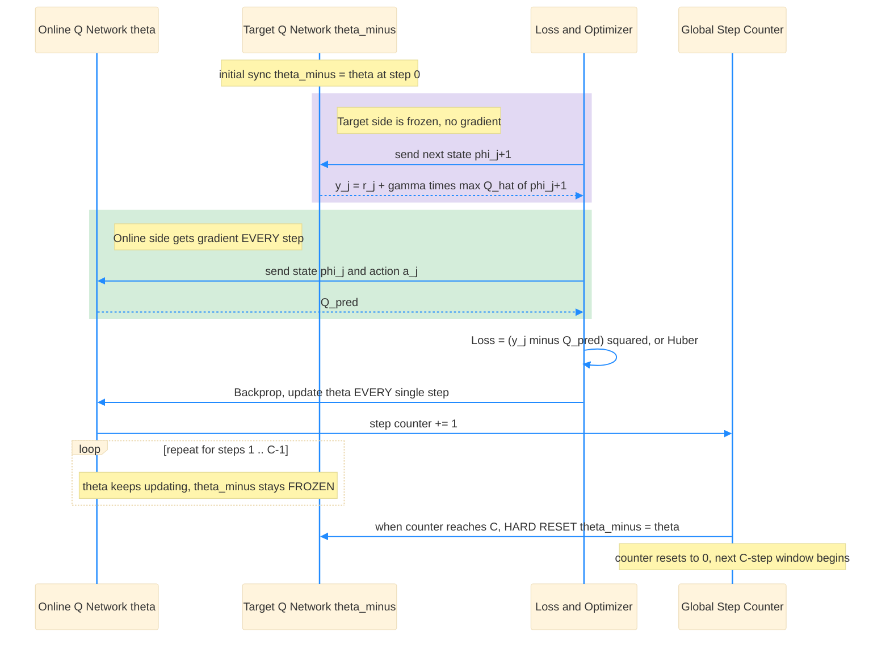

# Full DQN (Deep Q-Network) — Original Paper Diagrams

Full DQN ရဲ့ data flow ကို diagram ၂ ခုနဲ့ ဖော်ပြထားပါတယ် (Mnih et al., 2015, *Human-level control through deep reinforcement learning*, Nature — Algorithm 1: **Deep Q-learning with Experience Replay** ကို အခြေခံထားပါတယ်). ပထမတစ်ခုက **closed-loop overview** (Agent ⇄ Environment interaction အပါအဝင်) ဖြစ်ပြီး၊ ဒုတိယတစ်ခုက **Atari-scale full pipeline** (raw pixel preprocessing + CNN + hard target update every C steps) ကို ပိုမိုရှင်းလင်းစွာ ဖော်ပြထားတဲ့ detailed version ဖြစ်ပါတယ်။

## Diagram 1 — Basic Overview (Behavior Loop + Learning Loop)

> မှတ်ချက်: Online Network တစ်ခုတည်းက **"double-duty"** လုပ်ပါတယ် — (1) `Agent` ဆီ dashed arrow အတိုင်း, acting အချိန်မှာ Q-value ထုတ်ပေးပြီး ε-greedy action ရွေးဖို့ သုံးတယ်၊ (2) `Loss` ကနေ gradient ရလာပြီး weight update ဖြစ်နေတယ်။ Target Network ကတော့ **target y တွက်ရုံပဲ** သုံးတယ်, acting မှာ လုံးဝ မပါဝင်ဘူး (ဒီ bold `==>` arrow က hard-copy sync ကို ပြထားပါတယ်)။

## Diagram 2 — Detailed Full Atari Pipeline (Preprocessing → CNN → Hard Target Update)

### Diagram 1 vs Diagram 2 ခြားနားချက်

- Diagram 1 က general closed-loop (control-theory style) version ဖြစ်ပြီး, `Online` / `Target_Net` ဆိုတဲ့ node name အတိုချုပ်ပဲ သုံးထားပါတယ်။ Diagram 2 ကတော့ original Nature paper ရဲ့ **Atari pipeline အတိုင်း** — raw pixel `x_t` ကနေ grayscale + 84×84 downsample + 4-frame stack preprocessing (`φ`), CNN architecture (conv-conv-conv-FC), reward clipping `[-1, 1]`, RMSProp optimizer, နဲ့ `C` steps (ဥပမာ 10,000 steps) တိုင်း hard reset `θ⁻ ← θ` စတာတွေအထိ အသေးစိတ် ဖော်ပြထားပါတယ်။
- Color coding အားလုံးမှာ **Preprocessing** (Diagram 2 ထဲပဲ ရှိတယ်) = လိမ္မော်ရောင်၊ **Data Gathering / Acting** = ပြာ၊ **Sampling** = အဝါ၊ **Online/Current Q-Network** = အစိမ်း၊ **Target Network** = ခရမ်းရောင်၊ **Optimization** = အနီ ဖြစ်ပါတယ်။
- Diagram 1 ရဲ့ `Online -.-> Agent` dashed arrow နဲ့ Diagram 2 ရဲ့ `CNN_Online -. shares weights .- Q_Current` dashed arrow နှစ်ခုစလုံးက "Online network တစ်ခုတည်းကိုပဲ **acting** (behavior policy) အတွက်လည်းကောင်း, **training** (gradient target regression) အတွက်လည်းကောင်း တွဲသုံးနေတယ်" ဆိုတာကို အလေးပေးပြထားတာပါ — ဒါက NFQ ထက် Full DQN မှာ ပိုရှင်းလင်းစွာ သတ်မှတ်ထားတဲ့ design ဖြစ်ပါတယ်။

## Full DQN vs NFQ — ထပ်ဆင့် ကွာခြားချက်များ

| | NFQ (Riedmiller 2005) | Full DQN (Mnih et al., 2015) |
|---|---|---|
| Update loop | **Outer-loop iteration** တစ်ခုစီအတွက် Rprop နဲ့ batch (full pattern set) ကို offline fit | **Online, step-by-step** SGD (RMSProp) — step တိုင်း online network update |
| Target sync timing | Outer-loop iteration **ပြီးတိုင်း** (conceptual, dataset re-collect အခါ) | Fixed **global step counter C** (ဥပမာ 10,000 steps) တိုင်း hard copy `θ⁻ ← θ` |
| Replay buffer | NFQ paper original version မှာ clear-cut fixed-size circular replay buffer မပါ (whole trajectory set ပြန်သုံး) | Fixed-capacity **circular replay buffer** (capacity N, ဥပမာ 1M transitions), random uniform sampling |
| Input/Output | `(s, a)` pair input → scalar `Q(s,a)` output (original NFQ design) | State `s` (stacked preprocessed frames `φ`) input → **vector** `[Q(s,a₁), …, Q(s,aₙ)]` output, action အားလုံးအတွက် တစ်ပြိုင်နက် |
| Extra stability tricks | မပါ | Reward clipping `[-1,1]`, Huber/clipped loss, frame skipping, ε-decay schedule |

## Q&A — Full DQN အတွက် ဖြေကြားချက်များ

### မေး ၁။ Network နှစ်ခုလား? တစ်ခုထဲလား?

**Architecture (CNN layer structure) အရ တစ်မျိုးတည်းပဲ ဖြစ်ပေမယ့်, memory ထဲမှာ weight set ၂ ခု သီးခြားစီ ရှိနေရပါတယ် — ဒါက NFQ အတိုင်းပါပဲ။** ဒါပေမယ့် Full DQN မှာ ထပ်ဆင့် အရေးကြီးတဲ့ အချက်တစ်ခု ရှိပါတယ်:

- **Online / Main Q-Network** (weight θ) — ဒီ network တစ်ခုတည်းကိုပဲ **"double-duty"** ပေးထားပါတယ်:
  1. **Behavior policy** — `Agent` က `Q(s, ·; θ)` output vector ကနေ ε-greedy ဖြင့် action ရွေးချယ်ဖို့ သုံးတယ် (Diagram 1/2 ထဲက dashed arrow)။
  2. **Training target** — Loss function ထဲမှာ `Q(s,a;θ)` prediction ကို ဒီ network ကနေပဲ ယူပြီး, gradient descent နဲ့ **step တိုင်း** update လုပ်တယ်။
- **Target Q-Network** (weight θ⁻) — Online Network ရဲ့ **weight snapshot (clone) တစ်ခု** ဖြစ်ပြီး, target value `y` တွက်ဖို့ **အတွက်ပဲ** သုံးတယ်; acting (action ရွေးချယ်ခြင်း) မှာ လုံးဝ မပါဝင်ဘူး။ Frozen ထားလို့ ဒီ weight တွေဆီ gradient လုံးဝ မစီးဘူး။

ဒီတော့ "architecture တူတဲ့ clone copy ၂ ခု" ဆိုတဲ့ idea ကတော့ NFQ နဲ့ အတူတူပါပဲ, ဒါပေမယ့် **Full DQN မှာ "Target Network" ဆိုတဲ့ သီးခြား terminology ကို Mnih et al. (2015) က ပထမဆုံး တရားဝင် သတ်မှတ်ပေးခဲ့ပြီး**, Online network ရဲ့ "acting + training" dual role ကို ပိုရှင်းလင်းစွာ ပိုင်းခြားပြထားပါတယ်။

### မေး ၂။ Target ကို weight freeze လုပ်ပြီး, loop တစ်ခါပြီးမှ current အသစ်ယူကာ loss တွက်တာလား?

**မှန်ပါတယ်, ဒါပေမယ့် NFQ နဲ့ မတူတာက "ပြီးတော့" ဆိုတဲ့ timing ကို episode/outer-loop အစား **fixed step counter `C`** နဲ့ တိတိကျကျ သတ်မှတ်ထားတာပါ။**

- **Target (θ⁻)** ကို **`C` steps** (global environment-step counter, ဥပမာ original paper မှာ Atari game အများစုအတွက် `C = 10,000` steps) အတွင်းလုံး **freeze** ထားပြီး gradient **လုံးဝ မတွက်ဘူး**။
- **Online (θ)** ကိုတော့ **step တိုင်း** (NFQ ရဲ့ "whole batch ကို Rprop နဲ့ epoch ကြီးတွေ fit" သည့် offline style မဟုတ်ဘဲ, online/incremental SGD style) gradient descent နဲ့ update လုပ်တယ်။
- `C` steps ပြည့်တာနဲ့ `θ⁻ ← θ` ဆိုပြီး **hard copy** (weight အကုန်လုံးကို တိုက်ရိုက် ကူးယူခြင်း) တစ်ခါတည်း လုပ်တယ် — ဒါက **"hard update"** လို့ခေါ်ပြီး, (DDPG/soft-update variant တွေမှာ သုံးတဲ့ Polyak averaging `θ⁻ ← τθ + (1-τ)θ⁻` လို **gradual/soft blend** မဟုတ်ပါဘူး)။
- ဒီ "fixed-interval hard freeze" ကပဲ training ကို stable ဖြစ်စေတဲ့ core idea ဖြစ်ပြီး, NFQ ရဲ့ "outer-loop iteration ပြီးမှ sync" ဆိုတဲ့ concept ရဲ့ ပိုတိကျတဲ့ (engineering-friendly, step-count based) ဗားရှင်းပါပဲ။

### မေး ၃။ Network output က ဘာကို ထုတ်ပေးတာလဲ — evaluate လုပ်တာလား, action ရွေးချယ်တာလား?

**Network output ဟာ "evaluation" (value estimate vector) ပဲ ဖြစ်ပါတယ် — action ကို တိုက်ရိုက် ရွေးချယ်ပေးတာ မဟုတ်ပါဘူး, NFQ လိုပါပဲ။** Full DQN မှာ input/output shape ကတော့ NFQ ရဲ့ original `(s,a)` design ထက် ပိုမို efficient ပါတယ်:

- **Input:** raw Atari frame `x_t` ကို preprocess လုပ်ပြီးရလာတဲ့ **stacked state** `φ(s_t)` (ဥပမာ 84×84×4, frame 4 ခု stack) — state `s` ချည်းပဲ ထည့်တယ်, action ကို input ထဲ မထည့်ပါဘူး။
- **Output:** CNN ထဲကနေ possible action **အားလုံးအတွက်** Q-value တစ်ပြိုင်နက် ထွက်လာတဲ့ **vector** — `[Q(s,a₁;θ), Q(s,a₂;θ), …, Q(s,aₙ;θ)]`။ ဒါက "ဒီ state `s` မှာ action တစ်ခုချင်းစီ ယူရင် (optimal ဆက်လုပ်မယ်ဆိုရင်) ဘယ်လောက် expected discounted return ရနိုင်မလဲ" ဆိုတဲ့ **value evaluation** ချည်းပါပဲ။
- ဒီ vectorized output design ကြောင့် **forward pass တစ်ခါတည်းနဲ့ action အားလုံးရဲ့ Q-value ကို တွက်ထုတ်နိုင်ပြီး**, NFQ ရဲ့ `(s,a)` pair-by-pair input/output design (action တစ်ခုချင်းစီအတွက် separate forward pass လိုအပ်) ထက် Atari real-time control မှာ ပိုမြန်ပါတယ် — ဒါက Full DQN ရဲ့ practical engineering contribution တစ်ခု ဖြစ်ပါတယ်။
- **Action ရွေးချယ်ခြင်း** ကတော့ ဒီ Q-value vector ပေါ်မှာ **နောက်ထပ်တစ်ဆင့်** ထပ်လုပ်တာပါ:
  - Exploitation အချိန်မှာ — `argmax_a Q(s,a;θ)` (Q value အများဆုံး action ကို ယူတယ်)
  - Training/exploration အချိန်မှာ — **ε-greedy** (ε probability (schedule အရ 1.0 ကနေ 0.1 ဆီ decay) နဲ့ random action, (1-ε) နဲ့ argmax action)
- အတိုချုပ်ပြောရရင်: **Online Q-network = "critic/evaluator"** (value vector ထုတ်ပေးတယ်), action selection rule (argmax / ε-greedy) = **"policy"** — ဒီဟာက NFQ မှာရော Full DQN မှာပါ မပြောင်းလဲတဲ့ value-based method ရဲ့ core principle ဖြစ်ပါတယ်။
