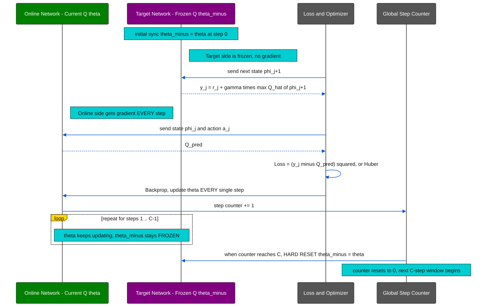

# Full DQN (Deep Q-Network) — Original Paper Diagrams

Full DQN ရဲ့ data flow ကို diagram ၂ ခုနဲ့ ဖော်ပြထားပါတယ် (Mnih et al., 2015, *Human-level control through deep reinforcement learning*, Nature — Algorithm 1: **Deep Q-learning with Experience Replay** ကို အခြေခံထားပါတယ်). ပထမတစ်ခုက **closed-loop overview** (Agent ⇄ Environment interaction အပါအဝင်) ဖြစ်ပြီး၊ ဒုတိယတစ်ခုက **Atari-scale full pipeline** (raw pixel preprocessing + CNN + hard target update every C steps) ကို ပိုမိုရှင်းလင်းစွာ ဖော်ပြထားတဲ့ detailed version ဖြစ်ပါတယ်။

### အရောင်အသုံးပြုပုံ (Color Rule)

[အရောင် ၈ မျိုးနှင့် network label သတ်မှတ်ချက် — 00_1_color_define.md](./00_1_color_define.md)

| အသုံးပြုပုံ | အရောင် | နမူနာ | Fill | Text |
|---|---|---|---|---|
| Policy Network / Actor; Online / Current Q Network | **Green / အစိမ်း** |  | `#008000` | `#FFFFFF` |
| Value Network / Critic / Baseline; Dueling value head | **Orange / လိမ္မော်** |  | `#FF8C00` | `#111111` |
| Frozen Target Network | **Purple / ခရမ်း** |  | `#800080` | `#FFFFFF` |
| State / environment / data / shared backbone | **Blue / အပြာ** |  | `#0057D9` | `#FFFFFF` |
| Batch / sampling / advantage | **Yellow / အဝါ** |  | `#FFD700` | `#111111` |
| Preprocessing / PER / action selection / synchronization | **Cyan / စိမ်းပြာ** |  | `#00CED1` | `#111111` |
| Loss / gradient / optimizer | **Red / အနီ** |  | `#DC143C` | `#FFFFFF` |
| Outputs / probabilities / returns / target values / aggregation | **Gray / မီးခိုး** |  | `#555555` | `#FFFFFF` |

**Green / orange / purple ကို network၊ trainable layer / head တွေအတွက်သာ သီးသန့်သုံးပါတယ်။** Network block ထဲမှာ `Policy Network`၊ `Value Network`၊ `Online Network` သို့မဟုတ် `Target Network` ဆိုပြီး အမျိုးအစားပါပါတယ်။ Neuron များကို စုပြထားသောပုံမှာ အမျိုးအစားကို enclosing network / layer ခေါင်းစဉ်မှာ ရေးထားပါတယ်။

Shared actor-critic block မှာ **Policy Network + Value Network** နှစ်ခုလုံးကို ဖော်ပြပြီး shared backbone / copy ကို blue သုံးထားပါတယ်။ Shared heads ဖြစ်ရင် သီးခြား model နှစ်ခုရှိတယ်လို့ မဆိုလိုပါဘူး။ Dueling ရဲ့ value / advantage heads က Q Network ထဲက အစိတ်အပိုင်းများဖြစ်ပြီး သီးခြား policy network မဟုတ်ပါဘူး။

**Target value / return = gray၊ Target Network = purple** ဖြစ်ပါတယ်။ Network outputs၊ action sampling၊ loss နဲ့ paper-lineage block များကို network အရောင် ၃ ရောင်နဲ့ မပြပါဘူး။ Group နောက်ခံကို transparent ထားပြီး arrow ကို blue သုံးထားပါတယ်။

## Diagram 1 — Basic Overview (Behavior Loop + Learning Loop)



<details>
<summary>Mermaid source (ပြင်ဆင်ရန်)</summary>

```text
%%{init: {"theme": "base", "themeVariables": {"primaryColor": "#555555", "primaryTextColor": "#FFFFFF", "primaryBorderColor": "#111111", "secondaryColor": "#555555", "tertiaryColor": "#FFFFFF", "lineColor": "#0057D9", "clusterBkg": "#FFFFFF", "clusterBorder": "#555555", "edgeLabelBackground": "#FFFFFF", "textColor": "#111111"}, "htmlLabels": false, "flowchart": {"htmlLabels": false}, "themeCSS": ".edgeLabel text, .edgeLabel tspan { fill: #111111 !important; } .edgeLabel { color: #111111 !important; } .cluster-label text, .cluster-label tspan { fill: #111111 !important; }"}}%%
graph TD
    subgraph Phase1 [Data Gathering - epsilon greedy Behavior Loop]
        Env[Environment] -->|Reward r_t and Next State s_t plus 1| Agent[Agent]
        Agent -->|Action a_t| Env
        Agent -->|Store Transition s,a,r,s_next,done| Buffer[(Replay Buffer D, capacity N)]
    end

    subgraph Phase2 [Mini Batch Sampling]
        Buffer -->|Sample Random Minibatch| Batch[Transition Sample]
    end

    subgraph Phase3 [Online Q Network and Target Q Network]
        Batch -->|State s and Action a| Online["Online Network (Main Q)<br/>Trainable weights theta"]
        Online --> Q_pred[Predicted Q value: Q of s,a;theta]

        Batch -->|Next State s'| Target_Net["Target Network (Q)<br/>theta_minus - FROZEN"]
        Target_Net --> Max_Q[max over a' of Q_hat of s',a';theta minus]
        Batch -->|Reward r, done flag| Target_Y[Target Value y]
        Max_Q --> Target_Y
    end

    subgraph Phase4 [Optimization]
        Q_pred --> Loss[Loss: MSE or Huber of y minus Q_pred]
        Target_Y --> Loss
        Loss --> Opt[Gradient Descent - updates theta EVERY step]
        Opt -->|Update Weights theta| Online
    end

    Online -.->|Q values of s for all actions drive epsilon greedy selection| Agent
    Online ==>|Hard Copy theta into theta minus EVERY C steps| Target_Net
    classDef data fill:#0057D9,stroke:#111111,stroke-width:2px,color:#FFFFFF;
    classDef batch fill:#FFD700,stroke:#111111,stroke-width:2px,color:#111111;
    classDef train fill:#DC143C,stroke:#111111,stroke-width:2px,color:#FFFFFF;
    classDef result fill:#555555,stroke:#111111,stroke-width:2px,color:#FFFFFF;
    classDef onlineNetwork fill:#008000,stroke:#111111,stroke-width:2px,color:#FFFFFF;
    classDef targetNetwork fill:#800080,stroke:#111111,stroke-width:2px,color:#FFFFFF;

    class Env,Agent,Buffer data;
    class Batch batch;
    class Loss,Opt train;
    class Q_pred,Max_Q,Target_Y result;
    class Online onlineNetwork;
    class Target_Net targetNetwork;
    style Phase1 fill:none,stroke:#555555,stroke-width:2px,color:#111111;
    style Phase2 fill:none,stroke:#555555,stroke-width:2px,color:#111111;
    style Phase3 fill:none,stroke:#555555,stroke-width:2px,color:#111111;
    style Phase4 fill:none,stroke:#555555,stroke-width:2px,color:#111111;
```

</details>

> မှတ်ချက်: Online Network တစ်ခုတည်းက **"double-duty"** လုပ်ပါတယ် — (1) `Agent` ဆီ dashed arrow အတိုင်း, acting အချိန်မှာ Q-value ထုတ်ပေးပြီး ε-greedy action ရွေးဖို့ သုံးတယ်၊ (2) `Loss` ကနေ gradient ရလာပြီး weight update ဖြစ်နေတယ်။ Target Network ကတော့ **target y တွက်ရုံပဲ** သုံးတယ်, acting မှာ လုံးဝ မပါဝင်ဘူး (ဒီ bold `==>` arrow က hard-copy sync ကို ပြထားပါတယ်)။

## Diagram 2 — Detailed Full Atari Pipeline (Preprocessing → CNN → Hard Target Update)



<details>
<summary>Mermaid source (ပြင်ဆင်ရန်)</summary>

```text
%%{init: {"theme": "base", "themeVariables": {"primaryColor": "#555555", "primaryTextColor": "#FFFFFF", "primaryBorderColor": "#111111", "secondaryColor": "#555555", "tertiaryColor": "#FFFFFF", "lineColor": "#0057D9", "clusterBkg": "#FFFFFF", "clusterBorder": "#555555", "edgeLabelBackground": "#FFFFFF", "textColor": "#111111"}, "htmlLabels": false, "flowchart": {"htmlLabels": false}, "themeCSS": ".edgeLabel text, .edgeLabel tspan { fill: #111111 !important; } .edgeLabel { color: #111111 !important; } .cluster-label text, .cluster-label tspan { fill: #111111 !important; }"}}%%
graph TD
    subgraph Phase0 [Raw Pixel Preprocessing]
        Raw[Raw Atari Frame x_t, 210x160 RGB] --> Pre[Preprocess: grayscale, downsample 84x84, stack last 4 frames]
        Pre --> Phi[Preprocessed State phi_t]
    end

    subgraph Phase1 [epsilon greedy Behavior Loop]
        Phi --> CNN_Online["Online Network (CNN Q)<br/>theta: conv-conv-conv-FC"]
        CNN_Online --> Qvec[Q value vector: one scalar per action, all actions at once]
        Qvec --> Select[epsilon greedy Action Selection]
        Select -->|Action a_t| Emu[Atari Emulator]
        Emu -->|Reward r_t clipped to -1,1 and Next Frame x_t+1| Raw2[New Raw Frame]
        Select -->|Store phi_t, a_t, r_t, phi_t+1, done| Buffer[(Replay Buffer D, capacity N e.g. 1e6)]
    end

    subgraph Phase2 [Mini Batch Sampling]
        Buffer -->|Sample Random Minibatch| Batch[Minibatch of Transitions]
    end

    subgraph Phase3 [Online CNN vs Frozen Target CNN]
        Batch -->|phi_j and a_j| Q_Current["Online Network (CNN Q)<br/>Same theta as acting network; gradient descent"]
        Q_Current --> Q_pred2[Q of phi_j,a_j;theta - Predicted]

        Batch -->|phi_j+1| Q_Target["Target Network (CNN Q)<br/>theta_minus - FROZEN; no gradient"]
        Q_Target --> Max_Q2[max over a' of Q_hat of phi_j+1,a';theta minus]
        Batch -->|r_j, done_j| Target_Y2["y_j = r_j  if terminal,  r_j + gamma times Max_Q2  otherwise"]
        Max_Q2 --> Target_Y2
    end

    subgraph Phase4 [Optimization - RMSProp]
        Q_pred2 --> Loss2[Loss: y_j minus Q_pred2, squared or Huber]
        Target_Y2 --> Loss2
        Loss2 --> Opt2[Gradient Descent Update]
        Opt2 -->|Update theta EVERY step| Q_Current
    end

    Q_Current ==>|theta minus is reset to theta EVERY C steps, e.g. C = 10000| Q_Target
    CNN_Online -. shares identical weights theta with .- Q_Current
    classDef data fill:#0057D9,stroke:#111111,stroke-width:2px,color:#FFFFFF;
    classDef batch fill:#FFD700,stroke:#111111,stroke-width:2px,color:#111111;
    classDef train fill:#DC143C,stroke:#111111,stroke-width:2px,color:#FFFFFF;
    classDef process fill:#00CED1,stroke:#111111,stroke-width:2px,color:#111111;
    classDef result fill:#555555,stroke:#111111,stroke-width:2px,color:#FFFFFF;
    classDef onlineNetwork fill:#008000,stroke:#111111,stroke-width:2px,color:#FFFFFF;
    classDef targetNetwork fill:#800080,stroke:#111111,stroke-width:2px,color:#FFFFFF;

    class Emu,Raw2,Buffer data;
    class Batch batch;
    class Loss2,Opt2 train;
    class Select,Raw,Pre,Phi process;
    class Qvec,Q_pred2,Max_Q2,Target_Y2 result;
    class CNN_Online,Q_Current onlineNetwork;
    class Q_Target targetNetwork;
    style Phase0 fill:none,stroke:#555555,stroke-width:2px,color:#111111;
    style Phase1 fill:none,stroke:#555555,stroke-width:2px,color:#111111;
    style Phase2 fill:none,stroke:#555555,stroke-width:2px,color:#111111;
    style Phase3 fill:none,stroke:#555555,stroke-width:2px,color:#111111;
    style Phase4 fill:none,stroke:#555555,stroke-width:2px,color:#111111;
```

</details>

### Diagram 1 vs Diagram 2 ခြားနားချက်

- Diagram 1 က general closed-loop (control-theory style) version ဖြစ်ပြီး, `Online` / `Target_Net` ဆိုတဲ့ node name အတိုချုပ်ပဲ သုံးထားပါတယ်။ Diagram 2 ကတော့ original Nature paper ရဲ့ **Atari pipeline အတိုင်း** — raw pixel `x_t` ကနေ grayscale + 84×84 downsample + 4-frame stack preprocessing (`φ`), CNN architecture (conv-conv-conv-FC), reward clipping `[-1, 1]`, RMSProp optimizer, နဲ့ `C` steps (ဥပမာ 10,000 steps) တိုင်း hard reset `θ⁻ ← θ` စတာတွေအထိ အသေးစိတ် ဖော်ပြထားပါတယ်။
- အရောင်အသုံးပြုပုံကို အပေါ်က **Color Rule** table အတိုင်း ဖတ်ပါ။ Network အရောင် ၃ ရောင်ကို အခြား block များမှာ မသုံးထားပါဘူး။
- Diagram 1 ရဲ့ `Online -.-> Agent` dashed arrow နဲ့ Diagram 2 ရဲ့ `CNN_Online -. shares weights .- Q_Current` dashed arrow နှစ်ခုစလုံးက "Online network တစ်ခုတည်းကိုပဲ **acting** (behavior policy) အတွက်လည်းကောင်း, **training** (gradient target regression) အတွက်လည်းကောင်း တွဲသုံးနေတယ်" ဆိုတာကို အလေးပေးပြထားတာပါ — ဒါက NFQ ထက် Full DQN မှာ ပိုရှင်းလင်းစွာ သတ်မှတ်ထားတဲ့ design ဖြစ်ပါတယ်။

## Full DQN vs NFQ — ထပ်ဆင့် ကွာခြားချက်များ

| | NFQ (Riedmiller 2005) | Full DQN (Mnih et al., 2015) |
|---|---|---|
| Update loop | **Outer-loop iteration** တစ်ခုစီအတွက် Rprop နဲ့ batch (full pattern set) ကို offline fit | **Online, step-by-step** SGD (RMSProp) — step တိုင်း online network update |
| Target sync timing | Outer-loop iteration **ပြီးတိုင်း** (conceptual, dataset re-collect အခါ) | Fixed **global step counter C** (ဥပမာ 10,000 steps) တိုင်း hard copy `θ⁻ ← θ` |
| Replay buffer | NFQ paper original version မှာ clear-cut fixed-size circular replay buffer မပါ (whole trajectory set ပြန်သုံး) | Fixed-capacity **circular replay buffer** (capacity N, ဥပမာ 1M transitions), random uniform sampling |
| Input/Output | `(s, a)` pair input → scalar `Q(s,a)` output (original NFQ design) | State `s` (stacked preprocessed frames `φ`) input → **vector** `[Q(s,a₁), …, Q(s,aₙ)]` output, action အားလုံးအတွက် တစ်ပြိုင်နက် |
| Extra stability tricks | မပါ | Reward clipping `[-1,1]`, Huber/clipped loss, frame skipping, ε-decay schedule |

## Q&A — Full DQN အတွက် ဖြေကြားချက်များ

### မေး ၁။ Network နှစ်ခုလား? တစ်ခုထဲလား?

**Architecture (CNN layer structure) အရ တစ်မျိုးတည်းပဲ ဖြစ်ပေမယ့်, memory ထဲမှာ weight set ၂ ခု သီးခြားစီ ရှိနေရပါတယ် — ဒါက NFQ အတိုင်းပါပဲ။** ဒါပေမယ့် Full DQN မှာ ထပ်ဆင့် အရေးကြီးတဲ့ အချက်တစ်ခု ရှိပါတယ်:

- **Online / Main Q-Network** (weight θ) — ဒီ network တစ်ခုတည်းကိုပဲ **"double-duty"** ပေးထားပါတယ်:
  1. **Behavior policy** — `Agent` က `Q(s, ·; θ)` output vector ကနေ ε-greedy ဖြင့် action ရွေးချယ်ဖို့ သုံးတယ် (Diagram 1/2 ထဲက dashed arrow)။
  2. **Training target** — Loss function ထဲမှာ `Q(s,a;θ)` prediction ကို ဒီ network ကနေပဲ ယူပြီး, gradient descent နဲ့ **step တိုင်း** update လုပ်တယ်။
- **Target Q-Network** (weight θ⁻) — Online Network ရဲ့ **weight snapshot (clone) တစ်ခု** ဖြစ်ပြီး, target value `y` တွက်ဖို့ **အတွက်ပဲ** သုံးတယ်; acting (action ရွေးချယ်ခြင်း) မှာ လုံးဝ မပါဝင်ဘူး။ Frozen ထားလို့ ဒီ weight တွေဆီ gradient လုံးဝ မစီးဘူး။

ဒီတော့ "architecture တူတဲ့ clone copy ၂ ခု" ဆိုတဲ့ idea ကတော့ NFQ နဲ့ အတူတူပါပဲ, ဒါပေမယ့် **Full DQN မှာ "Target Network" ဆိုတဲ့ သီးခြား terminology ကို Mnih et al. (2015) က ပထမဆုံး တရားဝင် သတ်မှတ်ပေးခဲ့ပြီး**, Online network ရဲ့ "acting + training" dual role ကို ပိုရှင်းလင်းစွာ ပိုင်းခြားပြထားပါတယ်။

### မေး ၂။ Target ကို weight freeze လုပ်ပြီး, loop တစ်ခါပြီးမှ current အသစ်ယူကာ loss တွက်တာလား?

**မှန်ပါတယ်, ဒါပေမယ့် NFQ နဲ့ မတူတာက "ပြီးတော့" ဆိုတဲ့ timing ကို episode/outer-loop အစား **fixed step counter `C`** နဲ့ တိတိကျကျ သတ်မှတ်ထားတာပါ။**



<details>
<summary>Mermaid source (ပြင်ဆင်ရန်)</summary>

```text
%%{init: {"theme": "base", "themeVariables": {"lineColor": "#0057D9", "signalColor": "#0057D9", "signalTextColor": "#111111", "actorLineColor": "#555555", "loopLineColor": "#555555", "actorBkg": "#555555", "actorBorder": "#111111", "actorTextColor": "#FFFFFF", "noteBkgColor": "#00CED1", "noteBorderColor": "#111111", "noteTextColor": "#111111", "labelBoxBkgColor": "#FFD700", "labelBoxBorderColor": "#111111", "labelTextColor": "#111111", "loopTextColor": "#111111"}, "themeCSS": "rect.actor[name=\"Onl\"] { fill: #008000 !important; stroke: #111111 !important; } rect.actor[name=\"Onl\"] + text { fill: #FFFFFF !important; } rect.actor[name=\"Tgt\"] { fill: #800080 !important; stroke: #111111 !important; } rect.actor[name=\"Tgt\"] + text { fill: #FFFFFF !important; } "}}%%
sequenceDiagram
    participant Onl as Online Network - Current Q theta
    participant Tgt as Target Network - Frozen Q theta_minus
    participant L as Loss and Optimizer
    participant Cnt as Global Step Counter

    Note over Tgt: initial sync theta_minus = theta at step 0
    rect rgba(255, 255, 255, 0)
    Note right of Tgt: Target side is frozen, no gradient
    L->>Tgt: send next state phi_j+1
    Tgt-->>L: y_j = r_j + gamma times max Q_hat of phi_j+1
    end
    rect rgba(255, 255, 255, 0)
    Note right of Onl: Online side gets gradient EVERY step
    L->>Onl: send state phi_j and action a_j
    Onl-->>L: Q_pred
    end
    L->>L: Loss = (y_j minus Q_pred) squared, or Huber
    L->>Onl: Backprop, update theta EVERY single step
    Onl->>Cnt: step counter += 1
    loop repeat for steps 1 .. C-1
        Note over Onl,Tgt: theta keeps updating, theta_minus stays FROZEN
    end
    Cnt->>Tgt: when counter reaches C, HARD RESET theta_minus = theta
    Note over Cnt: counter resets to 0, next C-step window begins
```

</details>

- **Target (θ⁻)** ကို **`C` steps** (global environment-step counter, ဥပမာ original paper မှာ Atari game အများစုအတွက် `C = 10,000` steps) အတွင်းလုံး **freeze** ထားပြီး gradient **လုံးဝ မတွက်ဘူး**။
- **Online (θ)** ကိုတော့ **step တိုင်း** (NFQ ရဲ့ "whole batch ကို Rprop နဲ့ epoch ကြီးတွေ fit" သည့် offline style မဟုတ်ဘဲ, online/incremental SGD style) gradient descent နဲ့ update လုပ်တယ်။
- `C` steps ပြည့်တာနဲ့ `θ⁻ ← θ` ဆိုပြီး **hard copy** (weight အကုန်လုံးကို တိုက်ရိုက် ကူးယူခြင်း) တစ်ခါတည်း လုပ်တယ် — ဒါက **"hard update"** လို့ခေါ်ပြီး, (DDPG/soft-update variant တွေမှာ သုံးတဲ့ Polyak averaging `θ⁻ ← τθ + (1-τ)θ⁻` လို **gradual/soft blend** မဟုတ်ပါဘူး)။
- ဒီ "fixed-interval hard freeze" ကပဲ training ကို stable ဖြစ်စေတဲ့ core idea ဖြစ်ပြီး, NFQ ရဲ့ "outer-loop iteration ပြီးမှ sync" ဆိုတဲ့ concept ရဲ့ ပိုတိကျတဲ့ (engineering-friendly, step-count based) ဗားရှင်းပါပဲ။

### မေး ၃။ Network output က ဘာကို ထုတ်ပေးတာလဲ — evaluate လုပ်တာလား, action ရွေးချယ်တာလား?

**Network output ဟာ "evaluation" (value estimate vector) ပဲ ဖြစ်ပါတယ် — action ကို တိုက်ရိုက် ရွေးချယ်ပေးတာ မဟုတ်ပါဘူး, NFQ လိုပါပဲ။** Full DQN မှာ input/output shape ကတော့ NFQ ရဲ့ original `(s,a)` design ထက် ပိုမို efficient ပါတယ်:

- **Input:** raw Atari frame `x_t` ကို preprocess လုပ်ပြီးရလာတဲ့ **stacked state** `φ(s_t)` (ဥပမာ 84×84×4, frame 4 ခု stack) — state `s` ချည်းပဲ ထည့်တယ်, action ကို input ထဲ မထည့်ပါဘူး။
- **Output:** CNN ထဲကနေ possible action **အားလုံးအတွက်** Q-value တစ်ပြိုင်နက် ထွက်လာတဲ့ **vector** — `[Q(s,a₁;θ), Q(s,a₂;θ), …, Q(s,aₙ;θ)]`။ ဒါက "ဒီ state `s` မှာ action တစ်ခုချင်းစီ ယူရင် (optimal ဆက်လုပ်မယ်ဆိုရင်) ဘယ်လောက် expected discounted return ရနိုင်မလဲ" ဆိုတဲ့ **value evaluation** ချည်းပါပဲ။
- ဒီ vectorized output design ကြောင့် **forward pass တစ်ခါတည်းနဲ့ action အားလုံးရဲ့ Q-value ကို တွက်ထုတ်နိုင်ပြီး**, NFQ ရဲ့ `(s,a)` pair-by-pair input/output design (action တစ်ခုချင်းစီအတွက် separate forward pass လိုအပ်) ထက် Atari real-time control မှာ ပိုမြန်ပါတယ် — ဒါက Full DQN ရဲ့ practical engineering contribution တစ်ခု ဖြစ်ပါတယ်။
- **Action ရွေးချယ်ခြင်း** ကတော့ ဒီ Q-value vector ပေါ်မှာ **နောက်ထပ်တစ်ဆင့်** ထပ်လုပ်တာပါ:
  - Exploitation အချိန်မှာ — `argmax_a Q(s,a;θ)` (Q value အများဆုံး action ကို ယူတယ်)
  - Training/exploration အချိန်မှာ — **ε-greedy** (ε probability (schedule အရ 1.0 ကနေ 0.1 ဆီ decay) နဲ့ random action, (1-ε) နဲ့ argmax action)
- အတိုချုပ်ပြောရရင်: **Online Q-network = "critic/evaluator"** (value vector ထုတ်ပေးတယ်), action selection rule (argmax / ε-greedy) = **"policy"** — ဒီဟာက NFQ မှာရော Full DQN မှာပါ မပြောင်းလဲတဲ့ value-based method ရဲ့ core principle ဖြစ်ပါတယ်။
