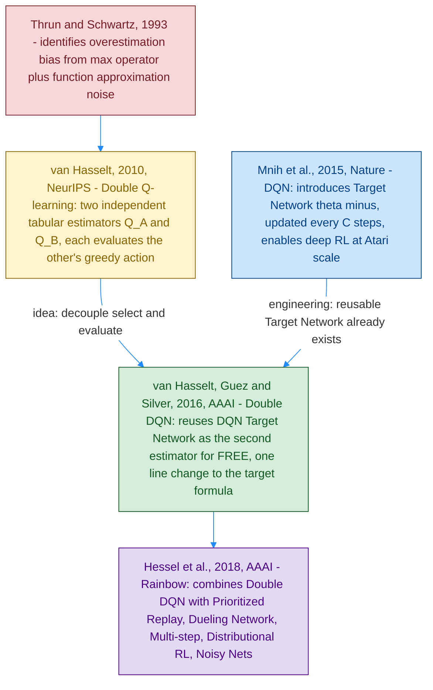
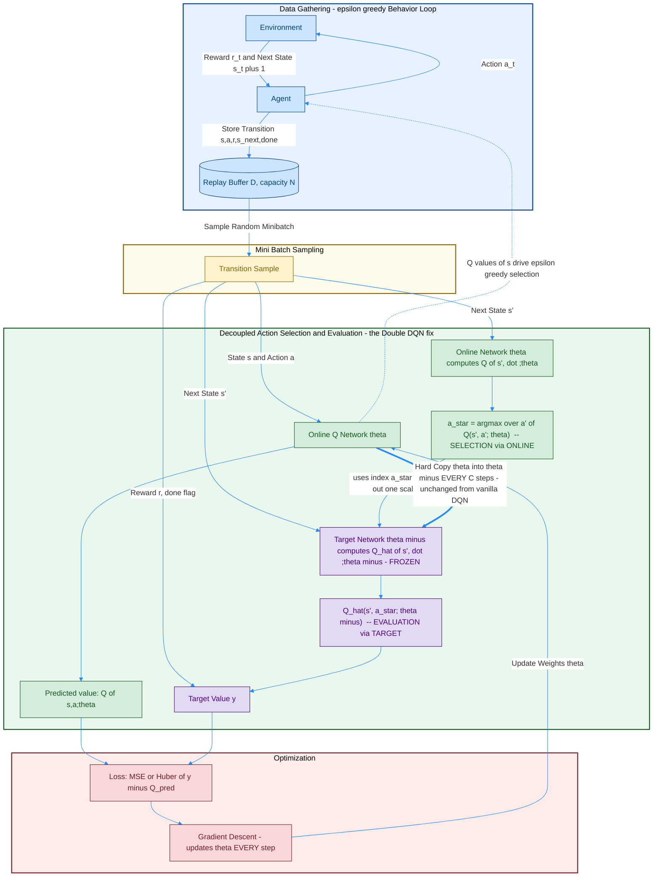
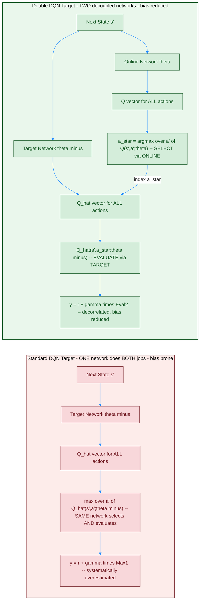
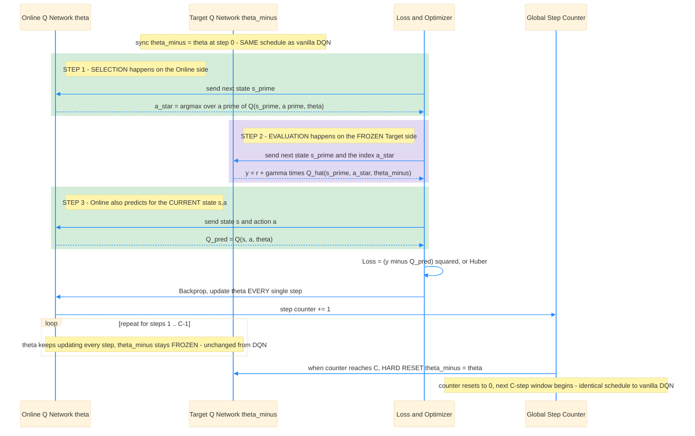

# Double DQN (DDQN) — Original Paper and Related Papers Diagrams

Double DQN ဟာ [Full DQN](</home/mr_robot/Desktop/Git/rl/Day81 RL python/02_Miguel Morales - Grokking Deep Reinforcement Learning/02_rl_with_dl/rom_photos/02_DQN.md>) ပေါ်မှာ တည်ဆောက်ထားတဲ့ **"overestimation bias"** ပြဿနာကို ဖြေရှင်းပေးတဲ့ improvement တစ်ခု ဖြစ်ပါတယ်။ ဒီ file ကို ရေးဆွဲဖို့ paper ၄ စောင်ကို ကိုးကားထားပါတယ်:

1. **Thrun & Schwartz (1993)**, *Issues in Using Function Approximation for Reinforcement Learning* — Q-learning ရဲ့ `max` operator က function approximation (neural net) ရဲ့ noise နဲ့ ပေါင်းရင် **systematic overestimation** ဖြစ်တတ်ကြောင်း ပထမဆုံး ထောက်ပြခဲ့တဲ့ paper။
2. **van Hasselt (2010)**, *Double Q-learning* (NeurIPS) — tabular setting မှာ **independent estimator ၂ ခု** (`Q^A`, `Q^B`) သုံးပြီး overestimation bias ကို လျှော့ချတဲ့ မူရင်း idea။
3. **van Hasselt, Guez & Silver (2016)**, *Deep Reinforcement Learning with Double Q-learning* (AAAI) — ဒီ file ရဲ့ **main/original paper**။ Double Q-learning idea ကို DQN အထဲ ထည့်သွင်းပြီး, network အသစ်တစ်ခု **မလိုအပ်ဘဲ** DQN မှာ ရှိပြီးသားဖြစ်တဲ့ Target Network ကိုပဲ second estimator အဖြစ် ပြန်သုံးတဲ့ idea။
4. **Hessel et al. (2018)**, *Rainbow: Combining Improvements in Deep Reinforcement Learning* (AAAI) — Double DQN ကို Prioritized Replay, Dueling Network, Multi-step Learning, Distributional RL, Noisy Nets တို့နဲ့ ပေါင်းစပ်ထားတဲ့ နောက်ဆက်တွဲ paper (context/related work)။

## ဘာပြဿနာကို ဖြေရှင်းတာလဲ — Overestimation (Maximization) Bias

Standard Q-learning / DQN ရဲ့ target `y = r + γ · maxₐ' Q̂(s', a'; θ⁻)` ထဲမှာ, `max` operator ကတစ်ခုတည်းသော network (`θ⁻`) ကိုပဲ သုံးပြီး **(1) ဘယ် action `a'` အကောင်းဆုံးလဲ ရွေးချယ်ခြင်း (selection)** နဲ့ **(2) အဲဒီ action ရဲ့ value ဘယ်လောက်လဲ အကဲဖြတ်ခြင်း (evaluation)** ကို **တစ်ပြိုင်နက် လုပ်ပါတယ်**။ Network ရဲ့ Q-value estimate တွေမှာ noise/error အမြဲပါတတ်လို့, `max` ဟာ noise အများဆုံး ဖောက်ထားတဲ့ (positively biased) action ကို ထပ်ကာထပ်ကာ ရွေးတတ်ပါတယ် — ဒါကြောင့် target `y` ဟာ true value ထက် **စနစ်တကျ ပိုမြင့်နေတတ်ပါတယ် (systematic overestimation)**။ Double DQN ရဲ့ အဓိက idea က **selection** နဲ့ **evaluation** ကို **network ၂ ခု ခွဲ**ပြီး, error တွေ decorrelate ဖြစ်အောင် လုပ်တာပါ။

## Diagram 1 — Paper Lineage (ဘယ်ကလာတာလဲ)

## Diagram 2 — Double DQN Full Algorithm Overview (Decoupled Selection and Evaluation)

> မှတ်ချက်: `Astar` node ကနေ `Target_Net` ဆီ arrow က "action **ရွေးချယ်ခြင်း** (argmax) ကို Online Network ရဲ့ output ကနေ ယူပြီး, ရွေးချယ်ထားတဲ့ အဲဒီ action **တစ်ခုတည်း**ရဲ့ value ကိုပဲ Target Network ရဲ့ output vector ထဲက ထုတ်ယူ (index) တာ" ဖြစ်ကြောင်း ပြထားပါတယ် — ဒါက Double DQN ရဲ့ **core mechanism** အတိအကျ ဖြစ်ပါတယ်။

## Diagram 3 — Side-by-Side: Standard DQN Target vs Double DQN Target (ဘယ်နေရာမှာ ကွာသွားလဲ)

### Diagram 2 vs Diagram 3 ရဲ့ ဆက်စပ်မှု

- Diagram 2 က Full DDQN algorithm ရဲ့ **closed loop** (acting + replay buffer + training + target sync) ကို ပြထားပြီး, Diagram 3 ကတော့ Diagram 2 ရဲ့ Phase 3 ထဲက **target `y` ဘယ်လိုတွက်လဲ** ဆိုတဲ့ အပိုင်းကိုပဲ **standard DQN နဲ့ side-by-side** ယှဉ်ပြထားတာပါ — ဒါက "Double DQN ဟာ DQN ကို architecture အသစ် ထပ်မထည့်ဘဲ, **target formula တစ်ကြောင်းတည်း** ပြောင်းလိုက်ရုံနဲ့ ရလာတဲ့ fix" ဆိုတာကို အထင်းသားဆုံး ပြသတဲ့ diagram ဖြစ်ပါတယ်။
- **Standard DQN** (ပန်းရောင် box) — `Target_Net` တစ်ခုတည်းကပဲ next state `s'` ကို Q-value vector အဖြစ် ထုတ်ပေးပြီး, အဲဒီ vector ပေါ်ကနေ `max` ယူလိုက်တာဟာ **select ရော evaluate ပါ** တစ်ပြိုင်နက် လုပ်လိုက်တာပါ — error ရှိနေရင် ၎င်း error ကိုယ်တိုင်က `max` ကို ဆွဲတင်တတ်တယ်။
- **Double DQN** (အစိမ်းရောင် box) — `Online` Network ကို next state `s'` အတွက် Q-vector ထုတ်ခိုင်းပြီး **`argmax` ရယူ (select)**၊ ဒါပေမယ့် အဲဒီ `a_star` ရဲ့ **value ကိုတော့** `Target_Net` ရဲ့ (ကွဲပြားတဲ့ weight `θ⁻` နဲ့ ထုတ်ထားတဲ့) vector ထဲကနေ **ပြန်ထုတ်ယူ (evaluate)** တာပါ — network ၂ ခုရဲ့ noise က ကွဲနေလို့ (decorrelated) ဖြစ်လို့, overestimation bias က သိသိသာသာ လျော့ကျသွားပါတယ်။

## Full DQN vs Double DQN — ကွာခြားချက် အနှစ်ချုပ်

| | Full DQN (Mnih et al., 2015) | Double DQN (van Hasselt et al., 2016) |
|---|---|---|
| Network count | Online θ + Target θ⁻ (၂ ခု) | Online θ + Target θ⁻ (**အတူတူပဲ, ၂ ခု** — extra network **မလိုအပ်**) |
| Target formula | `y = r + γ · maxₐ' Q̂(s',a';θ⁻)` | `y = r + γ · Q̂(s', argmaxₐ' Q(s',a';θ) ; θ⁻)` |
| Action **selection** for target | Target Network (θ⁻) ကိုယ်တိုင် `max` ယူ | **Online Network (θ)** က `argmax` ယူ |
| Action **evaluation** for target | Target Network (θ⁻) တစ်ခုတည်းက value ထုတ် | **Target Network (θ⁻)** ကပဲ value ထုတ် (ဒါပေမယ့် action ကို Online ကရွေးထားပြီးသား) |
| Target sync timing | Hard copy `θ⁻ ← θ` every `C` steps | **အတူတူပဲ** — Hard copy every `C` steps (ပြောင်းလဲမှု မရှိ) |
| Replay buffer | Fixed-capacity circular buffer | **အတူတူပဲ** — ပြောင်းလဲမှု မရှိ |
| Behavior policy (acting) | ε-greedy on Online Network | **အတူတူပဲ** — ε-greedy on Online Network |
| Overestimation bias | ရှိတယ် (systematic, positive) | **သိသိသာသာ လျော့ကျ** (Atari 49-game benchmark မှာ value estimate ပိုတိကျပြီး, score ပိုကောင်း) |
| Implementation cost | — | **~0** extra — target formula ၁ ကြောင်းပဲ ပြောင်းရတယ်, hyperparameter/architecture အားလုံး မပြောင်းရ |

> Engineering note: Grokking Deep RL စာအုပ် Chapter 9 ထဲမှာ hyperparameter table ([04_hyper_params_for_dqn_ddqn.png](</home/mr_robot/Desktop/Git/rl/Day81 RL python/02_Miguel Morales - Grokking Deep Reinforcement Learning/02_rl_with_dl/rom_photos/04_hyper_params_for_dqn_ddqn.png>)) ထဲမှာ Target Update ကို **Hard Update** (`C` steps, 100–10,000 steps) အပြင် **Soft Update** (`θ⁻ ← τθ + (1−τ)θ⁻`, `τ` = 0.001–0.01) ဆိုတဲ့ **optional alternative** လည်း ဖော်ပြထားပါတယ်။ ဒါပေမယ့် **original Double DQN paper (2016)** ကိုယ်တိုင်ကတော့ vanilla DQN ရဲ့ **hard update schedule အတိုင်းပဲ** ဆက်သုံးထားပါတယ် — soft update ဟာ paper ရဲ့ contribution မဟုတ်ဘဲ, နောက်ပိုင်း implementation (ဥပမာ DDPG-style continuous control) တွေက ငှားသုံးလာတဲ့ engineering variant တစ်ခုသာ ဖြစ်ပါတယ်။

## Q&A — Double DQN အတွက် ဖြေကြားချက်အသစ်များ

### မေး ၁။ Network နှစ်ခုလား? တစ်ခုထဲလား?

**Double DQN မှာလည်း weight set ၂ ခုပဲ ရှိပါတယ် — Full DQN ထက် network ထပ်တိုးစရာ မလိုအပ်ပါဘူး။** ဒါက Double DQN ရဲ့ **အထူးသတိထားရမယ့် အချက်** တစ်ခုပါ:

- **tabular Double Q-learning (van Hasselt, 2010)** မူရင်းကတော့ `Q^A`, `Q^B` ဆိုပြီး **လုံးဝ သီးခြား (independent)** value function ၂ ခု လိုအပ်ပါတယ် — step တိုင်း ၅၀/၅၀ coin-flip နဲ့ တစ်ခုကို ရွေးပြီး update လုပ်ပြီး၊ ကျန်တစ်ခုကို evaluator အဖြစ် သုံးတယ်။
- **Double DQN (van Hasselt et al., 2016)** ရဲ့ brilliant insight က — **DQN မှာ ရှိပြီးသား Target Network (θ⁻) ကိုပဲ second estimator အဖြစ် "ပြန်သုံး" (reuse)** လိုက်တာပါ။ θ⁻ ဟာ θ ရဲ့ **C steps ကြာအောင် ရှေ့က snapshot** ဖြစ်နေလို့, θ နဲ့ θ⁻ ရဲ့ Q-value estimate error တွေက **လုံလောက်အောင် ကွဲနေပါပြီ (decorrelated enough)** — ဒါကြောင့် independent estimator အသစ် မလိုအပ်ဘဲ, **"network ၂ ခု ရှိနေပြီးသား" ဆိုတဲ့ structure ကိုပဲ ထပ်အသုံးချ**လိုက်တာပါ။
- အတိုချုပ်: **Architecture တူတဲ့ clone copy ၂ ခု** ဆိုတဲ့ idea ကတော့ DQN/NFQ အတိုင်းပါပဲ၊ ဒါပေမယ့် Double DQN မှာ ၎င်း ၂ ခုရဲ့ **role ကို ပိုရှင်းလင်းစွာ ပိုင်းခြားသုံးထားတယ်**: Online (θ) = "**ဘယ် action**" (selection), Target (θ⁻) = "**ဘယ်လောက် value**" (evaluation)။

### မေး ၂။ Target ကို weight freeze လုပ်ပြီး, loop တစ်ခါပြီးမှ current အသစ်ယူကာ loss တွက်တာလား?

**မှန်ပါတယ်, timing mechanism ကတော့ Full DQN နဲ့ အတူတူပါပဲ (hard copy, `C` steps) — Double DQN က ပြောင်းထားတာက "target `y` ကို ဘယ် network ၂ ခုနဲ့ ဘယ်လို တွက်လဲ" ဆိုတဲ့ **formula** ချည်းသာ ဖြစ်ပါတယ်။**

- **Freeze timing** — Full DQN အတိုင်းပဲ, `θ⁻` ကို `C` steps အတွင်းလုံး freeze ထားတယ်, `C` ပြည့်မှ hard copy `θ⁻ ← θ` ပြန်လုပ်တယ်။ ဒါက **ပြောင်းမထားပါ**။
- **ပြောင်းထားတာက** — Target `y` ကို တွက်တဲ့အခါ, **STEP 1** မှာ Online Network ကို next state `s'` ပေးပြီး `argmax` (action `a_star`) ကို ရှာခိုင်းတယ်၊ **STEP 2** မှာမှ အဲဒီ `a_star` ကို Target Network ဆီ ပို့ပြီး, Target Network ရဲ့ (frozen) output vector ထဲက `a_star` index ရှိတဲ့ scalar value ကိုပဲ ထုတ်ယူတယ် — ဒါဟာ `maxₐ' Q̂(s',a';θ⁻)` လို Target Network တစ်ခုတည်းနဲ့ `max` ယူတာ **မဟုတ်တော့ပါ**။
- ဒီ "select-then-evaluate on a different frozen copy" mechanism ကပဲ, overestimation bias ကို လျှော့ချပေးနိုင်တဲ့ core idea ဖြစ်ပြီး, **training stability** (freeze/sync schedule ကြောင့်) ကိုလည်း Full DQN အတိုင်း ဆက်ရရှိနေတာပါ — fix ၂ ခု (stability fix + bias fix) က **တစ်ခုနဲ့တစ်ခု မငြင်းခုံဘဲ** အတူတကွ အလုပ်လုပ်ကြတာ ဖြစ်ပါတယ်။

### မေး ၃။ Network output က ဘာကို ထုတ်ပေးတာလဲ — evaluate လုပ်တာလား, action ရွေးချယ်တာလား?

**Double DQN မှာတော့ ဒီ "evaluation vs selection" ခွဲခြားမှုကို architecture ထဲမှာပါ စကားလုံးအတိအကျ (literal mechanism) အဖြစ် ထည့်သွင်းထားပါတယ် — Full DQN မှာ conceptual ဖြစ်ခဲ့ရင်, Double DQN မှာ mechanical ဖြစ်သွားတယ်။**

- **Online Network output** (`Q(s', ·; θ)` vector) ကို **"selection" အတွက်ပဲ** သုံးတယ် — `argmax` ယူပြီး action index `a_star` ကို ရှာထုတ်ဖို့ပဲ သုံးတယ်, ဒီ network ရဲ့ **value magnitude ကို target y မှာ တိုက်ရိုက် မသုံးပါဘူး**။
- **Target Network output** (`Q̂(s', ·; θ⁻)` vector) ကို **"evaluation" အတွက်ပဲ** သုံးတယ် — ဒီ vector ထဲက **Online Network ရွေးထားတဲ့ `a_star` index တစ်ခုတည်းရဲ့ scalar value ကိုပဲ** ထုတ်ယူတယ်; ဒီ network ကိုယ်တိုင် `argmax` ဘယ်တော့မှ မလုပ်ပါဘူး။
- ဒါကြောင့် Double DQN က "Q-network output = evaluation (value estimate)" ဆိုတဲ့ NFQ/DQN က အခြေခံမူကို **မပြောင်းလဲပါဘူး** — ဆက်လက် မှန်ကန်ပါတယ်။ ဒါပေမယ့် **ထပ်ဆင့် သင်ခန်းစာ** ကတော့: "evaluation" ကိုယ်တိုင်ကိုလည်း **network တစ်ခုတည်းအပေါ် လုံးဝ အားမကိုးသင့်ပါဘူး** — selection (ဘယ် action) နဲ့ evaluation (ဘယ်လောက်တန်ဖိုး) ကို **source နှစ်ခု ခွဲ**ရင်, ပိုတိကျတဲ့ (less biased) value estimate ရနိုင်တယ် ဆိုတာကို သက်သေပြထားပါတယ်။
- Agent ရဲ့ **actual behavior action** (environment ထဲ execute လုပ်မယ့် action) ကိုတော့ — Full DQN အတိုင်းပဲ, **Online Network** ရဲ့ current-state `Q(s, ·; θ)` output ပေါ်မှာ ε-greedy policy ကို ဆက်သုံးတာပါ (Target Network ကို acting အချိန်မှာ လုံးဝ မသုံးပါဘူး, target `y` တွက်ချိန်မှာပဲ သုံးတယ်)။
