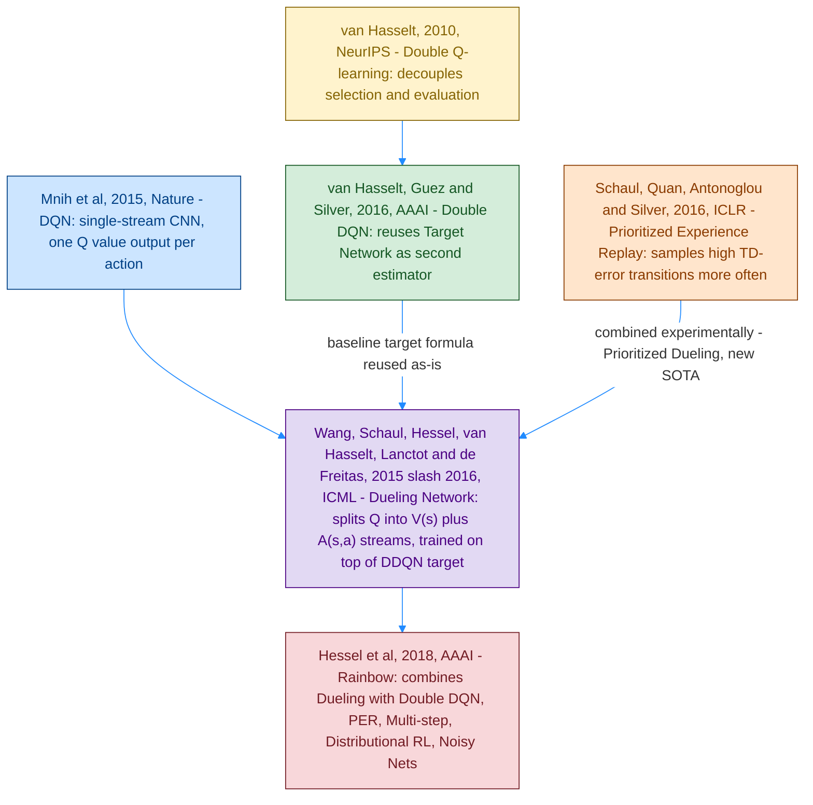
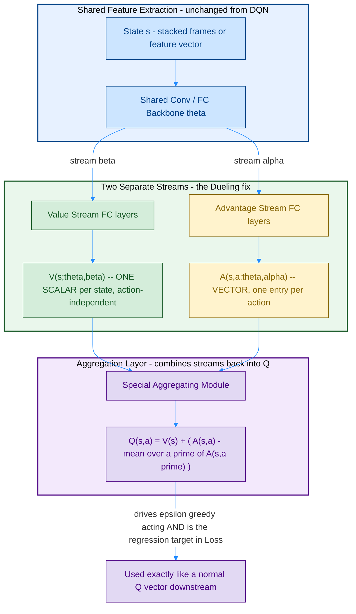
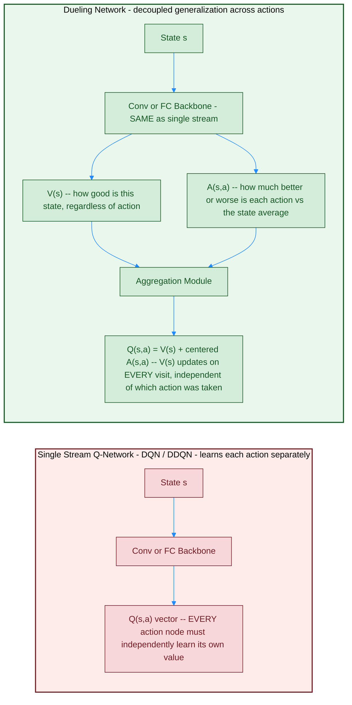
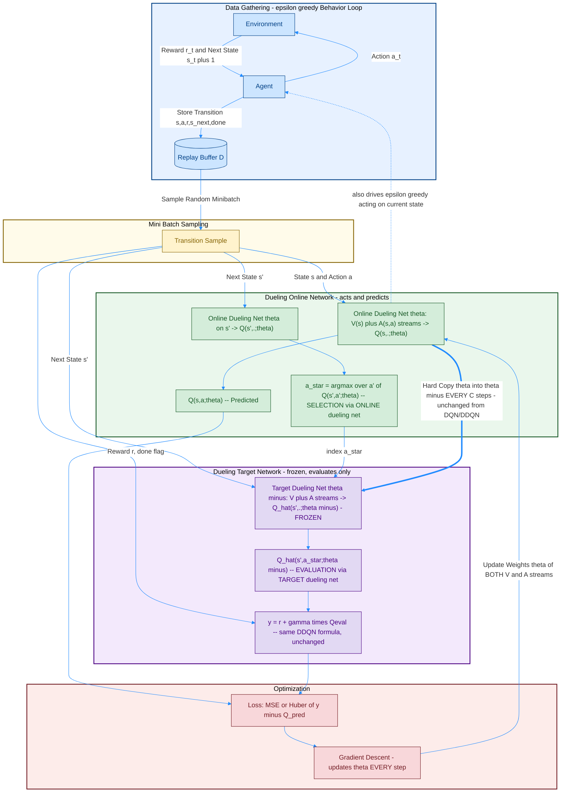
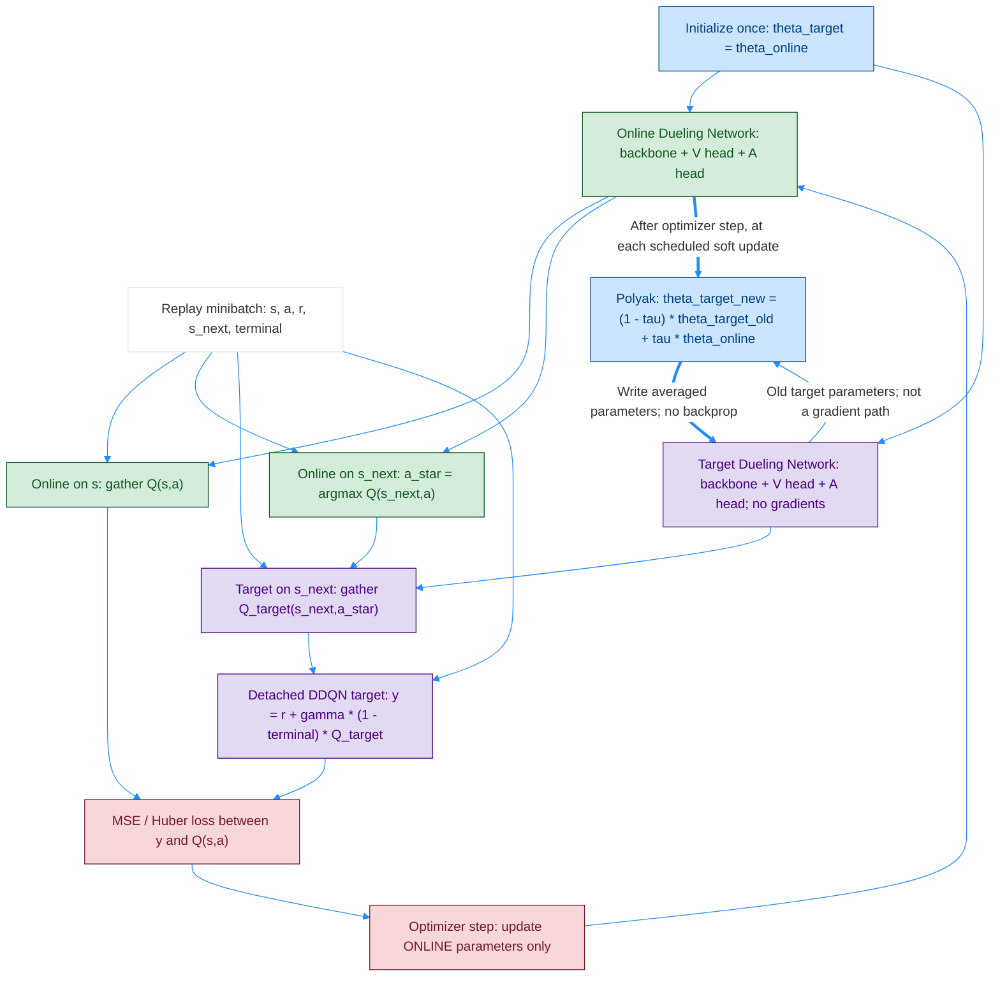

# Dueling DDQN (Dueling Network Architecture + Double DQN) — Original Paper and Related Papers Diagrams

Dueling DDQN ဟာ [Double DQN](</home/mr_robot/Desktop/Git/rl/Day81 RL python/02_Miguel Morales - Grokking Deep Reinforcement Learning/02_rl_with_dl/rom_photos/03_1_DOUBLE_DQN.md>) ရဲ့ **target formula** ကို မပြောင်းလဲဘဲ, [Full DQN](</home/mr_robot/Desktop/Git/rl/Day81 RL python/02_Miguel Morales - Grokking Deep Reinforcement Learning/02_rl_with_dl/rom_photos/02_1_DQN.md>) ရဲ့ **network architecture** ကိုသာ ပြောင်းလဲထားတဲ့ improvement တစ်ခု ဖြစ်ပါတယ် — selection/evaluation decoupling (DDQN) နဲ့ value/advantage decoupling (Dueling) ဟာ **independent ဖြစ်ပြီး အတူတကွ ပေါင်းသုံးနိုင်တဲ့** fix ၂ ခု ဖြစ်ပါတယ်။ ဒီ file ကို ရေးဆွဲဖို့ paper ၅ စောင်ကို ကိုးကားထားပါတယ်:

1. **Wang, Schaul, Hessel, van Hasselt, Lanctot & de Freitas (2015/2016)**, *Dueling Network Architectures for Deep Reinforcement Learning* (arXiv:1511.06581, first posted **November 2015**; ICML 2016 — Best Paper Award) — ဒီ file ရဲ့ **main/original paper**။ Single-stream Q-network ကို **Value stream `V(s)`** နဲ့ **Advantage stream `A(s,a)`** ဆိုပြီး streams ၂ ခု ခွဲထားတဲ့ architecture အသစ်။
2. **van Hasselt, Guez & Silver (2016)**, *Deep Reinforcement Learning with Double Q-learning* (AAAI) — Dueling paper ကိုယ်တိုင်က baseline algorithm အဖြစ် **Double DQN ရဲ့ target formula ကို တိုက်ရိုက် သုံးထား**ပါတယ် (paper ထဲက Section 4.2: *"we use the improved Double DQN (DDQN) learning algorithm"*)။
3. **Mnih et al. (2015)**, *Human-level control through deep reinforcement learning* (Nature) — original single-stream CNN Q-network, Dueling architecture က replace လုပ်ချင်တဲ့ baseline။
4. **Schaul, Quan, Antonoglou & Silver (2016)**, *Prioritized Experience Replay* (ICLR) — Dueling paper ထဲက **"Prioritized Dueling"** variant (Dueling + PER + DDQN ပေါင်းစပ်ထားတဲ့) ဟာ paper ရေးချိန်က Atari 57-game benchmark မှာ **state-of-the-art** ဖြစ်ခဲ့ပါတယ်။
5. **Hessel et al. (2018)**, *Rainbow: Combining Improvements in Deep Reinforcement Learning* (AAAI) — Dueling ကို Double DQN, Prioritized Replay, Multi-step Learning, Distributional RL, Noisy Nets တို့နဲ့ ပေါင်းစပ်ထားတဲ့ နောက်ဆက်တွဲ paper (context/related work)။

## ဘာပြဿနာကို ဖြေရှင်းတာလဲ — Action တစ်ခုချင်းစီကို မလိုအပ်ဘဲ အသေးစိတ် တန်ဖိုးဖြတ်နေခြင်း

Full DQN / Double DQN ရဲ့ single-stream network ဟာ `Q(s,a)` ကို action တစ်ခုချင်းစီအတွက် **သီးခြားစီ** estimate လုပ်ပါတယ်။ ဒါပေမယ့် states အများစုမှာ — **ဘယ် action ယူလုပ်မယ်ဆိုတာ သိပ်အရေးမကြီးတဲ့ အချိန်**တွေလည်း ရှိပါတယ် (ဥပမာ Dueling paper ရဲ့ Enduro game saliency-map ဥပမာ — ရှေ့မှာ ကားမရှိတဲ့ အချိန်မှာ steer/accelerate ဘာလုပ်လုပ် ရလဒ် သိပ်မကွာ)။ ဒီလို states တွေမှာ, network ဟာ "ဒီ state ကောင်းသလား/ဆိုးသလား" (state value) ကို သိရုံနဲ့ လုံလောက်ပြီး, "action တစ်ခုချင်းစီရဲ့ တိကျတဲ့ effect" ကို အသေးစိတ် သင်စရာ မလိုပါဘူး။ Single-stream architecture ကတော့ action အားလုံးအတွက် Q-value ကို **သီးခြားသီးခြား** output node ကနေ regress လုပ်နေရလို့, state value ဆိုင်ရာ learning signal ကို action node တွေအကြား **ထပ်ထပ်ပြီး အလဟဿ ပြန်သင်** နေရပါတယ် (generalize မလုပ်နိုင်ဘူး)။ Dueling architecture ရဲ့ idea က `Q(s,a) = V(s) + A(s,a)` ဆိုပြီး **state value `V(s)`** (scalar, action နဲ့ မဆိုင်) နဲ့ **advantage `A(s,a)`** (action တစ်ခုချင်းစီက state-value ထက် ဘယ်လောက် ပိုကောင်း/ညံ့လဲ) ကို **network architecture ထဲမှာပဲ** သီးခြား stream ၂ ခု ခွဲခိုင်းလိုက်ခြင်းဖြင့် — update တစ်ခါပြုလုပ်တိုင်း `V(s)` stream ဟာ action ရွေးချယ်ထားတာနဲ့ မဆိုင်ဘဲ update ဖြစ်နိုင်သွားပြီး, **actions အများကြားမှာ ပိုမိုကောင်းမွန်စွာ generalize** လုပ်နိုင်ပါတယ် (especially action count များလာလေလေ, action value တွေ ကပ်နေလေလေ အကျိုးရှိလေလေ ဖြစ်ပါတယ်)။

## Diagram 1 — Paper Lineage (ဘယ်ကလာတာလဲ)



## Diagram 2 — Dueling Network Architecture (Single Stream vs Two Streams)



> မှတ်ချက်: ဒီ diagram ကို ရေးဆွဲဖို့ book ထဲက hand-annotated diagrams ၂ ခုကို reference ထားပါတယ် — [04_3_dueling-architecture.png](</home/mr_robot/Desktop/Git/rl/Day81 RL python/02_Miguel Morales - Grokking Deep Reinforcement Learning/02_rl_with_dl/rom_photos/04_3_dueling-architecture.png>) (Dueling paper ရဲ့ original Figure 1 — single-stream vs dueling CNN diagram) နဲ့ [04_2_dueling.png](</home/mr_robot/Desktop/Git/rl/Day81 RL python/02_Miguel Morales - Grokking Deep Reinforcement Learning/02_rl_with_dl/rom_photos/04_2_dueling.png>) (`V(s)` node, `A(s,a)` nodes, နဲ့ stream merging node ကို label တပ်ထားတဲ့ CartPole-scale FC version)။

## Diagram 3 — Side-by-Side: Single-Stream DQN vs Dueling Network (ဘယ်နေရာမှာ ကွာသွားလဲ)



- **Single Stream** (ပန်းရောင် box) — action တစ်ခုချင်းစီက output node တစ်ခုစီကို **သီးခြား** regress လုပ်ရတယ်; state `s` ကောင်းတယ်ဆိုတဲ့ signal ကို action အားလုံး ကိုယ်စီ ပြန်သင်ရတယ်။
- **Dueling** (အစိမ်းရောင် box) — `V(s)` ကို action ဘယ်ဟာ ရွေးထားမိစေ **update တိုင်း** gradient ရတယ် (action ၁ ခုတည်းရွေးထားမိရင်တောင် `V(s)` stream ပါ update ဖြစ်သွားတယ်), `A(s,a)` ကတော့ action တစ်ခုချင်းစီက state average ထက် ဘယ်လောက်ကွာလဲဆိုတာပဲ learn လုပ်တယ် — ဒီ "shared `V(s)` signal" ကပဲ **sample efficiency** နဲ့ **generalization across actions** ကို တိုးစေတာ ဖြစ်ပါတယ်။

## Identifiability Problem နှင့် Aggregation Equation (Eq. 7 → 8 → 9)

Dueling paper ရဲ့ core engineering challenge က "streams ၂ ခု ကနေ `Q(s,a)` ကို ပြန်ပေါင်းတဲ့ aggregation module ကို ဘယ်လို design လုပ်မလဲ" ဆိုတာပါ။

**Equation (7) — Naive sum (မသုံးသင့်):**

```
Q(s,a; θ,α,β) = V(s; θ,β) + A(s,a; θ,α)
```

ဒီ equation ဟာ **unidentifiable** ပါတယ် — `V(s)` ထဲကို constant တစ်ခု ပေါင်းပြီး, `A(s,a)` ထဲကနေ အဲဒီ constant အတူတူကို နုတ်ချလိုက်ရင်, `Q(s,a)` ရလဒ် **အတူတူပဲ** ထွက်ပါတယ်။ ဒီတော့ network က `V(s)` နဲ့ `A(s,a)` ကို unique ဖြစ်အောင် ခွဲမသင်နိုင်ဘဲ, **arbitrary split** တစ်ခုကိုပဲ random ရွေးနေတတ်ပြီး — practice မှာ performance ညံ့ပါတယ်။

**Equation (8) — Subtract max:**

```
Q(s,a; θ,α,β) = V(s; θ,β) + ( A(s,a; θ,α) − max over a' of A(s,a'; θ,α) )
```

ဒီ version မှာ, greedy action `a* = argmax A(s,a)` အတွက် `A(s,a*) = 0` ဖြစ်အောင် force လုပ်ထားတယ် — ဒီတော့ `Q(s,a*) = V(s)` ဖြစ်သွားပြီး `V(s)` ရဲ့ semantics (state value = value at the greedy action) ကို ပြန်ရောက်စေတယ်။ ဒါပေမယ့် `max` operator ကြောင့် greedy action ပြောင်းတိုင်း `A` stream တစ်ခုလုံး ပြန်ချိန်ရတယ်.

**Equation (9) — Subtract mean (paper ရဲ့ final choice, experiment အားလုံးမှာ သုံးထားတာ):**

```
Q(s,a; θ,α,β) = V(s; θ,β) + ( A(s,a; θ,α) − (1/|A|) · Σ over a' of A(s,a'; θ,α) )
```

Mean ကို နုတ်တာက `V(s)` ရဲ့ exact semantics ကို အနည်းငယ် ဆုံးရှုံးစေပေမယ့် (constant တစ်ခုနဲ့ off-target ဖြစ်), optimization **ပိုတည်ငြိမ်**စေတယ် — `A` stream တွေဟာ **mean ပြောင်းသလောက်ပဲ** ချိန်ဖို့ လိုတော့တယ် (Eq. 8 လိုမျိုး greedy action ပြောင်းတိုင်း တုန့်ပြန်စရာ မလိုတော့ဘူး)။ Mean ကို နုတ်တာဟာ `A` (ဒါကြောင့် `Q`) values တွေရဲ့ **relative rank ကို လုံးဝ မပြောင်းပါဘူး** — ဒါကြောင့် `argmax`/ε-greedy policy အတွက် ရလဒ် အတူတူပဲ ရပါတယ်။ Paper ရေးသားသူများက softmax-weighted version လည်း စမ်းခဲ့ပေမယ့်, ရလဒ် ဒီ Eq. 9 **mean-subtraction** version နဲ့ ဆင်တူလို့, experiment အားလုံးမှာ **Eq. 9 ကိုပဲ** သုံးခဲ့ပါတယ်။

## Diagram 4 — Full Dueling DDQN Pipeline (Architecture + Target Formula ပေါင်းစပ်ပုံ)



> မှတ်ချက်: ဒီ diagram ဟာ [03_1_DOUBLE_DQN.md](</home/mr_robot/Desktop/Git/rl/Day81 RL python/02_Miguel Morales - Grokking Deep Reinforcement Learning/02_rl_with_dl/rom_photos/03_1_DOUBLE_DQN.md>) ရဲ့ **Diagram 2 (Decoupled Selection and Evaluation)** အတိုင်းတည်း ဖြစ်ပါတယ် — ကွာတာက `Online`/`Target` node တစ်ခုစီဟာ ယခင်က single Q-vector output network အစား, Diagram 2/3 ထဲက **`V(s) + A(s,a)` dueling aggregation module ပါတဲ့ network** ဖြစ်သွားတာပါ။ `Loss` ကနေ backprop ဖြစ်တော့, gradient ဟာ `V` stream နဲ့ `A` stream **နှစ်ခုစလုံးကို တစ်ပြိုင်နက် update** လုပ်ပါတယ် — stream နှစ်ခု သီးခြား loss function မရှိပါဘူး, shared single scalar loss ကနေပဲ backprop ဖြစ်ပါတယ်။

## Diagram 5 — Polyak Averaging ဖြင့် Target Update (Optional Soft-update Alternative)

Diagram 4 ရဲ့ **Online → Target bold blue arrow** က target parameters ကူးပေးတဲ့ လမ်းကြောင်းပါ။ အဲဒီနေရာမှာ hard copy အစား **soft update / Polyak averaging** ကို ရွေးသုံးနိုင်ပါတယ်။ အောက်က diagram ဟာ အဲဒီ alternative ကို သီးခြားပြထားတာဖြစ်ပြီး **original Dueling paper ရဲ့ hard-update setting ကို အစားထိုးဖော်ပြထားတာ မဟုတ်ပါဘူး**။



### Hard Copy နဲ့ Polyak Averaging ဘာကွာသလဲ?

| | Hard update — Diagram 4 / original paper | Soft update / Polyak — Diagram 5 / optional alternative |
|---|---|---|
| Formula | `θ⁻ ← θ` | `θ⁻ ← (1 − τ)θ⁻ + τθ` |
| Timing | သတ်မှတ်ထားတဲ့ `C` steps တိုင်း copy | သတ်မှတ်ထားတဲ့ soft-update event တိုင်း average; ဥပမာ learner optimizer step တိုင်း |
| Update ကြားက Target | Parameters မပြောင်းဘဲ ထားတယ် | Soft-update event ရောက်မှ နည်းနည်းစီ ပြောင်းတယ် |
| Target ဆီ gradient စီးသလား? | မစီးပါဘူး | မစီးပါဘူး; averaging operation သာ လုပ်တယ် |
| Dueling / DDQN logic | မပြောင်းပါဘူး | မပြောင်းပါဘူး; target-update rule ပဲ ပြောင်းတယ် |

ဒီစာမှာ **`τ` ဟာ Online အသစ်ရဲ့ contribution** ဖြစ်ပါတယ်။ ဥပမာ `τ = 0.005` ဆိုရင် update တစ်ခါတိုင်း:

```text
Target_new = 0.995 × Target_old + 0.005 × Online_current
```

- Target အဟောင်း **99.5%**၊ optimizer update ပြီးတဲ့ Online လက်ရှိ **0.5%** ကို ရောယူတာပါ။ `0.005` ဟာ engineering example သာဖြစ်ပြီး original Dueling paper ရဲ့ hyperparameter မဟုတ်ပါဘူး။
- Online / Target ကို အစမှာ တူညီအောင် copy လုပ်ပါ။ နောက်မှာ **Online optimizer step → scheduled Polyak update** ဆိုတဲ့ အစီအစဉ်ကို သုံးနိုင်ပါတယ်။
- Averaging ကို **shared backbone၊ Value head၊ Advantage head အားလုံးရဲ့ corresponding parameters** ပေါ်မှာ လုပ်ပါတယ်။ Q-value outputs တွေကို ရောယူတာ မဟုတ်ပါဘူး။
- **“Target frozen” ဆိုတာ gradient နဲ့ မသင်တာ** ကို ဆိုလိုပါတယ်။ Polyak averaging နဲ့ parameters ပြောင်းနိုင်ခြင်းနဲ့ မဆန့်ကျင်ပါဘူး။
- `τ = 1` ဆိုရင် အဲဒီ update event မှာ full copy ဖြစ်တယ်။ ဒါပေမယ့် **every-step full copy** နဲ့ **every-C-steps hard copy** က schedule မတူလို့ အတူတူမဟုတ်ပါဘူး။ `τ = 0` ဆိုရင် Target မရွေ့တော့ပါဘူး။
- အခြားစာတွေမှာ `θ⁻ ← ρ·θ⁻ + (1−ρ)·θ` လို့ ရေးတတ်ပါတယ်။ အဲဒီ convention မှာ **`ρ = 1−τ`** ဖြစ်လို့ coefficient အကြီး/အသေးကို မရောပါနဲ့။

**ရွေးချယ်ရာမှာ:** ပုံမှန်အားဖြင့် hard update **သို့မဟုတ်** soft update တစ်မျိုးကို ရွေးပြီး schedule unit ကို learner updates လား၊ environment steps လား ရှင်းရှင်းသတ်မှတ်ပါ။ Polyak averaging က Target ကို ပိုဖြည်းဖြည်းရွေ့စေပေမယ့် hard update ထက် အမြဲပိုကောင်းမယ်လို့ မဆိုလိုပါဘူး။ PER ပါရင်လည်း ဒီ target-update လမ်းကြောင်းမှာပဲ သုံးနိုင်ပြီး replay sampling / IS weighting တို့ကို သီးခြားထိန်းထားပါတယ်။

## Full DQN vs Double DQN vs Dueling DDQN — ကွာခြားချက် အနှစ်ချုပ်

| | Full DQN (Mnih et al., 2015) | Double DQN (van Hasselt et al., 2016) | Dueling DDQN (Wang et al., 2016) |
|---|---|---|---|
| Network output | Single stream → `Q(s,a)` vector | Single stream → `Q(s,a)` vector (architecture မပြောင်း) | **Two streams** `V(s)` (scalar) + `A(s,a)` (vector) → aggregation layer → `Q(s,a)` vector |
| Target formula | `y = r + γ·maxₐ' Q̂(s',a';θ⁻)` | `y = r + γ·Q̂(s', argmaxₐ' Q(s',a';θ) ; θ⁻)` | **Double DQN formula အတိုင်းတည်း** — `argmax` select via Online dueling net, evaluate via Target dueling net |
| Selection vs Evaluation bias fix | မပါ (overestimation ရှိ) | **ရှိတယ်** — selection/evaluation decouple | **ရှိတယ်** — Double DQN ကနေ inherit (architecture က independent fix) |
| Action generalization fix | မပါ | မပါ | **ရှိတယ်** — `V(s)` shared signal ကြောင့် actions အကြား generalize ပိုကောင်း |
| Identifiability concern | မရှိ (output node တစ်ခုချင်းစီ ကိုယ်ပိုင်) | မရှိ | **ရှိတယ်** — Eq. 7 unidentifiable, Eq. 9 (mean subtraction) နဲ့ ဖြေရှင်း |
| Extra network count | Online θ + Target θ⁻ (၂ ခု) | **အတူတူပဲ** (၂ ခု) | **အတူတူပဲ** (၂ ခု) — stream အသစ်ထည့်ခြင်းက network အသစ် ထပ်မထည့်ပါ, head တစ်ခု ထပ်ခွဲထားရုံပါ |
| Target sync timing | Hard copy `θ⁻ ← θ` every `C` steps | **အတူတူပဲ** | **အတူတူပဲ** — timing mechanism လုံးဝ မပြောင်းပါ |
| Combinable with PER? | Yes (independent idea) | Yes | **Yes — paper ကိုယ်တိုင်က "Prioritized Dueling" ပေါင်းစပ်ပြီး testing လုပ်ထား, SOTA ရခဲ့** |
| Best use case | Baseline | Overestimation ပြဿနာ ရှိတဲ့ environment | **Action count များ/similar-valued actions များတဲ့** environment (ဥပမာ Atari Enduro, Breakout) |

> Engineering note: hyperparameter table ([03_3_hyper_params_for_dqn_ddqn.png](</home/mr_robot/Desktop/Git/rl/Day81 RL python/02_Miguel Morales - Grokking Deep Reinforcement Learning/02_rl_with_dl/rom_photos/03_3_hyper_params_for_dqn_ddqn.png>)) မှာ ဖော်ပြထားတဲ့ **Hard Update** vs **Soft Update** schedule ၂ ခုစလုံးကို Dueling architecture နဲ့အတူ တွဲသုံးလို့ရပါတယ် — target-update mechanism (Hard/Soft) နဲ့ architecture (single-stream/dueling) ဟာ **orthogonal design choice** နှစ်ခု ဖြစ်ပါတယ်; original Dueling paper (2016) ကတော့ DDQN ရဲ့ **hard update schedule အတိုင်းပဲ** ဆက်သုံးထားပါတယ်။ [04_4_dueling.png](</home/mr_robot/Desktop/Git/rl/Day81 RL python/02_Miguel Morales - Grokking Deep Reinforcement Learning/02_rl_with_dl/rom_photos/04_4_dueling.png>) ထဲက "continuously updating target network" note ကလည်း ဒီ orthogonal relationship ကိုပဲ ထောက်ပြထားပါတယ်။

## Q&A — Dueling DDQN အတွက် ဖြေကြားချက်အသစ်များ

### မေး ၁။ Network နှစ်ခုလား? တစ်ခုထဲလား? Stream ဆိုတာ network အသစ်လား?

**Dueling DDQN မှာ weight set ၂ ခုပဲ ရှိပါတယ် (Online θ, Target θ⁻) — Double DQN ထက် network ထပ်တိုးစရာ မလိုအပ်ပါဘူး။ `V(s)`/`A(s,a)` stream ၂ ခုဆိုတာ "network အသစ်" မဟုတ်ဘဲ, **network တစ်ခုတည်းအတွင်းက head ၂ ခု** (output layer ခွဲထားတာ) ဖြစ်ပါတယ်။**

- **Shared backbone** (conv/FC layers, parameter `θ`) ကို `V` stream (`β`) နဲ့ `A` stream (`α`) **နှစ်ခုစလုံးက share** လုပ်ကြပါတယ် — feature extraction အဆင့်မှာ ကွဲမသွားသေးပါဘူး။
- **Value stream** (`β` parameters) ကနေ scalar `V(s;θ,β)` ထွက်ပြီး, **Advantage stream** (`α` parameters) ကနေ vector `A(s,a;θ,α)` ထွက်တယ် — ဒီ streams ၂ ခု **output layer အနီးမှာပဲ ကွဲသွားတာ**ပါ (ပုံအပြည့်ထဲက `θ` shared layers ကတော့ တစ်ခုတည်းပဲ)။
- **Aggregation module** က ဒီ streams ၂ ခုကို `Q(s,a) = V(s) + (A(s,a) − mean A)` ဆိုပြီး ပြန်ပေါင်း output ထုတ်တယ် — ဒီ module ဟာ learnable weight မပါဘဲ, **fixed arithmetic operation** ချည်းသာ ဖြစ်ပါတယ်။
- **Online (θ)** ကို gradient descent နဲ့ step တိုင်း update လုပ်တယ် (V stream, A stream, shared backbone — **အားလုံး တစ်ပြိုင်နက် update**)။ **Target (θ⁻)** ကတော့ Double DQN အတိုင်း **frozen weight snapshot** (clone) တစ်ခု ဖြစ်ပြီး, evaluation step အတွက်ပဲ သုံးတယ်။

### မေး ၂။ Target ကို weight freeze လုပ်ပြီး, loop တစ်ခါပြီးမှ current အသစ်ယူကာ loss တွက်တာလား?

**မှန်ပါတယ်, timing mechanism ဟာ Double DQN နဲ့ **လုံးဝ အတူတူ** ဖြစ်ပါတယ် (hard copy, `C` steps) — Dueling architecture က target sync timing ကို **လုံးဝ မထိခိုက်**စေပါဘူး။**

- Target `θ⁻` ကို `C` steps အတွင်းလုံး freeze ထားပြီး, `C` ပြည့်တာနဲ့ `θ⁻ ← θ` hard copy ပြန်လုပ်တယ် — ဒီ hard copy ထဲမှာ **V stream weight, A stream weight, shared backbone weight အားလုံး** ပါဝင်ပါတယ် (partial copy မဟုတ်ဘဲ, whole network snapshot တစ်ခုလုံး)။
- Target value `y` တွက်တဲ့အခါ, selection (`argmax`) ကို **Online dueling net** ကပဲ လုပ်ပြီး, evaluation ကို **Target dueling net** ကပဲ လုပ်တယ် — ဒါဟာ [03_1_DOUBLE_DQN.md](</home/mr_robot/Desktop/Git/rl/Day81 RL python/02_Miguel Morales - Grokking Deep Reinforcement Learning/02_rl_with_dl/rom_photos/03_1_DOUBLE_DQN.md>) ထဲက "select-then-evaluate on a different frozen copy" mechanism ကို **architecture အသစ်နဲ့ ထပ်ခါထပ်ခါ ပြန်သုံးထားတာ** ပဲ ဖြစ်ပါတယ်။
- အတိုချုပ်ပြောရရင်: **"ဘယ်အချိန် sync မလဲ"** ဆိုတဲ့ question ကို Dueling paper က **လက်ခံအတိုင်း copy ချ**သုံးထားပြီး, **"Q value ကို ဘယ်လို architecture နဲ့ represent မလဲ"** ဆိုတဲ့ question ကိုသာ ပြောင်းလဲထားတာ ဖြစ်ပါတယ် — ဒါကြောင့် Dueling ကို "drop-in replacement" (existing algorithm တွေအပေါ် architecture အသစ် ထည့်ရုံ) လို့ paper ကိုယ်တိုင် ဖော်ပြထားပါတယ်။

### မေး ၃။ Network output က ဘာကို ထုတ်ပေးတာလဲ — `V(s)` နဲ့ `A(s,a)` ကို ဘယ်လို အသုံးချတာလဲ?

**Final output (aggregation layer ကနေ ထွက်လာတဲ့ `Q(s,a)` vector) ကတော့ NFQ/DQN/DDQN အတိုင်းပဲ "evaluation" ဖြစ်ပြီး, action ကို တိုက်ရိုက် မရွေးချယ်ပေးပါဘူး — ဒါပေမယ့် internal stream ၂ ခုက semantics သီးခြားစီ ရှိပါတယ်:**

- **`V(s;θ,β)`** — "ဒီ state `s` ကနေ (optimal policy လိုက်မယ်ဆိုရင်) ဘယ်လောက် expected discounted return ရနိုင်မလဲ" ဆိုတဲ့ **action-independent** value estimate ပါ — action ဘယ်ဟာ ယူမယ်ဆိုတာကို မသိဘူး/မဆိုင်ဘူး။
- **`A(s,a;θ,α)`** — "action `a` ဟာ ဒီ state ရဲ့ **average/best action** ထက် ဘယ်လောက် ပိုကောင်း (သို့) ညံ့လဲ" ဆိုတဲ့ **relative** estimate ပါ — `argmax_a A(s,a) = 0` ဖြစ်အောင် (Eq. 8/9) force ထားလို့, Eq. 9 version အရ `A` stream ရဲ့ mean ကို `0` ဖြစ်အောင် ချိန်ထားပါတယ်။
- **Acting (action ရွေးချယ်ခြင်း)** — paper ကိုယ်တိုင် ထောက်ပြထားတဲ့ အတိုင်း, mean ကို နုတ်တာက rank ကို မပြောင်းလို့, **`A` stream တစ်ခုတည်းကိုပဲ** `argmax`/ε-greedy အတွက် သုံးလို့ရပါတယ် (`V(s)` ကို ထည့်မတွက်ဘဲ လုပ်လို့ရတယ်) — ဒါပေမယ့် practice မှာ ပြီးသား ပေါင်းထားတဲ့ `Q(s,a)` ပေါ် argmax ယူတာနဲ့ ရလဒ် **တူညီပါတယ်**။
- **Training/Loss** — Double DQN အတိုင်းပဲ, aggregated `Q(s,a;θ)` ကို target `y` နဲ့ MSE/Huber loss တွက်ပြီး backprop လုပ်တယ်; `V` stream နဲ့ `A` stream ကို **သီးခြား label/loss မပေးပါဘူး** — shared scalar loss တစ်ခုကနေပဲ gradient ခွဲဝေရောက်သွားပြီး, network ကိုယ်တိုင်က `V`/`A` split ကို (identifiability constraint အောက်မှာ) **data ကနေ အလိုအလျောက် သင်ယူ** သွားတာ ဖြစ်ပါတယ် — supervise ပြီး "ဒီနေရာမှာ V, ဒီနေရာမှာ A" ဆိုပြီး သီးခြား label ပေးစရာ မလိုပါဘူး။
