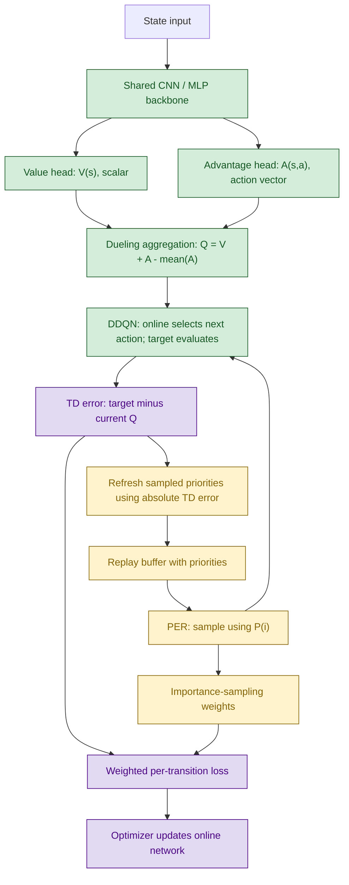
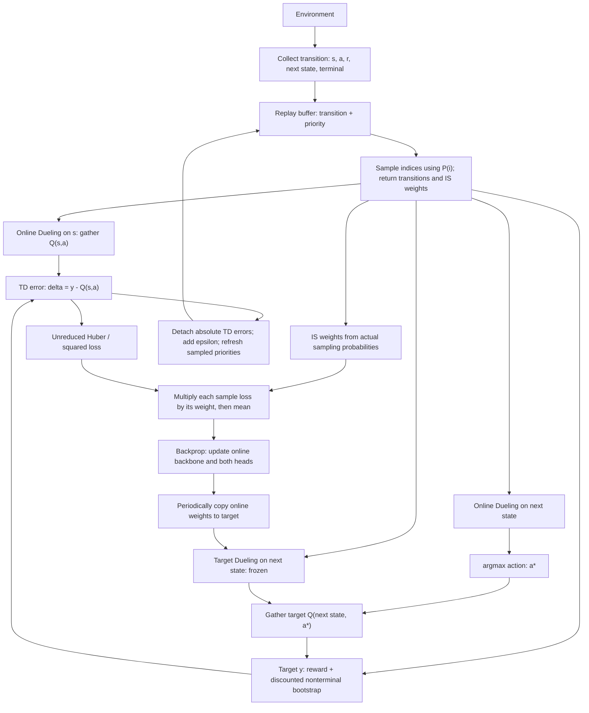
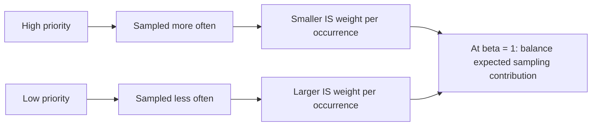
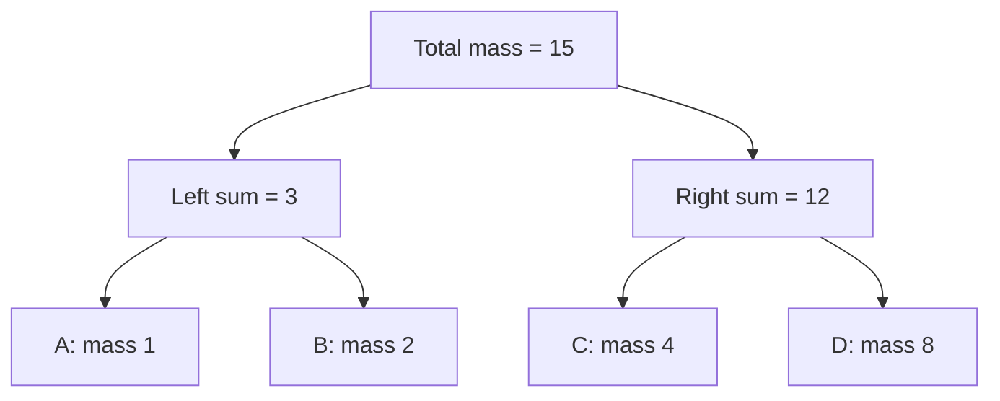
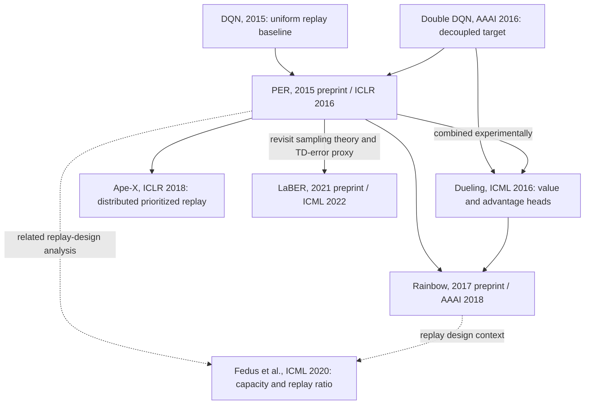

# Prioritized Experience Replay (PER) — Dueling DDQN နှင့် တွဲသုံးပုံ၊ Diagrams၊ Weights၊ Hyperparameters နှင့် Related Papers

[Dueling DDQN ရှင်းလင်းချက်](./04_1_Dueling_DDQN.md) ကို ဆက်ဖတ်တဲ့အနေနဲ့ ဒီစာမှာ **ဘယ် experience ကို ပြန်သင်မလဲ၊ ဘယ်လောက် weight ပေးပြီး သင်မလဲ** ဆိုတာကို ရှင်းပြထားပါတယ်။

> **အဓိကခွဲမှတ်ရန်:** Dueling က **network architecture**၊ Double DQN က **bootstrap target တွက်ပုံ**၊ PER က **replay sampling နှင့် update weighting** ဖြစ်ပါတယ်။ သုံးခုဟာ မတူတဲ့ပြဿနာတွေကို ဖြေရှင်းလို့ အတူတွဲသုံးနိုင်ပါတယ်။ **PER ဟာ network အသစ်၊ optimizer အသစ်၊ reward function အသစ် မဟုတ်ပါဘူး။**

## ၁။ Original Paper — Google DeepMind က ဘယ် paper လဲ?

**Tom Schaul, John Quan, Ioannis Antonoglou & David Silver — “Prioritized Experience Replay”**, Google DeepMind၊ **ICLR 2016**။ arXiv ကို **November 2015** မှာ စတင်တင်ခဲ့ပါတယ်။

- [Paper / arXiv:1511.05952](https://arxiv.org/abs/1511.05952)
- [Original PDF](https://arxiv.org/pdf/1511.05952)
- အဓိကဖတ်ရန်: **Section 3.3** stochastic prioritization၊ **Section 3.4** importance sampling၊ **Algorithm 1** Double DQN + proportional PER၊ **Appendix B.2 / Table 3** implementation နှင့် hyperparameters။

မူရင်း paper က uniform replay သုံးတဲ့ **DQN နှင့် Double DQN** တွေပေါ်မှာ PER ကို စမ်းသပ်ထားတာပါ။ **Dueling architecture ရှိမှ PER သုံးလို့ရတာ မဟုတ်ပါဘူး။** နောက်ထပ် [Dueling paper](https://proceedings.mlr.press/v48/wangf16.html) မှာ Dueling + DDQN + prioritized replay ကို တွဲစမ်းထားပါတယ်။

## ၂။ ဘာပြဿနာကို ဖြေရှင်းတာလဲ?

Replay buffer ထဲမှာ transition တစ်ခုကို အောက်ပါအတိုင်း သိမ်းပါတယ်။

```text
transition i = (state s_i, action a_i, reward r_i, next state s'_i, terminal flag d_i)
```

Uniform replay မှာ လက်ရှိ transition `N` ခုရှိရင် တစ်ခုစီရဲ့ sampling probability က `1/N` ဖြစ်ပါတယ်။ ဒါပေမယ့် transition အားလုံးဟာ **လက်ရှိ network အတွက် သင်ယူစရာပမာဏ တူတာ မဟုတ်ပါဘူး**။

- အကြိမ်ကြိမ်တွေ့ပြီး ခန့်မှန်းတတ်နေတဲ့ transition → TD error သေးနေနိုင်တယ်။
- မမျှော်လင့်ထားတဲ့ reward၊ failure၊ state change → TD error ကြီးနေနိုင်တယ်။
- ရှားပါးပေမယ့် အသုံးဝင်တဲ့ transition → uniform sampling မှာ အချိန်ကြာမှ ပြန်တွေ့နိုင်တယ်။

**PER ရဲ့ idea:** လက်ရှိခန့်မှန်းချက်နဲ့ target ကွာဟမှု `|TD error|` များတဲ့ transition တွေကို **ပိုမိုမကြာခဏ ပြန်သင်**ခိုင်းတယ်။ ဒါဟာ “အသုံးဝင်မှု” အတွက် heuristic ဖြစ်ပြီး **TD error ကြီးတိုင်း အရေးအကြီးဆုံး၊ reward ကောင်းဆုံး** လို့ မဆိုလိုပါဘူး။ Noise ကြောင့်လည်း error ကြီးနိုင်ပါတယ်။

## Diagram 1 — Dueling၊ DDQN၊ PER တို့ရဲ့ တာဝန်ခွဲခြားပုံ



| Component | ပြောင်းလဲတဲ့နေရာ | မပြောင်းလဲတဲ့နေရာ |
|---|---|---|
| Dueling | Q-network ထဲမှာ `V` / `A` heads ခွဲတယ် | Replay sampling rule ကို မသတ်မှတ်ဘူး |
| Double DQN | Online နဲ့ next action ရွေး၊ Target နဲ့ အကဲဖြတ်တယ် | Dueling architecture ဖြစ်ဖို့ မလိုဘူး |
| PER | Sample probability၊ loss weight၊ priority refresh | DDQN target formula၊ Dueling aggregation ကို မပြောင်းဘူး |

## ၃။ Dueling DDQN + PER ရဲ့ Formula များ

### ၃.၁ Online နှင့် Target — Dueling network နှစ်ခု

**Online parameters `θ`** နဲ့ **Target parameters `θ⁻`** ဆိုပြီး weight set နှစ်ခုရှိပါတယ်။ Network တစ်ခုစီအတွင်းမှာ backbone တစ်ခုနဲ့ heads နှစ်ခုပါပါတယ်။

```text
Q(s,a;θ) = V(s;θ) + A(s,a;θ) - mean_b A(s,b;θ)

Q(s,a;θ⁻) = V(s;θ⁻) + A(s,a;θ⁻) - mean_b A(s,b;θ⁻)
```

ဒီမှာ `θ` / `θ⁻` က သက်ဆိုင်ရာ backbone နဲ့ heads အားလုံးရဲ့ parameters ကို ခြုံရေးထားတာပါ။ **PER အတွက် တတိယ neural network မလိုပါဘူး။**

### ၃.၂ DDQN target နှင့် TD error

Discrete-action, one-step case အတွက်:

```text
a*_i = argmax_b Q(s'_i, b;θ)                         # Online selects
y_i  = r_i + γ × (1 - d_i) × Q(s'_i, a*_i;θ⁻)       # Target evaluates
q_i  = Q(s_i, a_i;θ)
δ_i  = y_i - q_i
```

- `d_i = 1` ဆိုတာ **အမှန်တကယ် terminal state** ဖြစ်တာကို ဆိုလိုပါတယ်။ ဒီအခါ `y_i = r_i` ပါ။
- Time-limit ကြောင့် `truncated` ဖြစ်တာကို terminal လို့ အလိုအလျောက်မယူရပါဘူး။ Task ရဲ့ semantics အရ bootstrap ဆက်လုပ်သင့်ရင် reset ပြီး state မဟုတ်တဲ့ **မှန်ကန်သော final observation** ကို သုံးရပါတယ်။
- `y_i` ကို gradient မစီးစေပါဘူး။ Online network ရဲ့ next-action selection လမ်းကြောင်းလည်း target calculation အတွက်သာ ဖြစ်ပါတယ်။

### ၃.၃ Priority → Probability → Weight: မတူတဲ့ quantity သုံးခု

**Proportional PER** အတွက်:

```text
Raw priority:       p_i = |δ_i| + ε_PER
Sampling mass:     m_i = p_i^α
Probability:       P(i) = m_i / Σ_j m_j
Raw IS weight:     w_i = (N × P(i))^(-β)
Normalized weight: w̃_i = w_i / max_j w_j
```

ဒီနေရာက `N` ဟာ **လက်ရှိ buffer ထဲက valid transitions အရေအတွက်** ဖြစ်ပြီး အမြဲတမ်း maximum capacity မဟုတ်ပါဘူး။ Denominator တွေက valid entries အားလုံးကို သုံးပါတယ်။

| Quantity | ဘာလုပ်ပေးတာလဲ? | ဘယ်လိုရသလဲ? |
|---|---|---|
| `p_i` | Transition ရဲ့ priority | နောက်ဆုံးတွက်ထားတဲ့ `|δ_i| + ε_PER` |
| `P(i)` | ဒီ transition ကို ရွေးမိနိုင်ခြေ | Buffer တစ်ခုလုံးရဲ့ priority mass နဲ့ normalize လုပ်တယ် |
| `w̃_i` | ရွေးမိပြီးနောက် loss/gradient အတွက် correction | Sampling probability၊ `N`၊ `β` ကနေတွက်တယ် |
| `θ` | Neural-network weights | Optimizer နဲ့ learn လုပ်တယ် |

**IS weight ဟာ trainable network weight မဟုတ်ပါဘူး။** `p_i`, `P(i)`, `w_i` တို့ကို gradient နဲ့ မသင်ပါဘူး။ Sampling metadata အဖြစ် သီးခြားကိုင်တွယ်ပါတယ်။

### ၃.၄ `α` နှင့် `β` — ဘာကွာသလဲ?

- **`α` = ဘယ်လောက် priority လိုက်ပြီး ရွေးမလဲ?**
  - `α = 0` → positive priorities အားလုံးရဲ့ mass က `1`၊ **uniform replay** ဖြစ်တယ်။
  - `α` တိုးလာလေ high-priority samples ကို ပိုရွေးလေဖြစ်တယ်။
  - `α = 1` → raw priority နဲ့ တိုက်ရိုက်အချိုးကျတယ်။ အများဆုံး `α` ဆိုတဲ့ သင်္ချာဆိုင်ရာကန့်သတ်ချက်တော့ မဟုတ်ပါဘူး။
- **`β` = non-uniform sampling ရဲ့ bias ကို ဘယ်လောက်ပြန်ပြင်မလဲ?**
  - `β = 0` → correction မလုပ်၊ weights အားလုံး `1`။
  - `0 < β < 1` → partial correction။
  - `β = 1` → raw IS weights နဲ့ဆို **uniform-buffer objective** ရဲ့ gradient ကို sampling bias မရှိအောင် ပြန်ခန့်မှန်းနိုင်တယ်။

Original paper က training အစမှာ partial correction သုံးပြီး နောက်ပိုင်း `β → 1` အထိ **linearly anneal** လုပ်ထားပါတယ်။

```text
β(t) = β₀ + (1 - β₀) × min(t / T_β, 1)
```

`t` နဲ့ `T_β` ကို **တူညီတဲ့ unit** သုံးပါ — နှစ်ခုစလုံး learner updates လား၊ environment steps လား ရှင်းရှင်းသတ်မှတ်ပါ။

### ၃.၅ Weighted loss — weight ကို ဘယ်နေရာမှာ ထည့်သလဲ?

Batch size `B` အတွက်:

```text
Squared loss: ℓ_i = 0.5 × δ_i²
Total loss:   L(θ) = (1/B) × Σ_i [w̃_i × ℓ_i]
```

Huber loss သုံးရင်လည်း **sample တစ်ခုချင်းစီရဲ့ Huber loss ကို အရင်တွက်၊ ပြီးမှ weight မြှောက်၊ နောက်ဆုံးမှ mean** ယူပါ။

```text
Huber_κ(δ) = 0.5 × δ²                    if |δ| ≤ κ
             κ × (|δ| - 0.5 × κ)        otherwise

L(θ) = mean_i [w̃_i × Huber_κ(δ_i)]
```

**မလုပ်သင့်တာ:** `mean[(w̃_i × δ_i)²]` ဆိုရင် weight က square ဖြစ်သွားပါတယ်။ `mean(ℓ)` ယူပြီးမှ sample weights မြှောက်တာလည်း intended weighted loss မဟုတ်ပါဘူး။

## Diagram 2 — Full Training Loop: Dueling DDQN + PER



**Update တစ်ကြိမ်ရဲ့ အစီအစဉ်:**

1. Transition အသစ်ကို buffer ထဲသိမ်းတယ်။ Original approach အရ maximum priority seen so far နဲ့ initialize လုပ်တယ်။ Empty buffer မှာ positive initial priority ဥပမာ `1` သုံးတယ်။
2. Warm-up ပြည့်ပြီး learning step ရောက်မှ `P(i)` နဲ့ batch ရွေးတယ်။
3. **Sampling လုပ်ချိန်က distribution** ကို အခြေခံပြီး IS weights တွက်တယ်။
4. Online/Target Dueling networks နဲ့ DDQN target၊ current Q၊ TD errors တွက်တယ်။
5. Weighted loss နဲ့ Online network ကို update လုပ်တယ်။ Target ကို backprop မလုပ်ဘူး။
6. ဒီ update အတွက် **optimizer မလုပ်မီ တွက်ထားတဲ့၊ detach လုပ်ထားတဲ့ `|δ_i|`** နဲ့ sampled entries ရဲ့ priorities ကို refresh လုပ်နိုင်တယ်။ Optimizer ပြီးမှ TD error ပြန်တွက်ဖို့ မဖြစ်မနေမလိုပါဘူး။
7. Target-sync schedule ရောက်ရင် `θ⁻ ← θ` လုပ်တယ်။ PER ကြောင့် sync schedule သီးခြားအသစ် မလိုပါဘူး။

> Maximum initial priority က sample အသစ်ကို စောစောရွေးမိနိုင်ခြေ မြင့်စေပါတယ်။ **FIFO နဲ့ overwrite မဖြစ်မီ transition တိုင်း အနည်းဆုံးတစ်ကြိမ် မဖြစ်မနေ sample ဖြစ်မယ်လို့ အာမမခံပါဘူး။**

## Diagram 3 — Priority ကြီးလေ Weight သေးလေ: ဘာကြောင့်လဲ?

အလွယ်တွက်ဖို့ buffer မှာ transition `4` ခု၊ raw priorities `[1, 2, 4, 8]`၊ **`α = 1`, `β = 1`** လို့ ယူကြည့်ပါ။ ဒါဟာ သင်ကြားရေးဥပမာဖြစ်ပြီး original proportional setting `α = 0.6` မဟုတ်ပါဘူး။

| Transition | `p_i` | `P(i)` | Raw `w_i = 1/(4P(i))` | Global-max normalized `w̃_i` | `P(i) × w̃_i` |
|---|---:|---:|---:|---:|---:|
| A | 1 | `1/15 ≈ 0.0667` | 3.75000 | 1.000 | `1/15` |
| B | 2 | `2/15 ≈ 0.1333` | 1.87500 | 0.500 | `1/15` |
| C | 4 | `4/15 ≈ 0.2667` | 0.93750 | 0.250 | `1/15` |
| D | 8 | `8/15 ≈ 0.5333` | 0.46875 | 0.125 | `1/15` |



**D ကို မကြာခဏ သင်ပေးပေမယ့် တစ်ခါချင်းစီမှာ weight သေးသေးပေးတယ်။** A ကို ရှားရှားရွေးပေမယ့် ရွေးမိရင် weight ပိုကြီးပေးတယ်။ Weight က reward လည်း မဟုတ်၊ “ဒီ transition အရေးမကြီး” လို့ ဆုံးဖြတ်တာလည်း မဟုတ်ပါဘူး။

### “Full correction” ဆိုတာကို တိတိကျကျနားလည်ရန်

Gradient `g_i` တစ်ခုစီကို လက်ရှိအချိန်မှာ fixed လို့ယူရင် raw weights၊ `β = 1` အတွက်:

```text
E_{i~P}[w_i × g_i]
  = Σ_i P(i) × [1/(N × P(i))] × g_i
  = (1/N) × Σ_i g_i
```

ဒါဟာ **လက်ရှိ uniform replay buffer objective** ကို ပြန်ရတာပါ။ Optimal policy ရဖို့ guarantee ပေးတာ မဟုတ်သလို off-policy behavior mismatch ကို အကုန်ပြင်ပေးတာလည်း မဟုတ်ပါဘူး။

- **Buffer တစ်ခုလုံးရဲ့ max weight နဲ့ normalize** လုပ်ရင် အပေါ်က gradient ကို common scale factor တစ်ခုနဲ့ လျှော့ထားတာ ဖြစ်တယ်။ Strictly exact unbiased magnitude မဟုတ်တော့ပေမယ့် relative contribution ကို ထိန်းထားတယ်။
- **Sampled minibatch ရဲ့ max နဲ့သာ normalize** လုပ်တာက လက်တွေ့မှာ တွေ့ရတဲ့ approximation ပါ။ Denominator ကိုယ်တိုင် batch ပေါ်မူတည်လို့ exact IS equivalence လို့ မဆိုသင့်ပါဘူး။
- Original equation နဲ့ နီးနီးကပ်ကပ်လုပ်ချင်ရင် buffer-wide minimum probability ကနေ maximum raw weight တွက်နိုင်ပါတယ်။

```text
P_min = min_j P(j), over valid buffer entries
w_max = (N × P_min)^(-β)
w̃_i  = (P_min / P(i))^β
```

## ၄။ Proportional vs Rank-based PER

| | Proportional | Rank-based |
|---|---|---|
| Raw priority | `p_i = |δ_i| + ε_PER` | `p_i = 1/rank(i)` |
| Probability | `p_i^α / Σ_j p_j^α` | `rank(i)^(-α) / Σ_j rank(j)^(-α)` |
| Rank အဓိပ္ပာယ် | မလိုပါဘူး | `|δ|` အကြီးဆုံးက rank `1` |
| Outlier effect | Error magnitude အလွန်ကြီးရင် probability လွန်တက်နိုင် | Magnitude ထက် order ကိုသုံးလို့ outlier အပေါ် ပို robust ဖြစ်နိုင် |
| Implementation | Sum-tree / segment tree အသုံးများ | Sorting / approximate ranking machinery လိုနိုင် |
| Original DDQN-based settings | `α = 0.6`, `β₀ = 0.4 → 1` | `α = 0.7`, `β₀ = 0.5 → 1` |

**Proportional implementation မှာ `α` ကို နှစ်ခါမတင်မိပါစေနဲ့။** ဒီစာမှာ raw priority ကို `p`၊ sampling mass ကို `m = p^α` လို့ သီးခြားသတ်မှတ်ထားပါတယ်။ Library တချို့က `m` ကိုပဲ “priority” လို့ ခေါ်တတ်လို့ API contract ကို စစ်ပါ။

## Diagram 4 — Sum-tree က ဘာကို သိမ်းတာလဲ?

ဒီစာရဲ့ notation အရ **leaf တစ်ခုစီမှာ sampling mass `m_i = p_i^α`** ကို သိမ်းတယ်။ အပေါ်က `α = 1` ဥပမာအတွက်:



```text
u ~ Uniform[0, total_mass)

u < left_sum  → left subtree
otherwise     → u -= left_sum, then right subtree
```

- ဥပမာ `u = 6` ဆိုရင် root မှာ right ကိုသွားပြီး `u = 3` ဖြစ်တယ်။ Right subtree ရဲ့ left mass `4` ထက်ငယ်လို့ **C** ကို ရွေးမိမယ်။
- Transition တစ်ခုရဲ့ mass ပြောင်းရင် leaf ကနေ root ထိ sums ပြန်ပြင်တယ်။
- Individual sample / priority update → **`O(log N)`**၊ total mass ဖတ်တာ → **`O(1)`**။
- Batch size `B` အတွက် sampling/update cost က ပုံမှန် **`O(B log N)`** ဖြစ်တယ်။
- Global weight normalization အတွက် minimum valid mass သိချင်ရင် **min-tree** ထပ်သုံးနိုင်တယ်။ ဒါဟာ neural network မဟုတ်ပါဘူး။
- Unused entries တွေကို sum-tree မှာ mass `0` ထားပြီး min-tree မှာ minimum ကို မလျော့စေမယ့် sentinel ဥပမာ `+∞` သုံးနိုင်တယ်။ Valid entries ရဲ့ priority ကတော့ positive ဖြစ်ရမယ်။

Original proportional PER က total mass range ကို `B` ပိုင်းခွဲပြီး တစ်ပိုင်းစီက draw လုပ်တဲ့ **stratified sampling** ကို သုံးထားပါတယ်။ High-mass transition တစ်ခုဟာ segment အများကြီးကို ဖြတ်နေတတ်လို့ batch တစ်ခုထဲမှာ **duplicate index ပါနိုင်ပါတယ်**။

## ၅။ Hyperparameters — Weight ကစလို့ ဘာတွေလိုသလဲ?

### ၅.၁ Original paper ထဲက values: reference နှင့် practical suggestion ကို မရောပါနှင့်

အောက်က original values က **PER paper ရဲ့ tuned Double DQN baseline variants၊ Appendix Table 3** ကို ရည်ညွှန်းပါတယ်။

| Parameter | Original proportional PER + DDQN | Original rank-based PER + DDQN |
|---|---:|---:|
| Prioritization exponent `α` | `0.6` | `0.7` |
| Initial IS exponent `β₀` | `0.4` | `0.5` |
| Final IS exponent | `1.0` | `1.0` |
| `β` schedule | Training အဆုံးအထိ linear annealing | Training အဆုံးအထိ linear annealing |
| Optimizer step-size `η` | `η_baseline / 4` | `η_baseline / 4` |
| ဒီ paper ရဲ့ `η_baseline` | `0.00025` | `0.00025` |
| အထက်ပါ baseline နဲ့ တွက်ရတဲ့ `η` | `0.0000625 = 6.25e-5` | `0.0000625 = 6.25e-5` |

> ဒါကို **Dueling DDQN + Adam အားလုံးအတွက် မဖြစ်မနေသုံးရမယ့် learning rate** လို့ မယူပါနဲ့။ မူရင်း DQN-family optimizer setup နဲ့ တွဲထားတဲ့ experimental setting ဖြစ်ပါတယ်။ Original table ထဲမှာ **အစောပိုင်း DQN + rank-based variant** က `α: 0.5 → 0`, `β = 0` လည်း ရှိပါတယ်။ အဲဒါကို DDQN-based settings နဲ့ မရောပါနဲ့။

### ၅.၂ PER-specific knobs နှင့် derived values

| Parameter / quantity | ဘာအတွက်လဲ? | စတင်စမ်းသပ်ရန် / မှတ်ချက် |
|---|---|---|
| PER variant | Proportional / rank-based | ပထမ implementation အတွက် proportional က နားလည်လွယ် |
| `α` | Priority strength | Proportional မှာ `0.6` ကို reference အဖြစ်စနိုင်; `0` နဲ့ uniform ablation လုပ် |
| `β₀` | Initial bias correction | Proportional reference `0.4` |
| `β_final` | Final correction | `1.0` |
| `T_β` | Annealing horizon | Planned training budget နဲ့ unit ကို ရှင်းရှင်းသတ်မှတ် |
| `ε_PER > 0` | Zero-error samples ကို probability သုညမဖြစ်စေဖို့ | **Engineering starting point** ဥပမာ `1e-6`; reward/TD scale အလိုက် tune; ဒီကိန်းကို original Table 3 value လို့ မယူရ |
| Initial priority | Sample အသစ်ကို စောစောမြင်စေဖို့ | Max raw priority seen so far; empty buffer initial value ဥပမာ `1` |
| Weight normalization | Update magnitude ထိန်းဖို့ | Buffer-wide maximum raw IS weight; batch-max သုံးရင် approximation ဟု မှတ်သား |
| Priority refresh | နောက်ဆုံး TD error နဲ့ priority ပြန်ညှိဖို့ | Sampled entries ကို learning update တိုင်း refresh |
| Priority cap / uniform mixture | Outlier dominance၊ coverage ကို ထိန်းဖို့ optional extensions | Basic PER မှာ မဖြစ်မနေမလို; ထည့်သုံးရင် probability/IS formula ကို တစ်ဆက်တည်းပြင် |
| `p_i`, `P(i)`, `w_i` | Transition တစ်ခုချင်းစီရဲ့ runtime values | **Fixed hyperparameters မဟုတ်**; learning နဲ့ sampling distribution ပြောင်းသလို ပြောင်းတယ် |

**Notation သတိ:** `ε_PER` ≠ action exploration `ε_explore` ≠ Adam/RMSProp ရဲ့ numerical-stability epsilon။ `β_IS` ကလည်း Adam ရဲ့ `β₁`, `β₂` မဟုတ်ပါဘူး။ Dueling head parameters ကို `α`, `β` လို့ ရေးထားတဲ့ အခြားစာတွေရှိရင်လည်း **ဒီစာက PER exponents နဲ့ အဓိပ္ပာယ်မတူပါဘူး**။

### ၅.၃ Dueling DDQN learner အတွက် ဆက်လိုအပ်တဲ့ knobs

အောက်ပါ values တွေက **vector-observation၊ discrete-action toy task** အတွက် စမ်းသပ်စတင်နိုင်တဲ့ ဥပမာများသာဖြစ်ပြီး paper ရဲ့ universal defaults မဟုတ်ပါဘူး။ Atari pixel inputs အတွက် architecture၊ memory footprint၊ step units တွေ သီးခြားရွေးရပါတယ်။

| Parameter | Engineering starting example | PER နဲ့ ဆက်စပ်ပုံ |
|---|---|---|
| Buffer capacity | `100,000` transitions | Diversity၊ data age၊ memory usage; လက်ရှိ `N` နဲ့ capacity မရောရန် |
| Batch size `B` | `64` | Weight တစ်ခုစီကို sample loss နဲ့ မှန်ကန်စွာ align လုပ်ရန် |
| Replay warm-up | `1,000` collected transitions | စောစောက data အနည်းငယ်ကိုပဲ ထပ်ခါတလဲလဲ မသင်စေရန် |
| Discount `γ` | `0.99` | DDQN targets နဲ့ TD-error scale ကို သက်ရောက် |
| Learning rate / optimizer | Adam `1e-4` ကို candidate အဖြစ်စမ်း | Uniform baseline နဲ့ယှဉ်ပြီး tune; original `η/4` ကို အလိုအလျောက်မကူးရန် |
| Train frequency | Environment step တိုင်း learning event `1` ကြိမ် | Sample collection နဲ့ optimization ကို ခွဲမှတ်ရန် |
| Gradient steps per event | `1` | ဒီဥပမာမှာ replay ratio = `1` learner update / environment transition |
| Hard target update `C` | Learner updates `1,000` ကြိမ်တိုင်း | Stale priorities နဲ့ target shifts ကို သက်ရောက်; schedule unit အတိအကျထား |
| Huber threshold `κ` | `1.0` | Loss gradient ကို ကန့်သတ်နိုင်; priority က `|δ|` ကိုပဲ သုံးနိုင် |
| Gradient clipping | Optional; ဥပမာ global norm `10` | Optimizer stability အတွက်သာ; IS weight နဲ့မတူ |
| Exploration schedule | ဥပမာ `ε_explore: 1.0 → 0.05` | **Data collection** အတွက်; PER က buffer ထဲရောက်ပြီးသား data ကိုပဲ ရွေးတယ် |
| Seeds / evaluation | Seeds အများကြီး၊ သီးခြား evaluation episodes | PER တကယ်ကောင်းသလား variance ကြောင့်လား ခွဲနိုင်ရန် |

Hard target copy အစား soft update သုံးနိုင်ပေမယ့် အဲဒါက သီးခြား design choice ပါ။ အသုံးပြုမယ့် target-update method၊ update unit နဲ့ schedule ကို တိတိကျကျသတ်မှတ်ပါ။

## ၆။ နောက်ပိုင်း Papers တွေနဲ့ ဘယ်လိုဆက်စပ်သလဲ?

## Diagram 5 — Paper Lineage: ပေါင်းစပ်ခြင်း၊ Scale ချဲ့ခြင်း၊ ပြန်လည်ဆန်းစစ်ခြင်း



Arrow တွေက တစ်ခုကတစ်ခုကို အကုန်အစားထိုးသွားတဲ့ version history မဟုတ်ပါဘူး။ **ပေါင်းသုံးခြင်း၊ extension လုပ်ခြင်း၊ သက်ဆိုင်ရာ design ကို ပြန်လေ့လာခြင်း** တို့ကို ခွဲပြထားတာပါ။

| Paper | PER နဲ့ ဆက်စပ်ပုံ | ဖတ်ပြီး သိသင့်တဲ့အချက် |
|---|---|---|
| **Schaul et al., ICLR 2016 — [Prioritized Experience Replay](https://arxiv.org/abs/1511.05952)** | Original PER | Proportional/rank-based sampling၊ annealed IS correction၊ efficient data structures |
| **Wang et al., ICML 2016 — [Dueling Network Architectures for Deep Reinforcement Learning](https://proceedings.mlr.press/v48/wangf16.html)** | DDQN learner + Dueling architecture + prioritized replay ကို တွဲစမ်း | PER နဲ့ Dueling က independent components ဖြစ်ပြီး ပေါင်းသုံးနိုင်တယ် |
| **Hessel et al., AAAI 2018 — [Rainbow: Combining Improvements in Deep Reinforcement Learning](https://arxiv.org/abs/1710.02298)** | DDQN၊ PER၊ Dueling၊ multi-step၊ distributional RL၊ Noisy Nets ဆိုတဲ့ components ခြောက်မျိုး ပေါင်း | PER ကို distributional loss နဲ့လည်း တွဲနိုင်တယ်။ Rainbow က **distributional KL discrepancy** အခြေခံ priority သုံးလို့ ဒီစာရဲ့ scalar `|δ|` ကို မျက်စိမှိတ်ကူးမသုံးရ |
| **Horgan et al., ICLR 2018 — [Distributed Prioritized Experience Replay / Ape-X](https://arxiv.org/abs/1803.00933)** | Actors အများကြီးက shared replay ကို data ပို့၊ learner က prioritized batches ယူ | Actors က initial TD priorities တွက်ပေးတယ်; new data အားလုံးကို max priority ပေးတဲ့ single-actor rule ကို scale ချဲ့ရုံ မဟုတ်ဘူး။ Q-learning နှင့် deterministic actor-critic instances ပါတယ် |
| **Fedus et al., ICML 2020 — [Revisiting Fundamentals of Experience Replay](https://proceedings.mlr.press/v119/fedus20a.html)** | Replay capacity၊ replay ratio၊ multi-step returns ရဲ့ effects ကို စနစ်တကျ စမ်းသပ် | PER replacement paper မဟုတ်ဘူး။ `α`, `β` တင်မက **ဘယ်လောက်သိမ်း၊ ဘယ်လောက်ပြန်သင်** ဆိုတာလည်း အရေးကြီးတယ် |
| **Lahire, Geist & Rachelson, ICML 2022 — [Large Batch Experience Replay / LaBER](https://proceedings.mlr.press/v162/lahire22a.html)** | Prioritized sampling ကို gradient-estimation importance sampling ရှုထောင့်က ပြန်ဆန်းစစ် | Ideal sampling က per-sample **gradient norm** နဲ့ ဆက်စပ်တယ်။ Large candidate batch ကနေ final batch ရွေးတဲ့ approximations ကို ပေးပြီး TD-error-only proxy ရဲ့ အကန့်အသတ်ကို နားလည်စေတယ် |

**Rainbow သတိ:** Dueling DDQN + PER သုံးထားရုံနဲ့ Rainbow မဖြစ်သေးပါဘူး။ Components ကျန်သေးပါတယ်။ Rainbow ablations မှာ PER နဲ့ multi-step learning ဖယ်လိုက်တာက performance ထိခိုက်မှုကြီးခဲ့ပေမယ့် **task အားလုံးမှာ component အားလုံး အမြဲအကျိုးရှိမယ်** လို့ ကောက်ချက်မချသင့်ပါဘူး။

**LaBER နဲ့ ဆက်စပ်တဲ့ သင်္ချာ intuition:** squared loss အတွက် sample gradient magnitude က အကြမ်းဖျင်း `|δ_i| × ||∇θ Q(s_i,a_i)||` ပေါ်မူတည်ပါတယ်။ PER က `|δ_i|` ကိုသာ အဓိကကြည့်လို့ gradient norm အပြည့်နဲ့ တူတာမဟုတ်ပါဘူး။ Huber loss မှာ error ကြီးရင် loss derivative က saturate ဖြစ်ပေမယ့် raw-error priority က ဆက်ကြီးနိုင်ပါသေးတယ်။

## ၇။ ဘယ် Network / Algorithm တွေနဲ့ တွဲသုံးနိုင်သလဲ?

| Learner | PER နဲ့ တွဲနိုင်သလား? | သတိထားရန် |
|---|---|---|
| DQN | ရတယ် | Target က DQN max target အတိုင်း; replay/weighting ပဲပြောင်း |
| Double DQN | ရတယ်; original Algorithm 1 | Online select / Target evaluate |
| **Dueling DDQN** | **ရတယ်; ဒီစာရဲ့ အဓိက combination** | Online/Target နှစ်ခုလုံး Dueling; priority က DDQN TD error ကနေရ |
| Distributional DQN / Rainbow | ရတယ် | Scalar TD error အစား သက်ဆိုင်ရာ distributional discrepancy ကို ရွေးနိုင် |
| DDPG / TD3 / SAC | Off-policy replay နဲ့ တွဲနိုင် | Critic errors၊ twin-critic priority aggregation၊ actor weighting တို့ကို သီးခြားသတ်မှတ်ရ; Dueling discrete-action head ကို အတင်းထည့်စရာမလို |
| Standard on-policy PPO / A2C | Classic PER ကို အဟောင်း buffer နဲ့ တိုက်ရိုက်မတပ်သင့် | On-policy objective / policy-ratio assumptions မတူ; PER IS correction တစ်ခုတည်းနဲ့ ဖြေရှင်းလို့မရ |

**“ဘယ် network နဲ့တွဲတာလဲ?” ရဲ့ တိုတောင်းတဲ့အဖြေ:** ဒီနေရာမှာ **Online Dueling Q-network + Target Dueling Q-network + DDQN learning rule + prioritized replay buffer** ပါ။ CNN လား MLP လားဆိုတာ observation ပေါ်မူတည်ပြီး PER ရဲ့ အခြေခံသဘောတရား မပြောင်းပါဘူး။

## ၈။ Q&A — မေးလေ့ရှိတဲ့ မေးခွန်းများ

### မေး ၁။ PER မှာ network ဘယ်နှခုရှိသလဲ?

PER ကိုယ်တိုင်မှာ neural network မရှိပါဘူး။ Dueling DDQN နဲ့တွဲထားရင် Online / Target **နှစ်ခု** ပါ။ Sum-tree၊ min-tree တွေက data structures ဖြစ်ပြီး extra networks မဟုတ်ပါဘူး။

### မေး ၂။ Reward ကြီးတဲ့ transition ကို ဦးစားပေးတာလား?

မဟုတ်ပါဘူး။ Classic proportional PER က **absolute TD error** ကို ဦးစားပေးတာပါ။ Reward နည်းနည်း သို့မဟုတ် negative ဖြစ်ပေမယ့် target နဲ့ current Q အလွန်ကွာရင် priority ကြီးနိုင်ပါတယ်။

### မေး ၃။ TD error negative ဖြစ်ရင် priority နိမ့်သလား?

မနိမ့်ပါဘူး။ `δ = -10` နဲ့ `δ = +10` ဟာ `|δ|` တူလို့ raw priority တူပါတယ်။ ဘယ်ဘက်ကို Q-value ပြင်ရမလဲဆိုတဲ့ direction ကိုတော့ loss gradient က ထိန်းပါတယ်။

### မေး ၄။ High-priority sample ကို weight ပြန်လျှော့တော့ priority ပေးတာ အလဟဿမဖြစ်ဘူးလား?

မဖြစ်ပါဘူး။ **Sampling frequency** နဲ့ **တစ်ခါချင်း update contribution** မတူပါဘူး။ `β < 1` မှာ high-priority data ကို ပိုအလေးပေးတဲ့ residual bias ရှိနေပြီး၊ `β = 1` မှာလည်း repeated nonlinear updates နဲ့ gradient variance က uniform sampling နဲ့ မတူနိုင်ပါတယ်။ ပိုကောင်းမယ်လို့တော့ အမြဲအာမမခံပါဘူး။

### မေး ၅။ Weight ကို `V` head နဲ့ `A` head အတွက် သီးခြားပေးရသလား?

မလိုပါဘူး။ `Q(s_i,a_i)` ကနေတွက်တဲ့ **sample loss တစ်ခု** ကို weight မြှောက်ပါတယ်။ Backprop က backbone နဲ့ heads နှစ်ခုလုံးဆီ စီးသွားတယ်။ IS weight ကို head output ထဲ တိုက်ရိုက်မမြှောက်ပါဘူး။

### မေး ၆။ `ε_PER` ကို ဘာလို့ထည့်ရသလဲ?

`|δ| = 0` ဖြစ်သွားတဲ့ transition က နောက်ပိုင်း network/target ပြောင်းလာရင် ပြန်အသုံးဝင်နိုင်ပါတယ်။ Positive epsilon ကြောင့် probability သုညမဖြစ်တော့ပေမယ့် **မကြာခဏပြန်မြင်မယ်လို့ မအာမခံပါဘူး**။

### မေး ၇။ Priority နဲ့ weight ကို တစ်ခါတွက်ပြီး အမြဲသုံးလို့ရသလား?

မရပါဘူး။ Sampling masses၊ total mass၊ current `N`၊ `β` တွေ ပြောင်းလို့ IS weights ကို sampling လုပ်ချိန်တိုင်း ပြန်တွက်ရပါတယ်။ Priorities က sampled transitions တွေကိုသာ refresh လုပ်တာများလို့ unsampled entries မှာ **stale TD errors** ရှိနိုင်ပါတယ်။

### မေး ၈။ Target network copy လုပ်တိုင်း priorities အကုန်ပြန်တွက်ရမလား?

Basic PER မှာ မလိုပါဘူး။ Sample ဖြစ်လာတဲ့အခါ lazy refresh လုပ်နိုင်ပါတယ်။ Full-buffer refresh က expensive ဖြစ်ပြီး optional extension ဖြစ်ပါတယ်။

### မေး ၉။ Priority နဲ့ weighted TD error ကို တွက်လို့ရသလား?

Classic proportional PER မှာ `p_i = |δ_i| + ε_PER` ပါ။ **`|w̃_i × δ_i|` ကို priority လုပ်တာ မဟုတ်ပါဘူး။** အဲဒီလိုလုပ်ရင် correction နဲ့ selection ပြန်ချိတ်မိပြီး algorithm ပြောင်းသွားပါတယ်။

### မေး ၁၀။ PER က rare success ကို ရှာပေးနိုင်သလား?

Buffer ထဲရောက်လာပြီးသား informative transition ကို ပိုပြန်သင်ပေးနိုင်ပါတယ်။ **မတွေ့ဖူးသေးတဲ့ success ကို ဖန်တီးပေးတဲ့ exploration mechanism မဟုတ်ပါဘူး။** Exploration policy က သီးခြားလိုပါတယ်။

### မေး ၁၁။ Huber loss သုံးရင် priority ကို Huber loss ကနေ ယူရမလား?

မဖြစ်မနေ မဟုတ်ပါဘူး။ Classic PER ပုံစံမှာ loss က Huber ဖြစ်နိုင်ပေမယ့် priority ကို raw `|δ|` ကနေ ယူနိုင်ပါတယ်။ Loss-based priority သုံးရင် သီးခြား variant ဖြစ်ကြောင်း ရှင်းပြပြီး စမ်းသပ်ပါ။

### မေး ၁၂။ Batch တစ်ခုထဲမှာ index တူတာ နှစ်ခါပါလို့ရသလား?

ရပါတယ်။ Probability mass အရ replacement-style သို့မဟုတ် stratified draws မှာ duplicate ဖြစ်နိုင်ပါတယ်။ Priority update ကို duplicate indices ရှိရင် **deterministic reduction rule** ဥပမာ max absolute error နဲ့ ပေါင်းပြီးရေးနိုင်ပါတယ်။ Sampling ကို မရှင်းဘဲ deduplicate လုပ်ပြီး old weights အတိုင်း မသုံးသင့်ပါဘူး။

### မေး ၁၃။ `α = 0` ဆိုရင် code က uniform baseline နဲ့ တူသင့်သလား?

တူသင့်ပါတယ် — positive valid priorities ရဲ့ masses အားလုံး `1` ဖြစ်ပြီး `P(i)=1/N`, `w_i=1` ဖြစ်ရပါမယ်။ Stratified sampler က batch composition ကို iid uniform draws နဲ့ အတိအကျမတူစေနိုင်ပေမယ့် aggregate marginal distribution က uniform ဖြစ်ပါတယ်။

### မေး ၁၄။ PER က overestimation bias ကို ဖြေရှင်းပေးသလား?

မဖြေရှင်းပါဘူး။ DDQN က selection/evaluation decoupling နဲ့ အဲဒီပြဿနာကို လျှော့ဖို့ ရည်ရွယ်တာပါ။ PER IS correction က **buffer sampling bias** အတွက်ဖြစ်ပြီး အဓိပ္ပာယ်မတူပါဘူး။

### မေး ၁၅။ PER မကောင်းတဲ့အခါ ဘာစစ်ရမလဲ?

- High-error outliers တွေက batch ကို လွှမ်းမိုးနေသလား?
- Reward scale၊ priority epsilon၊ `α`၊ learning rate အပြန်အလှန် မကိုက်ညီဘူးလား?
- IS weights ကို sample တစ်ခုချင်းစီရဲ့ loss နဲ့ မှန်မှန် align လုပ်ထားသလား?
- Early buffer သေးသေးကို replay ratio များများနဲ့ overfit ဖြစ်နေသလား?
- TD-error-only prioritization က မဖြေရှင်းနိုင်တဲ့ noise / partial observability ရှိသလား?

Uniform baseline နဲ့ seeds အများကြီး၊ environment transitions နဲ့ learner updates **တူညီတဲ့ budget** သုံးပြီး ယှဉ်ပါ။ Sample efficiency အပြင် tree maintenance overhead ပါတဲ့ **wall-clock time** ကိုလည်း သီးခြားတိုင်းပါ။

## ၉။ Implementation Checklist — မလွတ်သင့်တဲ့အချက်များ

- [ ] Current-Q၊ targets၊ TD errors၊ weights နဲ့ unreduced losses ကို **`[B]`** တစ်ခုချင်းစီ aligned ဖြစ်စေပါ။ `[B,1] × [B] → [B,B]` accidental broadcasting မဖြစ်စေပါနှင့်။
- [ ] Current action နဲ့ next action ကို `gather` မှန်မှန်လုပ်ပြီး TD error တစ်ခုစီကို buffer index မှန်မှန်နဲ့ ပြန်ချိတ်ပါ။
- [ ] Target / priority / IS-weight calculation ကို gradient graph ထဲမထည့်ပါနှင့်။
- [ ] Priorities positive၊ probabilities finite ဖြစ်ပြီး valid entries ပေါ်မှာ sum `≈ 1` ဖြစ်ရပါမယ်။
- [ ] Invalid / NaN TD errors ကို silent default priority နဲ့ မဖုံးပါနှင့်; training diagnostics ထုတ်ပြီး အကြောင်းရင်းကို ဖြေရှင်းပါ။
- [ ] Probability နဲ့ IS weights ကို **draw လုပ်ခဲ့တဲ့ distribution** ကနေယူပါ; priority update ပြီးမှ probability အသစ်နဲ့ ပြန်မတွက်ပါနှင့်။
- [ ] Optional mixture `P_mix(i) = (1-λ)P_PER(i) + λ/N` သုံးရင် correction မှာလည်း **`P_mix`** ကိုသုံးပါ။
- [ ] One-step terminal transition အတွက် `y=r` ဖြစ်တာနဲ့ time-limit bootstrap handling မှန်တာကို စစ်ပါ။
- [ ] `α=0` uniform case၊ `β=0` all-one weights၊ priority ပြောင်းပြီး root sum ပြောင်းတာတွေကို test လုပ်ပါ။
- [ ] ပေါ်က `[1,2,4,8]` ဥပမာနဲ့ probability/weight arithmetic ကို စစ်ပါ; high-priority entries ပိုရွေးမိကြောင်း empirical frequency ကိုလည်း tolerance နဲ့ စစ်ပါ။

## အနှစ်ချုပ်

```text
Dueling     → Q-value ကို V နဲ့ A ခွဲတည်ဆောက်တယ်။
Double DQN  → Online က action ရွေး၊ Target က တန်ဖိုးဖြတ်တယ်။
PER         → TD error အလိုက် sample ရွေး၊ IS weight နဲ့ loss contribution ပြင်တယ်။

raw priority      p_i = |δ_i| + ε_PER
sample probability P(i) ∝ p_i^α
IS weight          w_i = (N × P(i))^(-β)
training loss      mean_i [normalized_w_i × per_sample_loss_i]
```

**အရေးကြီးဆုံး:** `priority ကြီး → ပိုမကြာခဏရွေး`၊ `ရွေးမိနိုင်ခြေများ → IS correction weight ပိုသေး`။ PER ကို Dueling DDQN ထဲ ထည့်တဲ့အခါ **network architecture နဲ့ DDQN target မပြောင်းဘဲ replay sampling၊ loss weighting၊ priority refresh** ဆိုတဲ့နေရာတွေကို ချိတ်ဆက်ရတာပါ။
