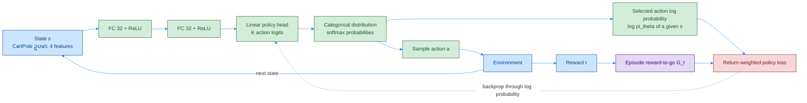
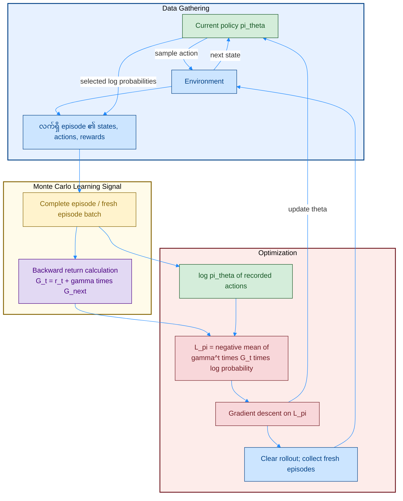
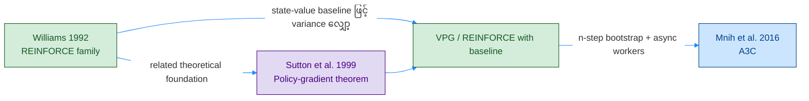

# REINFORCE — Original Paper၊ Policy Network နှင့် Algorithm Diagrams

[PER + Dueling DDQN](./05_1_VB_PER_Dueling_DDQN.md) အထိက **Q-value ကိုသင်ပြီး action ရွေးတာ** ဖြစ်ပါတယ်။ REINFORCE ကတော့ **policy `πθ(a|s)` ကို တိုက်ရိုက်သင်**ပါတယ်။ ကောင်းတဲ့ return ရလာတဲ့ action တွေရဲ့ probability ကို တိုးပေးတာပါ။

## ၁။ Original Paper နှင့် Related Papers

| ရင်းမြစ် | ဆက်စပ်ပုံ / ဖတ်ရန် |
|---|---|
| **Williams, 1992 — [Simple Statistical Gradient-Following Algorithms for Connectionist Reinforcement Learning](https://link.springer.com/article/10.1007/BF00992696)** | မူရင်း **REINFORCE family**၊ stochastic units နဲ့ expected reinforcement gradient ကို ချိတ်ဆက်ပြတယ် |
| **Sutton et al., NeurIPS 1999 — [Policy Gradient Methods for Reinforcement Learning with Function Approximation](https://papers.nips.cc/paper_files/paper/1999/hash/464d828b85b0bed98e80ade0a5c43b0f-Abstract.html)** | Policy-gradient theorem နဲ့ function approximation အတွက် သီအိုရီအခြေခံ |
| **[Grokking Deep RL — Chapter 11 မှတ်စု](../chapter_11_summarized.md)** | ဒီ repo ရဲ့ episodic REINFORCE၊ `FCDAP` policy network နဲ့ discounted loss convention |

**ဒီစာမှာဖော်ပြတာက ယနေ့အသုံးများတဲ့ episodic Monte Carlo REINFORCE ပုံစံ** ဖြစ်ပါတယ်။ မူရင်း 1992 paper က ဒီ MLP layer အရေအတွက်ကို သတ်မှတ်ထားတာ မဟုတ်သလို baseline မပါသော algorithm တစ်မျိုးတည်းကိုသာ ဆွေးနွေးထားတာလည်း မဟုတ်ပါဘူး။

### Color Rule — ရှေ့ဖိုင်များနှင့် တူညီသော Palette

| အရောင် | Fill / border / text | ဒီစာတွင် သုံးပုံ |
|---|---|---|
| အပြာနု | `#cce5ff` / `#004085` | State၊ environment၊ data gathering၊ features |
| အစိမ်းနု | `#d4edda` / `#155724` | သင်ယူနေသော policy network / action selection |
| အဝါနု | `#fff3cd` / `#856404` | လက်ရှိ trajectory batch |
| ခရမ်းနု | `#e2d9f3` / `#4b0082` | Return / learning signal တွက်ခြင်း |
| ပန်းရောင်နု | `#f8d7da` / `#721c24` | Loss၊ gradient၊ optimizer |

Arrow = **အပြာ `#218bff`**။ Policy-based အတွက် အရောင်ရဲ့ role ကို label နဲ့တွဲဖတ်ပါ။ ခရမ်းရောင် return block ရှိတာက DQN target network ရှိတယ်လို့ မဆိုလိုပါဘူး။

## Diagram 1 — Network Architecture: State → Policy → Action

**Network တစ်ခုပဲရှိတယ် — policy network `θ`**။ Output က Q-values မဟုတ်ဘဲ action distribution အတွက် **logits** ပါ။ `Categorical(logits=...)` က normalization ကို ကိုယ်တိုင်လုပ်ပေးလို့ softmax ကို code မှာ ထပ်ထည့်စရာမလိုပါဘူး။ `32 → 32` က Chapter 11 မှတ်စုရဲ့ ဥပမာဖြစ်ပြီး algorithm ရဲ့ မဖြစ်မနေ architecture မဟုတ်ပါဘူး။

Action sampling နဲ့ environment ကို backprop လုပ်ဖို့ မလိုပါဘူး။ Gradient က **ရွေးခဲ့တဲ့ action ရဲ့ `log πθ(a|s)`** ကနေ network ဆီ စီးပါတယ်။ Continuous action ဆိုရင် categorical head အစား Gaussian ရဲ့ `μ, σ` head မျိုး သုံးနိုင်ပါတယ်။

## Diagram 2 — Full Algorithm: Episode ပြီးမှ Policy Update

ဒီဖိုင်တွေမှာ **`r_t` = action `a_t` လုပ်ပြီး ရလာတဲ့ reward** လို့ သတ်မှတ်ထားပါတယ်။ စာအုပ် notation တချို့မှာ အဲဒီ reward ကို `R_{t+1}` လို့ ရေးပါတယ်။ `T` က episode length ပါ။

$$
G_t = \sum_{k=t}^{T-1}\gamma^{k-t}r_k,
\qquad
\mathcal L_\pi = -\frac{1}{T}\sum_{t=0}^{T-1}\gamma^t\,\operatorname{sg}(G_t)\log\pi_\theta(a_t\mid s_t).
$$

`sg` = **stop-gradient / detach**။ Complete episode အတွက် `G_T=0` ကနေ နောက်ပြန်တွက်ပါတယ်။ ဒီ `γ^t` အပြင်ဘက် weight က Chapter 11 ရဲ့ start-state discounted-objective convention နဲ့ ကိုက်ပါတယ်။ Practical VPG/A3C/A2C implementations အများအပြားက အပြင် `γ^t` မပါသော sampled-state surrogate သုံးကြပါတယ်; **return အတွင်း discount** နဲ့ **အပြင် timestep weight** ဟာ အဓိပ္ပာယ်မတူပါဘူး။

1. Policy ကို မပြောင်းဘဲ full episode တစ်ခု သို့မဟုတ် episode batch စုပါ။
2. Step တစ်ခုစီအတွက် အဲဒီနောက်က reward တွေသာ ပါတဲ့ `G_t` ကိုတွက်ပါ။
3. Recorded actions ရဲ့ log-probability ကို `G_t` နဲ့ weight ပေးပြီး policy update လုပ်ပါ။
4. Data အဟောင်းကိုရှင်းပြီး policy အသစ်နဲ့ ပြန်စုပါ။ **Persistent replay buffer၊ frozen target network၊ bootstrap value မပါပါဘူး။**

## Diagram 3 — Paper / Idea ဆက်စပ်ပုံ

ဒါက **idea ဆက်စပ်ပုံ** ဖြစ်ပါတယ်။ Baseline idea ကို VPG ကမှ ပထမဆုံးမိတ်ဆက်တယ်လို့ ဆိုလိုတာ မဟုတ်ပါဘူး။ A3C စာတမ်းကို [နောက်မှတ်စု](./08_1_PB_actor-critic_A3C.md) မှာ ချိတ်ပေးထားပါတယ်။

## ၂။ Q&A — မေးလေ့ရှိသော မေးခွန်းများ

### မေး ၁။ Network က action ကို ထုတ်ပေးတာလား၊ evaluate လုပ်တာလား?

**Action probability distribution ကို ထုတ်ပေးတယ်။** ဥပမာ `[0.7, 0.3]` က action နှစ်ခုရဲ့ probability ဖြစ်ပြီး Q-value နှစ်ခု မဟုတ်ပါဘူး။ Action ကို အဲဒီ distribution ထဲက sample လုပ်ပါတယ်။

### မေး ၂။ Reward positive ဆိုရင် အဲဒီ action က အကောင်းဆုံးလား?

မသေချာပါဘူး။ Return က random ဖြစ်နိုင်ပြီး နောက်ပိုင်း actions တွေရဲ့ သက်ရောက်မှုလည်း ပါပါတယ်။ REINFORCE က sample တစ်ခုအရ probability ကို ပြင်ပြီး episodes အများကြီးကနေ expected return ကောင်းအောင် သင်ပါတယ်။

### မေး ၃။ Loss ရှေ့မှာ minus ဘာလို့ပါသလဲ?

Optimizer က loss ကို **လျှော့**တာကြောင့်ပါ။ `-G log π` ကို လျှော့တာက return-weighted log-probability ကို တိုးတာနဲ့ ကိုက်ပါတယ်။ Positive score က ရွေးခဲ့တဲ့ action ကို အားပေးပြီး negative score က ဖိလျှော့ပါတယ်။

### မေး ၄။ Exploration အတွက် ε-greedy လိုသလား?

Standard REINFORCE မှာ **stochastic policy ထဲက sampling** နဲ့ explore လုပ်ပါတယ်။ Training အချိန် `argmax` သာယူရင် policy sampling assumption ပြောင်းသွားပါတယ်။

### မေး ၅။ ဘာလို့ full episode စောင့်ရသလဲ?

ဒီ MC ပုံစံက အမှန်တကယ်ရလာတဲ့ reward-to-go ကို သုံးလို့ပါ။ Long horizon မှာ update နောက်ကျပြီး variance မြင့်နိုင်ပါတယ်။ Value baseline နဲ့ variance လျှော့ပုံကို [VPG](./07_1_PB_VPG.md) မှာ ဆက်ကြည့်ပါ။

### မေး ၆။ Target network နဲ့ replay buffer ရှိသလား?

မရှိပါဘူး။ Episode data ခဏသိမ်းတာက rollout storage ဖြစ်ပါတယ်။ Policy ပြောင်းပြီးနောက် data အဟောင်းကို correction မပါဘဲ ထပ်ခါသုံးတာက standard on-policy REINFORCE မဟုတ်တော့ပါဘူး။

### မေး ၇။ Baseline ထည့်ရင် REINFORCE မဟုတ်တော့ဘူးလား?

**REINFORCE with baseline** လို့ ခေါ်နိုင်ပါတယ်။ ဒီအစဉ်မှာ သင်ရလွယ်ဖို့ baseline မပါတာကို REINFORCE၊ learned value baseline ပါတာကို VPG ဆိုပြီး ခွဲထားတာပါ။
