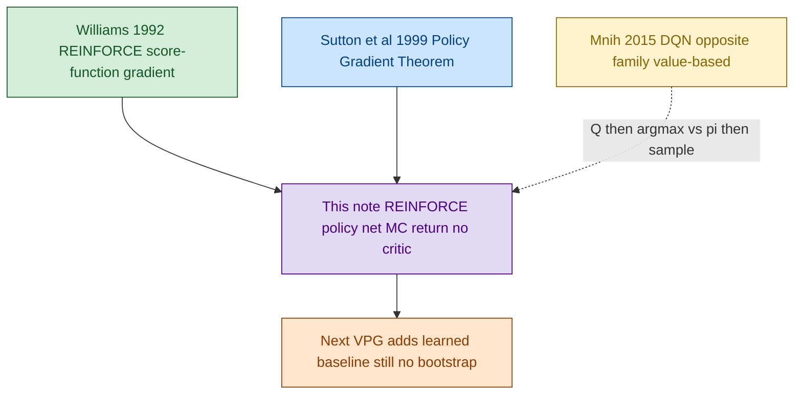
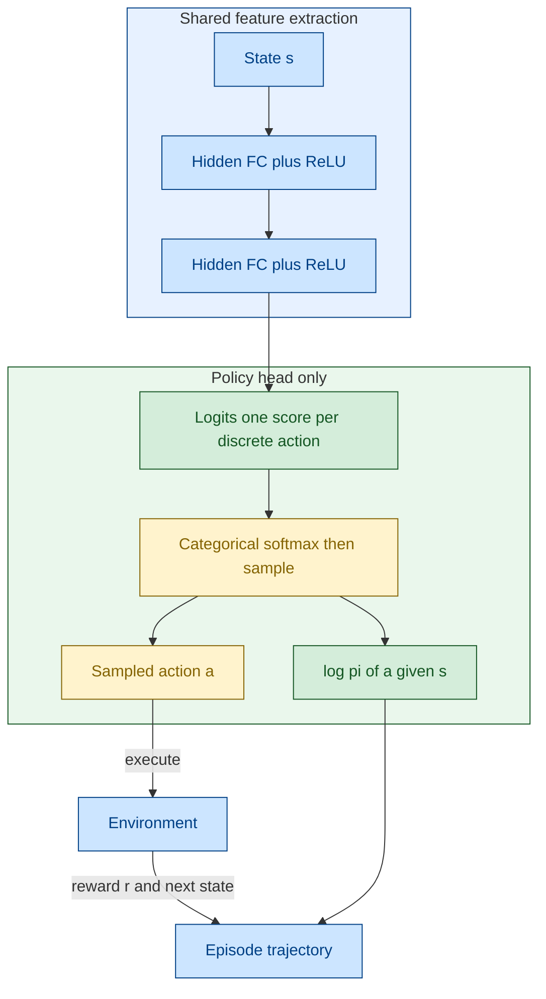
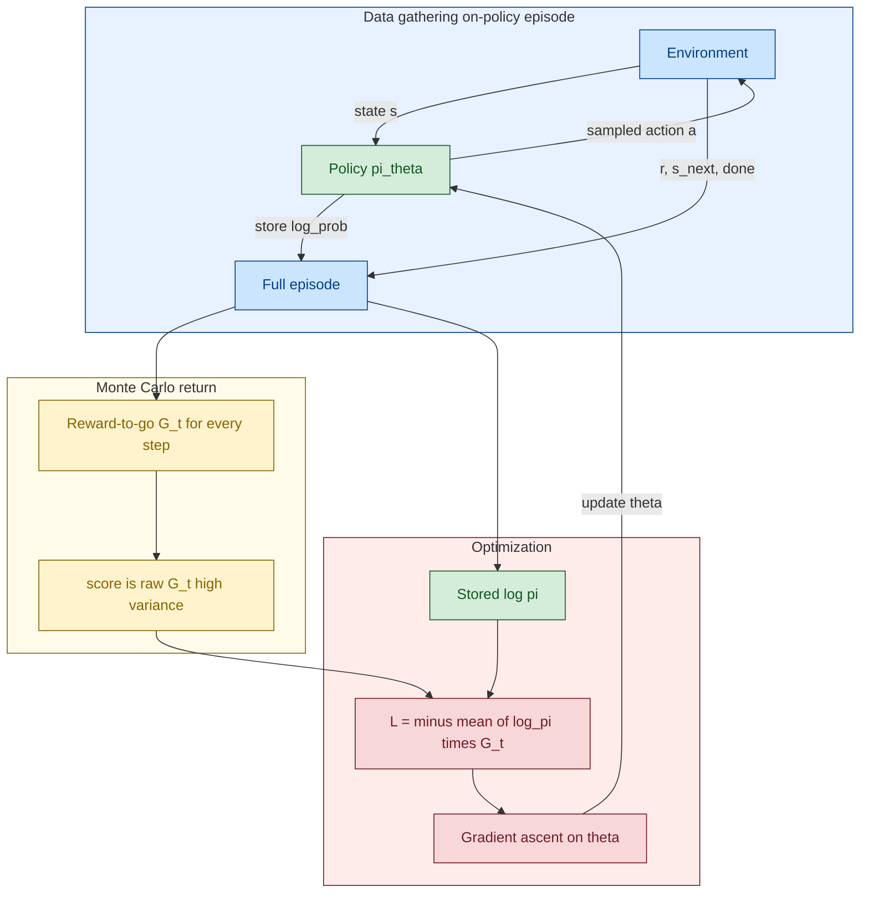

# REINFORCE — Original Paper Diagrams

REINFORCE ဟာ value function မသင်ဘဲ **policy `π_θ(a|s)` ကို တိုက်ရိုက် optimize** လုပ်တဲ့ အခြေခံ policy-gradient algorithm ဖြစ်ပါတယ်။ Value-based ဖိုင်တွေ ([NFQ](./01_1_VB_NFQ.md)–[PER](./05_1_VB_PER_Dueling_DDQN.md)) မှာ Q-network က evaluate ပဲလုပ်ပြီး action ကို `argmax` / ε-greedy နဲ့ ရွေးတယ်။ ဒီမှာတော့ network output က **action probability** ဖြစ်ပြီး sample လုပ်ပြီး environment ထဲ execute လုပ်ပါတယ်။

> **အနှစ်ချုပ်:** Network တစ်ခုတည်း (policy)။ Episode ပြီးမှ Monte-Carlo return `G_t` နဲ့ `log π` ကို မြှောက်ပြီး gradient ascent လုပ်တယ်။ Target network / replay buffer မရှိ။ Variance ကြီးတယ်။

## Original Paper နှင့် ဆက်စပ် Papers

1. **Williams (1992)**, *Simple Statistical Gradient-Following Algorithms for Connectionist Reinforcement Learning* — **main/original paper**။ REINFORCE (`REward Increment = Nonnegative Factor × Offset Reinforcement × Characteristic Eligibility`)။
2. **Sutton, McAllester, Singh & Mansour (1999)**, *Policy Gradient Methods for Reinforcement Learning with Function Approximation* (NeurIPS) — Policy Gradient Theorem။
3. **Sutton & Barto (2018)**, *Reinforcement Learning: An Introduction*, Ch. 13 — modern textbook derivation။
4. **Morales (2020)**, *Grokking Deep Reinforcement Learning*, Ch. 11 — ဒီ series ရဲ့ implementation context။

## Diagram အရောင်များ

GitHub Mermaid မှာ `%%{init}%%` က diagram ကို မဆွဲတာ / အရောင်မတင်တာ ဖြစ်တတ်လို့ **မသုံးပါ**။ `flowchart` နဲ့ node `:::class` သုံးထားပါတယ်။

| အရောင် | Fill / stroke | အဓိပ္ပာယ် |
|---|---|---|
| အပြာနု | `#cce5ff` / `#004085` | Environment၊ trajectory၊ shared backbone |
| အစိမ်းနု | `#d4edda` / `#155724` | Policy / Actor |
| အဝါနု | `#fff3cd` / `#856404` | Distribution၊ sampling၊ return |
| ခရမ်းနု | `#e2d9f3` / `#4b0082` | Value / Critic — REINFORCE မှာ မရှိ |
| ပန်းရောင်နု | `#f8d7da` / `#721c24` | Loss၊ optimization |
| လိမ္မော်နု | `#ffe5cc` / `#8a3b00` | Parallel / extra — ဒီ algorithm မှာ မရှိ |

## ဘာပြဿနာကို ဖြေရှင်းတာလဲ

Value-based method တွေက `Q` သင်ပြီးမှ policy derive လုပ်တယ်။ Continuous action၊ stochastic policy မှာ `argmax_a Q` က မလွယ်ဘူး။ REINFORCE က objective ကို တိုက်ရိုက်ထားတယ်။

```text
J(θ) = E_{τ ~ π_θ} [ G_0 ]
∇_θ J(θ) ≈ Σ_t  ∇_θ log π(A_t | S_t; θ) · G_t
G_t = Σ_{k=t}^{T-1} γ^{k-t} R_{k+1}
```

Dynamics model မလို။ ကုန်ကျတာက **full episode စောင့်ရခြင်း** နဲ့ **high variance**။

## Diagram 1 — Paper Lineage



## Diagram 2 — Network Architecture

**Policy network တစ်ခုတည်း။ Critic မရှိ၊ Target clone မရှိ။** Discrete action မှာ output က Q-vector မဟုတ်ဘဲ **logits** ဖြစ်ပြီး Categorical က probability ပြောင်းတယ်။



| | Value-based DQN | REINFORCE policy |
|---|---|---|
| Output | `Q(s, ·)` vector | logits → `π(a|s)` |
| Action | `argmax` / ε-greedy အပြင်က | **distribution.sample()** |
| Networks in memory | Online θ + Target θ⁻ | **θ တစ်ခုတည်း** |
| Training data | Replay minibatch off-policy | **On-policy episode** |

CartPole docker `04_reinforce`: `obs → 120 → 84 → n_actions` logits။ Grokking `FCDAP`: `obs → 32 → 32 → n_actions`။ Williams paper က CNN မသတ်မှတ် — idea က score-function။ Continuous action မှာ `Normal(μ, σ)` ပြောင်းရုံ။

## Diagram 3 — Training Loop (MC, no bootstrap)



Episode မပြီးခင် update မလုပ်။ Bootstrap `V(s')` မသုံးလို့ unbiased ဖြစ်ပေမယ့် noise များတယ်။

## Q&A

### မေး ၁။ Network နှစ်ခုလား?

**တစ်ခုတည်း။** Policy θ။ Target freeze / worker copy မရှိ။

### မေး ၂။ Output က evaluate လား၊ action လား?

Logits က **policy scores**။ Softmax ပြီးမှ sample / greedy။ DQN ရဲ့ `Q` evaluate နဲ့ မတူ။

### မေး ၃။ Actor-critic လား?

**မဟုတ်။** Critic / bootstrap မရှိ။ `G_t` က episode အဆုံးအထိ reward ပေါင်းခြင်းသာ။

## အနှစ်ချုပ်

```text
REINFORCE → policy only
action     → sample from π_θ
target     → Monte-Carlo G_t
loss       → - log π(a|s) · G_t
next       → VPG: subtract V(s) baseline
```
