# REINFORCE — Original Paper၊ Policy Network နှင့် Algorithm Diagrams

[PER + Dueling DDQN](./05_1_VB_PER_Dueling_DDQN.md) အထိက **Q-value ကိုသင်ပြီး action ရွေးတာ** ဖြစ်ပါတယ်။ REINFORCE ကတော့ **policy `πθ(a|s)` ကို တိုက်ရိုက်သင်**ပါတယ်။ ကောင်းတဲ့ return ရလာတဲ့ action တွေရဲ့ probability ကို တိုးပေးတာပါ။

## ၁။ Original Paper နှင့် Related Papers

| ရင်းမြစ် | ဆက်စပ်ပုံ / ဖတ်ရန် |
|---|---|
| **Williams, 1992 — [Simple Statistical Gradient-Following Algorithms for Connectionist Reinforcement Learning](https://link.springer.com/article/10.1007/BF00992696)** | မူရင်း **REINFORCE family**၊ stochastic units နဲ့ expected reinforcement gradient ကို ချိတ်ဆက်ပြတယ် |
| **Sutton et al., NeurIPS 1999 — [Policy Gradient Methods for Reinforcement Learning with Function Approximation](https://papers.nips.cc/paper_files/paper/1999/hash/464d828b85b0bed98e80ade0a5c43b0f-Abstract.html)** | Policy-gradient theorem နဲ့ function approximation အတွက် သီအိုရီအခြေခံ |
| **[Grokking Deep RL — Chapter 11 မှတ်စု](../chapter_11_summarized.md)** | ဒီ repo ရဲ့ episodic REINFORCE၊ `FCDAP` policy network နဲ့ discounted loss convention |

**ဒီစာမှာဖော်ပြတာက ယနေ့အသုံးများတဲ့ episodic Monte Carlo REINFORCE ပုံစံ** ဖြစ်ပါတယ်။ မူရင်း 1992 paper က ဒီ MLP layer အရေအတွက်ကို သတ်မှတ်ထားတာ မဟုတ်သလို baseline မပါသော algorithm တစ်မျိုးတည်းကိုသာ ဆွေးနွေးထားတာလည်း မဟုတ်ပါဘူး။

### အရောင်အသုံးပြုပုံ (Color Rule)

[အရောင် ၈ မျိုးနှင့် network label သတ်မှတ်ချက် — 00_1_color_define.md](./00_1_color_define.md)

| အသုံးပြုပုံ | အရောင် | နမူနာ | Fill | Text |
|---|---|---|---|---|
| Policy Network / Actor; Online / Current Q Network | **Green / အစိမ်း** |  | `#008000` | `#FFFFFF` |
| Value Network / Critic / Baseline; Dueling value head | **Orange / လိမ္မော်** |  | `#FF8C00` | `#111111` |
| Frozen Target Network | **Purple / ခရမ်း** |  | `#800080` | `#FFFFFF` |
| State / environment / data / shared backbone | **Blue / အပြာ** |  | `#0057D9` | `#FFFFFF` |
| Batch / sampling / advantage | **Yellow / အဝါ** |  | `#FFD700` | `#111111` |
| Preprocessing / PER / action selection / synchronization | **Cyan / စိမ်းပြာ** |  | `#00CED1` | `#111111` |
| Loss / gradient / optimizer | **Red / အနီ** |  | `#DC143C` | `#FFFFFF` |
| Outputs / probabilities / returns / target values / aggregation | **Gray / မီးခိုး** |  | `#555555` | `#FFFFFF` |

**Green / orange / purple ကို network၊ trainable layer / head တွေအတွက်သာ သီးသန့်သုံးပါတယ်။** Network block ထဲမှာ `Policy Network`၊ `Value Network`၊ `Online Network` သို့မဟုတ် `Target Network` ဆိုပြီး အမျိုးအစားပါပါတယ်။ Neuron များကို စုပြထားသောပုံမှာ အမျိုးအစားကို enclosing network / layer ခေါင်းစဉ်မှာ ရေးထားပါတယ်။

Shared actor-critic block မှာ **Policy Network + Value Network** နှစ်ခုလုံးကို ဖော်ပြပြီး shared backbone / copy ကို blue သုံးထားပါတယ်။ Shared heads ဖြစ်ရင် သီးခြား model နှစ်ခုရှိတယ်လို့ မဆိုလိုပါဘူး။ Dueling ရဲ့ value / advantage heads က Q Network ထဲက အစိတ်အပိုင်းများဖြစ်ပြီး သီးခြား policy network မဟုတ်ပါဘူး။

**Target value / return = gray၊ Target Network = purple** ဖြစ်ပါတယ်။ Network outputs၊ action sampling၊ loss နဲ့ paper-lineage block များကို network အရောင် ၃ ရောင်နဲ့ မပြပါဘူး။ Group နောက်ခံကို transparent ထားပြီး arrow ကို blue သုံးထားပါတယ်။

## Diagram 1 — Network Architecture: State → Policy → Action

### 1A — Policy Network ကို Neuron များအဖြစ် ကြည့်မယ်

**ဒီနေရာက policy network ဆိုတာ neural network (MLP) တစ်ခုပါပဲ။** State features တွေကို input အဖြစ်ယူပြီး hidden layers တွေကနေ action တစ်ခုစီအတွက် logit ထုတ်ပေးပါတယ်။ အောက်က စက်ဝိုင်းတစ်ခုစီက input feature သို့မဟုတ် neuron တစ်ခုကို ကိုယ်စားပြုပါတယ်။



<details>
<summary>Mermaid source (ပြင်ဆင်ရန်)</summary>

```text
%%{init: {"theme": "base", "themeVariables": {"primaryColor": "#555555", "primaryTextColor": "#FFFFFF", "primaryBorderColor": "#111111", "secondaryColor": "#555555", "tertiaryColor": "#FFFFFF", "lineColor": "#0057D9", "clusterBkg": "#FFFFFF", "clusterBorder": "#555555", "edgeLabelBackground": "#FFFFFF", "textColor": "#111111"}, "htmlLabels": false, "flowchart": {"htmlLabels": false}, "themeCSS": ".edgeLabel text, .edgeLabel tspan { fill: #111111 !important; } .edgeLabel { color: #111111 !important; } .cluster-label text, .cluster-label tspan { fill: #111111 !important; }"}}%%
flowchart LR
    subgraph NN ["Policy Network = Neural Network pi_theta — 4 → 32 → 32 → 2"]
        subgraph Input ["Input: CartPole state"]
            X1(("Cart<br/>position"))
            X2(("Cart<br/>velocity"))
            X3(("Pole<br/>angle"))
            X4(("Pole angular<br/>velocity"))
        end
        subgraph Hidden1 ["Policy Network - Hidden Layer 1: 32 neurons + ReLU"]
            H11(("h1_1"))
            H12(("h1_2"))
            H132(("h1_32"))
        end
        subgraph Hidden2 ["Policy Network - Hidden Layer 2: 32 neurons + ReLU"]
            H21(("h2_1"))
            H22(("h2_2"))
            H232(("h2_32"))
        end
        subgraph Head ["Policy Network Output Head: 2 logits"]
            ZL(("z_left"))
            ZR(("z_right"))
        end
        X1 --> H11 & H12 & H132
        X2 --> H11 & H12 & H132
        X3 --> H11 & H12 & H132
        X4 --> H11 & H12 & H132
        H11 --> H21 & H22 & H232
        H12 --> H21 & H22 & H232
        H132 --> H21 & H22 & H232
        H21 --> ZL & ZR
        H22 --> ZL & ZR
        H232 --> ZL & ZR
    end
    ZL --> P["Softmax / Categorical<br/>ဥပမာ: P(left) = 0.70<br/>P(right) = 0.30"]
    ZR --> P
    P --> A["Sample action<br/>left သို့မဟုတ် right"]
    classDef data fill:#0057D9,stroke:#111111,stroke-width:2px,color:#FFFFFF;
    classDef process fill:#00CED1,stroke:#111111,stroke-width:2px,color:#111111;
    classDef result fill:#555555,stroke:#111111,stroke-width:2px,color:#FFFFFF;
    classDef policyNetwork fill:#008000,stroke:#111111,stroke-width:2px,color:#FFFFFF;

    class X1,X2,X3,X4 data;
    class A process;
    class P result;
    class H11,H12,H132,H21,H22,H232,ZL,ZR policyNetwork;
    style NN fill:none,stroke:#008000,stroke-width:2px,color:#111111;
    style Input fill:none,stroke:#555555,stroke-width:2px,color:#111111;
    style Hidden1 fill:none,stroke:#008000,stroke-width:2px,color:#111111;
    style Hidden2 fill:none,stroke:#008000,stroke-width:2px,color:#111111;
    style Head fill:none,stroke:#008000,stroke-width:2px,color:#111111;
```

</details>

ပုံရှင်းအောင် hidden layer တစ်ခုစီမှာ **32 neurons ထဲက 3 ခုပဲ ကိုယ်စားပြုဆွဲထားပါတယ်**။ တကယ့် fully connected network မှာ ရှေ့ layer က neuron တိုင်းဟာ နောက် layer က neuron တိုင်းနဲ့ ဆက်ပါတယ်။ မြားတစ်ခုစီမှာ learn လုပ်မယ့် **weight** ရှိပြီး neuron တွေရဲ့ **bias** တွေနဲ့ပေါင်းပြီး `θ = {weights, biases}` ဖြစ်ပါတယ်။

**“Neural network” က တည်ဆောက်ပုံကို ပြောတာ၊ “policy” က အဲဒီ network ရဲ့ အလုပ်ကို ပြောတာပါ** — state ပေးရင် ဘယ် action ကို probability ဘယ်လောက်နဲ့ ရွေးမလဲဆိုတာ သင်ယူပေးတာဖြစ်ပါတယ်။ ဥပမာ `[0.70, 0.30]` ဆိုရင် left ကို 70%၊ right ကို 30% နဲ့ sample လုပ်နိုင်ပါတယ်။ REINFORCE update က ဒီ network ရဲ့ `θ` ကို ပြင်ပြီး action probabilities တွေကို ပြောင်းပေးပါတယ်။

### 1B — Network၊ Action နှင့် Learning Signal ဆက်စပ်ပုံ



<details>
<summary>Mermaid source (ပြင်ဆင်ရန်)</summary>

```text
%%{init: {"theme": "base", "themeVariables": {"primaryColor": "#555555", "primaryTextColor": "#FFFFFF", "primaryBorderColor": "#111111", "secondaryColor": "#555555", "tertiaryColor": "#FFFFFF", "lineColor": "#0057D9", "clusterBkg": "#FFFFFF", "clusterBorder": "#555555", "edgeLabelBackground": "#FFFFFF", "textColor": "#111111"}, "htmlLabels": false, "flowchart": {"htmlLabels": false}, "themeCSS": ".edgeLabel text, .edgeLabel tspan { fill: #111111 !important; } .edgeLabel { color: #111111 !important; } .cluster-label text, .cluster-label tspan { fill: #111111 !important; }"}}%%
flowchart LR
    S["State s<br/>CartPole ဥပမာ: 4 features"] --> H1["Policy Network<br/>Hidden layer 1: FC 32 + ReLU"]
    H1 --> H2["Policy Network<br/>Hidden layer 2: FC 32 + ReLU"]
    H2 --> Z["Policy Network Output Head<br/>K action logits"]
    Z --> P["Categorical distribution<br/>softmax probabilities"]
    P --> A["Sample action a"]
    P --> LP["Selected action log probability<br/>log pi_theta of a given s"]
    A --> E["Environment"]
    E -->|"next state"| S
    E --> R["Reward r"]
    LP --> L["Return-weighted policy loss"]
    R --> G["Episode reward-to-go G_t"]
    G --> L
    L -.->|"backprop through log probability"| Z
    classDef data fill:#0057D9,stroke:#111111,stroke-width:2px,color:#FFFFFF;
    classDef train fill:#DC143C,stroke:#111111,stroke-width:2px,color:#FFFFFF;
    classDef process fill:#00CED1,stroke:#111111,stroke-width:2px,color:#111111;
    classDef result fill:#555555,stroke:#111111,stroke-width:2px,color:#FFFFFF;
    classDef policyNetwork fill:#008000,stroke:#111111,stroke-width:2px,color:#FFFFFF;

    class S,E,R data;
    class L train;
    class A process;
    class P,LP,G result;
    class H1,H2,Z policyNetwork;
```

</details>

**Network တစ်ခုပဲရှိတယ် — policy network `θ`**။ Output က Q-values မဟုတ်ဘဲ action distribution အတွက် **logits** ပါ။ `Categorical(logits=...)` က normalization ကို ကိုယ်တိုင်လုပ်ပေးလို့ softmax ကို code မှာ ထပ်ထည့်စရာမလိုပါဘူး။ `32 → 32` က Chapter 11 မှတ်စုရဲ့ ဥပမာဖြစ်ပြီး algorithm ရဲ့ မဖြစ်မနေ architecture မဟုတ်ပါဘူး။

Action sampling နဲ့ environment ကို backprop လုပ်ဖို့ မလိုပါဘူး။ Gradient က **ရွေးခဲ့တဲ့ action ရဲ့ `log πθ(a|s)`** ကနေ network ဆီ စီးပါတယ်။ Continuous action ဆိုရင် categorical head အစား Gaussian ရဲ့ `μ, σ` head မျိုး သုံးနိုင်ပါတယ်။

## Diagram 2 — Full Algorithm: Episode ပြီးမှ Policy Update



<details>
<summary>Mermaid source (ပြင်ဆင်ရန်)</summary>

```text
%%{init: {"theme": "base", "themeVariables": {"primaryColor": "#555555", "primaryTextColor": "#FFFFFF", "primaryBorderColor": "#111111", "secondaryColor": "#555555", "tertiaryColor": "#FFFFFF", "lineColor": "#0057D9", "clusterBkg": "#FFFFFF", "clusterBorder": "#555555", "edgeLabelBackground": "#FFFFFF", "textColor": "#111111"}, "htmlLabels": false, "flowchart": {"htmlLabels": false}, "themeCSS": ".edgeLabel text, .edgeLabel tspan { fill: #111111 !important; } .edgeLabel { color: #111111 !important; } .cluster-label text, .cluster-label tspan { fill: #111111 !important; }"}}%%
flowchart TD
    subgraph Phase1 [Data Gathering]
        P["Policy Network<br/>Current pi_theta"] -->|"sample action"| E["Environment"]
        E -->|"next state"| P
        E --> D["လက်ရှိ episode ၏ states, actions, rewards"]
        P -->|"selected log probabilities"| D
    end
    subgraph Phase2 [Monte Carlo Learning Signal]
        D --> B["Complete episode / fresh episode batch"]
        B --> G["Backward return calculation<br/>G_t = r_t + gamma times G_next"]
    end
    subgraph Phase3 [Optimization]
        B --> LP["log pi_theta of recorded actions"]
        G --> L["L_pi = negative mean of<br/>gamma^t times G_t times log probability"]
        LP --> L
        L --> O["Gradient descent on L_pi"]
        O -->|"update theta"| P
        O --> N["Clear rollout; collect fresh episodes"]
        N --> E
    end
    classDef data fill:#0057D9,stroke:#111111,stroke-width:2px,color:#FFFFFF;
    classDef batch fill:#FFD700,stroke:#111111,stroke-width:2px,color:#111111;
    classDef train fill:#DC143C,stroke:#111111,stroke-width:2px,color:#FFFFFF;
    classDef result fill:#555555,stroke:#111111,stroke-width:2px,color:#FFFFFF;
    classDef policyNetwork fill:#008000,stroke:#111111,stroke-width:2px,color:#FFFFFF;

    class E,D,N data;
    class B batch;
    class L,O train;
    class LP,G result;
    class P policyNetwork;
    style Phase1 fill:none,stroke:#555555,stroke-width:2px,color:#111111;
    style Phase2 fill:none,stroke:#555555,stroke-width:2px,color:#111111;
    style Phase3 fill:none,stroke:#555555,stroke-width:2px,color:#111111;
```

</details>

ဒီဖိုင်တွေမှာ **`r_t` = action `a_t` လုပ်ပြီး ရလာတဲ့ reward** လို့ သတ်မှတ်ထားပါတယ်။ စာအုပ် notation တချို့မှာ အဲဒီ reward ကို `R_{t+1}` လို့ ရေးပါတယ်။ `T` က episode length ပါ။

$$
G_t = \sum_{k=t}^{T-1}\gamma^{k-t}r_k,
\qquad
\mathcal L_\pi = -\frac{1}{T}\sum_{t=0}^{T-1}\gamma^t\,\mathrm{sg}(G_t)\log\pi_\theta(a_t\mid s_t).
$$

`sg` = **stop-gradient / detach**။ Complete episode အတွက် `G_T=0` ကနေ နောက်ပြန်တွက်ပါတယ်။ ဒီ `γ^t` အပြင်ဘက် weight က Chapter 11 ရဲ့ start-state discounted-objective convention နဲ့ ကိုက်ပါတယ်။ Practical VPG/A3C/A2C implementations အများအပြားက အပြင် `γ^t` မပါသော sampled-state surrogate သုံးကြပါတယ်; **return အတွင်း discount** နဲ့ **အပြင် timestep weight** ဟာ အဓိပ္ပာယ်မတူပါဘူး။

1. Policy ကို မပြောင်းဘဲ full episode တစ်ခု သို့မဟုတ် episode batch စုပါ။
2. Step တစ်ခုစီအတွက် အဲဒီနောက်က reward တွေသာ ပါတဲ့ `G_t` ကိုတွက်ပါ။
3. Recorded actions ရဲ့ log-probability ကို `G_t` နဲ့ weight ပေးပြီး policy update လုပ်ပါ။
4. Data အဟောင်းကိုရှင်းပြီး policy အသစ်နဲ့ ပြန်စုပါ။ **Persistent replay buffer၊ frozen target network၊ bootstrap value မပါပါဘူး။**

## Diagram 3 — Paper / Idea ဆက်စပ်ပုံ



<details>
<summary>Mermaid source (ပြင်ဆင်ရန်)</summary>

```text
%%{init: {"theme": "base", "themeVariables": {"primaryColor": "#555555", "primaryTextColor": "#FFFFFF", "primaryBorderColor": "#111111", "secondaryColor": "#555555", "tertiaryColor": "#FFFFFF", "lineColor": "#0057D9", "clusterBkg": "#FFFFFF", "clusterBorder": "#555555", "edgeLabelBackground": "#FFFFFF", "textColor": "#111111"}, "htmlLabels": false, "flowchart": {"htmlLabels": false}, "themeCSS": ".edgeLabel text, .edgeLabel tspan { fill: #111111 !important; } .edgeLabel { color: #111111 !important; } .cluster-label text, .cluster-label tspan { fill: #111111 !important; }"}}%%
flowchart LR
    W["Williams 1992<br/>REINFORCE family"] -->|"state-value baseline ဖြင့် variance လျှော့"| V["VPG / REINFORCE with baseline"]
    W -->|"related theoretical foundation"| S["Sutton et al. 1999<br/>Policy-gradient theorem"]
    S --> V
    V -->|"n-step bootstrap + async workers"| A["Mnih et al. 2016<br/>A3C"]
    classDef data fill:#0057D9,stroke:#111111,stroke-width:2px,color:#FFFFFF;
    classDef result fill:#555555,stroke:#111111,stroke-width:2px,color:#FFFFFF;

    class A data;
    class W,V,S result;
```

</details>

ဒါက **idea ဆက်စပ်ပုံ** ဖြစ်ပါတယ်။ Baseline idea ကို VPG ကမှ ပထမဆုံးမိတ်ဆက်တယ်လို့ ဆိုလိုတာ မဟုတ်ပါဘူး။ A3C စာတမ်းကို [နောက်မှတ်စု](./08_1_PB_actor-critic_A3C.md) မှာ ချိတ်ပေးထားပါတယ်။

## ၂။ Q&A — မေးလေ့ရှိသော မေးခွန်းများ

### မေး ၁။ Network က action ကို ထုတ်ပေးတာလား၊ evaluate လုပ်တာလား?

**Action probability distribution ကို ထုတ်ပေးတယ်။** ဥပမာ `[0.7, 0.3]` က action နှစ်ခုရဲ့ probability ဖြစ်ပြီး Q-value နှစ်ခု မဟုတ်ပါဘူး။ Action ကို အဲဒီ distribution ထဲက sample လုပ်ပါတယ်။

### မေး ၂။ Reward positive ဆိုရင် အဲဒီ action က အကောင်းဆုံးလား?

မသေချာပါဘူး။ Return က random ဖြစ်နိုင်ပြီး နောက်ပိုင်း actions တွေရဲ့ သက်ရောက်မှုလည်း ပါပါတယ်။ REINFORCE က sample တစ်ခုအရ probability ကို ပြင်ပြီး episodes အများကြီးကနေ expected return ကောင်းအောင် သင်ပါတယ်။

### မေး ၃။ Loss ရှေ့မှာ minus ဘာလို့ပါသလဲ?

Optimizer က loss ကို **လျှော့**တာကြောင့်ပါ။ `-G log π` ကို လျှော့တာက return-weighted log-probability ကို တိုးတာနဲ့ ကိုက်ပါတယ်။ Positive score က ရွေးခဲ့တဲ့ action ကို အားပေးပြီး negative score က ဖိလျှော့ပါတယ်။

### မေး ၄။ Exploration အတွက် ε-greedy လိုသလား?

Standard REINFORCE မှာ **stochastic policy ထဲက sampling** နဲ့ explore လုပ်ပါတယ်။ Training အချိန် `argmax` သာယူရင် policy sampling assumption ပြောင်းသွားပါတယ်။

### မေး ၅။ ဘာလို့ full episode စောင့်ရသလဲ?

ဒီ MC ပုံစံက အမှန်တကယ်ရလာတဲ့ reward-to-go ကို သုံးလို့ပါ။ Long horizon မှာ update နောက်ကျပြီး variance မြင့်နိုင်ပါတယ်။ Value baseline နဲ့ variance လျှော့ပုံကို [VPG](./07_1_PB_VPG.md) မှာ ဆက်ကြည့်ပါ။

### မေး ၆။ Target network နဲ့ replay buffer ရှိသလား?

မရှိပါဘူး။ Episode data ခဏသိမ်းတာက rollout storage ဖြစ်ပါတယ်။ Policy ပြောင်းပြီးနောက် data အဟောင်းကို correction မပါဘဲ ထပ်ခါသုံးတာက standard on-policy REINFORCE မဟုတ်တော့ပါဘူး။

### မေး ၇။ Baseline ထည့်ရင် REINFORCE မဟုတ်တော့ဘူးလား?

**REINFORCE with baseline** လို့ ခေါ်နိုင်ပါတယ်။ ဒီအစဉ်မှာ သင်ရလွယ်ဖို့ baseline မပါတာကို REINFORCE၊ learned value baseline ပါတာကို VPG ဆိုပြီး ခွဲထားတာပါ။
