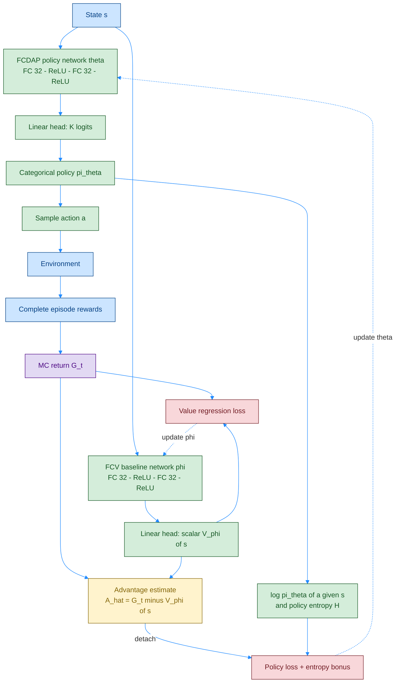
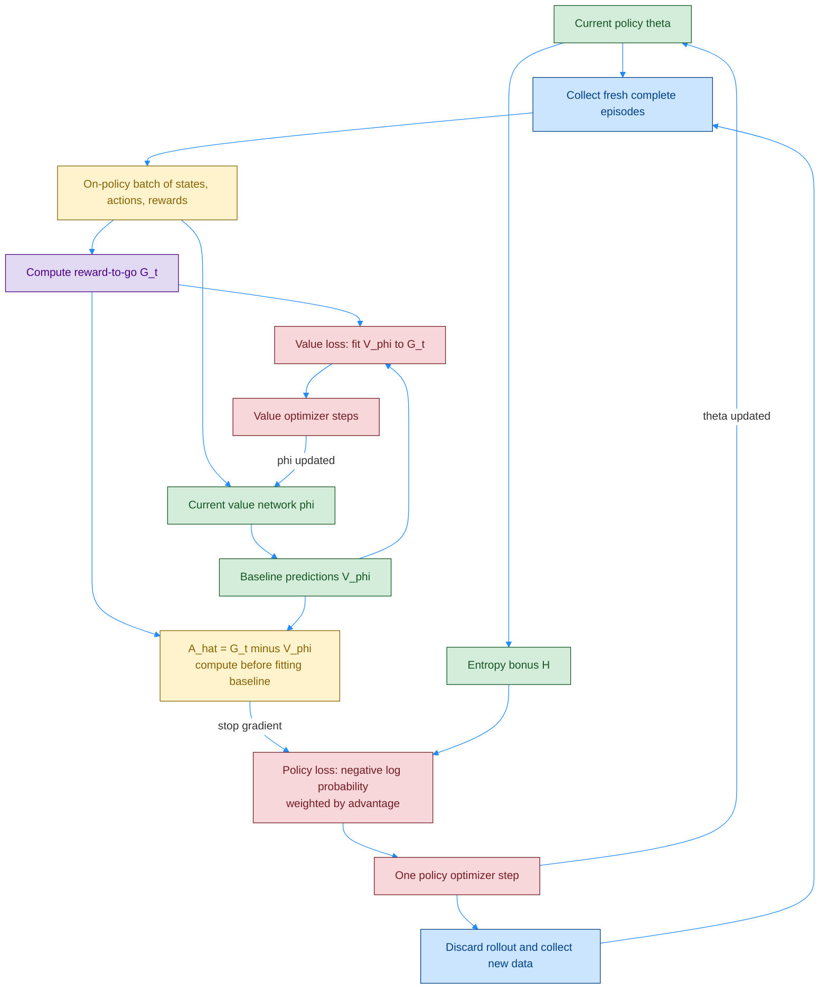
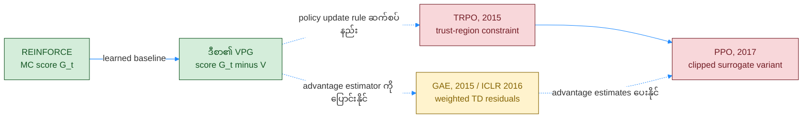

# VPG — REINFORCE with Value Baseline၊ Network နှင့် Algorithm Diagrams

[REINFORCE](./06_1_PB_REINFORCE.md) မှာ return `G_t` ကို policy score အဖြစ် တိုက်ရိုက်သုံးခဲ့ပါတယ်။ ဒီစာရဲ့ **Vanilla Policy Gradient (VPG)** က **“ဒီ state မှာ မျှော်လင့်ထားတာထက် ကောင်းသလား?”** ဆိုတဲ့ `Â_t = G_t − Vφ(s_t)` ကို သုံးပြီး gradient variance လျှော့ဖို့ ရည်ရွယ်ပါတယ်။

## ၁။ Original Foundations နှင့် Related Papers

**VPG အတွက် မူရင်း paper တစ်စောင်တည်း သီးခြားသတ်မှတ်ထားတာ မရှိပါဘူး။** Plain policy-gradient methods ကို ခေါ်တဲ့ နာမည်ဖြစ်ပြီး ဒီ repo ရဲ့ Chapter 11 အတိုင်း **MC return + learned baseline** version ကို အဓိကပြထားပါတယ်။

| ရင်းမြစ် | ဆက်စပ်ပုံ |
|---|---|
| **Williams, 1992 — [REINFORCE](https://link.springer.com/article/10.1007/BF00992696)** | Score-function policy-gradient နဲ့ baseline အခြေခံ |
| **Sutton et al., NeurIPS 1999 — [Policy Gradient Methods with Function Approximation](https://papers.nips.cc/paper_files/paper/1999/hash/464d828b85b0bed98e80ade0a5c43b0f-Abstract.html)** | Policy-gradient theorem၊ value-function approximation ဆက်စပ်သီအိုရီ |
| **[Spinning Up: Vanilla Policy Gradient](https://spinningup.openai.com/en/latest/algorithms/vpg.html)** | On-policy VPG ရဲ့ official algorithm reference; implementation မှာ GAE လည်း သုံးထားတယ် |
| **Schulman et al., 2015 — [TRPO](https://proceedings.mlr.press/v37/schulman15.html)** | Policy step အလွန်ကြီးသွားတာကို trust region နဲ့ ထိန်းတဲ့ ဆက်စပ်နည်း |
| **[Chapter 11 မှတ်စု](../chapter_11_summarized.md)** | ဒီမှာသုံးတဲ့ separate `FCDAP` / `FCV` networks နဲ့ MC baseline version |

### Color Rule

ရှေ့ဖိုင်တွေရဲ့ **fill / border / text** palette အတိုင်း: အပြာ `#cce5ff / #004085` = state/data၊ အစိမ်း `#d4edda / #155724` = trainable policy/value networks၊ အဝါ `#fff3cd / #856404` = batch/advantage၊ ခရမ်း `#e2d9f3 / #4b0082` = return/target evaluation၊ ပန်းရောင် `#f8d7da / #721c24` = loss/update။ Arrow = `#218bff`။

## Diagram 1 — Network Architecture: Policy နှင့် Value Baseline သီးခြားနှစ်ခု

ဒီ **Chapter 11 ဥပမာ**မှာ trainable networks နှစ်ခု၊ weight sets `θ` နဲ့ `φ` နှစ်ခုပါ။ Architecture တူဖို့မလိုဘဲ policy output က **action logits**၊ value output က **scalar expected return** ဖြစ်ပါတယ်။ `Vφ` က frozen target-network clone မဟုတ်ပါဘူး; regression loss နဲ့ သင်နေပါတယ်။ Shared trunk + heads နှစ်ခုလည်း ရွေးနိုင်ပေမယ့် VPG ရဲ့ မဖြစ်မနေ requirement မဟုတ်ပါဘူး။

## Diagram 2 — MC Baseline VPG Algorithm

`r_t` = action `a_t` ပြီးနောက် reward၊ `sg` = stop-gradient၊ `β ≥ 0` = entropy coefficient လို့ သတ်မှတ်ပါ။ ဒီ MC version မှာ:

$$
G_t=\sum_{k=t}^{T-1}\gamma^{k-t}r_k,
\qquad \hat A_t=G_t-V_\phi(s_t).
$$

$$
\mathcal L_\pi=-\mathrm{mean}_t\left[\gamma^t\mathrm{sg}(\hat A_t)\log\pi_\theta(a_t\mid s_t)\right]
-\beta\mathrm{mean}_t H[\pi_\theta(\cdot\mid s_t)],
\qquad
\mathcal L_V=\tfrac12\mathrm{mean}_t\left(V_\phi(s_t)-\mathrm{sg}(G_t)\right)^2.
$$

**ဒီမှာ အပြင် `γ^t` က စာအုပ် convention** ဖြစ်ပါတယ်။ [REINFORCE မှတ်စု](./06_1_PB_REINFORCE.md) မှာ ရှင်းထားသလို practical sampled-state VPG surrogate တချို့မှာ မပါပါဘူး။ Entropy bonus က optional ဖြစ်ပြီး **VPG ကို အဓိပ္ပာယ်သတ်မှတ်တဲ့ မဖြစ်မနေအပိုင်း မဟုတ်ပါဘူး**။ Value regression ကို batch တစ်ခုတည်းနဲ့ steps အများကြီးလုပ်နိုင်ပေမယ့် vanilla policy loss ကို policy ပြောင်းပြီးတိုင်း correction မပါဘဲ ထပ်ခါ optimize မလုပ်သင့်ပါဘူး။

### Baseline က ဘာကြောင့် အထောက်အကူဖြစ်သလဲ?

`V(s)=8` ဖြစ်တဲ့ state တစ်ခုမှာ `G=10` ဆိုရင် `Â=+2`၊ `G=5` ဆိုရင် `Â=−3` ပါ။ နှစ်ခုလုံး positive reward ရပေမယ့် ဒုတိယတစ်ခုက **မျှော်လင့်ချက်ထက် နိမ့်**လို့ ရွေးခဲ့တဲ့ action probability ကို လျှော့ဖို့ signal ပေးပါတယ်။

Action မပေါ်မူတည်တဲ့ baseline `b(s)` ကို fixed လို့ယူပြီး policy gradient တွက်ရင်:

$$
\mathbb E_{a\sim\pi_\theta}\!\left[b(s)\nabla_\theta\log\pi_\theta(a\mid s)\right]
=b(s)\nabla_\theta\sum_a\pi_\theta(a\mid s)=0.
$$

ဒါကြောင့် baseline subtraction က expected policy gradient ကို မပြောင်းဘဲ variance လျှော့နိုင်ပါတယ်။ **Baseline မကောင်းရင် variance အမြဲလျော့မယ်လို့ အာမမခံပါဘူး**; same-batch fitting/normalization က finite-sample effects လည်း ရှိနိုင်ပါတယ်။

## Diagram 3 — VPG၊ GAE၊ TRPO / PPO တို့၏ တာဝန်ကွာခြားပုံ

**GAE က score တွက်ပုံ၊ TRPO/PPO က policy update ထိန်းပုံ** ဖြစ်လို့ အတူတွဲနိုင်ပါတယ်။ [PPO မူရင်း paper](https://arxiv.org/abs/1707.06347) နဲ့ [GAE မှတ်စု](./09_1_PB_GAE.md) ကို ဆက်ဖတ်နိုင်ပါတယ်။

## ၂။ Q&A

### မေး ၁။ REINFORCE နဲ့ အဓိကဘာကွာသလဲ?

ဒီအစဉ်မှာ `G_t` အစား **`G_t−V(s_t)`** ကို policy score သုံးပြီး value baseline ကိုပါ သင်တာက အဓိကကွာခြားချက်ပါ။

### မေး ၂။ Policy နဲ့ value က online / target clone နှစ်ခုလား?

မဟုတ်ပါဘူး။ **Policy က “ဘာလုပ်မလဲ”၊ value က “ဒီ state မှာ ပျမ်းမျှဘယ်လောက်ရမလဲ”** ကို သင်တယ်။ နှစ်ခုလုံး trainable ဖြစ်ပြီး output meaning မတူပါဘူး။

### မေး ၃။ Actor-critic လို့ ခေါ်လို့ရသလား?

အခေါ်အဝေါ်ပေါ် မူတည်ပါတယ်။ စာအုပ်က **MC baseline VPG** နဲ့ **bootstrapped actor-critic** ကို ခွဲခေါ်ထားပါတယ်။ တချို့ရင်းမြစ်တွေက learned policy/value ပါရင် actor-critic လို့ ကျယ်ကျယ်ပြန့်ပြန့် ခေါ်ပါတယ်။ အဓိကက **ဒီ version ရဲ့ `G_t` ထဲမှာ next-state value bootstrap မပါ**တာပါ။

### မေး ၄။ Advantage ကို ဘာကြောင့် detach လုပ်ရသလဲ?

Policy update အတွက် advantage ကို **fixed learning signal** အဖြစ် သုံးချင်လို့ပါ။ Detach မလုပ်ရင် `-log π × (G−V)` ကနေ baseline ဆီ မရည်ရွယ်တဲ့ gradient စီးသွားနိုင်ပါတယ်။ Value ကို သူ့ regression loss နဲ့ သီးခြားသင်ပါတယ်။

### မေး ၅။ `Â` ဆိုတာ Dueling ရဲ့ advantage head လား?

မဟုတ်ပါဘူး။ ဒီမှာ **return နဲ့ baseline ကနေတွက်တဲ့ scalar estimate** ပါ။ Action တိုင်းအတွက် `A(s,a)` vector ထုတ်တဲ့ network head မရှိပါဘူး။

### မေး ၆။ VPG က GAE သုံးလို့ရသလား?

ရပါတယ်။ VPG ဆိုတာ plain policy-gradient update family ဖြစ်လို့ advantage estimator ကို ပြောင်းနိုင်ပါတယ်။ Spinning Up implementation ကလည်း GAE သုံးပါတယ်။ **ဒီစာရဲ့ MC version နဲ့ အဲဒီ implementation ကို ခွဲဖတ်ပါ။**

### မေး ၇။ Entropy မြင့်ရင် အမြဲကောင်းသလား?

မဟုတ်ပါဘူး။ Bonus က policy စောစောမတင်းကျပ်အောင် ကူညီပေမယ့် coefficient ကြီးလွန်းရင် reward ကောင်းတဲ့ action ပေါ် အာရုံမစိုက်နိုင်ပါဘူး။
