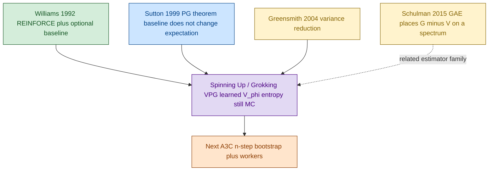
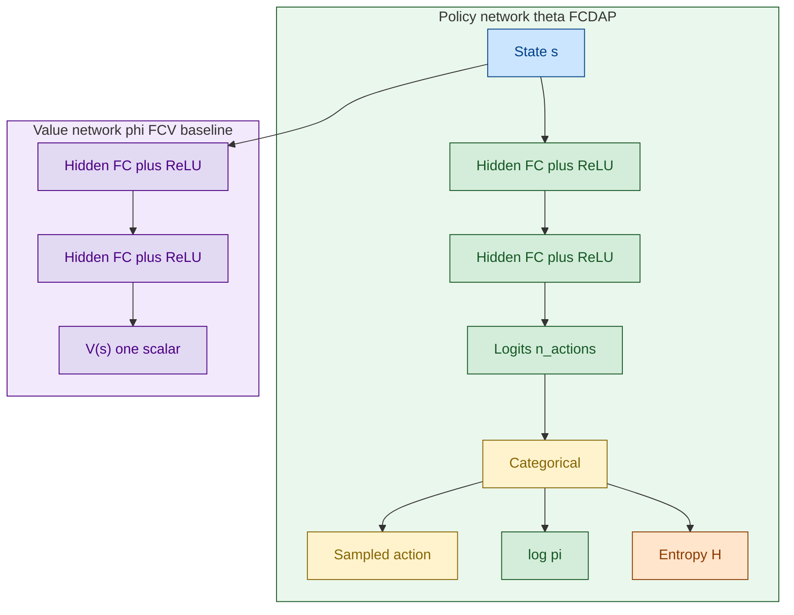
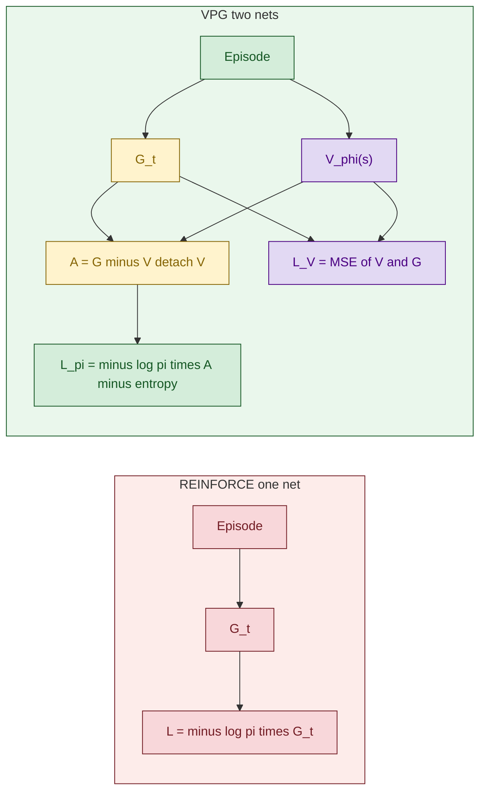
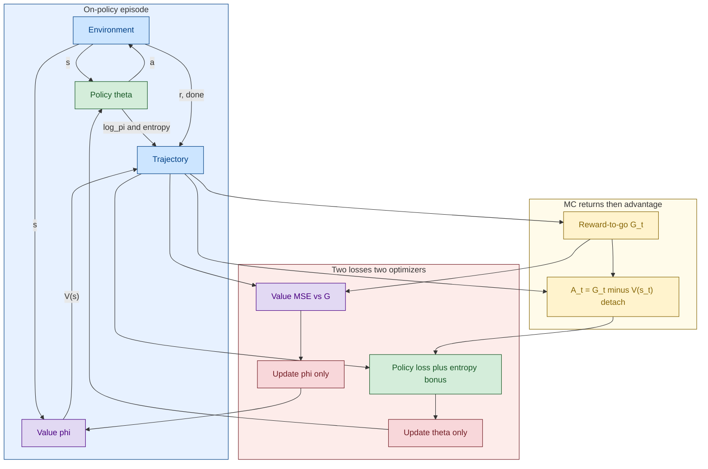

# VPG (Vanilla Policy Gradient) — REINFORCE with Baseline

[REINFORCE](./06_1_PB_REINFORCE.md) ပေါ်မှာ **learned value baseline `V_φ(s)`** ထည့်ထားတာက VPG ဖြစ်ပါတယ်။ Return `G_t` အစား advantage `A_t = G_t − V(s_t)` ကို policy gradient မှာ သုံးလို့ variance လျော့တယ်။ **Bootstrap မလုပ်သေးလို့ actor-critic မဟုတ်သေးပါ။**

> **အနှစ်ချုပ်:** Network ၂ ခု — Policy (actor) နဲ့ Value (baseline)။ နှစ်ခုလုံး episode ပြီးမှ MC `G_t` နဲ့ သင်တယ်။ Value က `G` ကို predict၊ Policy က `G − V` နဲ့ သင်တယ်။ Entropy bonus က exploration ထိန်းတယ်။

## Original Paper နှင့် ဆက်စပ် Papers

VPG ဆိုတာ paper ခေါင်းစဉ်တစ်ခုတည်း မဟုတ်ပါ။ OpenAI Spinning Up / Grokking က **REINFORCE + baseline** ကို ဒီနာမည်နဲ့ ခေါ်တာပါ။

1. **Williams (1992)** — original REINFORCE; **baseline ကိုယ်တိုင် ဒီ paper မှာ ပါပြီးသား** (constant သို့မဟုတ် state-dependent offset, unbiased)။
2. **Sutton et al. (1999)** — Policy Gradient Theorem; baseline က expectation မပြောင်းဘဲ variance ပဲလျှော့။
3. **Greensmith, Bartlett & Baxter (2004)**, *Variance Reduction Techniques for Gradient Estimates in RL*။
4. **Schulman et al. (2015)**, *GAE* — `G − V` က estimator မိသားစုထဲက တစ်ခု; နောက်ခြေမှာ [GAE](./10_1_PB_GAE.md)။
5. **OpenAI Spinning Up (2018), Vanilla Policy Gradient** — entropy regularization အလေ့အထ။
6. **Morales (2020)**, Grokking Ch. 11 — `FCDAP` + `FCV`, separate optimizers။

## Diagram အရောင်များ

GitHub အတွက် `%%{init}%%` မသုံး။ `flowchart` + `:::class`။

| အရောင် | Fill / stroke | အဓိပ္ပာယ် |
|---|---|---|
| အပြာနု | `#cce5ff` / `#004085` | Env၊ trajectory |
| အစိမ်းနု | `#d4edda` / `#155724` | Policy / Actor |
| အဝါနု | `#fff3cd` / `#856404` | Advantage `G − V` |
| ခရမ်းနု | `#e2d9f3` / `#4b0082` | Value baseline MC only |
| ပန်းရောင်နု | `#f8d7da` / `#721c24` | Loss / optimizer |
| လိမ္မော်နု | `#ffe5cc` / `#8a3b00` | Entropy |

## ဘာပြဿနာကို ဖြေရှင်းတာလဲ

REINFORCE ရဲ့ `G_t` က အပေါင်းကိန်းကြီး ဖြစ်တတ်တယ်။ ကောင်း/ဆိုး ခွဲဖို့ **ပျမ်းမျှထက် ဘယ်လောက်ကွာလဲ** ပဲလိုတယ်။

```text
A_t = G_t - V_φ(S_t)
L_π = - mean( log π(A_t|S_t;θ) · A_t.detach() ) - β_e · H[π]
L_V = mean( (G_t - V_φ(S_t))^2 )
```

`V` ကို detach လုပ်မှ baseline က policy gradient ကို bias မဖြစ်စေပါ။

## Diagram 1 — Paper Lineage



## Diagram 2 — Network Architectures

Grokking / docker `05_vpg`: **policy နဲ့ value က network သီးခြား ၂ ခု**။ Optimizer ၂ ခု။ DQN clone ၂ ခုနဲ့ မတူ — output shape ကွာတယ်၊ weight snapshot မဟုတ်။



| Head | Input | Output | Role |
|---|---|---|---|
| Policy | `s` | logits → `π(a|s)` | sample + `log π` |
| Value | `s` | scalar `V(s)` | baseline only — **next-state bootstrap မလုပ်** |

CartPole: Policy `4 → 120 → 84 → 2`, Value `4 → 120 → 84 → 1`။ Grokking hidden `(32, 32)`။ Dueling `V`/`A` နဲ့ မရော — ဒီ `V` က သီးခြား net၊ Q ပြန်မပေါင်း။

## Diagram 3 — REINFORCE vs VPG



## Diagram 4 — Training Loop



## REINFORCE vs VPG

| | REINFORCE | VPG |
|---|---|---|
| Policy net | ရှိ | ရှိ |
| Value net | မရှိ | **ရှိ — baseline** |
| Score | `G_t` | `G_t − V(s_t)` |
| Bootstrap `V(s')` | မရှိ | **မရှိ** |
| Actor-critic? | မဟုတ် | **မဟုတ်** |
| Entropy | မလိုအပ် | Grokking/Spinning Up မှာ ထည့်လေ့ရှိ |
| Target net / replay | မရှိ | မရှိ |

## Q&A

### မေး ၁။ Network နှစ်ခုလား? DQN clone လား?

**သီးခြား architecture ၂ ခု** — logits နဲ့ scalar `V`။ DQN θ / θ⁻ မဟုတ်။ Episode တိုင်း နှစ်ခုလုံး update။

### မေး ၂။ ဘာကြောင့် actor-critic မခေါ်သေးလဲ?

Critic က **bootstrapped** `r + γV(s')` သုံးတယ်။ VPG ရဲ့ `V` က MC `G` ကို regress ရုံ။

### မေး ၃။ `V` gradient က policy ဆီ စီးသလား?

`A = G − V.detach()` ဆိုရင် **မစီးပါ**။

## အနှစ်ချုပ်

```text
VPG        → policy θ + baseline φ
advantage  → G - V(s)   (MC, no bootstrap)
entropy    → keep π from collapsing
not AC yet → wait for A3C n-step V(s_{t+n})
```
