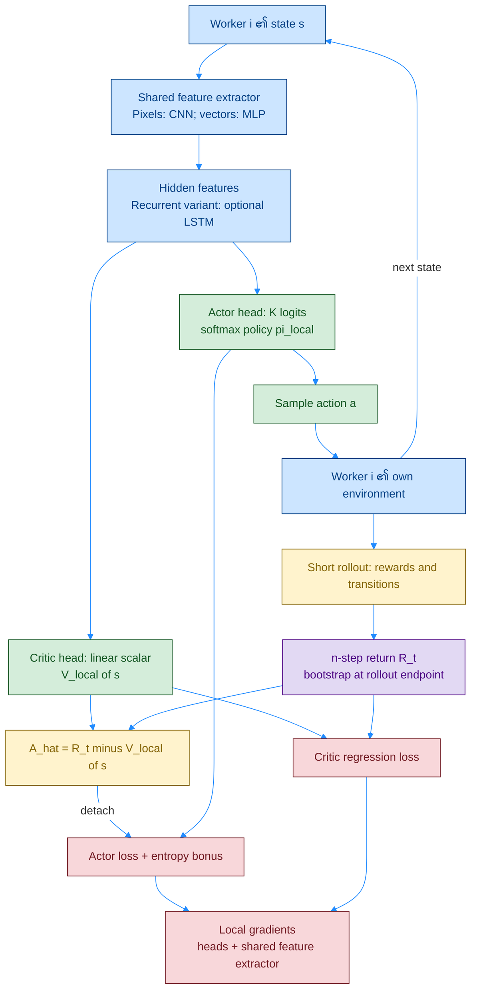
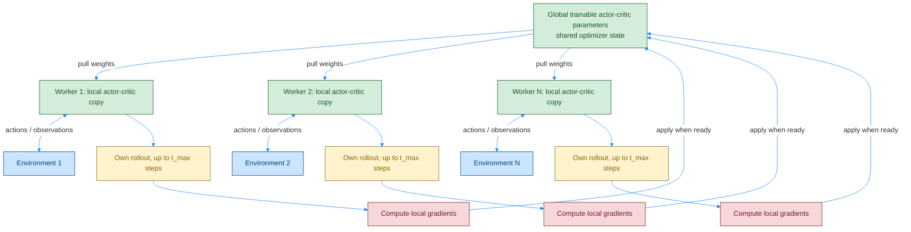
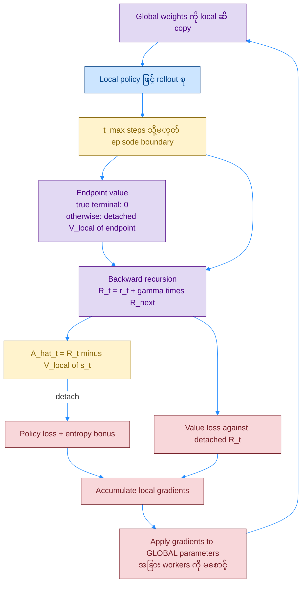

# A3C — Asynchronous Advantage Actor-Critic: Network၊ Workers နှင့် Algorithm

[VPG ရဲ့ MC baseline](./07_1_PB_VPG.md) က full episode ကို စောင့်ရပြီး data ကလည်း environment တစ်ခုထဲက ဆက်တိုက်လာပါတယ်။ **A3C** က **short n-step bootstrap + parallel environment workers + asynchronous gradient updates** ကို ပေါင်းသုံးပါတယ်။

## ၁။ Original Paper နှင့် Related Sources

| ရင်းမြစ် | ဖတ်ရန် / ဆက်စပ်ပုံ |
|---|---|
| **Mnih et al., ICML 2016 — [Asynchronous Methods for Deep Reinforcement Learning](https://proceedings.mlr.press/v48/mniha16.html)** | မူရင်း paper; **Section 4 ရဲ့ asynchronous advantage actor-critic** အပိုင်း |
| **[arXiv full paper + supplementary](https://arxiv.org/pdf/1602.01783)** | **Algorithm S3**: worker တစ်ခုရဲ့ sync၊ rollout၊ return၊ gradient၊ global update အစဉ်; PDF version အလိုက် algorithm numbering ကွာနိုင်ပါတယ် |
| **Sutton et al., NeurIPS 1999 — [Policy Gradient Methods with Function Approximation](https://papers.nips.cc/paper_files/paper/1999/hash/464d828b85b0bed98e80ade0a5c43b0f-Abstract.html)** | Policy-gradient / value-function သီအိုရီအခြေခံ |
| **[OpenAI Baselines: A2C, 2017](https://openai.com/index/openai-baselines-acktr-a2c/)** | A3C ရဲ့ synchronization ကို ပြောင်းထားတဲ့ နောက်ဆက်တွဲ implementation |

Paper ထဲမှာ async Q-learning / Sarsa နည်းတွေပါရှိပါတယ်။ **ဒီစာက A3C ကိုသာ ရည်ညွှန်းပါတယ်**; အခြား async value-based variants ရဲ့ target network ကို A3C ဆီ မရောထည့်ပါနှင့်။

### Color Rule

ရှေ့ဖိုင်တွေရဲ့ **fill / border / text** အတိုင်း: အပြာ `#cce5ff / #004085` = state/environment/shared features၊ အစိမ်း `#d4edda / #155724` = trainable policy/value networks၊ အဝါ `#fff3cd / #856404` = rollout/advantage၊ ခရမ်း `#e2d9f3 / #4b0082` = bootstrap target / parameter sync၊ ပန်းရောင် `#f8d7da / #721c24` = loss/gradient/update။ Arrow = `#218bff`။

## Diagram 1 — Worker တစ်ခု၏ Network Architecture

**မူရင်း paper ရဲ့ အသုံးများသော architecture** က hidden layers ကို share ပြီး **policy softmax head + linear value head** ခွဲထားတာပါ။ Recurrent variant မှာ LSTM ပါနိုင်ပေမယ့် A3C အတွက် မဖြစ်မနေ မလိုပါဘူး။ **[Chapter 11 ဥပမာ](../chapter_11_summarized.md)** က policy/value MLP နှစ်ခု သီးခြားထားတဲ့ implementation ကို ပြထားပါတယ်; အဲဒါလည်း A3C ဖြစ်နိုင်ပါတယ်။

**Actor head က action probability၊ critic head က scalar `V(s)`** ထုတ်ပါတယ်။ `Â` ကို return နဲ့ `V(s)` ကနေ တွက်တာဖြစ်ပြီး Dueling လို advantage head မရှိပါဘူး။

## Diagram 2 — Global Network နှင့် Asynchronous Workers

**Worker အားလုံးပြီးတဲ့အထိ မစောင့်ပါဘူး။** တစ်ခုအဆင်သင့်ဖြစ်ရင် သူ့ gradient နဲ့ global parameters ကို update လုပ်ပြီး global weights ပြန်ယူပါတယ်။ Local weights ကို global ဆီ တန်း overwrite လုပ်တာ မဟုတ်ပါဘူး။ ပြိုင်တူ workers ကြောင့် data correlation လျော့နိုင်ပေမယ့် data အားလုံး independent ဖြစ်သွားတယ်လို့ မဆိုလိုပါဘူး။

Local copy က rollout အတွင်း acting / gradient တွက်ဖို့ပါ။ **DQN target network အဖြစ် သုံးတာ မဟုတ်ပါဘူး**။ အခြား workers က global ကို ပြင်နေချိန်မှာ local gradient က အနည်းငယ် **stale** ဖြစ်နိုင်ပါတယ်။

## Diagram 3 — Worker Algorithm: Sync → Rollout → Bootstrap → Global Update

`r_t` = action ပြီးနောက် reward၊ `n` = ဒီ state ကနေ rollout endpoint အထိ steps ဖြစ်ပါတယ်။ True terminal ရောက်ရင် endpoint value ကို သုညထားပြီး:

$$
R_t^{(n)}=\sum_{k=0}^{n-1}\gamma^k r_{t+k}+\gamma^n V_{\text{local}}(s_{t+n}),
\qquad \hat A_t=R_t^{(n)}-V_{\text{local}}(s_t).
$$

$$
\mathcal L_\pi=-\operatorname{mean}_t[\log\pi_{\text{local}}(a_t\mid s_t)\operatorname{sg}(\hat A_t)]
-\beta\operatorname{mean}_t H[\pi_{\text{local}}],
\quad
\mathcal L_V=\tfrac12\operatorname{mean}_t\left[(V_{\text{local}}(s_t)-\operatorname{sg}(R_t^{(n)}))^2\right].
$$

ဒီ loss က practical A3C sampled-state convention ဖြစ်ပြီး အပြင် `γ^t` မထည့်ထားပါဘူး; return အတွင်း discount ကတော့ ပါပါတယ်။ Shared trunk ဆိုရင် `L = Lπ + cV LV` ကနေ heads နဲ့ trunk ဆီ gradient စီးပါတယ်။

**Rollout အတွင်း `n` တူမနေပါဘူး** — 5-step chunk ဆိုရင် အစဆုံး state က 5-step၊ နောက်တစ်ခုက 4-step၊ နောက်ဆုံးက 1-step return သုံးပါတယ်။ **Time-limit truncation / chunk cutoff** မှာ task ဆက်နိုင်သေးရင် final observation ရဲ့ value နဲ့ bootstrap လုပ်ပါ; reset ပြီး observation ကို endpoint အဖြစ် မသုံးပါနှင့်။

## ၂။ Q&A

### မေး ၁။ Network ဘယ်နှခုရှိသလဲ?

Shared-trunk design ဆိုရင် **global actor-critic model တစ်ခု + worker တစ်ခုစီရဲ့ local copy** ရှိတယ်။ Each model မှာ actor/value heads နှစ်ခုပါ။ Separate-policy/value design ဆိုရင် global နဲ့ local တစ်နေရာစီမှာ model နှစ်ခုစီ ရှိနိုင်ပါတယ်။ **Head count နဲ့ model-copy count ကို ခွဲမှတ်ပါ။**

### မေး ၂။ Critic က action ကို ရွေးပေးသလား?

မရွေးပါဘူး။ Actor policy ထဲက sample လုပ်ပါတယ်။ Critic `V(s)` က return / advantage တွက်ရာမှာ ကူညီပြီး actor ကို learning signal ပေးပါတယ်။

### မေး ၃။ Advantage head မရှိဘဲ A3C ဘာကြောင့် “Advantage” လို့ခေါ်သလဲ?

Policy gradient ကို **`n-step return − V(s)`** နဲ့ weight ပေးလို့ပါ။ နာမည်က training signal ကို ရည်ညွှန်းတာဖြစ်ပါတယ်။

### မေး ၄။ Replay buffer မသုံးဘဲ ဘာလို့ train လို့ရသလဲ?

Fresh short rollouts ကို worker အများကြီးက စုလို့ data diversity ရပါတယ်။ Standard A3C က persistent replay မသုံးပါဘူး။ Worker တစ်ခုရဲ့ ခဏသိမ်းတဲ့ rollout နဲ့ experience replay ကို မရောပါနှင့်။

### မေး ၅။ A3C က on-policy လား?

အများအားဖြင့် **on-policy actor-critic family** လို့ သတ်မှတ်ပါတယ်။ Data က worker ရဲ့ local behavior policy နဲ့ ကိုက်ပေမယ့် global update လုပ်ချိန်မှာ async policy lag ရှိနိုင်ပါတယ်။ Global latest policy နဲ့ အမြဲအတိအကျတူတယ်လို့ မဆိုလိုပါဘူး။

### မေး ၆။ LSTM၊ shared trunk၊ workers 16 ခု မဖြစ်မနေလိုသလား?

မလိုပါဘူး။ Observation/task နဲ့ compute ပေါ်မူတည်ပါတယ်။ **Asynchronous actor-learners + advantage-based bootstrapped updates** ဆိုတဲ့ mechanism ကို အဓိကမှတ်ပါ။

### မေး ၇။ GAE က A3C ရဲ့ မဖြစ်မနေအပိုင်းလား?

မဟုတ်ပါဘူး။ Original A3C က n-step advantage သုံးပါတယ်။ [GAE](./09_1_PB_GAE.md) နဲ့ အစားထိုးနိုင်ပြီး၊ workers အားလုံးကို စောင့်ပြီး batch update လုပ်တဲ့နည်းကို [A2C](./10_1_PB_actor-critic_A2C.md) မှာ ဆက်ဖတ်နိုင်ပါတယ်။
