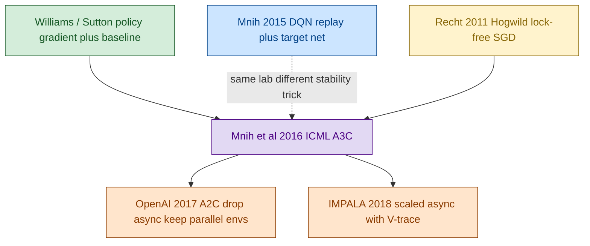
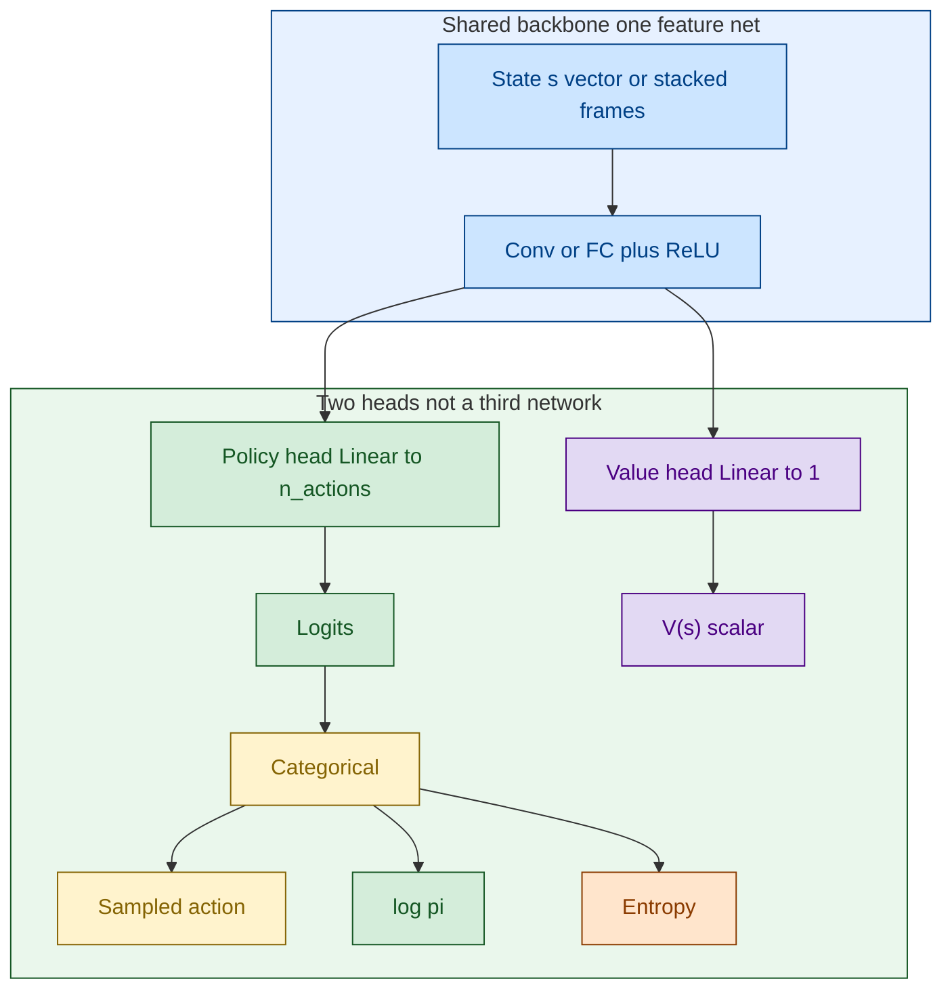
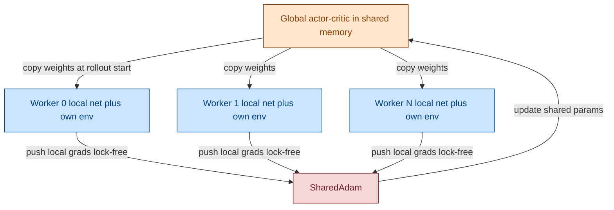
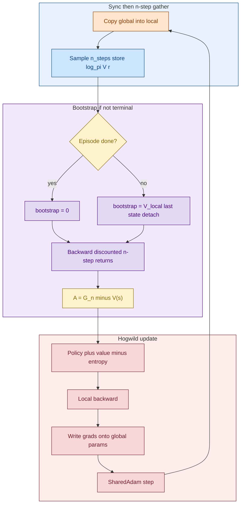

# A3C — Asynchronous Advantage Actor-Critic

[VPG](./07_1_PB_VPG.md) က MC return သုံးသေးလို့ critic မဟုတ်သေး။ A3C မှာ **n-step bootstrap** ထည့်လိုက်လို့ ပထမဆုံး **actor-critic** ဖြစ်လာပါတယ်။ On-policy data ကို **worker အများကြီး async** ပြေးပြီး decorrelate လုပ်တယ်။

> **အနှစ်ချုပ်:** Global actor-critic ၁ ခု + worker တစ်ခုစီမှာ local copy။ n-step rollout → advantage → local gradient ကို global ပေါ် Hogwild! update။ Local copy ≠ DQN target network။

## Original Paper နှင့် ဆက်စပ် Papers

1. **Mnih, Badia, Mirza, Graves, Lillicrap, Harley, Silver & Kavukcuoglu (2016)**, *Asynchronous Methods for Deep Reinforcement Learning* (ICML) — **main paper**။
2. **Mnih et al. (2015)**, Nature DQN — GPU + replay vs CPU workers + on-policy။
3. **Recht et al. (2011)**, *Hogwild!* — lock-free SGD။
4. **Williams (1992) / Sutton (1999)** — policy-gradient အခြေခံ။
5. **OpenAI Baselines (2017) A2C** — [A2C](./09_PB_actor-critic_A2C.md) sync ဗားရှင်း။
6. **Espeholt et al. (2018) IMPALA** — async scale-up + V-trace။

## Diagram အရောင်များ

GitHub အတွက် `%%{init}%%` မသုံး။ `flowchart` + `:::class`။

| အရောင် | Fill / stroke | အဓိပ္ပာယ် |
|---|---|---|
| အပြာနု | `#cce5ff` / `#004085` | Env၊ rollout၊ shared backbone |
| အစိမ်းနု | `#d4edda` / `#155724` | Policy head |
| အဝါနု | `#fff3cd` / `#856404` | n-step advantage |
| ခရမ်းနု | `#e2d9f3` / `#4b0082` | Value head / bootstrap |
| ပန်းရောင်နု | `#f8d7da` / `#721c24` | Loss / SharedAdam |
| လိမ္မော်နု | `#ffe5cc` / `#8a3b00` | Workers, Hogwild!, global memory |

## ဘာပြဿနာကို ဖြေရှင်းတာလဲ

1. VPG က episode အဆုံးစောင့်ရတယ် → n-step `V(s_{t+n})` နဲ့ ဖြတ်။
2. On-policy မှာ replay မသုံးချင် → worker ပတ်ဝန်းကျင် အများကြီး။

```text
G_t^{(n)} = r_{t+1} + … + γ^{n-1} r_{t+n} + γ^n V(s_{t+n})
A_t       = G_t^{(n)} - V(s_t)
L         = L_π + c_v L_V - c_e H
```

Terminal မှာ နောက်ဆုံး `V = 0`။

## Diagram 1 — Paper Lineage



## Diagram 2 — Network Architecture

မူရင်း Atari A3C: **shared conv + policy softmax + value scalar** (optional LSTM)။ Grokking က `FCDAP` + `FCV` သီးခြား ထားနိုင်။ docker `06_a3c` က `shared FC 128` + နှစ် head။



Dueling `Q = V + A − mean(A)` နဲ့ မရော။ A3C က `π` logits နဲ့ `V(s)` **သီးခြား output နှစ်မျိုး**။

| Variant | Backbone | Policy | Value |
|---|---|---|---|
| A3C Atari paper | conv (+ optional LSTM) | softmax | scalar `V` |
| Grokking CartPole | သီးခြား FC ၂ ခု | `FCDAP` | `FCV` |
| docker `06_a3c` | `Linear 4→128 ReLU` | `128→2` | `128→1` |

## Diagram 3 — Global vs worker copies (target net မဟုတ်)



DQN `θ⁻` = C steps freeze။ A3C local = rollout တစ်ခုအတွက် copy၊ ပြီးရင် global ပြန်ယူ။ Bootstrap `V` က local/current value head။

## Diagram 4 — Worker training loop



## VPG vs A3C

| | VPG | A3C |
|---|---|---|
| Value role | MC baseline | **n-step bootstrap critic** |
| Actor-critic? | မဟုတ် | **ဟုတ်** |
| Parallelism | တစ် env | **async workers** |
| Update | episode ပြီး | n-step (5–20) |
| Target Q net | မရှိ | **မရှိ** |
| Replay | မရှိ | မရှိ |

## Q&A

### မေး ၁။ Network ဘယ်နှခုလဲ?

Architecture တစ်မျိုး။ Memory မှာ **global ၁ + local N**။ DQN target မလို။

### မေး ၂။ Output က ဘာလဲ?

Policy head = logits → sample။ Value head = `V(s)` bootstrap။ Acting မှာ value မလို။

### မေး ၃။ Async ဘာကြောင့်?

CPU စကေး၊ worker က global မစောင့်။ Stale gradient ရှိနိုင် → [A2C](./09_PB_actor-critic_A2C.md) က sync batch။

## အနှစ်ချုပ်

```text
A3C actor  → π head (sample)
A3C critic → V head (n-step bootstrap)
parallel   → many local copies, Hogwild! on one global net
not DQN    → no frozen θ⁻, no replay
next       → A2C same heads, one net, sync env batch
```
