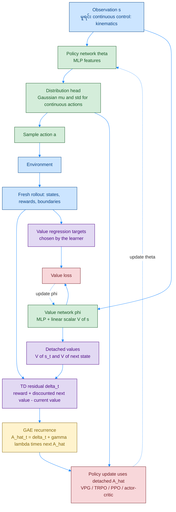
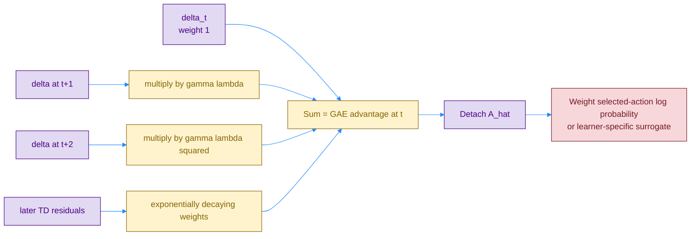
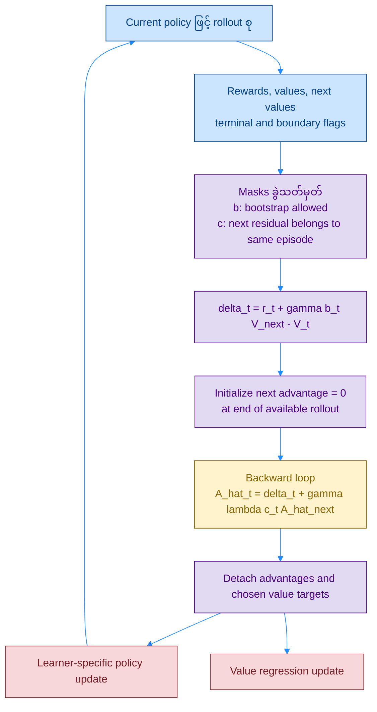

# GAE — Generalized Advantage Estimation: Network၊ TD Residual နှင့် Algorithm

**GAE က network architecture အသစ်မဟုတ်ဘဲ policy gradient အတွက် advantage estimate တွက်နည်း** ဖြစ်ပါတယ်။ [VPG](./07_1_PB_VPG.md) ရဲ့ MC estimate နဲ့ [A3C](./08_1_PB_actor-critic_A3C.md) ရဲ့ short n-step estimate အကြား bias–variance trade-off ကို `λ` နဲ့ ညှိနိုင်အောင် လုပ်ထားတာပါ။

## ၁။ Original Paper နှင့် Related Papers

| ရင်းမြစ် | ဖတ်ရန် / ဆက်စပ်ပုံ |
|---|---|
| **Schulman, Moritz, Levine, Jordan & Abbeel — [High-Dimensional Continuous Control Using Generalized Advantage Estimation](https://arxiv.org/abs/1506.02438)** | **June 2015 preprint / ICLR 2016**; Section 3 ရဲ့ TD residual နဲ့ GAE derivation |
| **[Original PDF](https://arxiv.org/pdf/1506.02438)** | Section 6.1: experiments မှာ GAE ကို **TRPO** နဲ့ ပေါင်းသုံးထားပုံ |
| **Schulman et al., ICML 2015 — [Trust Region Policy Optimization](https://proceedings.mlr.press/v37/schulman15.html)** | Policy update ကို trust region နဲ့ ထိန်းတဲ့ optimizer-side method |
| **Schulman et al., 2017 — [Proximal Policy Optimization Algorithms](https://arxiv.org/abs/1707.06347)** | Advantage estimates ကို policy surrogate ထဲ ထည့်သုံးတဲ့ နောက်ဆက်တွဲနည်း |
| **[Chapter 11 မှတ်စု](../chapter_11_summarized.md)** | ဒီ repo မှာ A3C-style actor-critic ပေါ် GAE ထည့်သုံးပုံ |

**ဖိုင်စဉ်က publication chronology မဟုတ်ပါဘူး။** GAE က A3C ပြီးမှ ထွက်လာတဲ့ version မဟုတ်ပါဘူး။ မူရင်း GAE experiments က separate policy/value neural networks နဲ့ TRPO သုံးထားပြီး **A3C worker system မလိုပါဘူး**။

### Color Rule

ရှေ့ဖိုင်များအတိုင်း **fill / border / text**: အပြာ `#cce5ff / #004085` = data/features၊ အစိမ်း `#d4edda / #155724` = policy/value networks၊ အဝါ `#fff3cd / #856404` = advantage / λ aggregation၊ ခရမ်း `#e2d9f3 / #4b0082` = bootstrap / detached targets၊ ပန်းရောင် `#f8d7da / #721c24` = losses/optimization။ Arrow = `#218bff`။

## Diagram 1 — Network Architecture နှင့် GAE ထည့်ရသောနေရာ



**Policy/value networks ရှိပြီးသားကို ဆက်သုံးတယ်။** GAE block မှာ trainable weights မရှိပါဘူး။ ဒီ diagram က မူရင်း paper နဲ့ ကိုက်သော separate-network layout ကို အကျဉ်းချုပ်ဆွဲထားတာဖြစ်ပြီး hidden widths အတိအကျကို မသတ်မှတ်ထားပါဘူး။ Discrete actions ဆို categorical head၊ shared actor-critic ဆို trunk တစ်ခုနဲ့ heads နှစ်ခုလည်း သုံးနိုင်ပါတယ်။

## ၂။ Core Equations — TD Error တွေကို Discount လုပ်ပြီးပေါင်းခြင်း

`r_t` = action `a_t` ပြီးနောက် reward၊ `V` = rollout စုချိန်က fixed value estimate၊ `γ` = reward discount၊ `λ` = trace-decay parameter ဖြစ်ပါတယ်။ Episode boundary မရှိသော segment အတွင်း:

$$
\delta_t=r_t+\gamma V(s_{t+1})-V(s_t),
\qquad
\hat A_t^{\mathrm{GAE}(\gamma,\lambda)}
=\sum_{l=0}^{T-t-1}(\gamma\lambda)^l\delta_{t+l}.
$$

`δ_t` က **လက်ရှိ V ထက် one-step result ဘယ်လောက်ပိုကောင်းလဲ** ဆိုတဲ့ signal ပါ။ GAE က နောက်ပိုင်း residual တွေကိုပါ decay လုပ်ပြီး သယ်လာပါတယ်။ **`V(s)` ကို action head အဖြစ်သုံးတာ မဟုတ်ပါဘူး။**

### Diagram 2 — λ က One-step နှင့် Multi-step Signals ကို ချိတ်ပေးပုံ



| `λ` | အဓိပ္ပာယ် | အကန့်အသတ် |
|---|---|---|
| `0` | `Â_t = δ_t` — one-step TD advantage | Value approximation error အပေါ် ပိုမှီခိုတယ် |
| `0 < λ < 1` | Short/long horizon signals ကို weighted mix လုပ်တယ် | Value မတိကျရင် bias ရှိနိုင်ပြီး variance နဲ့ ချိန်ညှိရတယ် |
| `1` | Full terminal episode မှာ `Â_t = G_t − V(s_t)` | MC baseline ပုံစံ၊ ပုံမှန်အားဖြင့် variance ပိုမြင့်နိုင်တယ် |

**`λ=1` ကို rollout cutoff မှာဖြတ်ထားရင်** `Â_t = bootstrapped return − V(s_t)` ဖြစ်ပြီး endpoint value error ရှိနိုင်သေးပါတယ်။ Complete terminal episode ရမှ MC equivalence အပြည့်ရပါတယ်။ `V=Vπ` အတိအကျဆိုရင် intermediate `λ` က value approximation ကြောင့်ဖြစ်တဲ့ bias မထည့်ပါဘူး။ `γ` က reward horizon / objective ကို သတ်မှတ်တာ၊ `λ` က estimator ရဲ့ trace ကို ညှိတာဖြစ်လို့ parameter နှစ်ခုကို အစားထိုးမသုံးရပါဘူး။

## Diagram 3 — Practical Algorithm: Boundary-aware Backward Pass



**Bootstrap mask `b` နဲ့ trace-continuation mask `c` ကို ခွဲဖတ်ပါ။**

| Transition အမျိုးအစား | `b_t` | `c_t` | ဘာကြောင့်လဲ? |
|---|---|---|---|
| ပုံမှန် nonterminal၊ same episode | `1` | `1` | Next value နဲ့ next residual နှစ်ခုလုံး ဆက်ယူနိုင် |
| True task terminal | `0` | `0` | Future value သုည၊ episode ပြီး |
| External time-limit truncation + reset | `1` | `0` | Final observation value နဲ့ bootstrap၊ reset episode ဆီ trace မကူး |
| Rollout အဆုံး၊ episode မပြီး | `1` | ရရှိသမျှ segment မှာပဲ ရပ် | Endpoint value သုံးပြီး အပြင်က residual မရှိလို့ `Â_next=0` ထား |

အထက်ပါ truncation rule က **underlying task ဆက်နိုင်သေးတဲ့ external cutoff** အတွက်ပါ။ Task ကိုယ်တိုင် finite horizon ပြီးသွားရင် true terminal အဖြစ် သတ်မှတ်ရပါတယ်။ Auto-reset environment မှာ `V_next` ကို **final observation** ကနေယူပါ။

Practical actor-critic version တစ်ခုမှာ `R̂_t^λ = sg(Â_t + V_old(s_t))` ကို critic target အဖြစ် သုံးနိုင်ပါတယ်။ ဒါက **ရွေးချယ်ထားတဲ့ value-fitting rule** ဖြစ်ပြီး GAE ရဲ့ မဖြစ်မနေ requirement မဟုတ်ပါဘူး; မူရင်း paper ရဲ့ value fitting ကို ဒီ rule နဲ့ တူတယ်လို့ မယူပါနှင့်။

### ကိန်းဂဏန်း ဥပမာ

Terminal 3-step episode မှာ `δ=[1,2,3]`၊ `γ=0.9`၊ `λ=0.8` ဆို `γλ=0.72` ဖြစ်ပါတယ်။

```text
A_hat_2 = 3
A_hat_1 = 2 + 0.72 × 3       = 4.16
A_hat_0 = 1 + 0.72 × 4.16    = 3.9952
```

ဒါကြောင့် step 0 ရဲ့ learning signal ထဲမှာ နောက်ကျရောက်လာတဲ့ residual တွေပါ သက်ရောက်ပါတယ်။ **Environment reward ကို တကယ်ပြောင်းရေးတာ မဟုတ်ပါဘူး။**

## ၃။ Q&A

### မေး ၁။ GAE network သီးခြားထပ်လိုသလား?

မလိုပါဘူး။ ရှိပြီးသား value estimates နဲ့ rewards ပေါ်က **weighted-sum / backward recurrence** ပါ။ Trainable advantage head မရှိပါဘူး။

### မေး ၂။ A3C၊ A2C၊ PPO ဘယ်တစ်ခုနဲ့ပဲ သုံးလို့ရသလဲ?

တစ်ခုတည်းအတွက် မဟုတ်ပါဘူး။ GAE က advantage estimator ဖြစ်လို့ learner ရဲ့ policy objective နဲ့ data assumptions ကိုက်ရင် VPG၊ TRPO၊ PPO၊ A2C သို့မဟုတ် A3C-style learner နဲ့ တွဲနိုင်ပါတယ်။

### မေး ၃။ `λ` ကြီးရင် အမြဲပိုကောင်းသလား?

မဟုတ်ပါဘူး။ Delayed signal ပိုသယ်လာပေမယ့် variance မြင့်နိုင်ပါတယ်။ Value quality၊ rollout length နဲ့ task ပေါ်မူတည်လို့ `λ=0.95` က universal optimum မဟုတ်ပါဘူး။

### မေး ၄။ `δ_t` က true advantage လား?

Sample တစ်ခုရဲ့ TD residual ဖြစ်ပါတယ်။ Value မှန်ကန်ရင် conditional expectation က advantage နဲ့ ကိုက်ပေမယ့် **sample တစ်ခုစီက true advantage နဲ့ အတိအကျမတူပါဘူး**။

### မေး ၅။ ဘာကို detach လုပ်ရသလဲ?

Standard policy-gradient update အတွက် **GAE calculation နဲ့ advantage output ကို fixed signal** အဖြစ်ထားပါတယ်။ Critic update မှာ target ကို detach လုပ်ပြီး current `Vφ(s)` prediction ဆီပဲ gradient စီးစေပါတယ်။

### မေး ၆။ GAE က replay data အဟောင်းကို on-policy ဖြစ်အောင် လုပ်ပေးသလား?

မလုပ်ပေးပါဘူး။ Advantage variance ကို ကိုင်တွယ်တာဖြစ်ပြီး behavior-policy mismatch ကို correction လုပ်ပေးတာ မဟုတ်ပါဘူး။

### မေး ၇။ A2C သုံးရင် GAE မဖြစ်မနေလိုသလား?

မလိုပါဘူး။ [A2C](./10_1_PB_actor-critic_A2C.md) က synchronous update scheme ဖြစ်ပြီး n-step advantage သို့မဟုတ် GAE ကို ရွေးသုံးနိုင်ပါတယ်။
