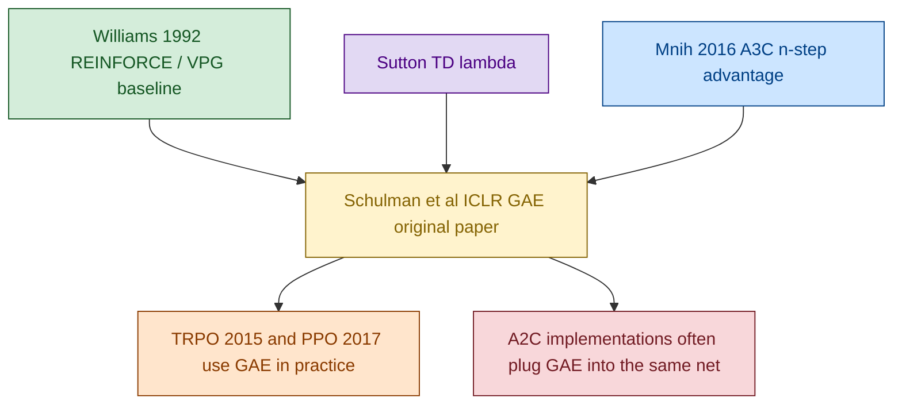
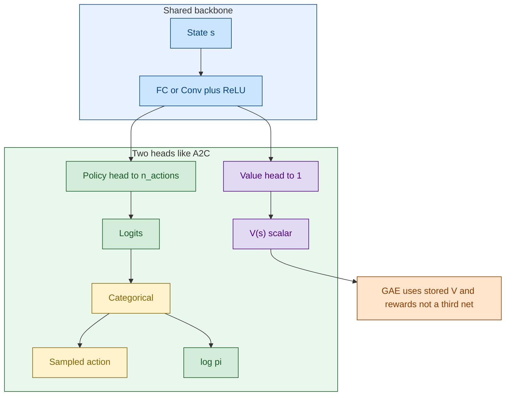
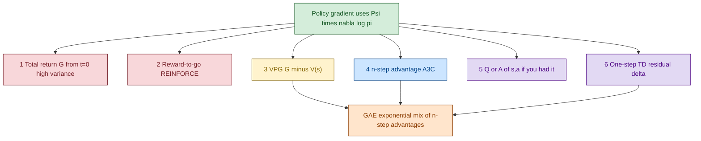
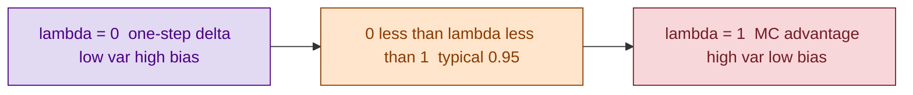
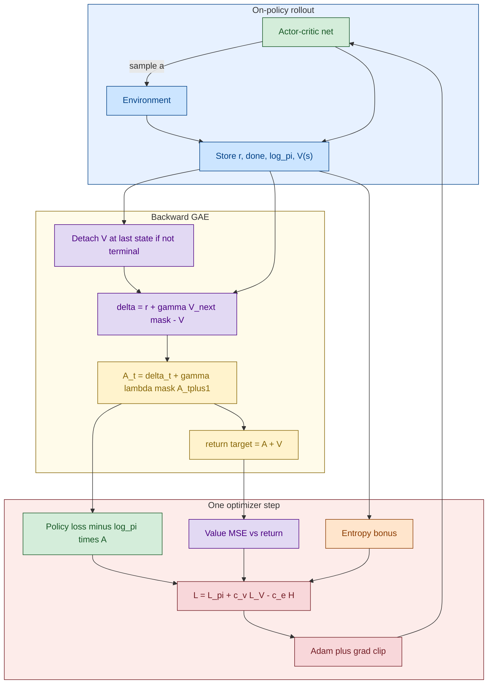

# GAE — Generalized Advantage Estimation

GAE ဟာ **network architecture အသစ် မဟုတ်ပါ**။ [VPG](./07_1_PB_VPG.md) ကနေ [A3C](./08_1_PB_actor-critic_A3C.md) / [A2C](./09_PB_actor-critic_A2C.md) အထိ သုံးတဲ့ policy-gradient ထဲက **`Ψ_t` (advantage / return estimator)** ကို bias–variance ချိန်ပေးတဲ့ တွက်ကိန်း ဖြစ်ပါတယ်။ Actor-critic net က A2C နဲ့ တူနိုင်တယ်။ ပြောင်းတာက `A_t` ဘယ်လိုရလဲ ဆိုတာပဲ။

> **အနှစ်ချုပ်:** `δ_t` (TD residual) တွေကို `(γλ)^l` နဲ့ exponential mix လုပ်တယ်။ `λ = 0` → 1-step (bias များ)။ `λ = 1` → MC advantage (variance များ)။ လက်တွေ့ `λ ≈ 0.95`။ Target Q-network မလို။

## Original Paper နှင့် ဆက်စပ် Papers

1. **Schulman, Moritz, Levine, Jordan & Abbeel (2015/2016)**, *High-Dimensional Continuous Control Using Generalized Advantage Estimation* (ICLR) — **main paper**။
2. **Sutton (1988) / Sutton & Barto** — TD(λ); GAE က advantage ဘက်က λ-return နဲ့ ဆင်တယ်။
3. **Williams (1992)** REINFORCE — `Ψ = G_t` စွန်း။
4. **Mnih et al. (2016)** A3C — n-step advantage = GAE ရဲ့ အထူးကိစ္စ (`λ` ကို n-step ကပ်လျက်)။
5. **Schulman et al. (2015) TRPO** နှင့် **(2017) PPO** — GAE ကို policy update နဲ့ တွဲသုံးလေ့ရှိ (PPO implementations အများစု)။
6. **OpenAI Baselines A2C (2017)** / Grokking Ch. 11 — A2C + GAE အဖြစ် တွေ့ရများ။

## Diagram အရောင်များ

GitHub Mermaid အတွက် `%%{init}%%` မသုံးပါ။ `flowchart` + `:::class` သုံးထားပါတယ်။

| အရောင် | Fill / stroke | အဓိပ္ပာယ် |
|---|---|---|
| အပြာနု | `#cce5ff` / `#004085` | Env, rollout, shared backbone |
| အစိမ်းနု | `#d4edda` / `#155724` | Policy head |
| အဝါနု | `#fff3cd` / `#856404` | Advantage / GAE mix |
| ခရမ်းနု | `#e2d9f3` / `#4b0082` | Value head / bootstrap / `δ_t` |
| ပန်းရောင်နု | `#f8d7da` / `#721c24` | Loss |
| လိမ္မော်နု | `#ffe5cc` / `#8a3b00` | `λ` knob / estimator family |

## ဘာပြဿနာကို ဖြေရှင်းတာလဲ

Policy gradient:

```text
g = E[ Σ_t  Ψ_t  ∇ log π(A_t | S_t; θ) ]
```

`Ψ_t` ရွေးမှ variance နဲ့ bias ပြောင်းတယ်။

| Ψ | နာမည် | Variance | Bias |
|---|---|---|---|
| full episode return `G_0` | အစက return | အမြင့်ဆုံး | နည်း |
| reward-to-go `G_t` | REINFORCE | ကြီး | 0 (MC) |
| `G_t - V(s_t)` | VPG | အလယ် | `V` အမှားရှိရင် နည်းနည်း |
| n-step `G_t^{(n)} - V(s_t)` | A3C | နည်းလာ | n တိုလေ bias များ |
| `δ_t = r + γV(s') - V(s)` | 1-step TD | အနိမ့်ဆုံး | အမြင့်ဆုံး |

GAE က n-step advantage အားလုံးကို λ နဲ့ ပေါင်းတယ်။

```text
δ_t     = r_t + γ V(s_{t+1}) (1 - d_t) - V(s_t)
A_t^GAE = δ_t + (γλ)(1-d_t) A_{t+1}^GAE
R_t     = A_t^GAE + V(s_t)          # critic target
```

`d_t = 1` (true terminal) မှာ bootstrap ဖြတ်။ Time-limit truncate ကို terminal လို့ မမှားပါနှင့်။

## Diagram 1 — Paper Lineage



## Diagram 2 — Network (A2C နဲ့ တူ — GAE က head မထည့်)

docker `07_gae` / Grokking GAE agent: **shared actor-critic တစ်ခု**။ Extra GAE network မရှိ။



CartPole ဥပမာ: `4 → 128 ReLU → {logits 2, V 1}`။ Acting မှာ `V` မလို။ GAE က rollout ပြီးမှ `V` sequence ကို သုံးတယ်။

## Diagram 3 — Ψ estimators (စာအုပ် math slide)



## Diagram 4 — λ spectrum



n-step A3C က fixed `n` တစ်ခု။ GAE က n အားလုံး ပေါင်းပြီး `λ` နဲ့ အလေးပေးတယ်။

## Diagram 5 — Training loop (GAE recursion)



Priority / IS weight မရှိ။ Replay မရှိ။ Target clone မရှိ။ `detach` က graph ပြန်မဝင်အောင်။

## VPG vs A3C vs GAE vs A2C

| | VPG | A3C n-step | GAE | A2C |
|---|---|---|---|---|
| ဘာလဲ | algorithm | algorithm | **estimator** | algorithm |
| Net | policy + value သီးခြား | AC heads / copies | **A3C/A2C net ပြန်သုံး** | shared AC |
| Ψ | `G - V` MC | fixed n-step | **λ-mix of n-step** | n-step သို့မဟုတ် GAE |
| Bootstrap | မရှိ | ရှိ | **ရှိ (`δ` ထဲ `V`)** | ရှိ |
| Parallel | မလို | async workers | မသတ်မှတ် | sync envs |

## Q&A

### မေး ၁။ GAE network ထပ်လိုသလား?

**မလို။** `V(s)` ရှိပြီးသား actor-critic ပေါ်မှာ `δ` နဲ့ recursion သာ။

### မေး ၂။ `λ` နဲ့ `γ` ကွာသလား?

`γ` က reward discount (MDP)။ `λ` က **estimator mixing** — environment dynamics မဟုတ်။

### မေး ၃။ Actor-critic လား?

GAE ကိုယ်တိုင်က estimator။ `V(s')` bootstrap သုံးလို့ **တွဲသုံးတဲ့ agent က actor-critic** ဖြစ်တယ်။ VPG MC `G-V` ပေါ် GAE တပ်လို့ မရသလောက် (δ မှာ `V(s')` လို)။

### မေး ၄။ Target network လား?

မဟုတ်။ နောက် state `V` က **လက်ရှိ** critic၊ `.detach()` ပဲ။

## အနှစ်ချုပ်

```text
GAE        → not a new net
delta      → r + γ V(s')(1-d) - V(s)
A          → mix deltas with (γλ)
λ=0 / λ=1  → 1-step / MC-like
plugs into → A3C, A2C, PPO
```
