# GAE — Generalized Advantage Estimation: Network၊ TD Residual နှင့် Algorithm

**GAE က network architecture အသစ်မဟုတ်ဘဲ policy gradient အတွက် advantage estimate တွက်နည်း** ဖြစ်ပါတယ်။ [VPG](./07_1_PB_VPG.md) ရဲ့ MC estimate နဲ့ [A3C](./08_1_PB_actor-critic_A3C.md) ရဲ့ short n-step estimate အကြား bias–variance trade-off ကို `λ` နဲ့ ညှိနိုင်အောင် လုပ်ထားတာပါ။

## ၁။ Original Paper နှင့် Related Papers

| ရင်းမြစ် | ဖတ်ရန် / ဆက်စပ်ပုံ |
|---|---|
| **Schulman, Moritz, Levine, Jordan & Abbeel — [High-Dimensional Continuous Control Using Generalized Advantage Estimation](https://arxiv.org/abs/1506.02438)** | **June 2015 preprint / ICLR 2016**; Section 3 ရဲ့ TD residual နဲ့ GAE derivation |
| **[Original PDF](https://arxiv.org/pdf/1506.02438)** | Section 6.1: experiments မှာ GAE ကို **TRPO** နဲ့ ပေါင်းသုံးထားပုံ |
| **Schulman et al., ICML 2015 — [Trust Region Policy Optimization](https://proceedings.mlr.press/v37/schulman15.html)** | Policy update ကို trust region နဲ့ ထိန်းတဲ့ optimizer-side method |
| **Schulman et al., 2017 — [Proximal Policy Optimization Algorithms](https://arxiv.org/abs/1707.06347)** | Advantage estimates ကို policy surrogate ထဲ ထည့်သုံးတဲ့ နောက်ဆက်တွဲနည်း |
| **[Chapter 11 မှတ်စု](../chapter_11_summarized.md)** | ဒီ repo မှာ A3C-style actor-critic ပေါ် GAE ထည့်သုံးပုံ |

**ဖိုင်စဉ်က publication chronology မဟုတ်ပါဘူး။** GAE က A3C ပြီးမှ ထွက်လာတဲ့ version မဟုတ်ပါဘူး။ မူရင်း GAE experiments က separate policy/value neural networks နဲ့ TRPO သုံးထားပြီး **A3C worker system မလိုပါဘူး**။

### အရောင်အသုံးပြုပုံ (Color Rule)

[အရောင် ၈ မျိုးနှင့် network label သတ်မှတ်ချက် — 00_1_color_define.md](./00_1_color_define.md)

| အသုံးပြုပုံ | အရောင် | နမူနာ | Fill | Text |
|---|---|---|---|---|
| Policy Network / Actor; Online / Current Q Network | **Green / အစိမ်း** |  | `#008000` | `#FFFFFF` |
| Value Network / Critic / Baseline; Dueling value head | **Orange / လိမ္မော်** |  | `#FF8C00` | `#111111` |
| Frozen Target Network | **Purple / ခရမ်း** |  | `#800080` | `#FFFFFF` |
| State / environment / data / shared backbone | **Blue / အပြာ** |  | `#0057D9` | `#FFFFFF` |
| Batch / sampling / advantage | **Yellow / အဝါ** |  | `#FFD700` | `#111111` |
| Preprocessing / PER / action selection / synchronization | **Cyan / စိမ်းပြာ** |  | `#00CED1` | `#111111` |
| Loss / gradient / optimizer | **Red / အနီ** |  | `#DC143C` | `#FFFFFF` |
| Outputs / probabilities / returns / target values / aggregation | **Gray / မီးခိုး** |  | `#555555` | `#FFFFFF` |

**Green / orange / purple ကို network၊ trainable layer / head တွေအတွက်သာ သီးသန့်သုံးပါတယ်။** Network block ထဲမှာ `Policy Network`၊ `Value Network`၊ `Online Network` သို့မဟုတ် `Target Network` ဆိုပြီး အမျိုးအစားပါပါတယ်။ Neuron များကို စုပြထားသောပုံမှာ အမျိုးအစားကို enclosing network / layer ခေါင်းစဉ်မှာ ရေးထားပါတယ်။

Shared actor-critic block မှာ **Policy Network + Value Network** နှစ်ခုလုံးကို ဖော်ပြပြီး shared backbone / copy ကို blue သုံးထားပါတယ်။ Shared heads ဖြစ်ရင် သီးခြား model နှစ်ခုရှိတယ်လို့ မဆိုလိုပါဘူး။ Dueling ရဲ့ value / advantage heads က Q Network ထဲက အစိတ်အပိုင်းများဖြစ်ပြီး သီးခြား policy network မဟုတ်ပါဘူး။

**Target value / return = gray၊ Target Network = purple** ဖြစ်ပါတယ်။ Network outputs၊ action sampling၊ loss နဲ့ paper-lineage block များကို network အရောင် ၃ ရောင်နဲ့ မပြပါဘူး။ Group နောက်ခံကို transparent ထားပြီး arrow ကို blue သုံးထားပါတယ်။

## Diagram 1 — Network Architecture နှင့် GAE ထည့်ရသောနေရာ



<details>
<summary>Mermaid source (ပြင်ဆင်ရန်)</summary>

```text
%%{init: {"theme": "base", "themeVariables": {"primaryColor": "#555555", "primaryTextColor": "#FFFFFF", "primaryBorderColor": "#111111", "secondaryColor": "#555555", "tertiaryColor": "#FFFFFF", "lineColor": "#0057D9", "clusterBkg": "#FFFFFF", "clusterBorder": "#555555", "edgeLabelBackground": "#FFFFFF", "textColor": "#111111"}, "htmlLabels": false, "flowchart": {"htmlLabels": false}, "themeCSS": ".edgeLabel text, .edgeLabel tspan { fill: #111111 !important; } .edgeLabel { color: #111111 !important; } .cluster-label text, .cluster-label tspan { fill: #111111 !important; }"}}%%
flowchart TD
    S["Observation s<br/>မူရင်း continuous control: kinematics"] --> P["Policy Network<br/>theta: MLP features"]
    P --> D["Policy Network Output Head<br/>Gaussian mu and std; continuous actions"]
    D --> A["Sample action a"]
    A --> E["Environment"]
    E --> B["Fresh rollout: states, rewards, boundaries"]
    S --> V["Value Network<br/>phi: MLP + linear scalar V(s)"]
    V --> VS["Detached values<br/>V of s_t and V of next state"]
    B --> TD["TD residual delta_t<br/>reward + discounted next value - current value"]
    VS --> TD
    TD --> G["GAE recurrence<br/>A_hat_t = delta_t + gamma lambda times next A_hat"]
    G --> L["Policy update uses detached A_hat<br/>VPG / TRPO / PPO / actor-critic"]
    D --> L
    L -.->|"update theta"| P
    B --> TV["Value regression targets<br/>chosen by the learner"]
    TV --> LV["Value loss"]
    V --> LV
    LV -.->|"update phi"| V
    classDef data fill:#0057D9,stroke:#111111,stroke-width:2px,color:#FFFFFF;
    classDef batch fill:#FFD700,stroke:#111111,stroke-width:2px,color:#111111;
    classDef train fill:#DC143C,stroke:#111111,stroke-width:2px,color:#FFFFFF;
    classDef process fill:#00CED1,stroke:#111111,stroke-width:2px,color:#111111;
    classDef result fill:#555555,stroke:#111111,stroke-width:2px,color:#FFFFFF;
    classDef policyNetwork fill:#008000,stroke:#111111,stroke-width:2px,color:#FFFFFF;
    classDef valueNetwork fill:#FF8C00,stroke:#111111,stroke-width:2px,color:#111111;

    class S,E,B data;
    class G batch;
    class L,LV train;
    class A process;
    class VS,TD,TV result;
    class P,D policyNetwork;
    class V valueNetwork;
```

</details>

**Policy/value networks ရှိပြီးသားကို ဆက်သုံးတယ်။** GAE block မှာ trainable weights မရှိပါဘူး။ ဒီ diagram က မူရင်း paper နဲ့ ကိုက်သော separate-network layout ကို အကျဉ်းချုပ်ဆွဲထားတာဖြစ်ပြီး hidden widths အတိအကျကို မသတ်မှတ်ထားပါဘူး။ Discrete actions ဆို categorical head၊ shared actor-critic ဆို trunk တစ်ခုနဲ့ heads နှစ်ခုလည်း သုံးနိုင်ပါတယ်။

## ၂။ Core Equations — TD Error တွေကို Discount လုပ်ပြီးပေါင်းခြင်း

`r_t` = action `a_t` ပြီးနောက် reward၊ `V` = rollout စုချိန်က fixed value estimate၊ `γ` = reward discount၊ `λ` = trace-decay parameter ဖြစ်ပါတယ်။ Episode boundary မရှိသော segment အတွင်း:

$$
\delta_t=r_t+\gamma V(s_{t+1})-V(s_t),
\qquad
\hat A_t^{\mathrm{GAE}(\gamma,\lambda)}
=\sum_{l=0}^{T-t-1}(\gamma\lambda)^l\delta_{t+l}.
$$

`δ_t` က **လက်ရှိ V ထက် one-step result ဘယ်လောက်ပိုကောင်းလဲ** ဆိုတဲ့ signal ပါ။ GAE က နောက်ပိုင်း residual တွေကိုပါ decay လုပ်ပြီး သယ်လာပါတယ်။ **`V(s)` ကို action head အဖြစ်သုံးတာ မဟုတ်ပါဘူး။**

### Diagram 2 — λ က One-step နှင့် Multi-step Signals ကို ချိတ်ပေးပုံ



<details>
<summary>Mermaid source (ပြင်ဆင်ရန်)</summary>

```text
%%{init: {"theme": "base", "themeVariables": {"primaryColor": "#555555", "primaryTextColor": "#FFFFFF", "primaryBorderColor": "#111111", "secondaryColor": "#555555", "tertiaryColor": "#FFFFFF", "lineColor": "#0057D9", "clusterBkg": "#FFFFFF", "clusterBorder": "#555555", "edgeLabelBackground": "#FFFFFF", "textColor": "#111111"}, "htmlLabels": false, "flowchart": {"htmlLabels": false}, "themeCSS": ".edgeLabel text, .edgeLabel tspan { fill: #111111 !important; } .edgeLabel { color: #111111 !important; } .cluster-label text, .cluster-label tspan { fill: #111111 !important; }"}}%%
flowchart LR
    D0["delta_t<br/>weight 1"] --> SUM["Sum = GAE advantage at t"]
    D1["delta at t+1"] --> W1["multiply by gamma lambda"]
    D2["delta at t+2"] --> W2["multiply by gamma lambda squared"]
    DN["later TD residuals"] --> WN["exponentially decaying weights"]
    W1 --> SUM
    W2 --> SUM
    WN --> SUM
    SUM --> SG["Detach A_hat"]
    SG --> L["Weight selected-action log probability<br/>or learner-specific surrogate"]
    classDef batch fill:#FFD700,stroke:#111111,stroke-width:2px,color:#111111;
    classDef train fill:#DC143C,stroke:#111111,stroke-width:2px,color:#FFFFFF;
    classDef result fill:#555555,stroke:#111111,stroke-width:2px,color:#FFFFFF;

    class W1,W2,WN,SUM batch;
    class L train;
    class D0,D1,D2,DN,SG result;
```

</details>

| `λ` | အဓိပ္ပာယ် | အကန့်အသတ် |
|---|---|---|
| `0` | `Â_t = δ_t` — one-step TD advantage | Value approximation error အပေါ် ပိုမှီခိုတယ် |
| `0 < λ < 1` | Short/long horizon signals ကို weighted mix လုပ်တယ် | Value မတိကျရင် bias ရှိနိုင်ပြီး variance နဲ့ ချိန်ညှိရတယ် |
| `1` | Full terminal episode မှာ `Â_t = G_t − V(s_t)` | MC baseline ပုံစံ၊ ပုံမှန်အားဖြင့် variance ပိုမြင့်နိုင်တယ် |

**`λ=1` ကို rollout cutoff မှာဖြတ်ထားရင်** `Â_t = bootstrapped return − V(s_t)` ဖြစ်ပြီး endpoint value error ရှိနိုင်သေးပါတယ်။ Complete terminal episode ရမှ MC equivalence အပြည့်ရပါတယ်။ `V=Vπ` အတိအကျဆိုရင် intermediate `λ` က value approximation ကြောင့်ဖြစ်တဲ့ bias မထည့်ပါဘူး။ `γ` က reward horizon / objective ကို သတ်မှတ်တာ၊ `λ` က estimator ရဲ့ trace ကို ညှိတာဖြစ်လို့ parameter နှစ်ခုကို အစားထိုးမသုံးရပါဘူး။

## Diagram 3 — Practical Algorithm: Boundary-aware Backward Pass



<details>
<summary>Mermaid source (ပြင်ဆင်ရန်)</summary>

```text
%%{init: {"theme": "base", "themeVariables": {"primaryColor": "#555555", "primaryTextColor": "#FFFFFF", "primaryBorderColor": "#111111", "secondaryColor": "#555555", "tertiaryColor": "#FFFFFF", "lineColor": "#0057D9", "clusterBkg": "#FFFFFF", "clusterBorder": "#555555", "edgeLabelBackground": "#FFFFFF", "textColor": "#111111"}, "htmlLabels": false, "flowchart": {"htmlLabels": false}, "themeCSS": ".edgeLabel text, .edgeLabel tspan { fill: #111111 !important; } .edgeLabel { color: #111111 !important; } .cluster-label text, .cluster-label tspan { fill: #111111 !important; }"}}%%
flowchart TD
    C["Collect rollout<br/>Use current Policy Network"] --> B["Rewards, values, next values<br/>terminal and boundary flags"]
    B --> M["Masks ခွဲသတ်မှတ်<br/>b: bootstrap allowed<br/>c: next residual belongs to same episode"]
    M --> D["delta_t = r_t + gamma b_t V_next - V_t"]
    D --> I["Initialize next advantage = 0<br/>at end of available rollout"]
    I --> G["Backward loop<br/>A_hat_t = delta_t + gamma lambda c_t A_hat_next"]
    G --> T["Detach advantages and chosen value targets"]
    T --> P["Update Policy Network<br/>Learner-specific policy objective"]
    T --> V["Update Value Network<br/>Value regression objective"]
    P --> C
    classDef data fill:#0057D9,stroke:#111111,stroke-width:2px,color:#FFFFFF;
    classDef batch fill:#FFD700,stroke:#111111,stroke-width:2px,color:#111111;
    classDef train fill:#DC143C,stroke:#111111,stroke-width:2px,color:#FFFFFF;
    classDef result fill:#555555,stroke:#111111,stroke-width:2px,color:#FFFFFF;

    class C,B data;
    class G batch;
    class P,V train;
    class M,D,I,T result;
```

</details>

**Bootstrap mask `b` နဲ့ trace-continuation mask `c` ကို ခွဲဖတ်ပါ။**

| Transition အမျိုးအစား | `b_t` | `c_t` | ဘာကြောင့်လဲ? |
|---|---|---|---|
| ပုံမှန် nonterminal၊ same episode | `1` | `1` | Next value နဲ့ next residual နှစ်ခုလုံး ဆက်ယူနိုင် |
| True task terminal | `0` | `0` | Future value သုည၊ episode ပြီး |
| External time-limit truncation + reset | `1` | `0` | Final observation value နဲ့ bootstrap၊ reset episode ဆီ trace မကူး |
| Rollout အဆုံး၊ episode မပြီး | `1` | ရရှိသမျှ segment မှာပဲ ရပ် | Endpoint value သုံးပြီး အပြင်က residual မရှိလို့ `Â_next=0` ထား |

အထက်ပါ truncation rule က **underlying task ဆက်နိုင်သေးတဲ့ external cutoff** အတွက်ပါ။ Task ကိုယ်တိုင် finite horizon ပြီးသွားရင် true terminal အဖြစ် သတ်မှတ်ရပါတယ်။ Auto-reset environment မှာ `V_next` ကို **final observation** ကနေယူပါ။

Practical actor-critic version တစ်ခုမှာ `R̂_t^λ = sg(Â_t + V_old(s_t))` ကို critic target အဖြစ် သုံးနိုင်ပါတယ်။ ဒါက **ရွေးချယ်ထားတဲ့ value-fitting rule** ဖြစ်ပြီး GAE ရဲ့ မဖြစ်မနေ requirement မဟုတ်ပါဘူး; မူရင်း paper ရဲ့ value fitting ကို ဒီ rule နဲ့ တူတယ်လို့ မယူပါနှင့်။

### ကိန်းဂဏန်း ဥပမာ

Terminal 3-step episode မှာ `δ=[1,2,3]`၊ `γ=0.9`၊ `λ=0.8` ဆို `γλ=0.72` ဖြစ်ပါတယ်။

```text
A_hat_2 = 3
A_hat_1 = 2 + 0.72 × 3       = 4.16
A_hat_0 = 1 + 0.72 × 4.16    = 3.9952
```

ဒါကြောင့် step 0 ရဲ့ learning signal ထဲမှာ နောက်ကျရောက်လာတဲ့ residual တွေပါ သက်ရောက်ပါတယ်။ **Environment reward ကို တကယ်ပြောင်းရေးတာ မဟုတ်ပါဘူး။**

## ၃။ Q&A

### မေး ၁။ GAE network သီးခြားထပ်လိုသလား?

မလိုပါဘူး။ ရှိပြီးသား value estimates နဲ့ rewards ပေါ်က **weighted-sum / backward recurrence** ပါ။ Trainable advantage head မရှိပါဘူး။

### မေး ၂။ A3C၊ A2C၊ PPO ဘယ်တစ်ခုနဲ့ပဲ သုံးလို့ရသလဲ?

တစ်ခုတည်းအတွက် မဟုတ်ပါဘူး။ GAE က advantage estimator ဖြစ်လို့ learner ရဲ့ policy objective နဲ့ data assumptions ကိုက်ရင် VPG၊ TRPO၊ PPO၊ A2C သို့မဟုတ် A3C-style learner နဲ့ တွဲနိုင်ပါတယ်။

### မေး ၃။ `λ` ကြီးရင် အမြဲပိုကောင်းသလား?

မဟုတ်ပါဘူး။ Delayed signal ပိုသယ်လာပေမယ့် variance မြင့်နိုင်ပါတယ်။ Value quality၊ rollout length နဲ့ task ပေါ်မူတည်လို့ `λ=0.95` က universal optimum မဟုတ်ပါဘူး။

### မေး ၄။ `δ_t` က true advantage လား?

Sample တစ်ခုရဲ့ TD residual ဖြစ်ပါတယ်။ Value မှန်ကန်ရင် conditional expectation က advantage နဲ့ ကိုက်ပေမယ့် **sample တစ်ခုစီက true advantage နဲ့ အတိအကျမတူပါဘူး**။

### မေး ၅။ ဘာကို detach လုပ်ရသလဲ?

Standard policy-gradient update အတွက် **GAE calculation နဲ့ advantage output ကို fixed signal** အဖြစ်ထားပါတယ်။ Critic update မှာ target ကို detach လုပ်ပြီး current `Vφ(s)` prediction ဆီပဲ gradient စီးစေပါတယ်။

### မေး ၆။ GAE က replay data အဟောင်းကို on-policy ဖြစ်အောင် လုပ်ပေးသလား?

မလုပ်ပေးပါဘူး။ Advantage variance ကို ကိုင်တွယ်တာဖြစ်ပြီး behavior-policy mismatch ကို correction လုပ်ပေးတာ မဟုတ်ပါဘူး။

### မေး ၇။ A2C သုံးရင် GAE မဖြစ်မနေလိုသလား?

မလိုပါဘူး။ [A2C](./10_1_PB_actor-critic_A2C.md) က synchronous update scheme ဖြစ်ပြီး n-step advantage သို့မဟုတ် GAE ကို ရွေးသုံးနိုင်ပါတယ်။
