# A2C — Synchronous Advantage Actor-Critic: Shared Network နှင့် Batched Algorithm

[A3C](./08_1_PB_actor-critic_A3C.md) က worker အဆင်သင့်ဖြစ်တိုင်း global parameters ပြင်ပါတယ်။ **A2C (Advantage Actor-Critic)** က workers / environments အားလုံးဆီက rollout ကို **တူညီတဲ့ policy version နဲ့ စု၊ batch ပေါင်း၊ တစ်ပြိုင်တည်း update** လုပ်ပါတယ်။

## ၁။ Original Foundation နှင့် Related Sources

| ရင်းမြစ် | ဆက်စပ်ပုံ / ဖတ်ရန် |
|---|---|
| **Mnih et al., ICML 2016 — [Asynchronous Methods for Deep Reinforcement Learning](https://proceedings.mlr.press/v48/mniha16.html)** | A3C ရဲ့ n-step advantage actor-critic အခြေခံ; A2C-only original paper မဟုတ်ပါဘူး |
| **[OpenAI Baselines: ACKTR & A2C — August 18, 2017](https://openai.com/index/openai-baselines-acktr-a2c/)** | **A2C and A3C** အပိုင်း: workers အားလုံးကို စောင့်ပြီး average update လုပ်သော synchronous variant |
| **[Official Baselines A2C implementation](https://github.com/openai/baselines/blob/master/baselines/a2c/a2c.py)** | Policy loss၊ value loss၊ entropy၊ batch size နဲ့ optimizer ကို ချိတ်ထားပုံ |
| **Schulman et al., ICLR 2016 — [GAE](https://arxiv.org/abs/1506.02438)** | Advantage estimator ကို ရွေးချယ်ပြောင်းနိုင်တဲ့ ဆက်စပ်နည်း |
| **Schulman et al., 2017 — [PPO](https://arxiv.org/abs/1707.06347)** | Synchronous rollout batch သုံးနိုင်ပေမယ့် policy-ratio / clipped objective ပါသော သီးခြားနည်း |

**A2C အတွက် အများလက်ခံထားတဲ့ သီးခြား original paper တစ်စောင်တည်း မရှိပါဘူး။** ဒီမှာ A3C paper နဲ့ official synchronous implementation ရှင်းလင်းချက်ကို အခြေခံထားပါတယ်။ Release ခေါင်းစဉ်မှာပါတဲ့ **ACKTR က သီးခြား algorithm** ဖြစ်ပြီး ACKTR paper ကို A2C မူရင်း paper လို့ မယူသင့်ပါဘူး။

### အရောင်အသုံးပြုပုံ (Color Rule)

[အရောင် ၈ မျိုးနှင့် network label သတ်မှတ်ချက် — 00_1_color_define.md](./00_1_color_define.md)

| အသုံးပြုပုံ | အရောင် | နမူနာ | Fill | Text |
|---|---|---|---|---|
| Policy Network / Actor; Online / Current Q Network | **Green / အစိမ်း** |  | `#008000` | `#FFFFFF` |
| Value Network / Critic / Baseline; Dueling value head | **Orange / လိမ္မော်** |  | `#FF8C00` | `#111111` |
| Frozen Target Network | **Purple / ခရမ်း** |  | `#800080` | `#FFFFFF` |
| State / environment / data / shared backbone | **Blue / အပြာ** |  | `#0057D9` | `#FFFFFF` |
| Batch / sampling / advantage | **Yellow / အဝါ** |  | `#FFD700` | `#111111` |
| Preprocessing / PER / action selection / synchronization | **Cyan / စိမ်းပြာ** |  | `#00CED1` | `#111111` |
| Loss / gradient / optimizer | **Red / အနီ** |  | `#DC143C` | `#FFFFFF` |
| Outputs / probabilities / returns / target values / aggregation | **Gray / မီးခိုး** |  | `#555555` | `#FFFFFF` |

**Green / orange / purple ကို network၊ trainable layer / head တွေအတွက်သာ သီးသန့်သုံးပါတယ်။** Network block ထဲမှာ `Policy Network`၊ `Value Network`၊ `Online Network` သို့မဟုတ် `Target Network` ဆိုပြီး အမျိုးအစားပါပါတယ်။ Neuron များကို စုပြထားသောပုံမှာ အမျိုးအစားကို enclosing network / layer ခေါင်းစဉ်မှာ ရေးထားပါတယ်။

Shared actor-critic block မှာ **Policy Network + Value Network** နှစ်ခုလုံးကို ဖော်ပြပြီး shared backbone / copy ကို blue သုံးထားပါတယ်။ Shared heads ဖြစ်ရင် သီးခြား model နှစ်ခုရှိတယ်လို့ မဆိုလိုပါဘူး။ Dueling ရဲ့ value / advantage heads က Q Network ထဲက အစိတ်အပိုင်းများဖြစ်ပြီး သီးခြား policy network မဟုတ်ပါဘူး။

**Target value / return = gray၊ Target Network = purple** ဖြစ်ပါတယ်။ Network outputs၊ action sampling၊ loss နဲ့ paper-lineage block များကို network အရောင် ၃ ရောင်နဲ့ မပြပါဘူး။ Group နောက်ခံကို transparent ထားပြီး arrow ကို blue သုံးထားပါတယ်။

## Diagram 1 — Shared Actor-Critic Network Architecture



<details>
<summary>Mermaid source (ပြင်ဆင်ရန်)</summary>

```text
%%{init: {"theme": "base", "themeVariables": {"primaryColor": "#555555", "primaryTextColor": "#FFFFFF", "primaryBorderColor": "#111111", "secondaryColor": "#555555", "tertiaryColor": "#FFFFFF", "lineColor": "#0057D9", "clusterBkg": "#FFFFFF", "clusterBorder": "#555555", "edgeLabelBackground": "#FFFFFF", "textColor": "#111111"}, "htmlLabels": false, "flowchart": {"htmlLabels": false}, "themeCSS": ".edgeLabel text, .edgeLabel tspan { fill: #111111 !important; } .edgeLabel { color: #111111 !important; } .cluster-label text, .cluster-label tspan { fill: #111111 !important; }"}}%%
flowchart TD
    S["State batch<br/>N observations at each acting step"] --> F["Shared Network Backbone<br/>Policy Network + Value Network features<br/>MLP / CNN"]
    F --> P["Policy Network (Actor Head)<br/>Linear: K logits per state"]
    F --> V["Value Network (Critic Head)<br/>Linear: one scalar V per state"]
    P --> D["Categorical policy for each environment"]
    D --> A["Sample N actions"]
    A --> E["N parallel / vectorized environments"]
    E -->|"N next observations"| S
    E --> B["Rollout over T steps<br/>T by N transitions"]
    B --> R["n-step targets<br/>bootstrap from endpoint V"]
    R --> ADV["A_hat = target minus V<br/>or optional GAE"]
    V --> ADV
    ADV -->|"detach"| LP["Policy loss"]
    D --> LP
    D --> H["Negative entropy loss"]
    V --> LV["Value loss"]
    R --> LV
    LP --> L["Combined loss"]
    H --> L
    LV --> L
    L -.->|"one backward pass updates shared trunk and heads"| F
    classDef data fill:#0057D9,stroke:#111111,stroke-width:2px,color:#FFFFFF;
    classDef batch fill:#FFD700,stroke:#111111,stroke-width:2px,color:#111111;
    classDef train fill:#DC143C,stroke:#111111,stroke-width:2px,color:#FFFFFF;
    classDef process fill:#00CED1,stroke:#111111,stroke-width:2px,color:#111111;
    classDef result fill:#555555,stroke:#111111,stroke-width:2px,color:#FFFFFF;
    classDef policyNetwork fill:#008000,stroke:#111111,stroke-width:2px,color:#FFFFFF;
    classDef valueNetwork fill:#FF8C00,stroke:#111111,stroke-width:2px,color:#111111;

    class S,F,E data;
    class B,ADV batch;
    class LP,H,LV,L train;
    class A process;
    class D,R result;
    class P policyNetwork;
    class V valueNetwork;
```

</details>

ဒီပုံစံမှာ **logical actor-critic network တစ်ခု၊ heads နှစ်ခု** ပါပါတယ်။ [Chapter 11 ရဲ့ `FCAC`](../chapter_11_summarized.md) ကလည်း shared hidden layers နဲ့ scalar value / action-logits outputs ခွဲထားပါတယ်။ Vector state အတွက် MLP၊ pixels အတွက် CNN သုံးနိုင်ပြီး continuous action မှာ Gaussian policy head သုံးနိုင်ပါတယ်။

**Synchronous updates က A2C ရဲ့ အဓိကဖြစ်ပြီး shared trunk က မဖြစ်မနေ မဟုတ်ပါဘူး။** Policy/value သီးခြား networks နဲ့လည်း ရနိုင်ပါတယ်။ Acting copies ရှိရင် rollout မစခင် တူညီတဲ့ weights ပေးထားရပြီး stale local gradients ကို အဆင်သင့်ဖြစ်သလို ပို့တာ မဟုတ်ပါဘူး။

## Diagram 2 — Full Algorithm: Collect Together → Batch → One Update



<details>
<summary>Mermaid source (ပြင်ဆင်ရန်)</summary>

```text
%%{init: {"theme": "base", "themeVariables": {"primaryColor": "#555555", "primaryTextColor": "#FFFFFF", "primaryBorderColor": "#111111", "secondaryColor": "#555555", "tertiaryColor": "#FFFFFF", "lineColor": "#0057D9", "clusterBkg": "#FFFFFF", "clusterBorder": "#555555", "edgeLabelBackground": "#FFFFFF", "textColor": "#111111"}, "htmlLabels": false, "flowchart": {"htmlLabels": false}, "themeCSS": ".edgeLabel text, .edgeLabel tspan { fill: #111111 !important; } .edgeLabel { color: #111111 !important; } .cluster-label text, .cluster-label tspan { fill: #111111 !important; }"}}%%
flowchart TD
    P["Current Actor-Critic Network<br/>Policy Network + Value Network<br/>Parameters fixed during rollout"]
    P --> E1["Environment 1: T steps"]
    P --> E2["Environment 2: T steps"]
    P --> EN["Environment N: T steps"]
    E1 --> B["Wait for all rollout segments<br/>stack batch with shape T by N"]
    E2 --> B
    EN --> B
    B --> R["Per-environment return recursion<br/>terminal masks and endpoint bootstrap"]
    R --> A["Compute detached advantages<br/>n-step baseline or GAE"]
    B --> F["Policy Network + Value Network forward pass<br/>Recorded states/actions: log probabilities, values, entropy"]
    A --> L["Mean combined loss over B = T times N samples"]
    R --> L
    F --> L
    L --> O["Zero grad, backward, optional grad clipping<br/>one optimizer step"]
    O -->|"new weights for next rollout"| P

    classDef data fill:#0057D9,stroke:#111111,stroke-width:2px,color:#FFFFFF;
    classDef batch fill:#FFD700,stroke:#111111,stroke-width:2px,color:#111111;
    classDef process fill:#00CED1,stroke:#111111,stroke-width:2px,color:#111111;
    classDef result fill:#555555,stroke:#111111,stroke-width:2px,color:#FFFFFF;
    classDef train fill:#DC143C,stroke:#111111,stroke-width:2px,color:#FFFFFF;

    class E1,E2,EN,P data;
    class B,A batch;
    class F process;
    class R result;
    class L,O train;

```

</details>

Environment တစ်ခု episode ပြီးရင် reset ပြီး rollout ဆက်ဖြည့်နိုင်ပါတယ်။ **Terminal mask နဲ့ returns / traces ကို episode အကြား ဖြတ်**ရပါတယ်။ ပြိုင်တူ environment အားလုံး episode တစ်ပြိုင်နက်ပြီးဖို့ မလိုပါဘူး; စောင့်တာက သတ်မှတ်ထားတဲ့ rollout segments ပါ။

`T=5`၊ `N=8` ဆို update တစ်ခါမှာ **`B=40` transitions** ပါပါတယ်။ Temporal returns / GAE ကို **environment တစ်ခုစီအတွက် သီးခြားတွက်ပြီးမှ** batch flatten လုပ်ပါ။ Environment 1 ရဲ့ နောက်ဆုံး step ကို Environment 2 ရဲ့ ပထမ step နဲ့ မဆက်တွက်ရပါဘူး။

## ၂။ Loss နှင့် Bootstrap အကျဉ်း

`r_t` = action ပြီးနောက် reward၊ `b_t=0` က true terminal၊ `b_t=1` က bootstrap လုပ်နိုင်တဲ့ transition ဖြစ်ပါတယ်။ Chunk endpoint မှာ detached value နဲ့ initialize လုပ်ပြီး episode boundaries မှန်အောင် နောက်ပြန်တွက်ပါ။

$$
\hat R_t=r_t+\gamma b_t\hat R_{t+1},
\qquad
\hat A_t=\hat R_t-V_\phi(s_t).
$$

$$
\mathcal L_\pi=-\mathrm{mean}_{t,i}\left[\log\pi_\theta(a_{t,i}\mid s_{t,i})\mathrm{sg}(\hat A_{t,i})\right],
\quad
\mathcal L_V=\tfrac12\mathrm{mean}_{t,i}\left[(V_\phi(s_{t,i})-\mathrm{sg}(\hat R_{t,i}))^2\right].
$$

$$
\mathcal L=\mathcal L_\pi+c_V\mathcal L_V-c_H\mathrm{mean}_{t,i}H[\pi_\theta(\cdot\mid s_{t,i})].
$$

`sg` = stop-gradient၊ `cV` = critic weight၊ `cH ≥ 0` = entropy coefficient ပါ။ Minimize လုပ်တဲ့ loss မှာ **entropy ကို minus နဲ့ထည့်**လို့ exploration ကို အားပေးပါတယ်။ Shared trunk ကို actor/critic losses နှစ်ခုလုံးက သင်ပေးပါတယ်။ Advantage detach လုပ်ထားတာကြောင့် value head ဆီ actor loss က တိုက်ရိုက် gradient မစီးပါဘူး။

**Truncation + reset သတိ:** အထက် return recursion က episode အတွင်းအတွက်ပါ။ External time limit ရောက်ရင် task ဆက်နိုင်သေးသော **final observation value** နဲ့ segment ကို အဆုံးသတ်တွက်ပါ; reset episode ရဲ့ return ကို ရှေ့ episode ဆီ မဆက်ပါနှင့်။ GAE ရွေးသုံးရင် [bootstrap / trace masks ခွဲပုံ](./09_1_PB_GAE.md) ကို ကြည့်ပါ။

## Diagram 3 — A3C vs A2C: Update Timing ကွာခြားပုံ



<details>
<summary>Mermaid source (ပြင်ဆင်ရန်)</summary>

```text
%%{init: {"theme": "base", "themeVariables": {"primaryColor": "#555555", "primaryTextColor": "#FFFFFF", "primaryBorderColor": "#111111", "secondaryColor": "#555555", "tertiaryColor": "#FFFFFF", "lineColor": "#0057D9", "clusterBkg": "#FFFFFF", "clusterBorder": "#555555", "edgeLabelBackground": "#FFFFFF", "textColor": "#111111"}, "htmlLabels": false, "flowchart": {"htmlLabels": false}, "themeCSS": ".edgeLabel text, .edgeLabel tspan { fill: #111111 !important; } .edgeLabel { color: #111111 !important; } .cluster-label text, .cluster-label tspan { fill: #111111 !important; }"}}%%
flowchart LR
    subgraph ASYNC [A3C - Asynchronous]
        W1["Worker 1 ready"] --> U1["Global update 1"]
        W2["Worker 2 ready later"] --> U2["Global update 2"]
        U1 --> G["Global Actor-Critic Network Weights<br/>Policy Network + Value Network<br/>May change during other rollouts"]
        U2 --> G
    end
    subgraph SYNC [A2C - Synchronous]
        E1["Environment 1 segment"] --> B["Wait and combine all segments"]
        E2["Environment 2 segment"] --> B
        B --> U["One batched optimizer update"]
        U --> P["Updated Actor-Critic Network<br/>Policy Network + Value Network<br/>Same version for next collection"]
    end
    classDef data fill:#0057D9,stroke:#111111,stroke-width:2px,color:#FFFFFF;
    classDef batch fill:#FFD700,stroke:#111111,stroke-width:2px,color:#111111;
    classDef train fill:#DC143C,stroke:#111111,stroke-width:2px,color:#FFFFFF;

    class W1,W2,E1,E2,G,P data;
    class B batch;
    class U1,U2,U train;
    style ASYNC fill:none,stroke:#555555,stroke-width:2px,color:#111111;
    style SYNC fill:none,stroke:#555555,stroke-width:2px,color:#111111;
```

</details>

| အချက် | A3C | A2C |
|---|---|---|
| Data collection | Local policies / environments အများကြီး | Same-version policy နဲ့ environments အများကြီး |
| Update | Worker ready ဖြစ်တိုင်း | Segments အားလုံးစု၊ batch တစ်ခုနဲ့ update |
| Policy lag | Local gradient stale ဖြစ်နိုင် | Collection အတွင်း learner weights ကို မပြောင်းထား |
| Compute | CPU worker updates နဲ့ အဆင်ပြေ | Batched network calls ကြောင့် GPU သုံးရလွယ် |
| အကန့်အသတ် | Concurrent updates / stale gradients | နှေးသော environment ကို စောင့်ရနိုင် |
| Advantage | Original n-step | n-step သို့မဟုတ် optional GAE |

## ၃။ Q&A

### မေး ၁။ A2C က deterministic policy လား?

မဟုတ်ပါဘူး။ Official description ရဲ့ synchronous / deterministic implementation ဆိုတာ **update coordination** ကို ရည်ညွှန်းတာပါ။ Actor က stochastic policy ဖြစ်နိုင်ပြီး actions ကို sample လုပ်ပါတယ်။ Hardware/environment randomness ပါလို့ runs အားလုံး အလိုအလျောက် bitwise တူမယ်လို့လည်း မဆိုလိုပါဘူး။

### မေး ၂။ Network တစ်ခုဆို actor နဲ့ critic ကို ဘယ်လိုခွဲသလဲ?

Hidden layers တူပြီး **output heads နှစ်ခု** ခွဲထားတာပါ။ Actor က action logits၊ critic က scalar value ထုတ်ပါတယ်။ ဒါက Dueling ရဲ့ `V+A−mean(A)` aggregation မဟုတ်ပါဘူး။

### မေး ၃။ Advantage ကို network က ထုတ်ပေးသလား?

မထုတ်ပေးပါဘူး။ Value head ထုတ်တဲ့ `V(s)` နဲ့ returns ကနေ တွက်ပါတယ်။ GAE ရွေးသုံးရင် weighted TD residuals ကနေ တွက်ပါတယ်။

### မေး ၄။ GAE မပါရင် A2C မဖြစ်တော့ဘူးလား?

ဖြစ်ပါသေးတယ်။ **A2C က synchronous actor-critic update scheme** ဖြစ်ပြီး GAE က optional estimator ပါ။

### မေး ၅။ A2C နဲ့ PPO က တူသလား?

မတူပါဘူး။ Standard A2C က fresh batch နဲ့ vanilla actor-critic update တစ်ခါ လုပ်ပါတယ်။ PPO က policy probability ratio / clipped surrogate ကိုသုံးပြီး batch တစ်ခုကို epochs အများကြီး optimize လုပ်နိုင်အောင် သတ်မှတ်ထားပါတယ်။

### မေး ၆။ Replay buffer / target network လိုသလား?

Standard A2C မှာ မလိုပါဘူး။ Rollout storage ကို update ပြီးရှင်းတယ်။ Critic target ကို detach လုပ်တာက **သီးခြား frozen target network တစ်ခုရှိတာနဲ့ မတူပါဘူး**။

### မေး ၇။ Workers များရင် အမြဲပိုမြန်၊ ပိုကောင်းသလား?

မသေချာပါဘူး။ Batch ကြီးလာတာနဲ့ update frequency၊ sample usage၊ communication overhead ပြောင်းပါတယ်။ နှေးတဲ့ worker ကို စောင့်ရခြင်းလည်း ရှိနိုင်ပါတယ်။ **Sample efficiency နဲ့ wall-clock speed ကို သီးခြားနှိုင်းပါ။**
