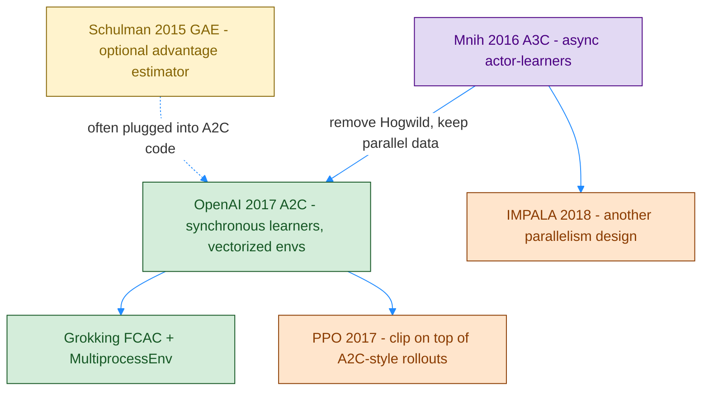
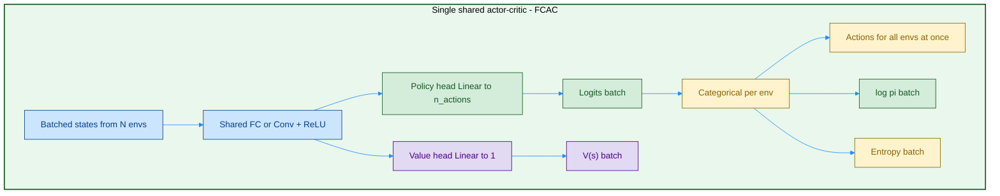
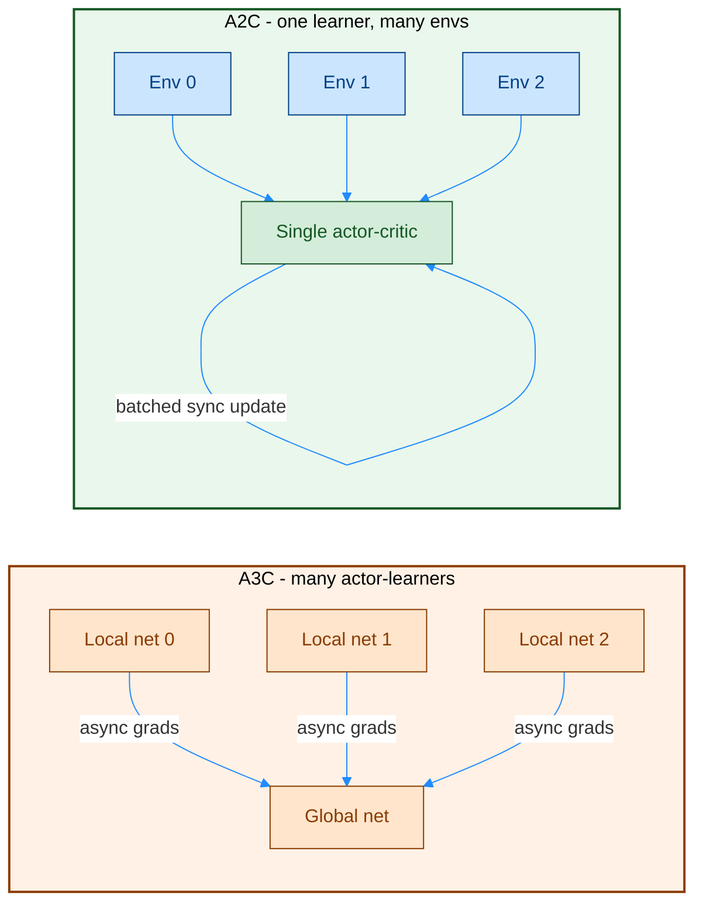
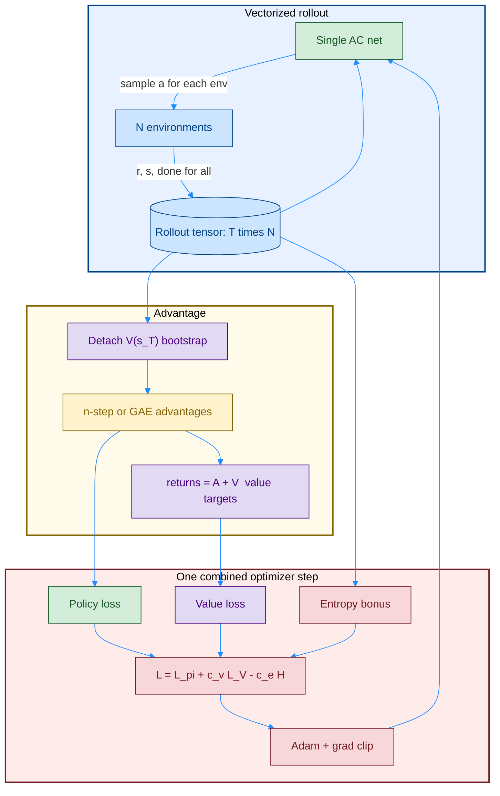

# A2C — Synchronous Advantage Actor-Critic

[A3C](./08_1_PB_actor-critic_A3C.md) ရဲ့ **architecture (actor + critic heads)** ကို ထိန်းထားပြီး **async Hogwild! ကို ဖြုတ်**လိုက်တာက A2C ဖြစ်ပါတယ်။ Worker တွေက environment ကို parallel step လုပ်ပြီး rollout ပြည့်မှ **network တစ်ခုတည်း** ကို batch update လုပ်တယ်။ GPU နဲ့ ကိုက်တယ်။

> **အနှစ်ချုပ်:** Shared actor-critic **တစ်ခုတည်း**။ `num_envs` ကို sync vector အနေနဲ့ step။ n-step (သို့ GAE) advantage။ Target network မရှိ။ Loss တစ်ခုထဲမှာ policy + value − entropy ပေါင်းတယ်။

## Original Paper နှင့် ဆက်စပ် Papers

A2C က peer-reviewed “A2C paper” သီးသန့် မဟုတ်ပါ။ A3C ကို engineering ပြန်ချိန်ထားတဲ့ **OpenAI Baselines** နာမည်ဖြစ်ပါတယ်။

1. **Mnih et al. (2016) ICML** — A3C original; A2C က ဒီ architecture/loss ကို sync ပြန်ရေး။
2. **OpenAI Baselines blog (2017)**, *OpenAI Baselines: ACKTR & A2C* (Wu, Espeholt, Andrychowicz, Zaremba, …) — **A2C နာမည် စတင်ကျယ်သုံး**။ Parallel env + one learner က A3C နဲ့ ယှဉ်ပြီး ပိုတည်ငြိမ် / ပိုမြန်နိုင်ကြောင်း။
3. **Schulman et al. (2015)**, *GAE* — ခေတ်သစ် A2C (SB3, CleanRL, Grokking နောက်ပိုင်း) အများအပြားက n-step အစား **GAE(λ)** သုံး။
4. **Schulman et al. (2017)**, *PPO* — A2C-style rollout + clipped surrogate; နောက်အခန်း။
5. **Morales (2020)** Grokking Ch. 11 — `FCAC` single net, `MultiprocessEnv`။
6. **Espeholt et al. (2018) IMPALA** — sync A2C ထက် actor/learner ခွဲ၊ off-policy correction။

## Diagram အရောင်များ

| အရောင် | Fill / border | အဓိပ္ပာယ် |
|---|---|---|
| အပြာနု | `#cce5ff` / `#004085` | Parallel envs၊ shared backbone |
| အစိမ်းနု | `#d4edda` / `#155724` | Policy head |
| အဝါနု | `#fff3cd` / `#856404` | Advantage / GAE |
| ခရမ်းနု | `#e2d9f3` / `#4b0082` | Value head / bootstrap |
| ပန်းရောင်နု | `#f8d7da` / `#721c24` | Combined loss / Adam |
| လိမ္မော်နု | `#ffe5cc` / `#8a3b00` | Sync batch, vector env (A3C worker နေရာ) |

## ဘာပြဿနာကို ဖြေရှင်းတာလဲ

A3C ရဲ့ lock-free update က implementation ခက်၊ GPU အလဟဿ၊ gradient stale ဖြစ်နိုင်။ A2C က:

- Env N ခု **တစ်ပြိုင်နက်** `step`
- Experience ကို **စုပြီးမှ** learner တစ်ခု update
- Decorrelation ကို async နဲ့မဟုတ်ဘဲ **parallel env တွေရဲ့ မတူတဲ့ state** နဲ့ ရ

Advantage နှစ်မျိုးတွေ့ရတယ်:

```text
# Paper-style / classic n-step (A3C formula, batched)
G_t^{(n)} = n-step return with V(s_{t+n}) bootstrap
A_t       = G_t^{(n)} - V(s_t)

# Common modern A2C (GAE)
δ_t = r_t + γ V(s_{t+1})(1-d_t) - V(s_t)
A_t = GAE(γ, λ) from δ
R_t = A_t + V(s_t)          # value target
L   = -mean(log π · A) + c_v MSE(V, R) - c_e mean(H)
```

GAE က A2C ရဲ့ မဖြစ်မနေ အစိတ်အပိုင်း မဟုတ်။ Orthogonal estimator ဖြစ်ပါတယ်။

## Diagram 1 — Paper Lineage



## Diagram 2 — Network Architecture (အရေးကြီးဆုံး)

A2C architecture က A3C နဲ့ **တူ**တယ်။ ကွာတာက **copy အရေအတွက်** — A2C မှာ live weights တစ်စုံတည်း။ Grokking `FCAC` က Dueling လို hidden မျှပြီး head နှစ်ခု၊ ဒါပေမယ့် output က `Q` မဟုတ် **`(logits, V)` tuple**။



CartPole docker `08_a2c`: `4 → 128 ReLU → {logits: 2, V: 1}`၊ `SyncVectorEnv` default `num_envs=8`။ Grokking: hidden `(32,32)` ပြီး `policy_output` + `value_output`။

```text
forward(s) -> (logits, V)
full_pass  -> action, log_prob, entropy, V
eval       -> argmax(logits)   # value head unused
```

**Target network မရှိ။** Rollout အဆုံး `V(s_T)` ကို **လက်ရှိ** value head နဲ့ တွက်ပြီး `.detach()` လုပ်တယ်။ ဒါက freeze clone မဟုတ်၊ graph ပြန်မဝင်အောင်ပဲ။

## Diagram 3 — A3C vs A2C parallelism



## Diagram 4 — Sync training loop



## Architecture နှိုင်းယှဉ် — REINFORCE → A2C

| | REINFORCE | VPG | A3C | A2C |
|---|---|---|---|---|
| Policy head | ရှိ | ရှိ | ရှိ | ရှိ |
| Value head | မရှိ | သီးခြား net | head သို့မဟုတ် သီးခြား | **shared net head** |
| Bootstrap | မရှိ | မရှိ | n-step `V` | n-step သို့မဟုတ် GAE |
| Actor-critic | မဟုတ် | မဟုတ် | ဟုတ် | **ဟုတ်** |
| Copies in RAM | 1 | 2 nets | 1 global + N local | **1** |
| Parallel | မရှိ | မရှိ | async learners | **sync envs** |
| Target Q | မရှိ | မရှိ | မရှိ | **မရှိ** |
| Typical loss | `-logπ G` | `-logπ A`, MSE `V` | same, Hogwild | **weighted sum, one step** |

## Q&A

### မေး ၁။ Network ဘယ်နှခုလဲ?

**တစ်ခု။** Shared backbone + policy head + value head။ A3C worker copy တွေ မလို။ DQN target မလို။

### မေး ၂။ A3C နဲ့ architecture ကွာသလား?

**မကွာသင့်ပါ** — နှစ်ခုလုံး actor-critic heads။ ကွာတာ parallelism နဲ့ update timing။ Code တချို့က A3C မှာ nets ခွဲ၊ A2C မှာ share — ဒါက implementation choice၊ algorithm definition မဟုတ်။

### မေး ၃။ GAE မထည့်ရင် A2C မဟုတ်ဘူးလား?

**ဟုတ်ပါတယ်။** A2C = synchronous advantage actor-critic။ GAE က advantage တွက်ပုံ option။

### မေး ၄။ Output က action တိုက်ရိုက်လား?

Logits → distribution။ Train: sample။ Eval: `argmax`။ `V(s)` က critic estimate၊ acting မပါ။

## အနှစ်ချုပ်

```text
A2C net     → shared backbone + π head + V head
data        → N envs, sync rollout T steps
advantage   → n-step or GAE (optional)
update      → one Adam step on combined loss
vs A3C      → no local clones, no Hogwild!
vs DQN      → no θ⁻, no replay; on-policy actor-critic
next typical → PPO clip / entropy / GAE on this skeleton
```
