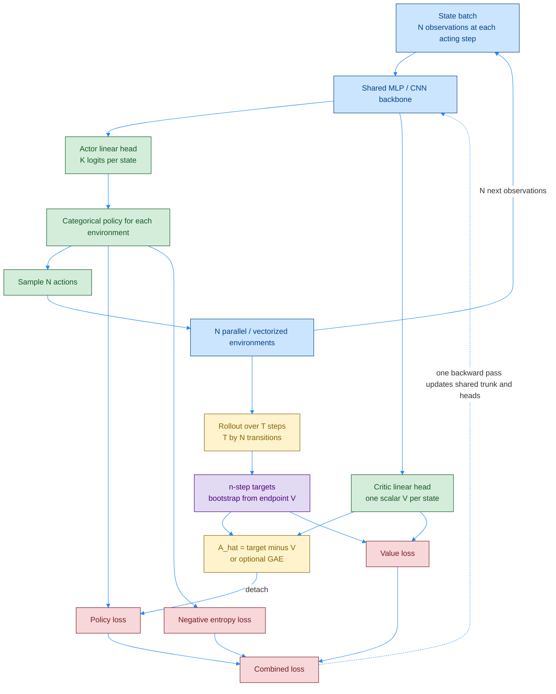
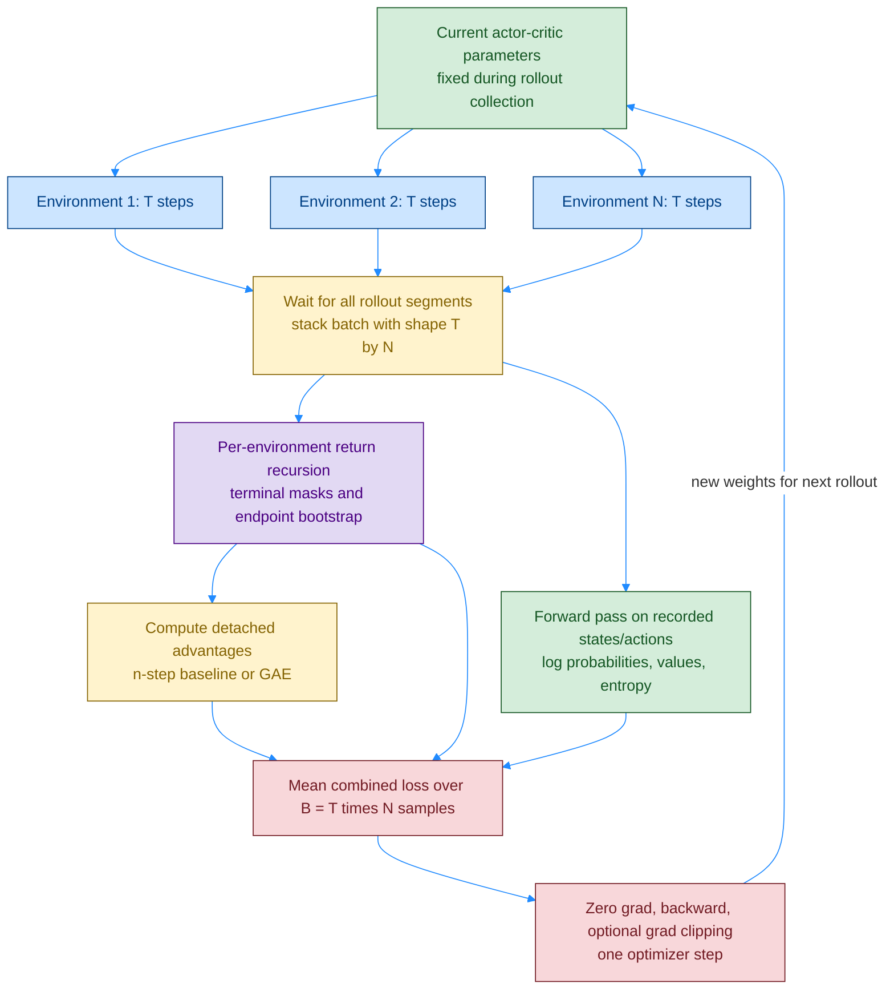
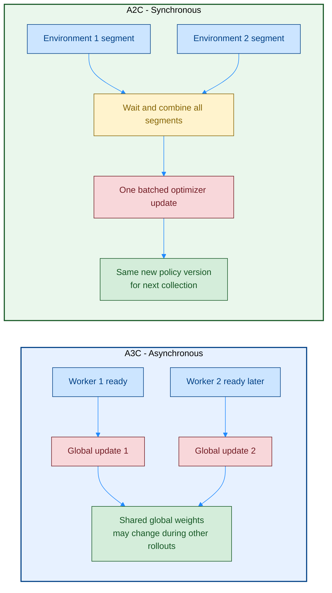

# A2C — Synchronous Advantage Actor-Critic: Shared Network နှင့် Batched Algorithm

[A3C](./08_1_PB_actor-critic_A3C.md) က worker အဆင်သင့်ဖြစ်တိုင်း global parameters ပြင်ပါတယ်။ **A2C (Advantage Actor-Critic)** က workers / environments အားလုံးဆီက rollout ကို **တူညီတဲ့ policy version နဲ့ စု၊ batch ပေါင်း၊ တစ်ပြိုင်တည်း update** လုပ်ပါတယ်။

## ၁။ Original Foundation နှင့် Related Sources

| ရင်းမြစ် | ဆက်စပ်ပုံ / ဖတ်ရန် |
|---|---|
| **Mnih et al., ICML 2016 — [Asynchronous Methods for Deep Reinforcement Learning](https://proceedings.mlr.press/v48/mniha16.html)** | A3C ရဲ့ n-step advantage actor-critic အခြေခံ; A2C-only original paper မဟုတ်ပါဘူး |
| **[OpenAI Baselines: ACKTR & A2C — August 18, 2017](https://openai.com/index/openai-baselines-acktr-a2c/)** | **A2C and A3C** အပိုင်း: workers အားလုံးကို စောင့်ပြီး average update လုပ်သော synchronous variant |
| **[Official Baselines A2C implementation](https://github.com/openai/baselines/blob/master/baselines/a2c/a2c.py)** | Policy loss၊ value loss၊ entropy၊ batch size နဲ့ optimizer ကို ချိတ်ထားပုံ |
| **Schulman et al., ICLR 2016 — [GAE](https://arxiv.org/abs/1506.02438)** | Advantage estimator ကို ရွေးချယ်ပြောင်းနိုင်တဲ့ ဆက်စပ်နည်း |
| **Schulman et al., 2017 — [PPO](https://arxiv.org/abs/1707.06347)** | Synchronous rollout batch သုံးနိုင်ပေမယ့် policy-ratio / clipped objective ပါသော သီးခြားနည်း |

**A2C အတွက် အများလက်ခံထားတဲ့ သီးခြား original paper တစ်စောင်တည်း မရှိပါဘူး။** ဒီမှာ A3C paper နဲ့ official synchronous implementation ရှင်းလင်းချက်ကို အခြေခံထားပါတယ်။ Release ခေါင်းစဉ်မှာပါတဲ့ **ACKTR က သီးခြား algorithm** ဖြစ်ပြီး ACKTR paper ကို A2C မူရင်း paper လို့ မယူသင့်ပါဘူး။

### Color Rule

ရှေ့ဖိုင်တွေရဲ့ **fill / border / text** အတိုင်း: အပြာ `#cce5ff / #004085` = data/environments/shared backbone၊ အစိမ်း `#d4edda / #155724` = policy/value heads၊ အဝါ `#fff3cd / #856404` = rollout batch/advantage၊ ခရမ်း `#e2d9f3 / #4b0082` = bootstrap targets / synchronization၊ ပန်းရောင် `#f8d7da / #721c24` = loss/optimizer။ Arrow = `#218bff`။

## Diagram 1 — Shared Actor-Critic Network Architecture

ဒီပုံစံမှာ **logical actor-critic network တစ်ခု၊ heads နှစ်ခု** ပါပါတယ်။ [Chapter 11 ရဲ့ `FCAC`](../chapter_11_summarized.md) ကလည်း shared hidden layers နဲ့ scalar value / action-logits outputs ခွဲထားပါတယ်။ Vector state အတွက် MLP၊ pixels အတွက် CNN သုံးနိုင်ပြီး continuous action မှာ Gaussian policy head သုံးနိုင်ပါတယ်။

**Synchronous updates က A2C ရဲ့ အဓိကဖြစ်ပြီး shared trunk က မဖြစ်မနေ မဟုတ်ပါဘူး။** Policy/value သီးခြား networks နဲ့လည်း ရနိုင်ပါတယ်။ Acting copies ရှိရင် rollout မစခင် တူညီတဲ့ weights ပေးထားရပြီး stale local gradients ကို အဆင်သင့်ဖြစ်သလို ပို့တာ မဟုတ်ပါဘူး။

## Diagram 2 — Full Algorithm: Collect Together → Batch → One Update

Environment တစ်ခု episode ပြီးရင် reset ပြီး rollout ဆက်ဖြည့်နိုင်ပါတယ်။ **Terminal mask နဲ့ returns / traces ကို episode အကြား ဖြတ်**ရပါတယ်။ ပြိုင်တူ environment အားလုံး episode တစ်ပြိုင်နက်ပြီးဖို့ မလိုပါဘူး; စောင့်တာက သတ်မှတ်ထားတဲ့ rollout segments ပါ။

`T=5`၊ `N=8` ဆို update တစ်ခါမှာ **`B=40` transitions** ပါပါတယ်။ Temporal returns / GAE ကို **environment တစ်ခုစီအတွက် သီးခြားတွက်ပြီးမှ** batch flatten လုပ်ပါ။ Environment 1 ရဲ့ နောက်ဆုံး step ကို Environment 2 ရဲ့ ပထမ step နဲ့ မဆက်တွက်ရပါဘူး။

## ၂။ Loss နှင့် Bootstrap အကျဉ်း

`r_t` = action ပြီးနောက် reward၊ `b_t=0` က true terminal၊ `b_t=1` က bootstrap လုပ်နိုင်တဲ့ transition ဖြစ်ပါတယ်။ Chunk endpoint မှာ detached value နဲ့ initialize လုပ်ပြီး episode boundaries မှန်အောင် နောက်ပြန်တွက်ပါ။

$$
\hat R_t=r_t+\gamma b_t\hat R_{t+1},
\qquad
\hat A_t=\hat R_t-V_\phi(s_t).
$$

$$
\mathcal L_\pi=-\operatorname{mean}_{t,i}\left[\log\pi_\theta(a_{t,i}\mid s_{t,i})\operatorname{sg}(\hat A_{t,i})\right],
\quad
\mathcal L_V=\tfrac12\operatorname{mean}_{t,i}\left[(V_\phi(s_{t,i})-\operatorname{sg}(\hat R_{t,i}))^2\right].
$$

$$
\mathcal L=\mathcal L_\pi+c_V\mathcal L_V-c_H\operatorname{mean}_{t,i}H[\pi_\theta(\cdot\mid s_{t,i})].
$$

`sg` = stop-gradient၊ `cV` = critic weight၊ `cH ≥ 0` = entropy coefficient ပါ။ Minimize လုပ်တဲ့ loss မှာ **entropy ကို minus နဲ့ထည့်**လို့ exploration ကို အားပေးပါတယ်။ Shared trunk ကို actor/critic losses နှစ်ခုလုံးက သင်ပေးပါတယ်။ Advantage detach လုပ်ထားတာကြောင့် value head ဆီ actor loss က တိုက်ရိုက် gradient မစီးပါဘူး။

**Truncation + reset သတိ:** အထက် return recursion က episode အတွင်းအတွက်ပါ။ External time limit ရောက်ရင် task ဆက်နိုင်သေးသော **final observation value** နဲ့ segment ကို အဆုံးသတ်တွက်ပါ; reset episode ရဲ့ return ကို ရှေ့ episode ဆီ မဆက်ပါနှင့်။ GAE ရွေးသုံးရင် [bootstrap / trace masks ခွဲပုံ](./09_1_PB_GAE.md) ကို ကြည့်ပါ။

## Diagram 3 — A3C vs A2C: Update Timing ကွာခြားပုံ

| အချက် | A3C | A2C |
|---|---|---|
| Data collection | Local policies / environments အများကြီး | Same-version policy နဲ့ environments အများကြီး |
| Update | Worker ready ဖြစ်တိုင်း | Segments အားလုံးစု၊ batch တစ်ခုနဲ့ update |
| Policy lag | Local gradient stale ဖြစ်နိုင် | Collection အတွင်း learner weights ကို မပြောင်းထား |
| Compute | CPU worker updates နဲ့ အဆင်ပြေ | Batched network calls ကြောင့် GPU သုံးရလွယ် |
| အကန့်အသတ် | Concurrent updates / stale gradients | နှေးသော environment ကို စောင့်ရနိုင် |
| Advantage | Original n-step | n-step သို့မဟုတ် optional GAE |

## ၃။ Q&A

### မေး ၁။ A2C က deterministic policy လား?

မဟုတ်ပါဘူး။ Official description ရဲ့ synchronous / deterministic implementation ဆိုတာ **update coordination** ကို ရည်ညွှန်းတာပါ။ Actor က stochastic policy ဖြစ်နိုင်ပြီး actions ကို sample လုပ်ပါတယ်။ Hardware/environment randomness ပါလို့ runs အားလုံး အလိုအလျောက် bitwise တူမယ်လို့လည်း မဆိုလိုပါဘူး။

### မေး ၂။ Network တစ်ခုဆို actor နဲ့ critic ကို ဘယ်လိုခွဲသလဲ?

Hidden layers တူပြီး **output heads နှစ်ခု** ခွဲထားတာပါ။ Actor က action logits၊ critic က scalar value ထုတ်ပါတယ်။ ဒါက Dueling ရဲ့ `V+A−mean(A)` aggregation မဟုတ်ပါဘူး။

### မေး ၃။ Advantage ကို network က ထုတ်ပေးသလား?

မထုတ်ပေးပါဘူး။ Value head ထုတ်တဲ့ `V(s)` နဲ့ returns ကနေ တွက်ပါတယ်။ GAE ရွေးသုံးရင် weighted TD residuals ကနေ တွက်ပါတယ်။

### မေး ၄။ GAE မပါရင် A2C မဖြစ်တော့ဘူးလား?

ဖြစ်ပါသေးတယ်။ **A2C က synchronous actor-critic update scheme** ဖြစ်ပြီး GAE က optional estimator ပါ။

### မေး ၅။ A2C နဲ့ PPO က တူသလား?

မတူပါဘူး။ Standard A2C က fresh batch နဲ့ vanilla actor-critic update တစ်ခါ လုပ်ပါတယ်။ PPO က policy probability ratio / clipped surrogate ကိုသုံးပြီး batch တစ်ခုကို epochs အများကြီး optimize လုပ်နိုင်အောင် သတ်မှတ်ထားပါတယ်။

### မေး ၆။ Replay buffer / target network လိုသလား?

Standard A2C မှာ မလိုပါဘူး။ Rollout storage ကို update ပြီးရှင်းတယ်။ Critic target ကို detach လုပ်တာက **သီးခြား frozen target network တစ်ခုရှိတာနဲ့ မတူပါဘူး**။

### မေး ၇။ Workers များရင် အမြဲပိုမြန်၊ ပိုကောင်းသလား?

မသေချာပါဘူး။ Batch ကြီးလာတာနဲ့ update frequency၊ sample usage၊ communication overhead ပြောင်းပါတယ်။ နှေးတဲ့ worker ကို စောင့်ရခြင်းလည်း ရှိနိုင်ပါတယ်။ **Sample efficiency နဲ့ wall-clock speed ကို သီးခြားနှိုင်းပါ။**
