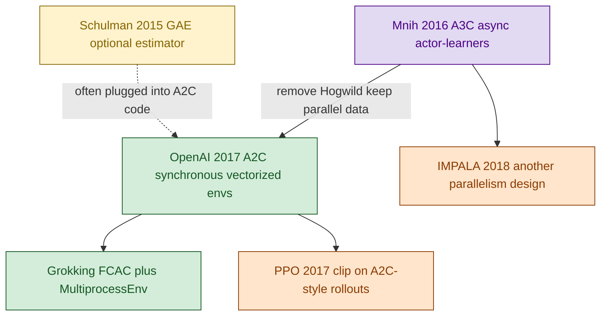
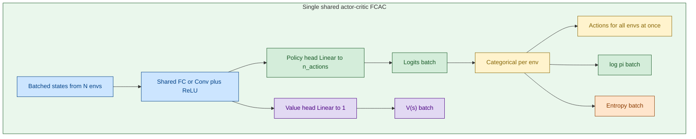
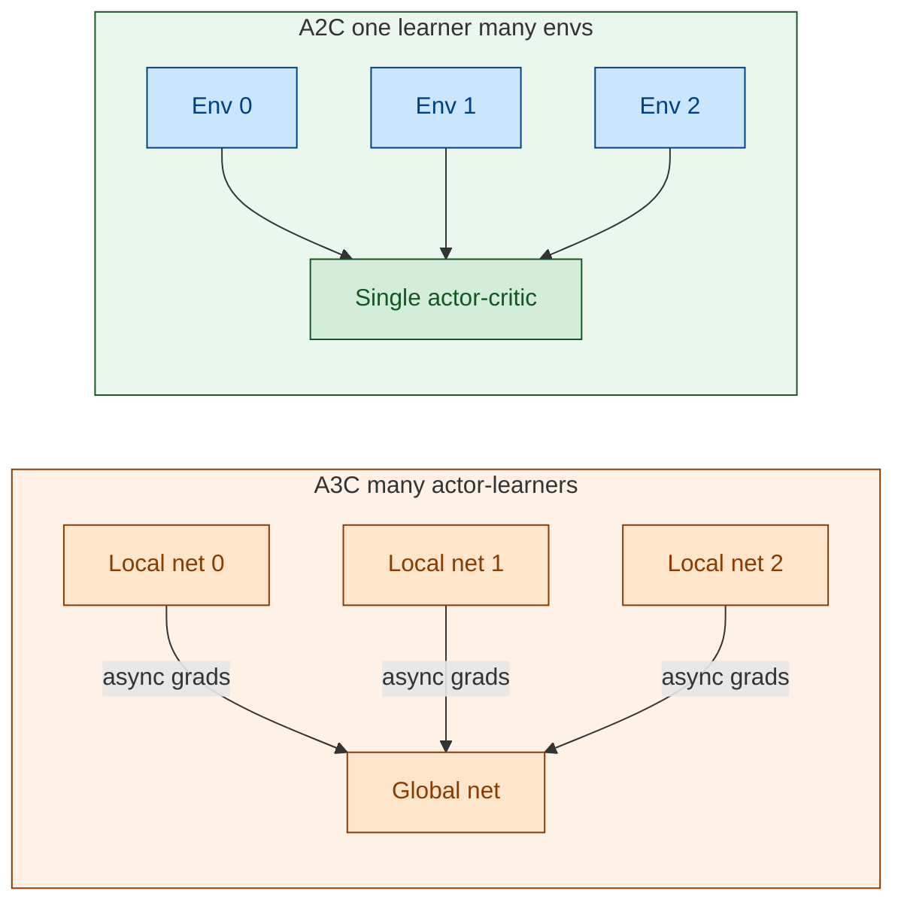
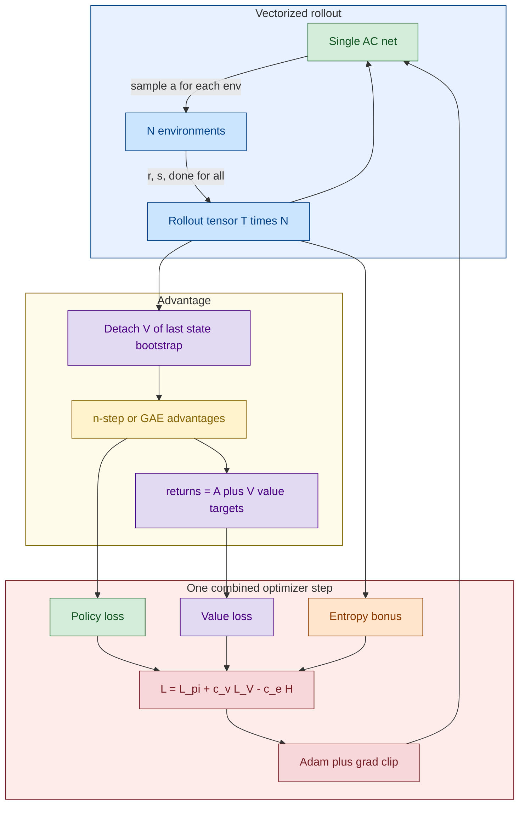

# A2C — Synchronous Advantage Actor-Critic

[A3C](./08_1_PB_actor-critic_A3C.md) ရဲ့ **actor + critic heads** ကို ထိန်းထားပြီး **async Hogwild! ကို ဖြုတ်**လိုက်တာက A2C ဖြစ်ပါတယ်။ Env တွေ parallel step လုပ်ပြီး rollout ပြည့်မှ **network တစ်ခုတည်း** ကို batch update လုပ်တယ်။ GPU နဲ့ ကိုက်တယ်။

> **အနှစ်ချုပ်:** Shared actor-critic တစ်ခုတည်း။ `num_envs` sync vector။ n-step သို့မဟုတ် [GAE](./10_1_PB_GAE.md)။ Target network မရှိ။ Loss တစ်ခုထဲမှာ policy + value − entropy။

## Original Paper နှင့် ဆက်စပ် Papers

A2C က peer-reviewed “A2C paper” သီးသန့် မဟုတ်ပါ။ A3C ကို engineering ပြန်ချိန်ထားတဲ့ **OpenAI Baselines** နာမည်ဖြစ်ပါတယ်။

1. **Mnih et al. (2016) ICML** — A3C original။
2. **OpenAI Baselines blog (2017)**, *ACKTR & A2C* — **A2C နာမည် စတင်ကျယ်သုံး**။
3. **Schulman et al. (2015) GAE** — ခေတ်သစ် A2C အများအပြားက n-step အစား GAE။
4. **Schulman et al. (2017) PPO** — A2C-style rollout + clip။
5. **Morales (2020)** Grokking Ch. 11 — `FCAC` + `MultiprocessEnv`။
6. **Espeholt et al. (2018) IMPALA**။

## Diagram အရောင်များ

GitHub အတွက် `%%{init}%%` မသုံး။ `flowchart` + `:::class`။

| အရောင် | Fill / stroke | အဓိပ္ပာယ် |
|---|---|---|
| အပြာနု | `#cce5ff` / `#004085` | Parallel envs၊ shared backbone |
| အစိမ်းနု | `#d4edda` / `#155724` | Policy head |
| အဝါနု | `#fff3cd` / `#856404` | Advantage / GAE |
| ခရမ်းနု | `#e2d9f3` / `#4b0082` | Value head / bootstrap |
| ပန်းရောင်နု | `#f8d7da` / `#721c24` | Combined loss / Adam |
| လိမ္မော်နု | `#ffe5cc` / `#8a3b00` | Sync batch, vector env |

## ဘာပြဿနာကို ဖြေရှင်းတာလဲ

A3C lock-free update က implementation ခက်၊ GPU အလဟဿ၊ gradient stale ဖြစ်နိုင်။ A2C က env N ခု တစ်ပြိုင်နက် `step`၊ စုပြီးမှ learner တစ်ခု update။

```text
# classic n-step
A_t = G_t^{(n)} - V(s_t)

# common modern A2C
δ_t = r_t + γ V(s_{t+1})(1-d_t) - V(s_t)
A_t = GAE(γ, λ) from δ
R_t = A_t + V(s_t)
L   = -mean(log π · A) + c_v MSE(V, R) - c_e mean(H)
```

GAE က A2C ရဲ့ မဖြစ်မနေ အစိတ်အပိုင်း မဟုတ်။ Orthogonal estimator။

## Diagram 1 — Paper Lineage



## Diagram 2 — Network Architecture

A2C architecture က A3C နဲ့ **တူ**တယ်။ ကွာတာက copy အရေအတွက် — A2C မှာ live weights တစ်စုံတည်း။ Grokking `FCAC` output က `(logits, V)` tuple — `Q` မဟုတ်။



CartPole docker `08_a2c`: `4 → 128 ReLU → {logits 2, V 1}`၊ default `num_envs=8`။

```text
forward(s) -> (logits, V)
full_pass  -> action, log_prob, entropy, V
eval       -> argmax(logits)
```

**Target network မရှိ။** `V(s_T)` ကို လက်ရှိ value head နဲ့ တွက်ပြီး `.detach()` — freeze clone မဟုတ်။

## Diagram 3 — A3C vs A2C parallelism



(Self-loop `NET --> NET` ကို GitHub Mermaid က parse တတ်လို့ ဖြုတ်ထားပါတယ်။ Update က learner တစ်ခုတည်းပေါ်မှာ sync batch ဖြစ်တယ်။)

## Diagram 4 — Sync training loop



## Architecture နှိုင်းယှဉ်

| | REINFORCE | VPG | A3C | A2C |
|---|---|---|---|---|
| Policy head | ရှိ | ရှိ | ရှိ | ရှိ |
| Value head | မရှိ | သီးခြား net | head သို့မဟုတ် သီးခြား | **shared net head** |
| Bootstrap | မရှိ | မရှိ | n-step `V` | n-step သို့မဟုတ် GAE |
| Actor-critic | မဟုတ် | မဟုတ် | ဟုတ် | **ဟုတ်** |
| Copies in RAM | 1 | 2 nets | 1 global + N local | **1** |
| Parallel | မရှိ | မရှိ | async learners | **sync envs** |
| Target Q | မရှိ | မရှိ | မရှိ | **မရှိ** |

## Q&A

### မေး ၁။ Network ဘယ်နှခုလဲ?

**တစ်ခု။** Shared backbone + policy head + value head။

### မေး ၂။ A3C နဲ့ architecture ကွာသလား?

**မကွာသင့်ပါ။** ကွာတာ parallelism နဲ့ update timing။

### မေး ၃။ GAE မထည့်ရင် A2C မဟုတ်ဘူးလား?

**ဟုတ်ပါတယ်** A2C ပါ။ GAE က advantage တွက်ပုံ option — [10_1_PB_GAE.md](./10_1_PB_GAE.md)။

### မေး ၄။ Output က action တိုက်ရိုက်လား?

Logits → distribution။ Train: sample။ Eval: `argmax`။ `V(s)` က critic၊ acting မပါ။

## အနှစ်ချုပ်

```text
A2C net     → shared backbone + π head + V head
data        → N envs, sync rollout T steps
advantage   → n-step or GAE (optional)
update      → one Adam step on combined loss
vs A3C      → no local clones, no Hogwild!
vs DQN      → no θ⁻, no replay
```
