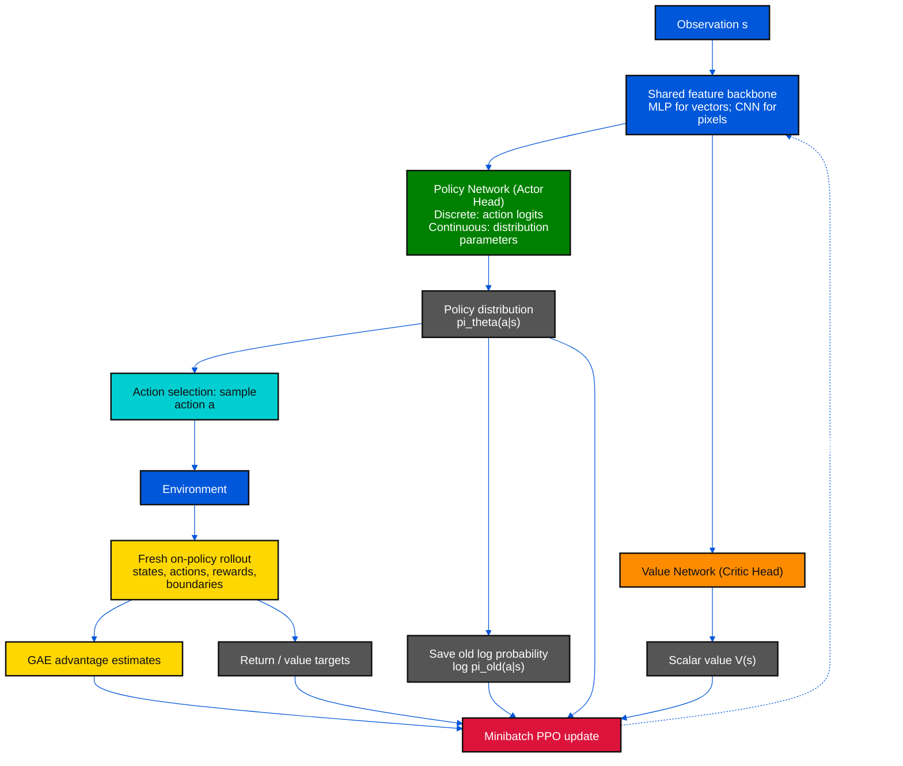
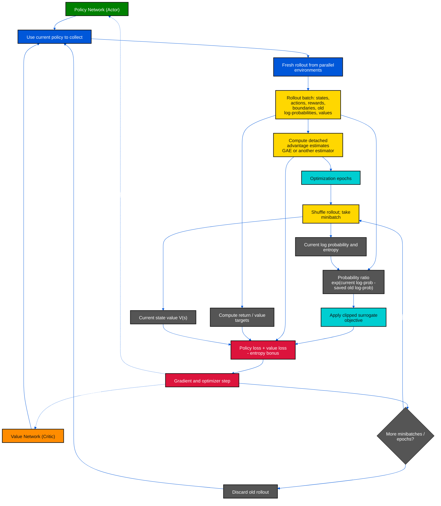

# PPO — Proximal Policy Optimization: Actor-Critic Network၊ Clipped Objective နှင့် Algorithm

[A2C](./10_1_PB_actor-critic_A2C.md) က rollout တစ်ခုအတွက် actor-critic ကို တစ်ကြိမ် update လုပ်ပါတယ်။ **PPO (Proximal Policy Optimization)** က အဲဒီ rollout ကို minibatch ခွဲပြီး optimization epoch အများကြီး ပြန်သုံးနိုင်စေဖို့ policy အသစ်နဲ့ rollout စုခဲ့တဲ့ policy အကြား probability ratio ကို objective ထဲမှာ ထည့်ပါတယ်။ ဒီဖိုင်မှာ လူသုံးများတဲ့ **PPO-Clip** ကို အဓိကရှင်းပြထားပါတယ်။

## ၁။ Original Paper နှင့် Related Papers

| ရင်းမြစ် | ဖတ်ရန် / ဆက်စပ်ပုံ |
|---|---|
| **Schulman, Wolski, Dhariwal, Radford & Klimov, 2017 — [Proximal Policy Optimization Algorithms](https://arxiv.org/abs/1707.06347)** | PPO မူရင်း paper; clipped surrogate နဲ့ adaptive KL-penalty variant နှစ်မျိုးလုံးကို ဆွေးနွေးထားပါတယ် |
| **[Original paper PDF](https://arxiv.org/pdf/1707.06347)** | PPO-Clip pseudocode နဲ့ policy/value clipping ဆိုင်ရာ experiment များ |
| **Schulman et al., ICLR 2016 — [Generalized Advantage Estimation](https://arxiv.org/abs/1506.02438)** | PPO experiment များတွင် မကြာခဏသုံးသော advantage estimator; PPO ကိုယ်တိုင်ရဲ့ clipping rule မဟုတ်ပါ |
| **Schulman et al., ICML 2015 — [Trust Region Policy Optimization](https://proceedings.mlr.press/v37/schulman15.html)** | PPO ရဲ့ motivation နဲ့ဆက်စပ်သော trust-region policy update |
| **[OpenAI Spinning Up: PPO](https://spinningup.openai.com/en/latest/algorithms/ppo.html)** | PPO-Clip ရဲ့ ratio၊ objective၊ practical update loop ကို ရှင်းပြထားသော algorithm reference |
| **[OpenAI Baselines: PPO](https://openai.com/index/openai-baselines-ppo/)** | PPO-Clip ၏ ရည်ရွယ်ချက်နဲ့ အသုံးပြုပုံကို ဖော်ပြထားသော မိတ်ဆက်စာ |

မူရင်းစာတမ်းက **PPO algorithms** ဟု အများကိန်းသုံးထားပါတယ်။ PPO-Clip က KL divergence ကို hard constraint အဖြစ် အတိအကျ enforce လုပ်တဲ့ TRPO မဟုတ်ပါဘူး။ Clipping ဟာ အချိုးအစား အလွန်ပြောင်းသွားခြင်းအတွက် policy objective ရဲ့ incentive ကို လျှော့ပေးတဲ့ heuristic ဖြစ်ပါတယ်။

### အရောင်အသုံးပြုပုံ (Color Rule)

[အရောင် ၈ မျိုးနှင့် network label သတ်မှတ်ချက် — 00_1_color_define.md](./00_1_color_define.md)

| အသုံးပြုပုံ | အရောင် | Fill | Text |
|---|---|---|---|
| Policy Network / Actor; Online / Current Q Network | Green / အစိမ်း | `#008000` | `#FFFFFF` |
| Value Network / Critic / Baseline | Orange / လိမ္မော် | `#FF8C00` | `#111111` |
| Frozen Target Network | Purple / ခရမ်း | `#800080` | `#FFFFFF` |
| State / environment / data / shared backbone | Blue / အပြာ | `#0057D9` | `#FFFFFF` |
| Batch / sampling / advantage | Yellow / အဝါ | `#FFD700` | `#111111` |
| Preprocessing / PER / action selection / synchronization | Cyan / စိမ်းပြာ | `#00CED1` | `#111111` |
| Loss / gradient / optimizer | Red / အနီ | `#DC143C` | `#FFFFFF` |
| Outputs / probabilities / returns / target values / aggregation | Gray / မီးခိုး | `#555555` | `#FFFFFF` |

PPO မှာ frozen target network မပါဝင်လို့ ဒီ diagram တွေမှာ ခရမ်းရောင် node မရှိပါဘူး။ Probability ratio နဲ့ network output တွေကို မီးခိုးရောင်၊ clipping လုပ်ငန်းစဉ်နဲ့ policy action sampling ကို စိမ်းပြာရောင် ပြထားပါတယ်။

## Diagram 1 — Actor-Critic Neural Network



Shared trunk တစ်ခုနဲ့ actor/critic heads နှစ်ခုသုံးတာက ပုံမှန်ရွေးချယ်မှုတစ်ခုဖြစ်ပေမယ့် **PPO ရဲ့ သတ်မှတ်ချက်မဟုတ်ပါဘူး**။ Separate policy/value networks လည်း အသုံးပြုနိုင်ပါတယ်။ Vector observation အတွက် MLP၊ image observation အတွက် CNN ကို feature extractor အဖြစ် သုံးနိုင်ပါတယ်။

- **Discrete action:** actor က action တစ်ခုစီအတွက် logits ထုတ်ပြီး softmax ဖြင့် categorical distribution တည်ဆောက်ပါတယ်။
- **Continuous action:** actor က များသောအားဖြင့် Gaussian distribution ရဲ့ mean နဲ့ standard deviation ကို ထုတ်ပါတယ်။ Action ကို sample လုပ်ပြီး environment ရဲ့ bounds ထဲ clamp သို့မဟုတ် transform လုပ်နိုင်ပါတယ်။
- **Critic:** state တစ်ခုစီအတွက် scalar `Vφ(s)` ခန့်မှန်းပါတယ်။ PPO အတွက် သီးခြား frozen target network မလိုပါဘူး။
- Rollout အတွင်း `log π_old(a|s)` ကို **update မစခင်** သိမ်းထားရပါတယ်။ Minibatch update တစ်ခုစီမှာ လက်ရှိ actor က `log πθ(a|s)` ကို ပြန်တွက်ပြီး ratio တည်ဆောက်ပါတယ်။

## ၂။ PPO-Clip ၏ အဓိကညီမျှခြင်းများ

`π_old` က rollout စုခဲ့သော behavior policy၊ `πθ` က လက်ရှိ optimize လုပ်နေသော policy၊ `Â_t` က detached advantage၊ `ε` က clipping range ဖြစ်ပါတယ်။

$$
r_t(\theta)=\frac{\pi_\theta(a_t\mid s_t)}{\pi_{\mathrm{old}}(a_t\mid s_t)}
=\exp\!\left(\log\pi_\theta(a_t\mid s_t)-\log\pi_{\mathrm{old}}(a_t\mid s_t)\right).
$$

$$
L^{\mathrm{CLIP}}(\theta)=\mathbb{E}_t\!\left[
\min\!\left(r_t(\theta)\hat A_t,
\operatorname{clip}(r_t(\theta),1-\epsilon,1+\epsilon)\hat A_t\right)
\right].
$$

ဒီ `L^CLIP` ကို **maximize** လုပ်ပါတယ်။ Implementation မှာ loss ကို minimize လုပ်ရင် `−L^CLIP` အဖြစ်ရေးပါ။ `Â_t > 0` ဆိုရင် ကောင်းခဲ့တဲ့ action ကို ပိုဖြစ်စေဖို့ ratio တိုးနိုင်ပေမယ့် `1+ε` ကျော်တဲ့နောက် ထပ်တိုးရန် incentive ကို clipping က ဖြတ်ပါတယ်။ `Â_t < 0` ဆိုရင် ratio လျှော့ဖို့ သင်ယူပြီး `1−ε` အောက်ကျသွားရင် ထပ်လျှော့ရန် incentive ကို လျှော့ပါတယ်။

**Clipping က ratio ကို အတင်းအကျပ် `[1−ε, 1+ε]` အတွင်းမှာ ထိန်းမထားပါဘူး။** Objective ရဲ့ clipped branch က update incentive ကို ကန့်သတ်တာပါ။ Gradient step အကြိမ်ကြိမ်လုပ်ခြင်း၊ shared parameters စတာကြောင့် အချို့ sample ရဲ့ ratio က interval ပြင်ပရောက်နိုင်သေးပါတယ်။ ဒါကြောင့် PPO သည် exact trust-region guarantee မဟုတ်ပါဘူး။

### Advantage: GAE နှင့် Boundary Masks

PPO သည် advantage estimator တစ်မျိုးတည်းကို မသတ်မှတ်ထားပါဘူး။ လက်တွေ့တွင် GAE ကို အသုံးများပါတယ်။ `b_t` သည် bootstrap ခွင့်ရှိလျှင် 1၊ true terminal မှာ 0 ဖြစ်ပြီး `c_t` သည် trace ကို နောက် transition ဆီဆက်နိုင်လျှင် 1 ဖြစ်ပါတယ်။

$$
\delta_t=r_t+\gamma b_t V_{\phi_{\mathrm{old}}}(s_{t+1})-V_{\phi_{\mathrm{old}}}(s_t),
\qquad
\hat A_t=\delta_t+\gamma\lambda c_t\hat A_{t+1}.
$$

True terminal မှာ `b=0, c=0`; environment reset үүсစေတဲ့ external time-limit truncation မှာ task ဆက်နေသေးလျှင် `b=1, c=0` သုံးပါ။ Truncation တွင် value ကို reset observation မဟုတ်ဘဲ **final observation** မှတွက်ရပါတယ်။ Rollout ကို flatten လုပ်မီ environment တစ်ခုစီအတွက် GAE ကို သီးခြားတွက်ပါ။ အသေးစိတ်ကို [GAE မှတ်စု](./09_1_PB_GAE.md) မှာကြည့်ပါ။

## ၃။ Critic နှင့် Entropy Loss

PPO actor update တစ်ခုတည်းနဲ့ မပြီးပါဘူး။ Critic ကို rollout target ဆီ regression လုပ်ပြီး policy entropy ကို ထိန်းပေးနိုင်ပါတယ်။ Advantage/return target များကို optimizer မစခင်တွက်ပြီး **detach** လုပ်ထားပါ။ ဥပမာ implementation တစ်ခုက:

$$
\hat R_t=\operatorname{sg}(\hat A_t+V_{\phi_{\mathrm{old}}}(s_t)),
\quad
L_V=\tfrac12\mathbb{E}_t[(V_\phi(s_t)-\hat R_t)^2],
\quad
L_H=\mathbb{E}_t[H(\pi_\theta(\cdot\mid s_t))].
$$

Minimize လုပ်သော combined loss ကို အောက်ပါအတိုင်း ရေးနိုင်ပါတယ်။

$$
L_{\mathrm{total}}=-L^{\mathrm{CLIP}}+c_V L_V-c_H L_H.
$$

`cV` နဲ့ `cH` က value/entropy coefficients ဖြစ်ပါတယ်။ `sg` က stop-gradient ကို ဆိုလိုပါတယ်။ `R̂=Â+V_old` သည် အသုံးများသော GAE-based critic target တစ်ခုဖြစ်သော်လည်း implementation အားလုံးအတွက် မဖြစ်မနေတူညီတဲ့ PPO စည်းမျဉ်းမဟုတ်ပါ။ မူရင်း PPO paper ထဲက value clipping လည်း **optional implementation choice** ဖြစ်ပါတယ်။

## Diagram 2 — PPO Training Loop



### PPO-Clip Pseudocode

```text
Initialize Policy Network pi_theta and Value Network V_phi

repeat:
    pi_old <- pi_theta
    collect a fresh rollout using pi_old
    save states, actions, rewards, boundaries,
         log pi_old(a|s), and old values
    compute returns and detached advantages

    for epoch = 1 ... K:
        shuffle rollout and split into minibatches
        for each minibatch:
            compute current log probabilities, values, entropy
            ratio <- exp(log_pi_current - saved_log_pi_old)
            maximize mean(min(ratio * advantage,
                              clip(ratio, 1-epsilon, 1+epsilon)
                                   * advantage))
            minimize critic regression loss
            maximize policy entropy bonus
            take optimizer step on actor-critic parameters

    discard this rollout; collect new data with updated policy
```

PPO သည် **on-policy** algorithm ဖြစ်ပါတယ်။ Rollout တစ်ခုကို epochs အနည်းငယ် ပြန်သုံးခြင်းက sample တစ်ခုကို policy-gradient update အကြိမ်ကြိမ်ပေးတာဖြစ်ပေမယ့် နောက် rollout အသစ်ကို updated policy နဲ့ စုရပါတယ်။ အရင် training phase တွေက data ကို အကန့်အသတ်မရှိ replay လုပ်တဲ့ DQN-style replay buffer မဟုတ်ပါဘူး။

## ၄။ PPO နှင့် A2C / TRPO ကွာခြားချက်

| အချက် | A2C | PPO-Clip | TRPO |
|---|---|---|---|
| Policy update | Batch တစ်ခုအတွက် ပုံမှန်အားဖြင့် update တစ်ကြိမ် | Batch တစ်ခုကို minibatch/epoch အများကြီး update | Constrained / trust-region update |
| Update control | Vanilla policy-gradient surrogate | Probability ratio ကို objective ထဲ clip | KL constraint နဲ့ second-order approximation |
| Rollout data | Fresh on-policy batch | Fresh on-policy batch ကို အကန့်အသတ်နဲ့ ပြန်သုံး | Fresh on-policy batch |
| Implementation | ရိုးရှင်း | First-order optimizer နဲ့ လက်တွေ့သုံးရလွယ် | Conjugate-gradient / line-search စသည် လိုတတ် |

PPO ထဲမှာ GAE, parallel environments, advantage normalization, gradient clipping တို့ကို တွေ့ရတတ်ပေမယ့် အားလုံးဟာ PPO-Clip ရဲ့ မဖြစ်မနေ အဓိပ္ပာယ်ဖွင့်ဆိုချက် မဟုတ်ပါဘူး။ Hyperparameters အတိအကျက environment နဲ့ implementation အလိုက် ကွဲနိုင်ပါတယ်။

## ၅။ အများတွေ့ရသော အမှားများ

1. **`π_old` ကို update လုပ်ပြီးမှ ပြန်တွက်ခြင်း:** ratio အတွက် denominator သည် rollout စုခဲ့သော policy ၏ probability ဖြစ်ရပါမယ်။ Saved old log-probabilities ကို မပြောင်းပါနှင့်။
2. **Clipped ratio ကို hard constraint ထင်ခြင်း:** objective ထဲက clipping ဟာ trust-region guarantee မဟုတ်ပါ။ လိုအပ်လျှင် KL divergence ကို သီးခြားစောင့်ကြည့်ပြီး target ကျော်လျှင် epoch ကို ရပ်နိုင်ပါတယ်။
3. **Old rollout ကို update အကြိမ်ကြိမ်သုံးလွန်းခြင်း:** policy က behavior policy နဲ့ ဝေးသွားနိုင်ပြီး on-policy approximation အားနည်းလာပါတယ်။ Epoch/minibatch အရေအတွက်ကို သင့်တင့်အောင်ရွေးပါ။
4. **Terminal နဲ့ truncation ကို တူညီစွာ mask လုပ်ခြင်း:** external time limit တွင် final-state value ဖြင့် bootstrap လုပ်ပြီး reset episode သို့ GAE trace မကူးစေပါနှင့်။
5. **Continuous action log-probability မှာ transform ကိုမထည့်ခြင်း:** action ကို `tanh` စသည်ဖြင့် transform လုပ်ထားရင် probability density တွက်ရာမှာ transform အကျိုးသက်ရောက်မှုကို ကိုက်ညီအောင် ကိုင်တွယ်ရပါတယ်။
6. **အရာအားလုံးကို PPO core လို့ မှတ်ခြင်း:** shared trunk, GAE, value clipping, advantage normalization, entropy bonus တို့က အသုံးများပေမယ့် အချို့သည် implementation choices ဖြစ်ပါတယ်။

## ၆။ အတိုချုပ်

PPO-Clip ရဲ့ loop ကို **policy နဲ့ rollout စု → old log-probability / value သိမ်း → advantage/return တွက် → ratio-clipped minibatch updates အကြိမ်ကြိမ် → rollout စွန့်ပြီး policy အသစ်နဲ့ ပြန်စု** လို့ မှတ်နိုင်ပါတယ်။ Actor က action distribution ထုတ်၊ critic က state value ခန့်မှန်းပြီး clipped surrogate က policy တစ်ကြိမ် update လုပ်ရာမှာ အလွန်ကြီးသော ratio အပြောင်းအလဲတွေ၏ incentive ကို လျှော့ပေးပါတယ်။
