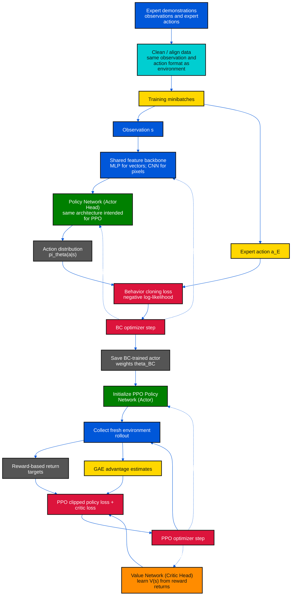
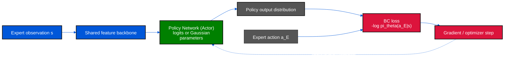

# PPO with Behavior Cloning: Demonstration များမှ Policy ကို ကြိုတင်သင်ပြီး PPO ဖြင့် Fine-tune လုပ်ခြင်း

PPO ကို random initialization ကနေ စတင်ရင် အစပိုင်း exploration က အချိန်ယူနိုင်ပါတယ်။ **Behavior Cloning (BC)** က expert demonstration ထဲက state–action pair တွေကို supervised learning နည်းနဲ့ သင်ပြီး policy ကို စတင်ကောင်းမွန်စေပါတယ်။ ထို့နောက် BC မှရလာတဲ့ **Policy Network weights ကို PPO Actor အဖြစ် initialize** လုပ်ပြီး environment reward နဲ့ fine-tune လုပ်ပါတယ်။

ဒီနည်းက PPO ရဲ့ မူရင်း algorithm ထဲက မဖြစ်မနေအဆင့် မဟုတ်ပါဘူး။ **BC pretraining → PPO fine-tuning** ဆိုတဲ့ training pipeline ဖြစ်ပါတယ်။ BC က “expert ဘာလုပ်ခဲ့လဲ” ကို သင်ပေးပြီး PPO က “environment reward အရ ဘယ် action က ပိုကောင်းလဲ” ကို ဆက်သင်ပေးပါတယ်။

## ၁။ Papers နှင့် ဆက်စပ်နည်းများ

| ရင်းမြစ် | ဘာအတွက် ဖတ်ရန် |
|---|---|
| **Pomerleau, 1989 — [ALVINN: An Autonomous Land Vehicle in a Neural Network](https://publications.ri.cmu.edu/alvinn-an-autonomous-land-vehicle-in-a-neural-network)** | State/observation မှ expert မောင်းနှင်မှုကို neural network နဲ့ တိုက်ရိုက်သင်ယူခဲ့တဲ့ အစောပိုင်း ဥပမာ |
| **Ross, Gordon & Bagnell, AISTATS 2011 — [DAgger](https://proceedings.mlr.press/v15/ross11a.html)** | Learner က ရောက်လာတဲ့ states တွေမှာ expert ကို ထပ်မံမေးပြီး distribution shift ကို လျှော့ရန် ရည်ရွယ်သော imitation-learning နည်း |
| **Rajeswaran et al., RSS 2018 — [Learning Complex Dexterous Manipulation with Deep Reinforcement Learning and Demonstrations](https://arxiv.org/abs/1709.10087)** | Demonstration ဖြင့် policy pretraining လုပ်ပြီးနောက် reinforcement learning နဲ့ တိုးတက်စေတဲ့ DAPG ဥပမာ။ ဒီနည်းက PPO ကိုယ်တိုင် မဟုတ်ပါ |
| **Schulman et al., 2017 — [Proximal Policy Optimization Algorithms](https://arxiv.org/abs/1707.06347)** | BC မှ initialize လုပ်ပြီးနောက် သုံးမယ့် PPO objective နဲ့ update algorithm |
| **[OpenAI Spinning Up: PPO](https://spinningup.openai.com/en/latest/algorithms/ppo.html)** | PPO rollout၊ advantage နဲ့ clipped policy update အဆင့်များ |

**သတိ:** DAPG က demonstration information ကို policy-gradient training မှာပါ အသုံးပြုပါတယ်။ ဒီဖိုင်မှာ အဓိကပြထားတာက ပိုရိုးရှင်းတဲ့အစီအစဉ်ဖြစ်တဲ့ **BC နဲ့ကြိုသင် → demonstration dataset ကိုခဏထား → PPO သီးသန့်လုပ်** ပုံစံပါ။

### အရောင်အသုံးပြုပုံ (Color Rule)

[စံအရောင်နှင့် network label — 00_1_color_define.md](./00_1_color_define.md)

| Role | Fill | Text |
|---|---|---|
| Policy Network / Actor | Green `#008000` | `#FFFFFF` |
| Value Network / Critic | Orange `#FF8C00` | `#111111` |
| Frozen Target Network | Purple `#800080` | `#FFFFFF` |
| State / environment / data / shared backbone | Blue `#0057D9` | `#FFFFFF` |
| Demonstration batch / advantage | Yellow `#FFD700` | `#111111` |
| Action selection / preprocessing | Cyan `#00CED1` | `#111111` |
| Loss / gradient / optimizer | Red `#DC143C` | `#FFFFFF` |
| Probabilities / returns / targets / outputs | Gray `#555555` | `#FFFFFF` |

PPO မှာ frozen target network မရှိတဲ့အတွက် ခရမ်းရောင် network block မပါပါဘူး။ Demonstration ဟာ data အနေနဲ့ အပြာ၊ minibatch/advantage အနေနဲ့ အဝါ၊ network outputs အနေနဲ့ မီးခိုး၊ training loss/optimizer အနေနဲ့ အနီ သုံးထားပါတယ်။

## Diagram 1 — BC Pretraining မှ PPO Fine-tuning သို့



BC နဲ့ PPO မှာ **Actor ရဲ့ input preprocessing နဲ့ policy output format ကို တူညီအောင်ထားပါ**။ ဥပမာ expert action ကို normalized coordinates နဲ့ သိမ်းထားရင် PPO environment ကလည်း တူညီတဲ့ coordinates ကို သုံးပါ။ Observation normalization statistics ကို BC မှာတွက်ထားပါက PPO စတင်ချိန်မှာ အဲဒီ statistics ကို ဆက်သုံးပြီး PPO update လုပ်စဉ် သတ်မှတ်ထားတဲ့ policy အတိုင်းသာ ပြင်ပါ။

## ၂။ Demonstration Dataset

Expert trajectory တစ်ခုမှာ အနည်းဆုံး အောက်ပါ pair များ ပါရပါမယ်။

$$
\mathcal D_E=\{(s_i,a_i^E)\}_{i=1}^{N}.
$$

`s_i` က policy သုံးမယ့် observation ဖြစ်ပြီး `a_i^E` က expert ရွေးခဲ့တဲ့ action ဖြစ်ပါတယ်။ အများအားဖြင့် **BC အတွက် reward မလိုပါဘူး**။ ဒါပေမယ့် trajectory boundary, task identifier, recurrent hidden state စတာတွေ လိုအပ်မလိုအပ်က policy/environment ပေါ်မူတည်ပါတယ်။

Data ကို သုံးမီ observation နဲ့ action ရဲ့ shape၊ units၊ ordering၊ normalization နဲ့ terminal/reset အဓိပ္ပာယ်တွေကို စစ်ပါ။ Train/validation ခွဲရာမှာ adjacent timesteps တွေကို random ခွဲမယ့်အစား **trajectory သို့မဟုတ် episode အလိုက်ခွဲ**ရင် အလွန်ဆင်တူတဲ့ frames တွေ train နဲ့ validation နှစ်ဖက်လုံးမှာ ပါနေခြင်းကို လျှော့နိုင်ပါတယ်။

## ၃။ Behavior Cloning Neural Network နှင့် Objective

BC ရဲ့ Actor သည် နောက်ပိုင်း PPO မှာသုံးမယ့် **Policy Network တစ်ခုတည်း** ဖြစ်ပါတယ်။ BC stage မှာ ပုံမှန်အားဖြင့် Critic ကို မသင်သေးပါဘူး။ Discrete action ဆို actor က action logits ထုတ်ပြီး continuous action ဆို Gaussian policy ရဲ့ mean/scale သို့မဟုတ် သတ်မှတ်ထားတဲ့ action distribution ကို ထုတ်ပါတယ်။

Behavior cloning က expert action ကို policy က ဖြစ်နိုင်ခြေမြင့်အောင် supervised maximum-likelihood လုပ်ပါတယ်။

$$
\mathcal L_{\mathrm{BC}}(\theta)
=-\frac{1}{N}\sum_{i=1}^{N}\log\pi_\theta(a_i^E\mid s_i).
$$

### Discrete action

Actor က action တစ်ခုစီအတွက် logits `z(s)` ထုတ်ပြီး softmax က `πθ(a|s)` ပေးပါတယ်။ BC loss က expert ရွေးထားတဲ့ action အတွက် cross-entropy ဖြစ်ပါတယ်။

$$
\mathcal L_{\mathrm{BC}}=-\frac{1}{N}\sum_i\log\operatorname{softmax}(z_\theta(s_i))_{a_i^E}.
$$

### Continuous action

Gaussian policy `\pi_\theta(a|s)=\mathcal N(\mu_\theta(s),\operatorname{diag}(\sigma_\theta^2(s)))` ဆိုလျှင် BC မှာ expert action ရဲ့ negative log-likelihood ကို minimize လုပ်ပါတယ်။ အောက်ပါ expression သည် action dimensions အလိုက် diagonal Gaussian အတွက် ဖြစ်ပါတယ်။

$$
\mathcal L_{\mathrm{BC}}=\frac{1}{N}\sum_i\frac12\sum_j\left[
\frac{(a_{ij}^E-\mu_{ij})^2}{\sigma_{ij}^2}+2\log\sigma_{ij}+\log(2\pi)\right].
$$

Deterministic mean ကိုသာ သင်ချင်တဲ့ setting မှာ MSE သုံးနိုင်ပေမယ့် **PPO actor က stochastic Gaussian policy ဖြစ်နေမယ်ဆိုရင် likelihood loss နဲ့ တိုက်ရိုက်ကိုက်ညီအောင်လုပ်တာ ပိုသဘာဝကျပါတယ်**။ Action ကို `tanh` သို့မဟုတ် bounds အတွင်း transform လုပ်ထားရင် BC နဲ့ PPO နှစ်ခုစလုံးမှာ action mapping ကို တူညီစွာသုံးပါ။ PPO ရဲ့ log-probability တွက်ချက်ရာမှာ transform သက်ရောက်မှုကို မှန်ကန်စွာ ထည့်ရပါတယ်။

## Diagram 2 — BC အတွင်း Actor ကို ဘယ်လို သင်သလဲ



ဒီမှာ `a_E` က label ဖြစ်ပြီး actor က sample ထုတ်တဲ့ action ကို environment ဆီပို့ရန် မလိုပါဘူး။ BC က demonstration state ပေးထားတဲ့နေရာတွေမှာ expert action ကို ခန့်မှန်းတတ်အောင် သင်တာပါ။ Validation loss တည်ငြိမ်လာခြင်း၊ held-out demonstration များပေါ် action accuracy/NLL နှင့် environment မှာ စမ်းသပ်သော task performance တို့ကို ကြည့်ပြီး checkpoint ရွေးနိုင်ပါတယ်။ **Train loss ကျတာတစ်ခုတည်းက rollout အောင်မြင်မယ်လို့ မအာမခံပါဘူး။**

## ၄။ BC မှ PPO သို့ ကူးပြောင်းပုံ

### အဆင့် A — BC actor ကို စတင် policy အဖြစ် သတ်မှတ်ပါ

BC အပြီး Policy Network parameters ကို `θ_BC` ဟုထားပြီး PPO စတင် actor ကို:

$$
\theta_0\leftarrow\theta_{\mathrm{BC}}
$$

လို့ initialize လုပ်ပါ။ Architecture, observation preprocessing, action distribution, action scaling တို့ကို PPO environment နဲ့ ကိုက်ညီကြောင်း စစ်ပြီး deterministic evaluation နဲ့ stochastic sampling နှစ်မျိုးစလုံး စမ်းပါ။

### အဆင့် B — Critic ကို reward-based learning အတွက် အဆင်သင့်လုပ်ပါ

BC action labels က `V(s)` ကို တိုက်ရိုက်မပေးပါဘူး။ ပုံမှန်အစီအစဉ်မှာ Critic parameters `φ` ကို အသစ် initialize လုပ်ပြီး BC policy နဲ့ environment rollout စုကာ reward-derived returns ကို target လုပ်ပြီး PPO critic loss နဲ့ သင်ပါတယ်။

Demonstration trajectory တွေမှာ task နဲ့ကိုက်ညီတဲ့ reward/return ရှိရင် value function ကို warm-start regression လုပ်တာ ဖြစ်နိုင်ပါတယ်။ ဒါက optional extension ဖြစ်ပါတယ်။ Expert return estimate ဟာ PPO rollout မှာရှိတဲ့ current policy value နဲ့ မတူနိုင်တာကြောင့် အလိုအလျောက် မကူးသုံးပါနှင့်။ Shared actor-critic trunk သုံးလျှင် BC က trunk ကို update လုပ်ထားပြီး Critic head က random ဖြစ်နိုင်တာကို ထည့်တွက်ပါ။

### အဆင့် C — PPO data ကို ကိုယ်ပိုင် policy ကနေ အသစ်စုပါ

PPO မစခင် `π_old ← π_{θ0}` ဟုထားပါ။ Environment ထဲက **အသစ်သော on-policy rollout** ကို ဒီ policy နဲ့ စု၊ action အတွက် old log-probability ကို မှတ်တမ်းတင်၊ reward နဲ့ value ကနေ return/GAE တွက်ပြီး PPO clipped objective ဖြင့် actor/critic ကို update လုပ်ပါ။ Update ပြီးရင် rollout ကို စွန့်ပြီး policy အသစ်နဲ့ data ပြန်စုပါ။

`[14_1_AAC_PPO.md](./14_1_AAC_PPO.md)` မှာ PPO ratio၊ GAE masks နဲ့ actor-critic losses ကို အသေးစိတ်ရှင်းပြထားပါတယ်။ ဒီ pipeline မှာ demonstration transitions ကို **PPO rollout လို့ မဟန်ဆောင်ပါနှင့်**။ PPO ratio denominator `π_old(a|s)` ဟာ sample ကို တကယ်ထုတ်ခဲ့တဲ့ behavior policy probability ဖြစ်ရပါမယ်။ Expert action ဟာ expert policy က ထုတ်ခဲ့တာဖြစ်လို့ PPO rollout ratio ထဲ တိုက်ရိုက်ထည့်လို့မရပါဘူး။

### End-to-end pseudocode

```text
Input: expert demonstrations D_E = {(s, a_expert)}

# Stage 1: Behavior cloning
initialize Policy Network pi_theta
repeat for BC epochs:
    sample demonstration minibatch (s, a_expert)
    loss_BC = -mean(log pi_theta(a_expert | s))
    update theta to minimize loss_BC
save theta_BC and observation/action preprocessing

# Stage 2: PPO initialization and online fine-tuning
theta <- theta_BC
initialize Value Network V_phi
repeat for PPO iterations:
    pi_old <- pi_theta
    collect fresh environment rollout using pi_old
    save old log-probabilities and old values
    compute reward-based returns and detached advantages
    optimize PPO clipped actor loss and critic regression loss
    discard rollout and collect again with updated pi_theta
```

## ၅။ Distribution Shift၊ မေ့လျော့မှုနှင့် ရွေးချယ်စရာများ

BC သည် expert ရောက်ခဲ့သော state distribution `d_E(s)` ကို အဓိကမြင်ရပါတယ်။ Learner က အနည်းငယ်ကွဲတဲ့ action လုပ်လိုက်ရင် နောက် state တွေဟာ demonstration ထဲ မပါတဲ့ နေရာကို ရောက်နိုင်ပြီး အဲဒီမှာ BC policy အမှားဆက်တိုက်ဖြစ်နိုင်ပါတယ်။ ဒါကို **distribution shift / compounding errors** လို့ ခေါ်ပါတယ်။ PPO fine-tuning က reward ကနေ recovery ကို သင်နိုင်ပေမယ့် **အလိုအလျောက်ပြင်မယ်လို့ အာမမခံပါဘူး**။

| ရွေးချယ်မှု | ဘာလုပ်သလဲ | ဘယ်အချိန်စဉ်းစားမလဲ |
|---|---|---|
| **BC → PPO (ဒီဖိုင်)** | BC ဖြင့် actor initialize လုပ်ပြီး PPO မှာ demonstration loss မသုံးတော့ | ရိုးရှင်းသော warm-start လိုတဲ့အခါ |
| **DAgger** | Learner rollout state များမှာ expert label ထပ်ယူ၊ dataset နဲ့ policy ကို ထပ်သင် | Expert ကို ဆက်မေးနိုင်ပြီး state-distribution gap ကြီးတဲ့အခါ |
| **BC loss + PPO loss တွဲသုံးခြင်း** | PPO အတွင်း demonstration minibatch များပေါ် BC objective ထပ်ပေါင်း | Expert action တွေကို ဆက်ထိန်းရန်လိုသည့်အခါ; loss weight ချိန်ညှိရန်လို |
| **DAPG လို demo-augmented policy gradient** | Demonstration ကနေ policy ကို initialize လုပ်ပြီး RL gradient မှာလည်း demo contribution ထည့် | သက်ဆိုင်ရာ algorithm နှင့် implementation ကို အတိအကျ လိုက်နာနိုင်သည့်အခါ |

PPO update အတွင်း BC term ကို ထည့်မယ်ဆိုရင် `L_total = L_PPO + λ_BC L_BC` ပုံစံဖြစ်နိုင်ပေမယ့် ဒါက ဒီဖိုင်ရဲ့ **BC ကြိုတင်သင်ပြီးမှ PPO သီးသန့်လုပ်ခြင်းနဲ့ မတူတဲ့ variant** ဖြစ်ပါတယ်။ `λ_BC` မြင့်လွန်းရင် actor က expert action ကိုပဲ ဆက်ကပ်နေပြီး reward ရှာဖွေမှုကို ကန့်သတ်နိုင်ပါတယ်။ နိမ့်လွန်းရင် PPO က BC initialization ကို မကြာခင်မေ့သွားနိုင်ပါတယ်။

## ၆။ လက်တွေ့ စစ်ဆေးရန်

- Expert နဲ့ learner တို့ observation/action schema တူပါသလား?
- Continuous actions ရဲ့ unit, range, clipping, `tanh` transform တူပါသလား?
- Demonstration trajectory များ မှန်ကန်စွာ reset/boundary ခွဲထားပါသလား?
- BC checkpoint မှာ actor weights **နှင့် preprocessing statistics** ကိုပါ သိမ်းထားပါသလား?
- PPO စတင်ချိန် `π_old` ကို BC-initialized actor မှ snapshot လုပ်ထားပါသလား?
- PPO rollout သည် environment က လတ်တလောထုတ်ပေးသော on-policy data ဖြစ်ပါသလား?
- Critic သည် expert labels မဟုတ်ဘဲ reward-based returns/value targets ကို သင်နေပါသလား?
- BC baseline နဲ့ BC→PPO result ကို evaluation seeds တူတူနဲ့ သီးခြားနှိုင်းထားပါသလား?

## ၇။ အနှစ်ချုပ်

**Behavior Cloning က PPO actor ကို expert state–action pairs ဖြင့် ကြိုတင် initialize လုပ်ပေးပါတယ်။** BC loss က action likelihood ကိုတိုးစေပြီး optimizer က actor ကိုသင်ပါတယ်။ အဲဒီ actor ကို PPO ဆီကူးပြီး PPO ကိုယ်ပိုင် environment rollout အသစ်များ၊ reward/GAE၊ critic targets နဲ့ clipped policy updates သုံးကာ ဆက်လက်သင်ယူစေပါတယ်။ Demonstration များသည် initialization အတွက်ဖြစ်ပြီး standard PPO ၏ on-policy rollout အစားထိုး မဟုတ်ပါ။
